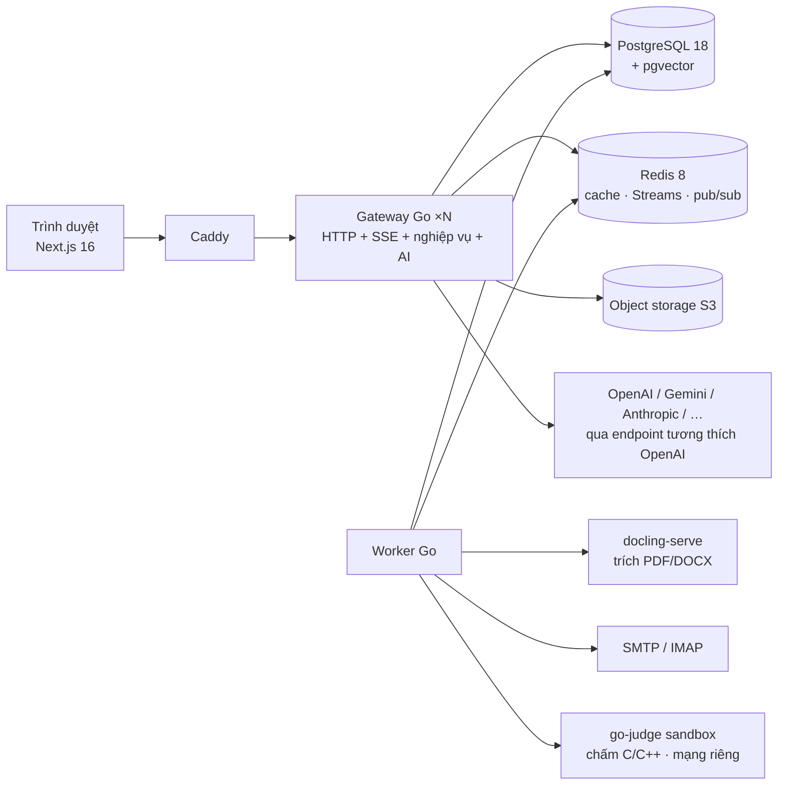
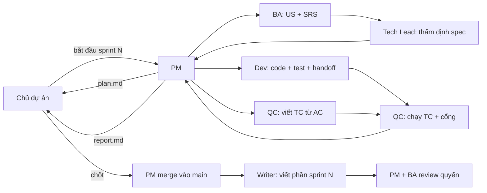

# EduPilot v2

Nền tảng vận hành lớp học có AI cho một học phần đại học: hỏi đáp hai kênh (chat riêng tư + Threads công khai) có tường lửa dữ liệu cá nhân, escalation sang giảng viên, CRM sinh viên và điểm danh, sổ điểm tính theo quy chế môn học, chấm tự luận tự động có giảng viên duyệt, **bài thi hằng tuần (trắc nghiệm + lập trình C/C++ chấm tự động)**, tài liệu và lịch, luyện đề, cấu hình LLM nhiều nhà cung cấp, và màn quan sát lớp học.

Đồ án tốt nghiệp — viết mới hoàn toàn (D45) từ ý tưởng của Project III. Mã Project III nằm ở [`legacy/`](legacy/) **chỉ để tham khảo**: không build, không chạy, không import.

> **Trạng thái:** đã vào `main`:
> - sprint 1 (P0), 1.5 (prototype giao diện), 2 (PG — nền Go), 3 (PU + P1 LLM Gateway), 4 (P2 Lớp học);
> - 5 (PE thi hằng tuần, chấm C/C++ bằng sandbox `go-judge`);
> - 5.5 (giao diện panel nổi, D59);
> - **6 (P3 + P8):** chat riêng và Threads có tường lửa dữ liệu cá nhân, che tên / MSSV trước mọi lời gọi LLM; tài liệu trích bằng `docling-serve` + tìm lai; thư viện, lịch, feed ICS; 535 test case, cổng P3 và P8 đạt.
> - **7 (P4 + P5):** nút "Nhờ giảng viên", hộp thư hỗ trợ `/inbox`, chuông tức thì qua nhiều bản gateway, thư trả lời đúng một lần, SLA ticket, kiểm duyệt Threads, kho tri thức; điểm danh `/attendance`, hồ sơ 360, at-risk theo tuần, thời gian học có công tắc tắt, `/me`; 550 test case, cổng P4 và P5 đạt.
> - **8 (P6):** sổ điểm kiểu bảng tính; AI trích công thức từ quy chế → giảng viên xác nhận → code tính (decimal, 30/30 khớp đáp án tính tay); chốt / mở khoá có lý do; nhập / xuất XLSX; điểm của tôi + tính thử; cổng P6 đạt.
> - **9 (P7):** bài tập nộp trong app / ZIP / mail / Teams giả lập, khớp sinh viên theo danh sách lớp, AI chấm nháp hai lượt có bằng chứng, duyệt cạnh nhau, chỉ giảng viên công bố, phúc khảo; cổng P7 đạt kỹ thuật (nợ LCP màn nộp bài).
>
> Đang làm: sprint 11 (P10: quan sát AI, lỗ hổng kiến thức, thống kê điểm thi, nhật ký quản trị) và 10.8 (điểm danh bằng QR). Tiến độ: [`docs/PROGRESS.md`](docs/PROGRESS.md) · Báo cáo sprint: [`docs/sprints/<N>/report.md`](docs/sprints/) · Lộ trình: [`docs/sprints/ROADMAP.md`](docs/sprints/ROADMAP.md).

---

## Mục lục
1. [Bài toán và mục tiêu đo được](#1-bài-toán-và-mục-tiêu-đo-được)
2. [Kiến trúc](#2-kiến-trúc)
3. [Công nghệ](#3-công-nghệ)
4. [Cấu trúc thư mục](#4-cấu-trúc-thư-mục)
5. [Chạy trên máy](#5-chạy-trên-máy)
6. [Kiểm thử và CI](#6-kiểm-thử-và-ci)
7. [Luật bất biến](#7-luật-bất-biến)
8. [Tài liệu](#8-tài-liệu)
9. [Quy trình làm việc: đội agent và sprint](#9-quy-trình-làm-việc-đội-agent-và-sprint)
10. [Lộ trình 11 sprint](#10-lộ-trình-11-sprint)
11. [Vì sao viết mới](#11-vì-sao-viết-mới)

---

## 1. Bài toán và mục tiêu đo được

Một học phần đại cương: 1.000 sinh viên, 20 lớp, 5 trợ giảng, ≈ 3.000 câu hỏi mỗi tuần (tải thiết kế **T1**, `docs/SYSTEM_DESIGN.md`). Vòng đời khép kín: sinh viên hỏi → AI trả lời hoặc chuyển giảng viên → bài nộp được chấm nháp → giảng viên duyệt, công bố → điểm danh, điểm cộng, điểm thành phần gộp thành điểm cuối kỳ theo quy chế → giảng viên thấy lớp đang yếu ở đâu.

| Mã | Mục tiêu | Chỉ số |
| --- | --- | --- |
| G1 | Dữ liệu cá nhân không lọt ra kênh công khai, không ra LLM ở dạng định danh | Recall ≥ 95%; 0 MSSV / họ tên thật trong payload gửi LLM |
| G3 | Chấm tự luận sát giảng viên | QWK ≥ 0,7; MAE ≤ 1,0 (thang 10) trên ≥ 60 bài chấm tay |
| G4 | Đổi LLM không sửa code | Đổi provider trên giao diện, mọi luồng vẫn qua |
| G5 | Điểm cuối kỳ đúng tuyệt đối | 30/30 khớp bảng tính tay; không dùng LLM để tính |
| G6 | Hiệu năng ở T1 | Sự kiện SSE đầu ≤ 300 ms; TTFT ≤ 1,5 s (cache) / ≤ 4 s (RAG); API đọc p95 ≤ 300 ms |

Đầy đủ: [`docs/PRD.md`](docs/PRD.md) (module M0–M15, tiêu chí nghiệm thu), [`docs/FLOWS.md`](docs/FLOWS.md) (luồng F1–F19).

## 2. Kiến trúc

Một **modular monolith Go** không trạng thái + Postgres + Redis. Không có service Python (D46): AI (gọi LLM, RAG, che danh tính, chấm bài) chạy trong cùng tiến trình Go. Ngoại lệ duy nhất là một container sandbox chấm code C/C++ của bài thi (D55), không chứa nghiệp vụ.



- **Gateway không trạng thái** — phiên = JWT; rate limit, idempotency, ánh xạ che danh tính = Redis; file = object storage + URL ký sẵn. Nhân bản ngang bằng `--scale gateway=N`.
- **Việc nặng không chạy trong request** — trích tài liệu, chấm bài, mail, báo cáo đi qua Redis Streams; API trả `202` + job id, tiến độ qua SSE.
- **Mọi lời gọi LLM qua `internal/llm`** với Scheduler ba làn ưu tiên (`INTERACTIVE` > `NEAR_REALTIME` > `BATCH`), hạn mức, cầu dao — chấm bài hàng loạt không làm chat của sinh viên treo.
- **Luật tốc độ đường hỏi–đáp (D47):** đúng một lời gọi LLM sinh chữ có stream mỗi câu hỏi; truy xuất tất định (vector + từ khoá bằng SQL); phân loại một lần bằng luật + embedding; không vòng lặp agent mở.

Chi tiết: [`docs/ARCHITECTURE.md`](docs/ARCHITECTURE.md) (lược đồ dữ liệu, API, cấu trúc package, biến môi trường), [`docs/SYSTEM_DESIGN.md`](docs/SYSTEM_DESIGN.md) (ước lượng tải, SLO, lộ trình mở rộng).

## 3. Công nghệ

Phiên bản nền chốt ở D48.

| Tầng | Công nghệ |
| --- | --- |
| Backend | Go 1.27 · `chi` v5 · `pgx` v5 + `sqlc` + `pgvector-go` · `goose` · `go-redis` v9 · `openai-go` · `shopspring/decimal` (điểm, cấm `float64`) · `slog` + OpenTelemetry |
| Frontend | Next.js 16 (App Router, React Server Components, Turbopack) · React 19 · TypeScript · TanStack Query · zustand · recharts · `lucide-react` · Be Vietnam Pro |
| Dữ liệu | PostgreSQL 18 + pgvector (HNSW) · Redis 8 · object storage tương thích S3 |
| Hạ tầng local | Docker Compose · Caddy 2.11 (TLS nội bộ, proxy `/api` → gateway, không đệm SSE) · PgBouncer 1.26 (transaction mode) · MinIO · Mailpit (SMTP 1025, UI 8025) · `go-judge` (sandbox chấm code, từ sprint 5, D58) · `docling-serve` (từ sprint 6) |
| Kiểm thử | `go test -race` · testcontainers-go · `kin-openapi` (contract test, chỉ trong test — D52) · Playwright · `@redocly/cli` · k6 · `golangci-lint` |
| Công cụ | pnpm 12 · Node 24 LTS · GitHub Actions |

Thư viện ngoài bảng ở `ARCHITECTURE.md` §3 không được thêm khi chưa có quyết định.

## 4. Cấu trúc thư mục

```text
.
├── backend-go/              # Gateway + worker Go (một go.mod) — chi tiết: backend-go/README.md
│   ├── cmd/gateway/         # điểm vào HTTP (+ lệnh `migrate`, `token` cho dev)
│   ├── cmd/worker/          # consumer nền (outbox, việc dài)
│   ├── internal/
│   │   ├── platform/        # config, log, otel, redis, db (pgx), blob (MinIO), outbox, clock
│   │   ├── httpapi/         # router chi, middleware, lỗi thống nhất, cursor, Idempotency-Key, ETag, SSE
│   │   ├── auth/            # JWT, refresh xoay vòng, bcrypt, RBAC, chống dò, CourseAccessGuard
│   │   ├── user/            # tài khoản, đăng ký, xác minh email, lời mời
│   │   ├── course/          # lớp, mã tham gia, thành viên, nạp danh sách lớp, lịch buổi học
│   │   ├── today/           # "Hôm nay": Provider theo vai, cache Redis xoá theo sự kiện
│   │   ├── escalation/      # ticket nhờ giảng viên: idempotent, Nhận / trả lời, SLA, tự đóng
│   │   ├── notify/          # một cửa thông báo: gộp, đẩy tức thì qua /events (Redis pub/sub)
│   │   ├── workhours/       # tính giờ chờ theo ngày làm việc (T2–T6, giờ VN)
│   │   ├── knowledge/       # kho tri thức từ ticket / Threads đã xác nhận (che PII rồi nạp)
│   │   ├── crm/             # điểm danh, phát biểu, ghi chú, hồ sơ 360 (audit), at-risk theo tuần
│   │   ├── activity/        # thời gian học: heartbeat chỉ ghi Redis, rollup vào DB
│   │   ├── seedtool/        # lệnh quản trị cho seed dữ liệu quá khứ (chỉ dev / test)
│   │   ├── exam/            # bài thi: lượt làm, tự lưu, nộp, công bố, kết quả, phúc khảo, liêm chính
│   │   ├── quiz/            # Quiz Engine: chấm trắc nghiệm (decimal, từng phần)
│   │   ├── judge/           # client go-judge + hàng chấm code (thuê việc kiểu outbox)
│   │   ├── privacy/         # phát hiện / ẩn / che / khôi phục danh tính (roster theo lớp, unmask_stream)
│   │   ├── agent/           # định tuyến tất định, tool theo kênh (danh tính từ trusted_context)
│   │   ├── chat/            # chat riêng: SSE, nối lại, Dừng, khoá giờ thi
│   │   ├── thread/          # Threads: tường lửa PII, AI trả lời nền, xác nhận của giảng viên
│   │   ├── rag/             # tìm lai vector + từ khoá (RRF), lọc audience trong SQL
│   │   ├── ingest/          # worker gọi docling-serve, chunk, nhúng
│   │   ├── document/        # tài liệu: tải lên, cờ, đoạn, thống kê
│   │   ├── library/         # thư viện cho sinh viên
│   │   ├── calendar/        # lịch gộp, feed ICS, nhắc 24 h
│   │   ├── mail/            # go-mail + mail_outbox (retry, dead-letter)
│   │   ├── llm/             # cổng LLM (openai-go), Scheduler ba làn, cầu dao, llm_audit
│   │   ├── llmconfig/       # API quản trị provider / tuyến / ngân sách
│   │   ├── jobs/            # việc dài: 202 + GET /jobs/{id}
│   │   ├── store/           # sqlc (queries/*.sql)
│   │   ├── contract/        # response thật khớp api/openapi.yaml
│   │   └── testroutes/      # route chỉ cho test (build tag `testroutes`, image mặc định không có)
│   ├── db/migrations/       # goose, từ 00001
│   ├── api/openapi.yaml     # hợp đồng API — endpoint nào cũng phải có ở đây
│   └── Dockerfile           # multi-stage, image < 10 MB, nonroot, không shell
├── frontend/                # Next.js 16
│   ├── src/app/             # route
│   └── src/shared/          # token, primitive, lớp dữ liệu dùng chung (PU)
├── seed/documents/          # PDF môn học dùng làm dữ liệu seed
├── scripts/
│   ├── dev.mjs              # pnpm dev: dựng stack, chờ healthy
│   ├── ui-antipatterns.sh   # chặn phản mẫu giao diện (DESIGN.md §21)
│   └── team-up.sh           # dựng pane agent trên herdr
├── deploy/                  # Caddyfile, cấu hình PgBouncer
├── benchmarks/              # k6 (load/), số đo (reports/), đánh giá offline
├── docs/                    # PRD, kiến trúc, phase, spec, sprint, quyết định, research
├── legacy/                  # mã Project III — CHỈ ĐỌC
├── docker-compose.local.yml # stack dev; docker-compose.test.yml bật route thử
└── .github/workflows/ci.yml
```

Quy ước Go: `internal/<module>/{handler,service,repo}.go`; handler mỏng, logic ở service, SQL ở `internal/store/queries/*.sql` (sqlc). Frontend: `frontend/src/features/<module>/`, mọi màn dùng primitive ở `frontend/src/shared/`.

## 5. Chạy trên máy

Hướng dẫn cho MacBook Apple Silicon. Mọi lệnh dưới đây chạy ở thư mục gốc repo.

### 5.1 Cài một lần
```bash
brew install node@24 pnpm go colima docker docker-compose golangci-lint gh   # go/golangci-lint/gh chỉ cần khi chạy test
colima start --cpu 6 --memory 10 --disk 100     # máy 18 GB: 6 CPU / 10 GB là cấu hình đã đo và chạy đồng thời demo + một stack thử
pnpm install --frozen-lockfile
```
- `docling` (đọc PDF/DOCX) riêng ≈ 1,8 GiB RAM.
- Testcontainers trên Colima: xem `backend-go/README.md` (`~/.testcontainers.properties`).

### 5.2 Dựng stack demo
```bash
SEED_ON_EMPTY_DB=true COMPOSE_PROFILES=ingest pnpm dev
```
`pnpm dev` tự tạo `.env.local` từ `.env.example` (lần đầu), build image, chạy migration, chờ mọi service healthy rồi (DB trống + `SEED_ON_EMPTY_DB=true`) chạy seed. **Không cần sửa `.env.local`**: `.env.example` đã đủ biến bắt buộc, chỉ chứa giá trị dev giả (`docker compose config` chạy được với nguyên bản). Gateway thiếu biến bắt buộc thì thoát mã 1 và nêu tên biến.

- `COMPOSE_PROFILES=ingest` bật `docling`; **seed cần nó** (bước 11 nạp tài liệu). Không bật thì seed dừng ở bước đó với lỗi «Tài liệu chưa READY».
- Seed đầy đủ ≈ 10 phút (9 phút 39 giây khi đo, kèm `SEED_GUIDANCE_DEMO=1 SEED_DECISION_DEMO=1`). Chạy lại an toàn (idempotent): `pnpm seed`.
- `pnpm dev:status` · `pnpm dev:logs` · `pnpm dev:down` (giữ dữ liệu) · `pnpm dev:down -v` (xoá cả dữ liệu).
- Hai bản gateway sau Caddy: `docker compose --env-file .env.local -f docker-compose.local.yml -p edupilot up -d --scale gateway=2 --wait`.

| Cái gì | Ở đâu | Ghi chú |
| --- | --- | --- |
| Ứng dụng | https://localhost | Caddy là cửa vào duy nhất (`/api/*` → gateway, còn lại → frontend). Chứng chỉ nội bộ: trình duyệt cảnh báo một lần, `curl -k`. Đăng nhập **chỉ** qua địa chỉ này |
| frontend trực tiếp | http://localhost:3000 | Không đăng nhập được (khác site với API, cookie `SameSite=Lax` bị chặn) |
| Hộp thư giả | http://localhost:8025 | thư xác minh, đặt lại mật khẩu, trả lời của giảng viên |
| MinIO | http://localhost:9001 | console kho tệp |
| Postgres / Redis | `localhost:5433` / `localhost:6380` | user và DB `edupilot`; ứng dụng đi qua PgBouncer trong mạng compose |
| `/api/v1/healthz`, `/readyz` | https://localhost/api/v1/… | `readyz` kiểm DB + Redis |

Tài khoản mẫu: `admin@`, `teacher@`, `sv.kha@` (Sinh viên B, lớp 1) … `@edupilot.local`; mật khẩu = `SEED_DEFAULT_PASSWORD` trong `.env.local` (mặc định của `.env.example`: `Edupilot#Seed-2026`). Lớp 1 = **761987** (mã tham gia `AN7K2MQ`), lớp 2 = 761988 (`BX4P9TW`). Sandbox chấm code là service `judge` (`go-judge`); trên Colima arm64 chạy với `-no-seccomp` (D58).

#### Dựng lại stack demo cho buổi trình bày (công thức Gate P10, 25/11)
`pnpm dev` tự đặt các biến dưới đây; khi gọi `docker compose` trực tiếp (dựng lại từng service, đổi env) thì phải tự đặt. Nguồn: lượt chạy Gate P10 ngày 25/11 (`docs/regression/gate-p10-demo.md` trên nhánh `qc2/regression`) và sổ tay vận hành của chủ dự án.

1. **Sao lưu trước mọi thao tác:**
   ```bash
   docker compose -p edupilot exec -T postgres pg_dump -U edupilot -d edupilot -Fc > ~/edupilot-$(date +%Y%m%d-%H%M).dump
   # khôi phục: docker compose -p edupilot exec -T postgres pg_restore -U edupilot -d edupilot --clean --if-exists < tệp.dump
   ```
2. **`.env.local`** phải có `BLOB_PUBLIC_ENDPOINT=localhost` và `BLOB_PUBLIC_USE_SSL=true`. Thiếu hai dòng này, URL tải tệp ký sẵn trỏ `localhost:9000`, CSP chặn, mọi lần tải tệp báo «Không kết nối được».
3. **Tệp compose phụ** (ngoài repo): `docker-compose.local.yml` không chuyển `KNOWLEDGE_EMBED_TIMEOUT` (worker, mặc định 10 s) và `AI_SUMMARY_TIMEOUT` (gateway, mặc định 20 s) vào container, nên đặt trong `.env.local` không có tác dụng. Với nhà cung cấp thật cần nới:
   ```yaml
   # ~/edupilot-demo.override.yml
   services:
     worker:
       environment:
         KNOWLEDGE_EMBED_TIMEOUT: 45s   # embedding thật qua mạng ≈ 11–24 s mỗi lời gọi (đo 25/11)
     gateway:
       environment:
         AI_SUMMARY_TIMEOUT: 60s        # khoảng hợp lệ 5–120 s
   ```
4. **Mọi lệnh compose của demo** dùng cùng tiền tố (thiếu `-f` tệp phụ → timeout về mặc định; thiếu `COMPOSE_PROFILES=ingest` → không có `docling`, seed dừng ở bước 11):
   ```bash
   export COMPOSE_PROJECT_NAME=edupilot COMPOSE_PROFILES=ingest
   C="docker compose -f docker-compose.local.yml -f $HOME/edupilot-demo.override.yml --env-file .env.local"
   ```
5. **Sau mỗi lần build**, tạo lại MỌI service vừa build rồi đối chiếu image id. Build xong mà không tạo lại thì container vẫn chạy image cũ (đã xảy ra với frontend ngày 25/11). Tên image cố định trong compose (`edupilot-gateway`, `edupilot-worker`, …) nên mọi stack trên máy dùng chung một tag: dựng stack thử (`ep-qc`, …) sẽ đổi tag `latest` mà stack demo không biết. Vì vậy build lại từ đúng commit ngay trước khi tạo lại demo.
   ```bash
   $C build gateway worker frontend
   $C up -d --force-recreate --no-deps gateway worker frontend
   for s in gateway worker frontend; do
     c=$(docker inspect edupilot-$s-1 --format '{{.Image}}' | cut -d: -f2 | cut -c1-12)
     i=$(docker images edupilot-$s:latest --format '{{.ID}}')
     [ "$c" = "$i" ] && echo "$s khớp $i" || echo "$s LỆCH: container $c, image $i"
   done
   ```
   (`judge`, `mock-graph`, `mock-imap` cũng vậy nếu có build lại.)
6. **Seed trong ngày trình bày** (buổi học «hôm nay» lấy theo ngày chạy seed; `docs/DEMO_SCRIPT.md` chuẩn bị #5), trên DB trống (đã sao lưu ở bước 1; xoá dữ liệu: `$C down -v` rồi `$C up -d --wait`):
   1. Dọn Mailpit trước seed: `curl -X DELETE http://localhost:8025/api/v1/messages`.
   2. Nới tạm 4 giới hạn theo IP (seed gửi hàng nghìn yêu cầu từ một IP; `pnpm dev` tự làm): `RATE_LIMIT_IP_PER_MIN=5000 AUTH_LOGIN_IP_PER_MIN=1000 AUTH_REGISTER_IP_PER_HOUR=1000 AUTH_TOKEN_IP_PER_MIN=1000 $C up -d --force-recreate --no-deps gateway`.
   3. **Đặt tuyến `EMBEDDING` trước khi seed nạp tài liệu** (nạp bằng embedding giả thì báo cáo lỗ hổng kiến thức vô nghĩa): tạo Admin bằng đúng mật khẩu seed, `grep '^SEED_DEFAULT_PASSWORD=' .env.local | cut -d= -f2- | $C exec -T gateway /gateway admin create --email admin@edupilot.local --name "Quản trị viên EduPilot"`; đăng nhập Admin → `/settings/llm` → thêm nhà cung cấp embedding thật (mục 5.3) → tuyến `EMBEDDING`. Các tuyến sinh chữ để bản giả trong lúc seed (seed trích quy chế bằng bản ghi demo; cách làm như `PHASE=seed` của `deploy/vps-llm.mjs`), đổi sang bản thật sau seed.
   4. `pnpm seed` (Admin đã có thì bước 1 của seed bỏ qua).
   5. Trả 4 giới hạn: `$C up -d --force-recreate --no-deps gateway` (không kèm biến).
7. Làm tiếp các việc chuẩn bị ở `docs/DEMO_SCRIPT.md` mục 2 (chấm Bài tập 03 trước, sinh báo cáo lỗ hổng «30 ngày» cho cả hai lớp, bật điểm danh bằng mã).

### 5.3 LLM thật: 9router hoặc OpenCode Go (tuỳ chọn)
Mặc định `LLM_PROVIDER=fake`: không cần mạng, đủ cho demo và test. Có hai nhà cung cấp thật, cùng loại «Máy chủ riêng (tương thích OpenAI)» (`openai_compatible`); đổi qua lại chỉ bằng tuyến ở `/settings/llm`, không dựng lại (P-11-106). Khoá chỉ nhập ở `/settings/llm` (lưu mã hoá), không ghi vào `.env.local` hay repo.

**9router** (chạy trên Mac, `http://127.0.0.1:20128`; bật bằng `9router -n -t`; **không** gọi Gemini trực tiếp):
1. Kiểm: `curl -s http://127.0.0.1:20128/v1/models | head -c 200` trả danh sách model.
2. Stack demo: đăng nhập Admin → `/settings/llm` → `Thêm nhà cung cấp` → «Máy chủ riêng (tương thích OpenAI)», địa chỉ `http://host.docker.internal:20128/v1` (container thấy Mac qua tên này), khoá 9router, model `ag/gemini-3.8-flash` → gán cho các tác vụ ở mục tuyến. `rpm_limit` đặt ≈ 10–20 (9router bận thì chậm).
3. Stack đo / thử (cổng lệch): `BASE=https://localhost:<cổng HTTPS> PHASE=live node deploy/vps-llm.mjs` làm đúng các bước trên bằng API (script từ chối stack demo; xem `benchmarks/README.md`).

**OpenCode Go** (dịch vụ ngoài, cần khoá của chủ dự án; tài khoản phải đặt Region **Global**: model không được phép với vùng hoặc gói của khoá trả `400 BAD_REQUEST`, gateway không thử lại, không chuyển nhà; P-11-108):

| Dùng cho | Địa chỉ (`base_url`) | Model | Ghi chú |
| --- | --- | --- | --- |
| Sinh chữ (chat, chấm, đặt tên chủ đề, …) | `https://opencode.ai/inference/go/v1` | `deepseek-v4.1-flash` | Gateway nhận ra host `opencode.ai` và tự gửi `User-Agent`, `x-opencode-session`, `reasoning_effort=low`, cộng 4096 vào `max_tokens` (token suy luận tính vào trần; FR-33) |
| Embedding (tuyến `EMBEDDING`) | `https://opencode.ai/inference/go/openai/v1` | `qwen3-embedding-8b`, loại «Tìm kiếm tài liệu (1536 chiều)» | Nhà cung cấp riêng. Mỗi lời gọi ≈ 11–24 s, có lúc `429` (đo 25/11): cần `KNOWLEDGE_EMBED_TIMEOUT=45s` cho worker (mục 5.2 bước 3) |
| Decision model (D60) | `https://opencode.ai/inference/go/systemone/v1` | `gemini-decision-1` | Gateway gọi `POST {base}/systemone` khi host là `opencode.ai`. Chỉ gọi thật khi `LLM_DECISION_ALLOW_REAL=true` (và trong trần `LLM_DECISION_REAL_DAILY_CAP`, mặc định 300 / ngày); lượt thật cần chủ dự án cho phép (D60 (6)) |

Các bước trên stack demo:
1. Sinh chữ + embedding: `/settings/llm` → `Thêm nhà cung cấp` hai lần theo hai dòng đầu của bảng → tuyến các tác vụ sinh chữ sang nhà thứ nhất, tuyến `EMBEDDING` sang nhà thứ hai. Đặt `EMBEDDING` **trước** khi seed nạp tài liệu (mục 5.2 bước 6). Đổi embedding sau khi đã nạp thì phải nhúng lại tài liệu.
2. Decision: thêm vào `.env.local` `LLM_DECISION_ALLOW_REAL=true` và `LLM_DECISION_BASE_URL=https://opencode.ai/inference/go/systemone/v1` (compose chuyển cả hai cho gateway và worker), tạo lại `gateway` và `worker` (`$C up -d --force-recreate --no-deps gateway worker`), rồi ở phần «Quyết định» của `/settings/llm` nhập khoá và chọn `gemini-decision-1`.
3. Tóm tắt AI của hồ sơ 360 với nhà cung cấp thật: `AI_SUMMARY_TIMEOUT=60s` cho gateway qua tệp compose phụ (mặc định 20 s; compose không chuyển biến này từ `.env.local`).

Về lại bản giả: `/settings/llm` → công tắc «Đang bật» của nhà cung cấp thật sang tắt. Không còn nhà cung cấp bật thì gateway rơi về `LLM_PROVIDER=fake`, kèm bản ghi `seed/demo/fake_llm.json` (xem `docs/DEMO_SCRIPT.md` mục 5). Decision về bản giả: chọn `decision-fake`.

Embedding giả cho kết quả gom cụm vô nghĩa (Gate P10 lượt 1, 25/11): báo cáo lỗ hổng kiến thức chỉ trình bày với embedding thật (`docs/DEMO_SCRIPT.md` chuẩn bị #4). Ngưỡng gán chương theo `qwen3-embedding-8b`: liên quan ≥ 0,38, lạc đề ≤ 0,32 (P-11-115).

### 5.4 Nhiều stack trên một máy
Mỗi stack một `COMPOSE_PROJECT_NAME` và một độ lệch cổng `EP_PORT_OFFSET` (cổng host cộng N; HTTPS = 443 + N). Hai máy giả `mock-graph` / `mock-imap` (8090 / 8091 + N) cũng lệch theo N khi dựng bằng `pnpm dev`; seed đọc `EP_PORT_MOCK_GRAPH` / `EP_PORT_MOCK_IMAP` để gửi thư thử đúng stack (thiếu thì thư rơi vào mock-imap của stack demo). **RAM: tối đa demo + một stack thử cùng lúc.**

| Stack | Dựng | Dùng cho |
| --- | --- | --- |
| `edupilot` (demo) | `pnpm dev` | trình bày, bảo vệ |
| `ep-qc` (QC) | `EP_PORT_OFFSET=500 COMPOSE_PROJECT_NAME=ep-qc COMPOSE_PROFILES=ingest pnpm dev` | QC kiểm sprint; HTTPS `https://localhost:943`, Mailpit `:8525` |
| `ep-<vai>` (đo) | xem `benchmarks/README.md` | T1, LLM thật; **không ghi lên demo** |

Chế độ thử (đường `testroutes`, thêm `FAKE_LLM_VALID_KEY`…): thêm `-f docker-compose.test.yml` (và `-f docker-compose.test-seed.yml` khi seed nhiều) vào lệnh compose; `pnpm dev` không tự thêm. Dừng đúng stack bằng cùng biến: `EP_PORT_OFFSET=500 COMPOSE_PROJECT_NAME=ep-qc pnpm dev:down` (thêm `-v` để xoá dữ liệu).

Seed / kiểm trên stack lệch cổng — truyền địa chỉ của chính stack đó:
```bash
export COMPOSE_PROJECT_NAME=ep-qc API_URL=https://localhost:943/api/v1 MAILPIT_URL=http://localhost:8525
export EP_PORT_MOCK_GRAPH=8590 EP_PORT_MOCK_IMAP=8591   # mock-graph / mock-imap của stack này (= 8090 / 8091 + 500)
export SEED_DEFAULT_PASSWORD=…   # bản của stack đó
pnpm seed
```

### 5.5 Kiểm dữ liệu mẫu (`check-*-seed`)
Mỗi script gọi API thật bằng tài khoản seed (cần `API_URL`, `SEED_DEFAULT_PASSWORD`; xem 5.4 cho stack lệch cổng) và thoát mã ≠ 0 khi lệch. Không đối số = kiểm, và phần lớn chạy lại seed để kiểm idempotent (`--no-rerun` bỏ bước chạy lại).
```bash
for s in assignments chat crm decision docs exam grade guidance knowledge p10 practice; do
  node scripts/check-$s-seed.mjs || echo "✗ $s"
done
```
- Chạy trên stack seed đủ **không phải stack demo**: `check-decision-seed` / `check-guidance-seed` mong cổng / cờ ở trạng thái seed mặc định.
- Chế độ có tên ghi dữ liệu (`assignments grade|demo5|teams|v2`, `exam demo`): chạy một lần, rồi dựng lại stack. Danh sách chế độ ở dòng đầu mỗi tệp.
- `check-p10-seed.mjs`: seed quan sát AI, lỗ hổng kiến thức (chủ đề D đúng 2 SV) và thống kê điểm thi. **Cần DB dựng lại từ trống**, vì seed lớp 1 đã đổi cách chia câu.

### Prototype (sprint 1.5)
Các màn chưa dựng thật (Threads, sổ điểm, chấm bài…) vẫn là bản mô phỏng của sprint 1.5 (`frontend/src/mock/`), được thay dần bằng màn thật theo từng sprint (D51). Kịch bản đi trọn: [`docs/DEMO_SCRIPT.md`](docs/DEMO_SCRIPT.md).

## 6. Kiểm thử và CI

```bash
# Go (xem backend-go/README.md: testcontainers trên colima cần ~/.testcontainers.properties)
make -C backend-go lint        # go vet + golangci-lint, cả build tag mặc định và testroutes
make -C backend-go test        # go test -race -tags testroutes ./... (gồm contract test)
make -C backend-go sqlc-check  # sqlc diff
# OpenAPI
pnpm exec redocly lint backend-go/api/openapi.yaml
# Frontend
pnpm -C frontend lint && pnpm -C frontend build
bash scripts/ui-antipatterns.sh
# Tải (stack đang chạy)
export JWT_SECRET_KEY="$(grep '^JWT_SECRET_KEY=' .env.local | cut -d= -f2-)"   # cùng khoá với gateway đang chạy
TOKEN="$(cd backend-go && go run ./cmd/gateway token --role STUDENT)" && k6 run -e BASE=https://localhost -e TOKEN="$TOKEN" benchmarks/load/smoke.js
```

Quản trị viên đầu tiên (không có route HTTP tạo ADMIN; mật khẩu CHỈ từ biến `ADMIN_PASSWORD` hoặc stdin, không có cờ `--password`; chạy lại cùng email thì thoát 0 và không đổi gì):

```bash
ADMIN_PASSWORD='…' ./bin/gateway admin create --email admin@edupilot.local --name "Quản trị"
```

CI (`.github/workflows/ci.yml`, runner `ubuntu-24.04`) chạy job **Go** (`go vet` hai bộ tag, `golangci-lint`, `sqlc diff`, `go test -race -tags testroutes`) và **Frontend** (lint, build, `ui-antipatterns.sh`, Playwright gồm ảnh mốc và axe, Lighthouse CI) trên mọi push và pull request; không đụng `legacy/`, không dùng secret, không gọi LLM thật (provider `fake` + bản ghi replay). Ảnh mốc Playwright sinh trong image `mcr.microsoft.com/playwright` để khớp CI. Số đo nền của bản Go: [`benchmarks/reports/pg-baseline.md`](benchmarks/reports/pg-baseline.md).

## 7. Luật bất biến

Tóm tắt; bản đầy đủ và có hiệu lực là [`CLAUDE.md`](CLAUDE.md).

1. Go sở hữu nghiệp vụ và AI; không service Python.
2. Danh tính lấy từ JWT — tool của agent không nhận MSSV/user id từ LLM.
3. Mọi lời gọi LLM / embedding đi qua `internal/llm`.
4. Hai kênh, một tường lửa: nội dung công khai qua tường lửa PII trước khi lưu; tên và MSSV được thay placeholder quanh MỌI lời gọi LLM.
5. Tính điểm là code thuần (`decimal`); LLM không tính hay làm tròn điểm; giảng viên xác nhận công thức và công bố điểm.
6. Migration bằng goose từ `00001`, không sửa migration đã merge.
7. Danh sách nào cũng phân trang con trỏ; ghi có tác dụng phụ phải idempotent; sửa đồng thời dùng `version` → 409.
8. MSSV tự khai không bao giờ mở dữ liệu; chỉ email đã xác minh hoặc `user_id` từ phiên là danh tính.
9. Giao diện: đỏ là tín hiệu, không phải nền; một hành động chính mỗi vùng; sinh viên không thấy từ kỹ thuật AI; không gamify.

## 8. Tài liệu

| File | Nội dung |
| --- | --- |
| [`docs/PRD.md`](docs/PRD.md) | Yêu cầu, module M0–M15, tiêu chí nghiệm thu, mục tiêu G1–G8 |
| [`docs/FLOWS.md`](docs/FLOWS.md) | 19 luồng end-to-end F1–F19, cả nhánh lỗi |
| [`docs/ARCHITECTURE.md`](docs/ARCHITECTURE.md) | Thành phần, lược đồ dữ liệu, REST, provider LLM, env, kiểm thử |
| [`docs/SYSTEM_DESIGN.md`](docs/SYSTEM_DESIGN.md) | Tải T1, nút cổ chai, SLO, lộ trình mở rộng |
| [`docs/DECISIONS.md`](docs/DECISIONS.md) | Nhật ký quyết định D1–D59 |
| [`docs/design/DESIGN.md`](docs/design/DESIGN.md), [`docs/UX.md`](docs/UX.md) | Hệ thiết kế "Red Thread / Academic Instrument" + panel có kỷ luật (D59), hợp đồng từng route, luật UX |
| [`docs/phases/`](docs/phases/) | Backlog kỹ thuật: P0, PG, PU, P1–P10, PR — lát việc + cổng nghiệm thu |
| [`docs/specs/`](docs/specs/) | User story + SRS theo feature (BA viết) |
| [`docs/sprints/`](docs/sprints/) | Kế hoạch, handoff, test case, QC report, góp ý, báo cáo từng sprint |
| [`docs/thesis-notes/`](docs/thesis-notes/) | Nguyên liệu luận văn theo sprint |
| [`docs/research/`](docs/research/) | Báo cáo nghiên cứu công nghệ / hạ tầng có PoC (vai Research) |
| [`docs/DEMO_SCRIPT.md`](docs/DEMO_SCRIPT.md) | Kịch bản demo bảo vệ 15 phút |
| [`docs/PROGRESS.md`](docs/PROGRESS.md) | Đang ở đâu, nợ gì |

## 9. Quy trình làm việc: đội agent và sprint

Một người (chủ dự án) và sáu phiên agent trên [herdr](https://herdr.dev), giao tiếp qua file trong repo ([`docs/team/`](docs/team/)). Mọi vai đọc [`docs/team/CONTEXT.md`](docs/team/CONTEXT.md) trước khi làm. Sau mỗi lượt test, agent chạy `docker volume prune -f`; PM dọn sâu Docker khi đóng sprint.

| Vai | Việc | Sửa được |
| --- | --- | --- |
| `pm` | Lập sprint, giao việc, quyết góp ý kỹ thuật, tổng hợp, dừng hỏi chủ dự án | `docs/sprints/**`, `docs/PROGRESS.md`, `docs/thesis-notes/**` |
| `ba` | User story + SRS theo feature | `docs/specs/**` |
| `dev` | Thi công từng story theo lát dọc | mã nguồn |
| `qc` | Viết test case từ AC (song song với dev), kiểm thử thăm dò, chạy, báo PASS/FAIL, chạy cổng phase | `docs/sprints/N/qc/**`, test mới |
| `research` | Kiểm chứng công nghệ, hạ tầng, rủi ro bằng nguồn chính + PoC; kiêm **Tech Lead**: trả lời dev khi phân vân kỹ thuật (`docs/sprints/N/techlead.md`), thẩm định spec của BA trước khi duyệt (`TL-REVIEW.md`, PM quyết) | `docs/research/**`, `docs/sprints/N/techlead.md`, `docs/specs/*/TL-REVIEW.md` |
| `writer` | Viết quyển đồ án tốt nghiệp (LaTeX, tiếng Việt, template SoICT "Định hướng ứng dụng"): sprint nào merge xong thì viết phần sprint đó; PM và BA review | thư mục quyển ngoài repo (`docs/team/WRITER.md`) |



- Spec đã duyệt chỉ đổi qua `docs/sprints/N/proposals.md` khi PM chấp nhận; **không thoả hiệp ngang hàng** (dev không xin QC nới test, QC không sửa test cho khớp code, BA không sửa AC cho khớp code).
- Câu hỏi đụng hành vi sản phẩm, quyền, điểm số, dữ liệu cá nhân luôn về chủ dự án.
- Chạy cuốn chiếu: trong lúc QC kiểm sprint N, PM lập kế hoạch và BA viết spec sprint N+1; nhánh `sprint/N+1-…` xếp chồng lên nhánh N khi N chưa vào `main`. Chủ dự án chốt báo cáo → merge `--no-ff` vào `main`.
- Không mở subagent khi PM chưa cho phép (tiết kiệm token).

## 10. Lộ trình 11 sprint

| Sprint | Trạng thái | Phase | Kết quả chính |
| :---: | :---: | --- | --- |
| 1 | ✅ Xong | P0 | Mặt bằng mới, khung Go + Next.js, stack local, CI, kịch bản demo |
| 1.5 | ✅ Xong | Prototype | Prototype bấm được toàn bộ tính năng (D51), đổi 4 vai, Threads mô phỏng như thật, đi trọn kịch bản demo 15 phút |
| 2 | ✅ Xong | PG | Nền Go: DB / migration / sqlc, Redis, blob, outbox, chuẩn API, SSE, contract test, Caddy + PgBouncer, nhân bản gateway |
| 3 | ✅ Xong | PU + P1 | Token, app shell, primitive, ảnh mốc + axe + Lighthouse CI; cổng LLM (openai-go) + Scheduler ba làn + cầu dao + `/settings/llm` thật |
| 4 | ✅ Xong | P2 | Đăng nhập / đăng ký / xác minh email / đặt lại mật khẩu, chống dò, mời giảng viên / TA, mở lớp, mã tham gia, nạp danh sách lớp (nối chỉ bằng email), "Hôm nay", seed bằng API thật |
| 5 | ✅ Xong | PE | Bài thi hằng tuần (D54–D58): ngân hàng câu hỏi, trắc nghiệm + lập trình C/C++ chấm bằng sandbox `go-judge`, tự công bố khi đóng, liêm chính (khoá chat, log rời tab, so độ giống); trả nợ LCP / TBT (US-PU-06) |
| 5.5 | ✅ Xong | UI | Giao diện panel nổi (D59): nền canvas xám ấm, mỗi vùng làm việc trên một `Panel`; khung, màn sinh viên / Staff / Admin; ảnh trước / sau, axe, Lighthouse |
| 6 | ✅ Xong | P3 + P8 | Chat riêng + Threads, tường lửa PII, che danh tính trước LLM (E1 recall 0,960); tài liệu (`docling-serve`), thư viện, lịch + ICS |
| 7 | ✅ Xong | P4 + P5 | "Nhờ giảng viên", `/inbox`, chuông tức thì, thư đúng một lần, SLA ticket, kiểm duyệt Threads; điểm danh, hồ sơ 360 (audit), at-risk, thời gian học có công tắc |
| 8 | ✅ Xong | P6 | Sổ điểm kiểu bảng tính, AI trích công thức từ quy chế → giảng viên xác nhận → code tính (decimal, 30/30 khớp đáp án tính tay), chốt / mở khoá có lý do, nhập / xuất XLSX, điểm của tôi + tính thử |
| 9 | ✅ Xong | P7 | Bài tập nộp trong app / ZIP / mail / Teams giả lập, khớp sinh viên an toàn, AI chấm nháp hai lượt có bằng chứng, duyệt cạnh nhau, chỉ giảng viên công bố, phúc khảo |
| 9.1 | ✅ Xong | UI/UX | Khảo sát 34 màn × 4 vai × 1440 / 375 (27 vấn đề), sửa theo 6 đợt: nút có lý do khoá, giờ ICT, menu tiếng Việt, "Hôm nay" chia nhóm, sổ điểm / duyệt bài gọn, trang giới thiệu v2 + video có phụ đề |
| 9.5 | | NFR | Seed đầy đủ, đo tải / hiệu năng trên Mac (VPS đã thu hồi), đánh giá LLM thật (Gemini) |
| 10 | ✅ Xong | P9 | Luyện đề: ngân hàng câu hỏi (trích từ đề cũ, sinh từ tài liệu có trích dẫn, duyệt hàng loạt), luyện theo chủ đề, thi thử có giờ + tự lưu, tự luận có nhận xét gợi ý, chủ đề cần ôn trên "Hôm nay", liêm chính với bài thi, nhập Google Forms vào sổ điểm |
| 10.5 | ✅ Xong | D60 | Decision model `gemini-decision-1` + cascade 3 cổng (tường lửa Threads chỉ-thêm-chặn, cờ chèn lệnh, định tuyến chat; dưới ngưỡng về luật), mặc định tắt theo lớp, bản giả cho CI / demo, `/settings/llm` + `/observability` |
| 11 | | P10 | Observation, đánh giá E1–E6, test tải T1, hoàn thiện → **vạch bảo vệ** |

Chi tiết ghép phase, cổng và mục cắt được khi trễ: [`docs/sprints/ROADMAP.md`](docs/sprints/ROADMAP.md).

## 11. Vì sao viết mới

Đọc mã Project III ([`docs/thesis-notes/legacy-perf.md`](docs/thesis-notes/legacy-perf.md)) cho thấy hệ cũ chậm vì **thiết kế**, không vì ngôn ngữ: mỗi câu hỏi gọi LLM 2–6 lần nối tiếp trước khi hiện chữ đầu (tạo thread kèm AI: 6 lần, 4 lần là cùng một phép phân loại), danh sách thread N+1, DB đặt xa, trích tài liệu chạy chung tiến trình với chat, sáu runtime trong một container CPU yếu. Các quyết định D45 (viết mới), D46 (chỉ Go), D47 (luật tốc độ), D48 (phiên bản nền) trả lời trực tiếp từng nguyên nhân.
