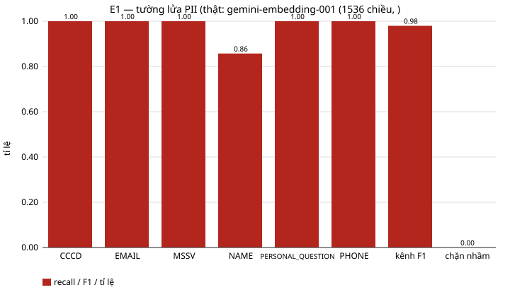

# E1 — tường lửa PII của Threads

Trạng thái: **OK** · nhãn: **SOÁT (53/57 đồng ý; bất đồng → BA phán: S6-13, S6-01, S6-26, S6-38; nhãn cuối sau phán 57/57 khớp)** (nhãn bộ dữ liệu; `giaovien` (người gán nhãn do chủ dự án chỉ định, từ 2026-11-25) gán mù — P-11-3, `HUONG-DAN-CHU-DU-AN.md`). Stack `ep-qc` (sha bản gateway không ghi lúc đo); báo cáo dựng bằng bộ đo @ `b76148bc`, 2026-11-25.

Lượt chính `real` (thật: gemini-embedding-001 (1536 chiều, Gemini trực tiếp — PM cho phép, trần 1.000 lời gọi)): kênh **P 1,000 · R 0,960 · F1 0,980** (mục tiêu F1 ≥ 0,90), chặn nhầm 0,000; TP 96 · FP 0 · FN 4 · TN 100.
Rò rỉ payload LLM: **0** lần trúng tên / MSSV / email roster trên 2723 payload đã che (mục tiêu = 0).

## Theo lượt

| lượt | nhúng | P | R | F1 | chặn nhầm | TP | FP | FN | TN |
| --- | --- | --- | --- | --- | --- | --- | --- | --- | --- |
| fake-a | giả (fake) | 1,000 | 0,960 | 0,980 | 0,000 | 96 | 0 | 4 | 100 |
| fake-b | giả (fake) | 1,000 | 0,960 | 0,980 | 0,000 | 96 | 0 | 4 | 100 |
| real | thật: gemini-embedding-001 (1536 chiều, Gemini trực tiếp — PM cho phép, trần 1.000 lời gọi) | 1,000 | 0,960 | 0,980 | 0,000 | 96 | 0 | 4 | 100 |

## Recall theo loại PII (lượt chính)

| loại | recall | TP | FN |
| --- | --- | --- | --- |
| CCCD | 1,000 | 6 | 0 |
| EMAIL | 1,000 | 11 | 0 |
| MSSV | 1,000 | 16 | 0 |
| NAME | 0,857 | 24 | 4 |
| PERSONAL_QUESTION | 1,000 | 38 | 0 |
| PHONE | 1,000 | 9 | 0 |

Precision theo loại không định nghĩa được: mẫu âm không mang loại PII, tường lửa chỉ trả chặn / không chặn (precision chỉ có ở mức kênh).

## Theo nhóm

| nhóm | TP | FN | FP | TN | recall / chặn nhầm |
| --- | --- | --- | --- | --- | --- |
| N1 | 0 | 0 | 0 | 50 | 0,000 |
| N2 | 0 | 0 | 0 | 15 | 0,000 |
| N3 | 0 | 0 | 0 | 15 | 0,000 |
| N4 | 0 | 0 | 0 | 10 | 0,000 |
| N5 | 0 | 0 | 0 | 10 | 0,000 |
| S1 | 12 | 0 | 0 | 0 | 1,000 |
| S2 | 8 | 0 | 0 | 0 | 1,000 |
| S3 | 8 | 0 | 0 | 0 | 1,000 |
| S4 | 6 | 0 | 0 | 0 | 1,000 |
| S5 | 20 | 0 | 0 | 0 | 1,000 |
| S6 | 38 | 0 | 0 | 0 | 1,000 |
| S7 | 0 | 4 | 0 | 0 | 0,000 |
| S8 | 4 | 0 | 0 | 0 | 1,000 |

## Rò rỉ payload

Quét 2723 dòng `llm_request_payloads` (bản đã che, gồm mọi lời gọi của E2–E5) với 90 mẫu (tên, MSSV, email của 13 sinh viên roster seed; so không dấu): name 0, mssv 0, email 0.
Theo tác vụ: GRADING 2156, CHAT 549, QUESTION_GEN 17, UTILITY 1.

Tái lập (AC11): hai lượt nhúng giả `fake-a`, `fake-b` → TP/FP/FN/TN **bằng nhau** (sai số cho phép: bằng nhau tuyệt đối với nhúng giả (Q-S11-13)).

## Soát nhãn người (P-11-3)

- Gán mù 57 mẫu phân tầng (32 dương, 25 âm theo nhãn bộ dữ liệu), người gán `giaovien` (người gán nhãn do chủ dự án chỉ định, từ 2026-11-25), theo định nghĩa trong `HUONG-DAN-CHU-DU-AN.md` lúc gán.
- Đồng ý thô với nhãn bộ dữ liệu: **53/57** (Cohen κ = 0,860).
- 4 bất đồng (S6-13, S6-01, S6-26, S6-38) đều thuộc nhóm S6 «hỏi điểm / chuyên cần / thi lại / phúc khảo của chính mình»: người gán `CHO QUA`, bộ dữ liệu `CHẶN`. Nguyên nhân: định nghĩa `CHẶN` trong hướng dẫn gán chỉ nêu «lộ dữ liệu cá nhân của một người cụ thể», thiếu vế Q4 (PRD M1: câu hỏi cá nhân không bao giờ lưu công khai).
- BA phán theo spec (7c717d0b, `benchmarks/pii/LABELING.md`): cả 4 mẫu = `CHẶN` ⇒ nhãn cuối khớp nhãn bộ dữ liệu **57/57**. PM quyết không cho gán lại (đã thấy bất đồng = mất tính mù); vế Q4 thêm vào hướng dẫn SAU lượt gán.
- Độ phủ / F1 ở trên tính trên nhãn bộ dữ liệu (200 mẫu); nhãn cuối của mẫu soát trùng nhãn bộ dữ liệu ở mọi mẫu nên số không đổi.

## Giới hạn

- Dữ liệu mô phỏng (D44): 200 câu do agent soạn; chưa kiểm chứng trên bài đăng thật của sinh viên. Nhãn soát mù trên 57/200 mẫu (một người gán).
- Nhóm S6 chỉ có 4 mẫu trong gói soát và cả 4 lệch do định nghĩa, nên chưa đo được độ nhất quán của người gán trên nhóm này.
- Tường lửa không có NER (D46): tên người ngoài roster không kèm tín hiệu khác (S7) không được bảo vệ.
- Rò rỉ chỉ quét những tác vụ có ghi `llm_request_payloads` trong cửa sổ đo và chỉ với roster seed; precheck Threads không gọi LLM sinh chữ (0 lời gọi).
