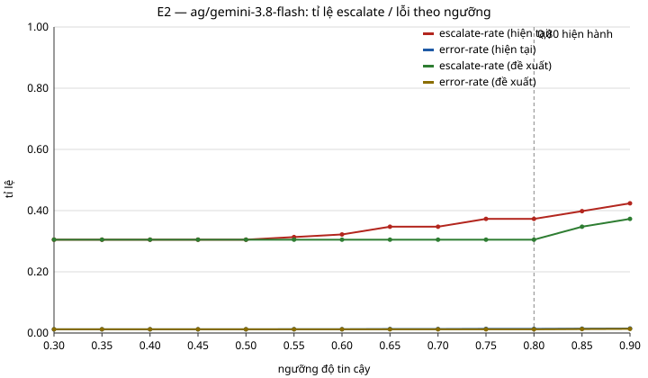
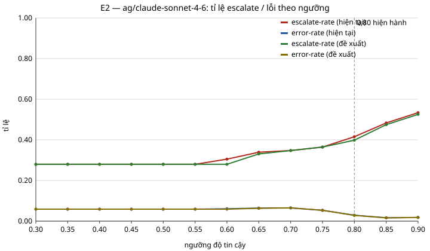
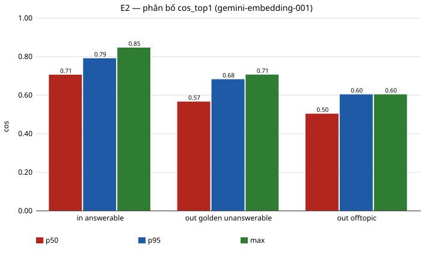

# E2 — ngưỡng escalation và hiệu chỉnh độ tin cậy

Trạng thái: **OK** · nhãn: **WAITING_HUMAN** (BA soạn, chủ dự án chưa soát 20 %). Stack `ep-qc` @ `4c919bf5`, 2026-11-15. Nhúng: thật `gemini-embedding-001` (1536 chiều) trong lượt đo — 395 lời gọi nhúng (llm_audit), xong đã trả về nhúng giả. Hằng số lúc đo: RAG_SIM_FLOOR 0,25 · RAG_SIM_CEIL 0,65 · conf = 0,6·retr + 0,4·ground · ngưỡng lớp 0,80. Bảng theo ngưỡng tính trên câu vàng; bảng trước–sau và đề xuất tính trên câu vàng + 20 câu ngoài chủ đề.

## Đề xuất cấu hình (một bộ số cho cả hai model; dev áp qua env, không viết cứng — P-11-19)

`RAG_SIM_FLOOR` = **0,25** (mọi giá trị trong [0,250; 0,515] cho cùng kết quả trên bộ này), `RAG_SIM_CEIL` = **0,60**, trọng số truy xuất w = **0,6** (conf = 0,6·retr + 0,4·ground), ngưỡng lớp giữ **0,80**.

| model | cấu hình | ticket giả | bắt câu sai | escalate | lỗi lọt |
| --- | --- | --- | --- | --- | --- |
| P1 | hiện tại | 0,099 | 0,982 | 0,460 | 0,013 |
| P1 | đề xuất | 0,099 | 0,982 | 0,460 | 0,013 |
| P2 | hiện tại | 0,163 | 0,966 | 0,500 | 0,029 |
| P2 | đề xuất | 0,138 | 0,966 | 0,485 | 0,028 |

Sàn không tách được câu ngoài chủ đề khỏi câu trong tài liệu với model nhúng này: cos của câu ngoài chủ đề lên tới 0,60 trong khi câu trả lời đúng thấp nhất ≈ 0,57 (bảng phân bố). Câu ngoài tài liệu được chặn nhờ câu từ chối (P-11-18) và độ tin cậy, không nhờ sàn; sàn cao hơn ≈ 0,57 bắt đầu bỏ câu đúng.

**Quyết định PM (P-11-33, 2026-11-15):** giữ tham số hiện hành (FLOOR 0,25 · CEIL 0,65 · w 0,6 · ngưỡng 0,80); đóng P-11-19, P-11-22. Bảng «đề xuất» ở trên chỉ để tham khảo.

## P1: `ag/gemini-3.8-flash` qua 9router (openai_compatible)

- 118 câu vàng + 19 câu ngoài chủ đề phân tích được; loại 3: E2-011 (SKIPPED LLM_UNAVAILABLE), E2-097 (SKIPPED LLM_UNAVAILABLE), OT-15 (SKIPPED LLM_UNAVAILABLE).
- Đúng trên câu trả lời được: **0,862**; bịa trên câu không trả lời được: **0,000**.
- Groundedness suy ngược ngoài [0, 1] (cos đo lại lệch với cos lúc trả lời): 0 mục.
- Ở 0,80 hiện hành — câu sai lọt tới sinh viên: E2-079; câu đúng bị đẩy ticket: E2-016, E2-022, E2-037, E2-038, E2-040, E2-064, E2-065, E2-068.

| ngưỡng | escalate (hiện tại) | lỗi lọt (hiện tại) | ticket giả trong tài liệu | bắt được câu sai | escalate (đề xuất) | lỗi lọt (đề xuất) |
| --- | --- | --- | --- | --- | --- | --- |
| 0,30 | 0,305 | 0,012 | 0,000 | 0,973 | 0,305 | 0,012 |
| 0,35 | 0,305 | 0,012 | 0,000 | 0,973 | 0,305 | 0,012 |
| 0,40 | 0,305 | 0,012 | 0,000 | 0,973 | 0,305 | 0,012 |
| 0,45 | 0,305 | 0,012 | 0,000 | 0,973 | 0,305 | 0,012 |
| 0,50 | 0,305 | 0,012 | 0,000 | 0,973 | 0,305 | 0,012 |
| 0,55 | 0,314 | 0,012 | 0,012 | 0,973 | 0,305 | 0,012 |
| 0,60 | 0,322 | 0,013 | 0,025 | 0,973 | 0,305 | 0,012 |
| 0,65 | 0,347 | 0,013 | 0,062 | 0,973 | 0,305 | 0,012 |
| 0,70 | 0,347 | 0,013 | 0,062 | 0,973 | 0,305 | 0,012 |
| 0,75 | 0,373 | 0,013 | 0,099 | 0,973 | 0,305 | 0,012 |
| 0,80 | 0,373 | 0,013 | 0,099 | 0,973 | 0,305 | 0,012 |
| 0,85 | 0,398 | 0,014 | 0,136 | 0,973 | 0,347 | 0,013 |
| 0,90 | 0,424 | 0,015 | 0,173 | 0,973 | 0,373 | 0,013 |

Phân bố cos_top1 (P-11-19):

| nhóm | n | p50 | p95 | max |
| --- | --- | --- | --- | --- |
| in_answerable | 94 | 0,706 | 0,791 | 0,847 |
| out_golden_unanswerable | 24 | 0,567 | 0,683 | 0,707 |
| out_offtopic | 19 | 0,504 | 0,604 | 0,604 |

Trước–sau ở ngưỡng 0,80 (P-11-22: ngưỡng giữ nguyên; chọn floor / ceil / w cho «ticket giả» thấp nhất mà «bắt câu sai» không kém cấu hình hiện tại):

| cấu hình | floor | ceil | w_retr | ticket giả | bắt câu sai | escalate | lỗi lọt |
| --- | --- | --- | --- | --- | --- | --- | --- |
| hiện tại | 0,25 | 0,65 | 0,6 | 0,099 | 0,982 | 0,460 | 0,013 |
| đề xuất | 0,25 | 0,60 | 0,8 | 0,000 | 0,982 | 0,402 | 0,012 |
| kiểm chéo fit_odd_eval_even | 0,25 | 0,65 | 0,8 | 0,050 | 1,000 | 0,457 | 0,000 |
| kiểm chéo fit_even_eval_odd | 0,25 | 0,60 | 0,8 | 0,000 | 0,962 | 0,373 | 0,024 |

## P2: `ag/claude-sonnet-4-6` qua 9router (openai_compatible)

- 118 câu vàng + 20 câu ngoài chủ đề phân tích được; loại 2: E2-003 (SKIPPED LLM_UNAVAILABLE), E2-004 (SKIPPED LLM_UNAVAILABLE).
- Đúng trên câu trả lời được: **0,860**; bịa trên câu không trả lời được: **0,000**.
- Groundedness suy ngược ngoài [0, 1] (cos đo lại lệch với cos lúc trả lời): 0 mục.
- Ở 0,80 hiện hành — câu sai lọt tới sinh viên: E2-050, E2-079; câu đúng bị đẩy ticket: E2-015, E2-016, E2-021, E2-022, E2-024, E2-037, E2-040, E2-043, E2-063, E2-065, E2-068, E2-069, E2-072.

| ngưỡng | escalate (hiện tại) | lỗi lọt (hiện tại) | ticket giả trong tài liệu | bắt được câu sai | escalate (đề xuất) | lỗi lọt (đề xuất) |
| --- | --- | --- | --- | --- | --- | --- |
| 0,30 | 0,280 | 0,059 | 0,000 | 0,868 | 0,280 | 0,059 |
| 0,35 | 0,280 | 0,059 | 0,000 | 0,868 | 0,280 | 0,059 |
| 0,40 | 0,280 | 0,059 | 0,000 | 0,868 | 0,280 | 0,059 |
| 0,45 | 0,280 | 0,059 | 0,000 | 0,868 | 0,280 | 0,059 |
| 0,50 | 0,280 | 0,059 | 0,000 | 0,868 | 0,280 | 0,059 |
| 0,55 | 0,280 | 0,059 | 0,000 | 0,868 | 0,280 | 0,059 |
| 0,60 | 0,305 | 0,061 | 0,037 | 0,868 | 0,280 | 0,059 |
| 0,65 | 0,339 | 0,064 | 0,087 | 0,868 | 0,331 | 0,063 |
| 0,70 | 0,347 | 0,065 | 0,100 | 0,868 | 0,347 | 0,065 |
| 0,75 | 0,364 | 0,053 | 0,113 | 0,895 | 0,364 | 0,053 |
| 0,80 | 0,415 | 0,029 | 0,163 | 0,947 | 0,398 | 0,028 |
| 0,85 | 0,483 | 0,016 | 0,250 | 0,974 | 0,475 | 0,016 |
| 0,90 | 0,534 | 0,018 | 0,325 | 0,974 | 0,525 | 0,018 |

Phân bố cos_top1 (P-11-19):

| nhóm | n | p50 | p95 | max |
| --- | --- | --- | --- | --- |
| in_answerable | 93 | 0,707 | 0,791 | 0,847 |
| out_golden_unanswerable | 25 | 0,568 | 0,683 | 0,707 |
| out_offtopic | 20 | 0,503 | 0,553 | 0,604 |

Trước–sau ở ngưỡng 0,80 (P-11-22: ngưỡng giữ nguyên; chọn floor / ceil / w cho «ticket giả» thấp nhất mà «bắt câu sai» không kém cấu hình hiện tại):

| cấu hình | floor | ceil | w_retr | ticket giả | bắt câu sai | escalate | lỗi lọt |
| --- | --- | --- | --- | --- | --- | --- | --- |
| hiện tại | 0,25 | 0,65 | 0,6 | 0,163 | 0,966 | 0,500 | 0,029 |
| đề xuất | 0,25 | 0,60 | 0,6 | 0,138 | 0,966 | 0,485 | 0,028 |
| kiểm chéo fit_odd_eval_even | 0,25 | 0,60 | 0,6 | 0,154 | 0,967 | 0,507 | 0,029 |
| kiểm chéo fit_even_eval_odd | 0,25 | 0,65 | 0,6 | 0,171 | 0,964 | 0,493 | 0,029 |

## Định nghĩa

- **good**: câu trả lời được (`answerable`), AI trả lời, không phải câu từ chối, đủ mọi nhóm `must_contain`. Mọi trường hợp khác là **bad** (sai, thiếu ý, bịa, từ chối, không trả lời).
- **escalate** ở ngưỡng t: Threads bỏ qua (SKIPPED) hoặc cos_top1 < sàn hoặc câu từ chối (P-11-18) hoặc độ tin cậy < t — đúng chính sách chat riêng (SRS 4.8).
- **escalate-rate** = escalate / tổng; **lỗi lọt** (error-rate) = bad không escalate / số câu hiện cho sinh viên; **ticket giả trong tài liệu** = good bị escalate / good; **bắt câu sai** = bad bị escalate / bad.
- Độ tin cậy giả định: retr = clamp((cos − floor) / (ceil − floor)); ground suy ngược = (conf − 0,6·retr₀) / 0,4 với retr₀ ở 0,25 / 0,65; conf′ = w·retr′ + (1 − w)·ground. Không gọi lại LLM.

## Giới hạn

- Dữ liệu mô phỏng (D44): câu hỏi do BA soạn từ tài liệu seed lớp 1, chưa kiểm chứng trên câu hỏi thật của sinh viên. Nhãn **chưa có người ngoài đội soát** (`WAITING_HUMAN`).
- Chấm `must_contain` so chuỗi: câu đúng diễn đạt khác biến thể bị tính sai — sai số thuộc phép đo (README E2), không sửa nhãn cho vừa kết quả.
- cos_top1 đọc từ DB chỉ-đọc (API không trả cos): max cos trên mọi đoạn sinh viên được thấy, có thể lệch nhẹ với `BestCosine(hits)` của top-K sau RRF; mục lệch được đếm ở trên.
- Hiệu chỉnh khớp trên chính bộ 140 mục: kiểm chéo nửa–nửa ở bảng trên cho thấy độ ổn định; đề xuất là **số cấu hình** cho dev áp (env, không viết cứng — P-11-19), cần đo lại sau khi áp.
- Số đo LLM qua 9router (thuê bao): độ trễ gồm cả proxy. Câu Threads chạy làn NEAR_REALTIME, một lời gọi sinh chữ mỗi câu (D47).
