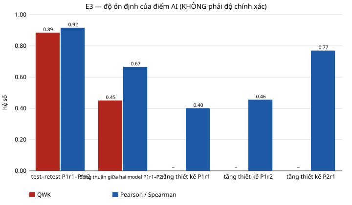

# E3 — chấm tự luận

Trạng thái: **WAITING_HUMAN**. Stack `ep-qc` @ `4c919bf5`, 2026-11-15. Bộ bài: 60 bài BT-A của KC106 (sha256 `86d833a00ef2b402…`), rubric 4 tiêu chí × 2,5, cờ lưu ý chấm tắt.

**Chưa có điểm người chấm.** Chưa có điểm người chấm ≥ 60 bài (Q-E-18). Điểm LLM không được dùng làm chuẩn (vòng tròn). Gói chấm tay: e3-cham-tay.csv. Khi chủ dự án điền `benchmarks/eval/human/e3_scores.csv` (cùng cột với `e3-cham-tay.csv`), chạy `make eval-report`: QWK / MAE / Pearson tính lại ngay, không gọi LLM.

## Độ ổn định (không phải độ chính xác)

| phép so | n | QWK | MAE | Pearson |
| --- | --- | --- | --- | --- |
| test–retest (cùng model, 2 vòng): P1r1 – P1r2 | 60 | 0,885 | 0,325 | 0,916 |
| đồng thuận giữa hai model: P1r1 – P2r1 | 24 | 0,451 | 0,729 | 0,666 |

| model | n | Spearman điểm AI ~ hồ sơ thiết kế lúc sinh bài |
| --- | --- | --- |
| P1r1 | 60 | 0,400 |
| P1r2 | 60 | 0,456 |
| P2r1 | 24 | 0,770 |

Lượt chấm (llm_audit, task GRADING; độ trễ chỉ tính lời gọi `ok`): P1r1: circuit_open 157, error 32, ok 117 — p50 10733 ms, p95 14248 ms; P1r2: circuit_open 18, error 17, ok 111 — p50 10783 ms, p95 14415 ms; P2r1: circuit_open 1613, error 43, ok 48 — p50 26503 ms, p95 33005 ms.
Số bài chấm xong / 60: P1r1 60, P1r2 60, P2r1 24. Lỗi `NETWORK` / `BAD_RESPONSE` / `SERVER` từ 9router làm cầu dao mở (`circuit_open`); P1 tự thử lại tới đủ 60 bài.
**P2r1 không đủ bài (AC6):** 2026-11-15 18:00–18:13: chấm lại tuần tự bài FAILED bằng claude-sonnet-4-6 — 9router trả 403 hạn mức (antigravity, «reset after 1m») liên tục; 1 bài thử lại vẫn FAILED; dừng để nhả stack. P2 chỉ có 24/60 bài.

Model: P1 = `ag/gemini-3.8-flash`, P2 = `ag/claude-sonnet-4-6` (qua 9router).

## Phụ lục — nhãn giảng viên MÔ PHỎNG (KC106, 40 bài kc021–kc060)

Nhãn do agent đóng vai giảng viên tạo ở sprint 10.6 (`benchmarks/guidance/kc/data/labels.csv`). **Không phải điểm người chấm**, không thay AC5; chỉ để đối chiếu.

| model | n | QWK | MAE | Pearson |
| --- | --- | --- | --- | --- |
| P1r1 | 40 | 0,442 | 1,575 | 0,856 |
| P1r2 | 40 | 0,461 | 1,456 | 0,886 |
| P2r1 | 5 | 0,444 | 1,050 | 0,869 |

## Giới hạn

- Dữ liệu mô phỏng (D44): 60 bài do `ag/gemini-3.8-flash-medium` sinh theo hồ sơ chất lượng; chưa kiểm chứng trên bài làm thật của sinh viên. Bài sinh và model chấm P1 cùng họ gemini-3.8-flash.
- E3 chấm tay: **chủ dự án** (chưa thực hiện). Chưa có người chấm độc lập thứ hai nên chưa có mốc QWK người–người.
- QWK tính trên điểm tổng làm tròn về bậc 0,5 (21 hạng). Spearman với «hồ sơ thiết kế» đo việc model tách được tầng chất lượng do người viết đề đặt, không phải điểm chấm.
- Đính chính 9.5 (P-11-26): mẫu S7 của R3 (AI 10,0 so với nhãn giảng viên 8,00) là một điểm lệch lớn của chấm BT03, ghi lại ở đây; R3 «8,0 vs 4,5» là hàng seed bị tính nhầm, không phải AI bị dắt.
- Số đo qua 9router (thuê bao): độ trễ gồm cả proxy; mỗi bài 2 lượt gọi (chấm hai lượt).
