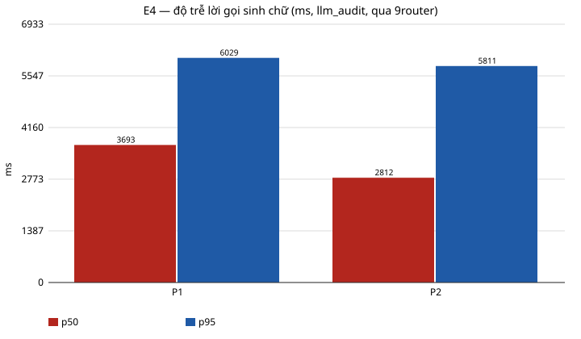

# E4 — so sánh model

Trạng thái: **OK**. Stack `ep-qc` @ `4c919bf5`, 2026-11-15. Cả hai model gọi qua 9router (openai_compatible), cùng stack, cùng seed, cùng bộ câu E2.

| | P1: `ag/gemini-3.8-flash` | P2: `ag/claude-sonnet-4-6` |
| --- | --- | --- |
| E2 đúng (câu trả lời được) | 0,862 | 0,860 |
| E2 bịa (câu không trả lời được) | 0,000 | 0,000 |
| E2 ở ngưỡng 0,80: escalate / lỗi lọt | 0,460 / 0,013 | 0,500 / 0,029 |
| E3 so với người | WAITING_HUMAN | WAITING_HUMAN |
| E3 ổn định (QWK) | 0,885 (P1r1–P1r2) | 0,451 (P1r1–P2r1) |
| Lời gọi CHAT (lỗi) | 148 (15) | 143 (9) |
| Độ trễ LLM p50 / p95 (ms) | 3693 / 6029 | 2812 / 5811 |
| Đăng câu → có trả lời p50 / p95 (ms) | 4976 / 17148 | 4925 / 8030 |
| Token TB vào / ra | 3858 / 41 | 4159 / 109 |
| Giá niêm yết USD / 1M (vào / ra) | 0.75 / 3.75 | 3.0 / 15.0 |
| Chi phí quy đổi / 100 yêu cầu (USD, token đo qua 9router) | 0,3048 | 1,4105 |
| Chi phí ước tính / 100 yêu cầu khi gọi thẳng (USD) | 0,1398 | 0,7505 |

## Giới hạn

- Dữ liệu mô phỏng (D44), cùng bộ 140 câu của E2; E3 chưa có điểm người (`WAITING_HUMAN`), nên chất lượng chấm chỉ có độ ổn định.
- Độ trễ đo **qua 9router** (gồm cả proxy và hàng đợi của 9router), làn NEAR_REALTIME của Threads; không phải độ trễ API gốc của nhà cung cấp.
- Chi phí là quy đổi theo giá niêm yết ngày 2026-11-15 (Gemini 3.8 Flash: giá giới thiệu tới 31/12/2026, từ 01/01/2027 gấp đôi); 9router là thuê bao nên chi phí biên thực bằng 0.
- Nhà cung cấp: Google (gemini-3.8-flash) và Anthropic (claude-sonnet-4-6), đều qua 9router `ag/`; ngày đo ghi ở `meta`.
