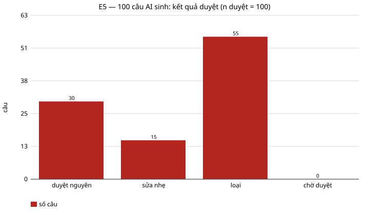

# E5 — câu hỏi AI sinh

Trạng thái: **OK**. Sinh trên stack `ep-qc` (2026-11-15; bản gateway của từng lô ở cột «bản dựng», sha do người dựng xác nhận, image không mang sha); duyệt trên stack `ep-eval` (VPS, 2026-11-25: DB `ep-qc` dump 2026-11-25 + gateway 708dc729, `benchmarks/eval/ep-eval.compose.yml`). Bộ đo `benchmarks/eval/e5.py` @ `74622a8b`, 2026-11-25. Model sinh: `QC 9router/ag/gemini-3.8-flash` qua 9router.

- Sinh: **100** câu từ 10 lô (10 câu / lô, MCQ một đáp án, mức MEDIUM, nguồn: «Network Security Threats», «Forecasting (QMB ch. 6b)»). Bỏ: không.
- Duyệt: **n = 100** — duyệt nguyên 30 (30,0 %), sửa nhẹ 15 (15,0 %), loại 55 (55,0 %); chờ duyệt 0. **Dùng được (duyệt nguyên + sửa nhẹ): 45,0 %**. Loại theo lý do: LAC_DE 38, TRUNG_LAP 14, KHO_DE_BAT_THUONG 3.
- Lời gọi QUESTION_GEN (llm_audit): 10, p50 18764 ms, p95 25271 ms; token vào 68113, ra 23677.

## Từng lô

| lô | chủ đề | bản dựng | POST (UTC) | xong (UTC) | giây | trạng thái | câu tạo | bỏ | lỗi | POST bị 429 trước lô | lời gọi LLM (trạng thái) |
| --- | --- | --- | --- | --- | --- | --- | --- | --- | --- | --- | --- |
| lo01 | Phân loại mối đe doạ an ninh mạng | `31c19e0d` | 21:58:42 | 21:58:53 | 11 | SUCCEEDED | 10 | 0 | – | – | ok 1 |
| lo02 | Sâu máy tính, virus và trojan | `31c19e0d` | 21:59:02 | 21:59:25 | 24 | SUCCEEDED | 10 | 0 | – | – | ok 1 |
| lo03 | Tấn công trinh sát | `31c19e0d` | 21:59:33 | 21:59:54 | 21 | SUCCEEDED | 10 | 0 | – | – | ok 1 |
| lo04 | Tấn công truy cập và leo thang đặc quyền | `31c19e0d` | 22:00:03 | 22:00:24 | 21 | SUCCEEDED | 10 | 0 | – | – | ok 1 |
| lo05 | Tấn công từ chối dịch vụ | `31c19e0d` | 22:00:32 | 22:01:00 | 28 | SUCCEEDED | 10 | 0 | – | – | ok 1 |
| lo06 | Biện pháp giảm thiểu tấn công mạng | `31c19e0d` | 22:01:08 | 22:01:33 | 26 | SUCCEEDED | 10 | 0 | – | – | ok 1 |
| lo07 | Mô hình dự báo chuỗi thời gian | `31c19e0d` | 22:01:41 | 22:01:50 | 9 | SUCCEEDED | 10 | 0 | – | – | ok 1 |
| lo08 | Trung bình trượt và trung bình trượt có trọng số | `31c19e0d` | 22:01:58 | 22:02:15 | 17 | SUCCEEDED | 10 | 0 | – | – | ok 1 |
| lo09 | Làm trơn hàm mũ | `708dc729` | 23:00:31 | 23:00:57 | 26 | SUCCEEDED | 10 | 0 | – | 22:02:23 | ok 1 |
| lo10 | Đo sai số dự báo | `708dc729` | 23:01:05 | 23:01:19 | 14 | SUCCEEDED | 10 | 0 | – | – | ok 1 |

## Kết quả duyệt theo lô

| lô | chủ đề | duyệt nguyên | sửa nhẹ | loại | lý do loại | trang trích dẫn |
| --- | --- | --- | --- | --- | --- | --- |
| lo01 | Phân loại mối đe doạ an ninh mạng | 0 | 6 | 4 | LAC_DE 4 | 2–50 |
| lo02 | Sâu máy tính, virus và trojan | 9 | 0 | 1 | TRUNG_LAP 1 | 12–50 |
| lo03 | Tấn công trinh sát | 2 | 0 | 8 | LAC_DE 6, TRUNG_LAP 1, KHO_DE_BAT_THUONG 1 | 2–46 |
| lo04 | Tấn công truy cập và leo thang đặc quyền | 0 | 1 | 9 | LAC_DE 6, TRUNG_LAP 3 | 2–50 |
| lo05 | Tấn công từ chối dịch vụ | 0 | 4 | 6 | TRUNG_LAP 3, LAC_DE 3 | 13–50 |
| lo06 | Biện pháp giảm thiểu tấn công mạng | 9 | 0 | 1 | TRUNG_LAP 1 | 2–43 |
| lo07 | Mô hình dự báo chuỗi thời gian | 8 | 2 | 0 | – | 3–23 |
| lo08 | Trung bình trượt và trung bình trượt có trọng số | 2 | 2 | 6 | TRUNG_LAP 4, KHO_DE_BAT_THUONG 2 | 6–10 |
| lo09 | Làm trơn hàm mũ | 0 | 0 | 10 | LAC_DE 10 | 3–19 |
| lo10 | Đo sai số dự báo | 0 | 0 | 10 | LAC_DE 9, TRUNG_LAP 1 | 3–22 |

Bản dựng (`raw/builds.json`): `31c19e0d` = image `c71505e4f4d6` tạo 2026-11-15T18:42:16Z (QC xác nhận qua PM 2026-11-16; image đã bị xoá khi QC dựng lại 22:05Z); `708dc729` = image `09d80a7b3d3c` tạo 2026-11-15T22:05:14Z (QC qua PM 2026-11-16: dựng lại ep-qc ở 708dc729 lúc 22:05Z).

## Phát hiện của người duyệt

Người duyệt ghi khi duyệt; số trong ngoặc do Tech Lead kiểm lại trên dữ liệu (2026-11-25).

1. Lô 09 «Làm trơn hàm mũ» và lô 10 «Đo sai số dự báo»: tài liệu «Forecasting (QMB ch. 6b)» không có hai chủ đề này mà máy vẫn sinh đủ 10 câu / lô (kiểm: 19 đoạn, 23 trang của tài liệu trong `content_chunks` không có «smoothing», «forecast error», «MAD», «mean absolute deviation»). Hệ thống chưa từ chối khi chủ đề không có trong nguồn.
2. Lô 03–05 (trinh sát, truy cập, từ chối dịch vụ) chỉ trích trang ≤ 50 của «Network Security Threats» (kiểm: tài liệu 141 trang; trích dẫn lô 01–06 nằm trong trang 2–50, trong khi «reconnaissance» có ở trang 46, 69, 72, 79, 91, 119; «denial of service» ở 17, 46, 60, 69, 79, 91; «access attack» ở 46, 69, 79, 91): phần sau trang 50 của tài liệu không được dùng.
3. Khoảng 45 ý khác nhau cho 100 câu (ước lượng của người duyệt): nhiều câu hỏi lại cùng một ý; 14 câu bị loại vì `TRUNG_LAP`.
4. Đáp án đúng nằm ở phương án A trong **72/100** câu (thứ tự phương án như máy sinh).
5. **34/100** câu lộ mã trích dẫn nội bộ `[Cn]` trong chữ hiện cho người đọc (giải thích; 1 câu cả trong đề).

## Cách duyệt

Người duyệt `giaovien` (người gán nhãn do chủ dự án chỉ định, từ 2026-11-25) duyệt mù trên gói `benchmarks/eval/human/e5_duyet_goi.csv` (đề, phương án, đáp án đánh dấu, giải thích, nguồn + trích đoạn; không có điểm / nhận định của máy), điền `benchmarks/eval/human/e5_duyet.csv` (DUYỆT / SỬA kèm bản sửa / BỎ kèm lý do). `e5.py apply` áp từng quyết định qua API của `ep-eval` bằng vai giảng viên (DUYỆT → duyệt; SỬA → lưu bản sửa rồi duyệt, gen-stats tính «sửa nhẹ»; BỎ → loại kèm lý do) → `raw/e5-apply.json`; `e5.py report` đọc gen-stats từng lô.

## Giới hạn

- Dữ liệu mô phỏng (D44): tài liệu seed lớp 1; chưa kiểm chứng với câu hỏi giảng viên thật dùng trong lớp.
- Tỉ lệ chỉ tính trên câu đã duyệt (AC7); chưa duyệt đủ 100 câu thì ghi cỡ mẫu thật, không nội suy.
- Người duyệt: `giaovien` (người gán nhãn do chủ dự án chỉ định, từ 2026-11-25); một người, không có người duyệt thứ hai.
