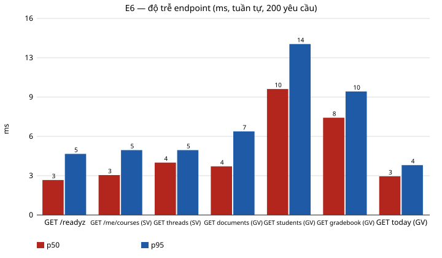

# E6 — nền Go

Trạng thái: **OK**. Stack `ep-qc` @ `468207a7`, 2026-11-15. Máy: MacBook Apple Silicon 18 GB, Colima 6 CPU / 10 GB, k6 trong VM 1,5 CPU. 2 lượt.

## RAM khi nghỉ (sau 60 s không yêu cầu, `docker stats`)

| tiến trình | r1 | r2 |
| --- | --- | --- |
| gateway | 22,7 MiB | 18,4 MiB |
| worker | 19,2 MiB | 14,3 MiB |
| postgres | 248,0 MiB | 224,8 MiB |
| pgbouncer | 8,6 MiB | 8,6 MiB |
| redis | 9,7 MiB | 9,8 MiB |
| caddy | 23,0 MiB | 22,7 MiB |
| frontend | 82,1 MiB | 82,2 MiB |
| minio | 91,9 MiB | 92,0 MiB |
| docling | 1077,2 MiB | 1077,2 MiB |
| judge | 13,0 MiB | 13,0 MiB |

## Khởi động lạnh (`docker start` → sẵn sàng, ms, 3 lần)

| tiến trình | r1 | r2 |
| --- | --- | --- |
| gateway | 314, 486, 376 | 386, 320, 163 |
| worker | 218, 795, 225 | 178, 173, 248 |

## Kích thước image

| image | MiB |
| --- | --- |
| `edupilot-gateway-test` | 17,4 |
| `edupilot-worker-test` | 16,3 |
| `ep-eval-gateway:468207a7` | 17,4 |
| `ep-eval-worker:468207a7` | 16,3 |

## Độ trễ endpoint (ms, r1 / r2)

| endpoint | n | p50 | p95 | max | ≠ 200 | 429 (đã loại) |
| --- | --- | --- | --- | --- | --- | --- |
| GET /readyz | 200 / 200 | 3,2 / 2,9 | 4,9 / 4,7 | 7,5 / 5,2 | 0 | 0 / 0 |
| GET /me/courses (SV) | 200 / 200 | 4,0 / 3,8 | 6,4 / 6,0 | 11,5 / 20,7 | 0 | 0 / 0 |
| GET threads lớp 1 (SV) | 200 / 200 | 4,8 / 4,4 | 6,1 / 7,4 | 12,1 / 11,9 | 0 | 0 / 0 |
| GET documents lớp 1 (GV) | 200 / 200 | 4,0 / 3,5 | 5,3 / 5,0 | 13,2 / 7,5 | 0 | 0 / 0 |
| GET students lớp 1 (TA) | 200 / 200 | 9,0 / 8,5 | 11,0 / 10,8 | 16,8 / 16,3 | 0 | 0 / 0 |
| GET gradebook lớp 1 (GV) | 200 / 200 | 8,8 / 11,5 | 15,8 / 18,7 | 21,5 / 27,6 | 0 | 0 / 0 |
| GET today lớp 1 (TA) | 200 / 200 | 3,1 / 7,5 | 4,5 / 25,2 | 8,6 / 52,8 | 0 | 0 / 0 |

Mỗi endpoint đo bằng một tài khoản riêng (nhân viên dùng chung thì nghỉ 61 s ngoài vùng đo); trong vùng đo không thử lại: phản hồi 429 (giới hạn 600 yêu cầu / phút / người) bị loại khỏi độ trễ và đếm ở cột cuối.

Tái lập (AC11, sai số ±15 %, Q-S11-13): RAM gateway + worker lệch 22,0 %, khởi động gateway 14,9 %, worker 20,9 % → **NGOÀI sai số**. Khởi động lạnh chỉ vài trăm ms nên dao động lịch CPU của VM Colima (vài trăm ms) đủ làm lệch phần trăm lớn; trung vị lớn nhất 376 ms.

## Giới hạn

- Một máy (MacBook, Colima), một bản gateway + một worker, dữ liệu seed T0 (nhỏ). Tải T1 không chạy lại (Q-E-20): số T1 ở báo cáo 9.5 (`benchmarks/reports/load-*.json`).
- Image chạy trên `ep-qc` là bản test (`edupilot-*-test`, có route thử); kích thước giao hàng là dòng `ep-eval-*` (target production, distroless) dựng từ cùng commit.
- Độ trễ đo từ máy Mac qua Caddy HTTPS, client tuần tự (không đồng thời): là độ trễ nền, không phải dưới tải. Không đối chiếu hệ cũ (D45).
