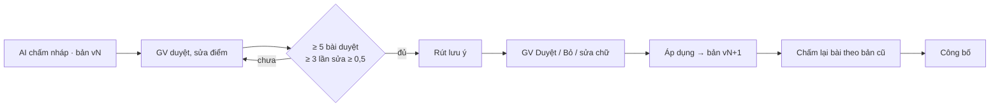

# Hướng dẫn vận hành: học từ lần giảng viên sửa (D61, D62)

> **Bản phác (techlead-mem, 2026-11-14).** Dev điền ảnh màn hình và tên nút cuối cùng ở L6. Chỗ ghi `[CHỜ L…]` là phần chưa có mã.
>
> Nguồn chuẩn: `docs/specs/FEAT-grading-guidance/SRS.md`. Thiết kế mã: `docs/sprints/10.6/techlead.md` TL-1.

Người đọc: giảng viên (TEACHER) bật và dùng tính năng; quản trị viên (ADMIN) vận hành và đo.

Hướng dẫn trả lời sáu câu:
- tính năng làm gì;
- bật thế nào;
- một vòng duyệt lưu ý đi ra sao;
- chấm lại và công bố thế nào;
- đọc số đo;
- quên / xoá và sự cố.

## 1. Tính năng làm gì

Mỗi lần giảng viên sửa điểm nháp của AI, hệ thống đã lưu: điểm AI không sửa được (`ai_scores`), điểm giảng viên chốt (`criteria`). Tính năng dùng lại các lần sửa đó theo bốn cách. Mỗi cách có một công tắc riêng cho từng lớp, **mặc định tắt**.

| Công tắc | Làm gì | Ai bật |
| --- | --- | --- |
| `GRADING_GUIDANCE`: Lưu ý chấm | Rút "lưu ý chấm" từ các lần sửa của **một** bài tập. Giảng viên duyệt rồi áp dụng thành **bản** v1, v2… Lượt chấm sau của bài đó dùng các lưu ý đã duyệt | TEACHER, ADMIN |
| `THREAD_SUGGEST`: Câu tương tự | Khi sinh viên soạn câu hỏi Threads, hiện ≤ 3 thread đã có câu trả lời được xác nhận | TEACHER, ADMIN |
| `QUESTION_HINTS`: Mẫu câu bị loại | Khi sinh câu hỏi luyện đề / thi, nhắc AI tránh các lỗi mà giảng viên hay loại | TEACHER, ADMIN |
| `REGRESSION_CAPTURE`: Ca hồi quy | Mỗi lần sửa lớn (≥ 1 điểm) hoặc phúc khảo "Điều chỉnh" thành một ca để chạy lại khi đổi prompt / model | **chỉ ADMIN** |

Ba điều **không** xảy ra:
- AI không tự áp lưu ý, không tự công bố điểm.
- Lưu ý không đụng điểm tổng, trừ nộp muộn, làm tròn: những thứ đó là code.
- Sinh viên không thấy gì của tính năng: không lưu ý, không bản, không công tắc.

Cũng không có "bộ nhớ" theo sinh viên. Lưu ý gắn với bài tập, không gắn với người (D61).

## 2. Bật cho một lớp

1. Kiểm `GUIDANCE_ENABLED=true` ở gateway và worker (mặc định). Đặt `false` để tắt **cứng** cả hệ thống: API ghi trả `409 GUIDANCE_DISABLED`, chấm bài như trước 10.6.
2. `/class/settings` → khối "Học từ lần sửa" → bật công tắc cần dùng. `[CHỜ L6: ảnh]`
3. Nên bật **sau** khi lớp đã có ít nhất một bài tự luận được duyệt ≥ 5 bài.
4. Chỉ để bật lâu dài khi số đo của lớp đạt tiêu chí "bật được" (mục 5). Chưa đạt thì giữ tắt; không nới ngưỡng.

## 3. Một vòng lưu ý chấm (bài tự luận)



1. **Duyệt bài như thường lệ.** Sửa điểm tiêu chí mà AI chấm lệch. Mỗi lần sửa ≥ 0,5 điểm là một tín hiệu.
2. **Rút lưu ý** (`/assignments/[id]` → khối "Lưu ý chấm"):
   - Nút khoá khi chưa đủ điều kiện; di chuột lên nút để xem lý do.
   - Việc chạy nền khoảng vài chục giây; rời trang được.
   - Tối đa 3 lần / giờ / bài tập.
   - Kết quả là ≤ 8 lưu ý "Chờ duyệt". Mỗi lưu ý ghi số lần sửa ủng hộ (ít nhất 2).
   - "Không có lưu ý mới" là kết quả bình thường khi các lần sửa không theo một quy luật.
3. **Duyệt từng lưu ý.** Giữ những lưu ý mô tả đúng cách mình chấm; `Bỏ` những lưu ý mâu thuẫn rubric hoặc tả sai bài.
   - Đọc kỹ: hệ thống rút lưu ý từ **nhận xét của AI**, không đọc bài làm. Nhận xét AI tả sai thì lưu ý cũng sai.
   - PoC đo được đúng lỗi này. Bỏ lưu ý sai là việc làm cho tính năng có ích (research §5.1: duyệt rồi mới áp thì sai số nháp giảm 49 %, tự áp chỉ giảm 17 %).
   - Có thể sửa chữ lưu ý trước khi `Duyệt`. Chữ có tên / MSSV hoặc nói về tổng / trừ muộn bị từ chối.
4. **Áp dụng.** Mọi lưu ý đã `Duyệt` (và lưu ý `Cho nghỉ`) vào **một** bản mới. `Duyệt` từng cái không tạo bản; chỉ `Áp dụng` mới tạo.
5. **Cho nghỉ** một lưu ý không còn đúng: nó chuyển "Chờ nghỉ" và rời bản ở lần `Áp dụng` sau. Lượt chấm cũ vẫn ghi nhận nó, vì mỗi lượt chấm **ghim** bản đã dùng.

**Nếu rubric đổi sau khi có lưu ý:** lưu ý của tiêu chí đã xoá không còn được dùng khi chấm. Cho nghỉ chúng ở lần duyệt sau.

## 4. Chấm lại và công bố

Luật (P-106-2): **điểm giảng viên đã duyệt không bao giờ bị chấm lại hay ghi đè.** Chỉ bài **chưa từng được duyệt** mới phải theo bản hiện hành.

| Bài sau khi `Áp dụng` bản mới | Hệ thống làm | Giảng viên làm |
| --- | --- | --- |
| Nháp chấm theo bản cũ, chưa từng duyệt | Gắn "Bản cũ"; không cho sửa điểm hay `Duyệt` (`409 MIXED_GUIDANCE`) | Bấm `Chấm lại`, rồi duyệt bản mới |
| Đã duyệt (kể cả bộ bài dùng để rút lưu ý) | **Miễn**: giữ nguyên điểm, công bố bình thường. Sửa lại rồi duyệt lại cũng vẫn miễn | Không cần làm gì |
| Đã công bố | Không bao giờ chấm lại | – |

- Hàng chờ `/grading` báo **"N bài chấm theo bản cũ · Chấm lại"**. N chỉ đếm nháp chưa từng duyệt. `Chấm lại` chấm đúng các bài đó, không đụng bài đã duyệt.
- Mỗi lần ≤ 200 bài. Bài đã chấm lại 20 lần bị bỏ qua và được báo số.
- **Công bố:** hộp xác nhận ghi thêm số bài được miễn theo lý do, ví dụ "5 bài duyệt theo bản cũ". Một lô có thể gồm điểm chốt theo hai bản; đó là quyết định của giảng viên.

Không cần công bố trước khi `Áp dụng`: bộ bài dùng để rút lưu ý đã được duyệt nên được miễn.

## 5. Đọc số đo

Khối "Lưu ý chấm" có bảng nhỏ theo bản. Số tính trên bài đã duyệt / công bố; dưới 5 bài thì hiện `—`.

| Số | Ý nghĩa | Muốn thấy |
| --- | --- | --- |
| `mae_criterion`, `mae_total` | sai số trung bình giữa điểm nháp AI và điểm giảng viên chốt (tiêu chí / tổng trước trừ muộn) | giảm sau mỗi bản |
| `bias_total` (có dấu) | AI chấm cao hơn (+) hay thấp hơn (−) giảng viên | gần 0. **Âm dần là dấu hiệu lưu ý làm AI chấm gắt quá tay** (PoC đã thấy: +0,23 → −0,25) |
| `edited_rate` | tỉ lệ bài giảng viên phải sửa ít nhất một tiêu chí | giảm |

**Tiêu chí "bật được"** (SRS §9), đo trong **cùng một bài tập**: 20 bài đầu để học, 40 bài sau để đo. Cần đủ cả ba:
- MAE tổng giảm ≥ 20 %;
- |lệch TB| không xấu hơn bản 0 quá 0,20 điểm;
- tiêu chí vốn đúng mà nay sai ≤ 1,5 lần bản 0.

Không đạt thì giữ tắt. Lưu ý chỉ có tác dụng trong bài tập sinh ra nó, nên đo ở bài tập thứ hai không có nghĩa.

## 6. Ca hồi quy (ADMIN)

- Bật `REGRESSION_CAPTURE` cho lớp dùng để đo.
- Ca lưu **theo tham chiếu**: id kết quả / bài + điểm số, **không** lưu văn bản.
- Khi đổi prompt chấm, đổi model của tuyến `GRADING` hoặc đổi `BuildEssayPrompt`, chạy trên **stack test** (không phải stack demo):

```bash
cd backend-go && go run ./cmd/regress run --course <id> --baseline ../benchmarks/guidance/baseline.json   # [CHỜ L5]
```

- Thoát mã khác 0 khi "Có lùi": MAE tăng quá `REGRESSION_MAX_REL`, hoặc lệch TB xấu thêm.
- `export` mặc định bị từ chối (`REGRESSION_EXPORT_ALLOWED=false`). Đừng bật nếu PM chưa cho phép từng lần.
- LLM chỉ qua 9router. Không gọi Gemini trực tiếp.

## 7. Quên / xoá

| Việc | Hệ thống làm |
| --- | --- |
| Xoá dữ liệu một sinh viên (PR) | Bỏ id kết quả của em khỏi nguồn của lưu ý. Lưu ý còn < 2 lần sửa ủng hộ thì gắn nhãn **"Cần xem lại"**; **không** tự nghỉ, không đổi cách chấm. Xoá ca hồi quy liên quan |
| Giảng viên muốn bỏ hết lưu ý của một bài | `Cho nghỉ` từng lưu ý → `Áp dụng` (bản mới rỗng) → `Chấm lại` |
| Tắt công tắc | Lượt chấm mới không dùng lưu ý (ghim bản 0); lưu ý vẫn giữ để bật lại; không còn chặn nháp theo bản cũ |

Lưu ý không chứa tên, MSSV, email: hệ thống kiểm lúc rút và lúc sửa chữ.

## 8. Sự cố

| Thấy | Nguyên nhân thường gặp | Làm gì |
| --- | --- | --- |
| "Chưa rút được lưu ý" | LLM lỗi hoặc sai dạng sau 3 lần thử | Thử lại sau; xem `/observability` tuyến `GRADING` |
| `409 NOT_ENOUGH_DATA` | Chưa đủ 5 bài duyệt / 3 lần sửa ≥ 0,5 | Duyệt thêm bài |
| `429` khi rút | Quá 3 lần / giờ / bài | Chờ |
| `409 MIXED_GUIDANCE` khi sửa / duyệt một bài | Nháp chấm theo bản cũ, chưa từng duyệt | `Chấm lại` bài đó (hoặc cả lô ở hàng chờ) |
| AI chấm gắt hơn hẳn sau khi áp | Lưu ý STRICTER quá rộng | Xem `bias_total`; `Cho nghỉ` lưu ý đó; tắt công tắc nếu cần |
| Không hiện câu tương tự khi soạn | Công tắc tắt, câu < 3 từ, câu có thông tin cá nhân, hoặc chưa có thread được xác nhận đủ gần | Bình thường; lỗi được bỏ qua im lặng |

## 9. Chi phí

| Việc | Lời gọi LLM |
| --- | --- |
| Rút lưu ý | 1 lời gọi `Structured` mỗi lần bấm (≈ 3–6 nghìn token vào), làn chạy nền |
| Chấm lại | như chấm thường: 2 lượt mỗi bài |
| Khối lưu ý | +3–6 % token mỗi lượt chấm |
| Câu tương tự | ≤ 1 lần nhúng mỗi lần ngừng gõ, thường trúng cache của bước kiểm tường lửa |
| Mẫu câu bị loại | 0 lời gọi thêm |

## 10. Tham chiếu

- Quyết định: `docs/DECISIONS.md` D61, D62; `docs/sprints/10.6/proposals.md` P-106-1…3.
- Đặc tả: `docs/specs/FEAT-grading-guidance/` (US, SRS, QUESTIONS).
- Thiết kế mã: `docs/sprints/10.6/techlead.md` TL-1.
- Research và PoC: `docs/research/2026-11-14-agent-memory.md`, `docs/research/poc/agent-memory/` (nhánh `research/agent-memory`).
