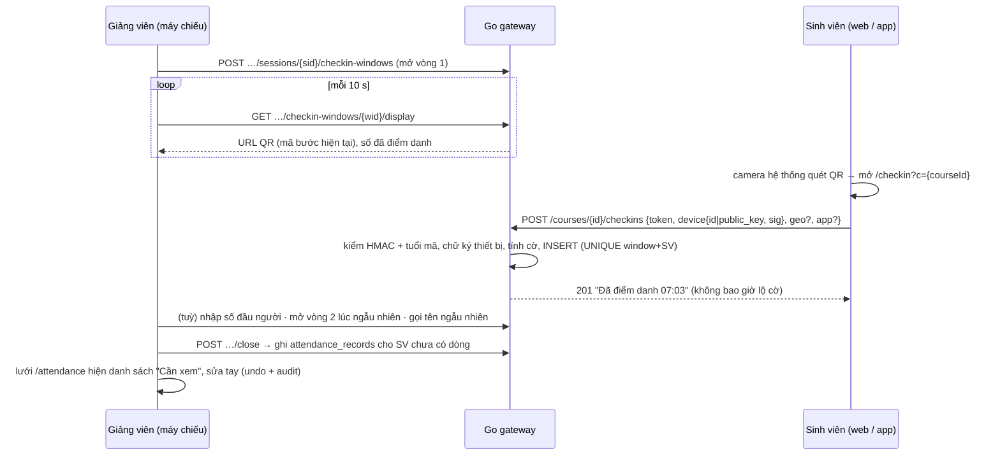

# Điểm danh tự phục vụ chống gian lận (sprint 10.7): web + app điện thoại

**Câu hỏi.** Sinh viên tự điểm danh bằng điện thoại thì làm thế nào để chống gian lận nhiều nhất có thể, mà vẫn giữ luật repo (Go không trạng thái, D46, không tự phạt sinh viên), chạy ở tải T1, và có app điện thoại theo quyết định của chủ dự án?

**Kết luận trước.**
1. **Không có cơ chế đơn lẻ nào đủ.** Mã QR xoay vòng chặn được ảnh chụp gửi bạn, nhưng không chặn được người ngồi trong lớp chuyển mã theo thời gian thực. Bài báo IJACSA 10/2026 ghi nhận đúng điểm này: mã còn hạn được chuyển đi, cộng toạ độ giả trong vùng, vẫn được chấp nhận ([nguồn](https://thesai.org/Downloads/Volume17No10/Paper_2-A_Session_Bound_Attendance_Protocol_with_Rotating_QR_Codes.pdf)). Thiết kế đề xuất có **5 lớp**:
   - QR xoay vòng 10 s, kiểm bằng HMAC không trạng thái;
   - khoá thiết bị ký từng lượt (web: WebCrypto; app: khoá phần cứng có chứng thực);
   - tín hiệu vị trí (tuỳ chọn);
   - đối chiếu do người làm: đếm đầu người, vòng 2 ngẫu nhiên, gọi tên ngẫu nhiên;
   - gắn cờ bất thường.

   Chỉ gắn cờ cho giảng viên xem. Không tự từ chối, không tự phạt.
2. **App: Capacitor bọc web hiện có, làm Android trước, phát hành APK sideload.** App mở thêm hai lớp bảo đảm:
   - **Android Key Attestation**: miễn phí, không gọi API Google. Go kiểm bằng `crypto/x509` + `encoding/asn1`; PoC đã chạy với chuỗi chứng chỉ thật, xem §7.
   - **`Location.isMock()`**: phát hiện vị trí giả.

   Mọi màn còn lại tái dùng nguyên Next.js + `shared/`. iOS hoãn vì cần Apple Developer Program (99 USD/năm). Sinh viên iPhone dùng web/PWA, mức tin cậy thấp hơn và bị gắn cờ.
3. **Không dùng selfie / khuôn mặt** (dữ liệu sinh trắc, Luật 91/2025 Điều 31 khoản 4). **Không chặn chụp màn hình**: QR nằm trên máy chiếu, nên `FLAG_SECURE` trên máy sinh viên không có tác dụng gì.
4. **Đường nóng không cần Redis.** Kiểm mã bằng HMAC, khử trùng bằng UNIQUE ở Postgres. Đo 200 lượt kiểm mã + chữ ký: 1,7 ms trên Mac, nên tải T1 (200 SV / 30 s ≈ 7 req/s) không đáng kể. Màn chiếu dùng poll 10 s thay SSE vì đơn giản hơn và giữ gateway không trạng thái (§5.4).
5. **Lát cho 10.7:** L1–L5 bắt buộc, khoảng 2 L + 3 M + 2 S; L6 (BLE) là tuỳ chọn (§8). Có 9 câu hỏi cần chủ dự án quyết (§9) và 3 thư viện/SDK cần duyệt (§6.3).

Độ chắc chắn:
- **Cao:** cơ chế mã, chữ ký, Key Attestation (đã chạy PoC), năng lực nền tảng (tài liệu chính thức).
- **Trung bình:** công sức Capacitor. Chưa dựng thử APK trên máy thật; đó là việc đầu tiên của L5.

---

## 1. Hiện trạng repo

- M5 (`docs/PRD.md`): TA / giảng viên điểm danh tay ở `/attendance`, `PUT …/sessions/{sid}/attendance` (cả lưới, một giao dịch, khoá lạc quan `version`). Sinh viên chỉ xem qua `GET /courses/{id}/me/attendance` và tool `get_my_attendance`.
- `attendance_records.marked_by NOT NULL`, `attendance_status` = `PRESENT/LATE/EXCUSED/ABSENT` (`00013_crm.sql`). `courses.settings jsonb` đã có (`00003`) → chính sách điểm danh theo lớp **không cần bảng mới**.
- Frontend: Next.js 16 `output: "standalone"`, 47 trang, 9 route động (`[id]`…), refresh token trong cookie `credentials: "include"` (`shared/data/apiClient.ts:145`). Chưa có manifest / PWA.
- Migration: `00020_decision` đã dùng; 00021–00023 giữ chỗ → đề xuất **`00024_attendance_checkin.sql`**.

## 2. Mối đe doạ thực tế

| # | Cách gian lận | Ai làm được | Độ phổ biến [SUY LUẬN theo kinh nghiệm lớp đông] |
| --- | --- | --- | --- |
| T1 | Chụp QR gửi nhóm chat, bạn ở nhà quét ảnh | Ai cũng làm được | Rất cao với QR tĩnh |
| T2 | Chuyển mã thời gian thực (gọi video, gửi ảnh liên tục, đọc mã số) | Cần người trong lớp hợp tác | Trung bình |
| T3 | Điểm danh hộ: người trong lớp đăng nhập tài khoản của bạn trên máy mình (đăng xuất / đăng nhập, trình duyệt ẩn danh, nhiều hồ sơ trình duyệt) | Cần mật khẩu của bạn | Cao |
| T4 | Cầm hộ điện thoại của bạn vào lớp | Cần 2 máy | Thấp–trung bình |
| T5 | Điểm danh rồi bỏ về | Ai cũng làm được | Cao |
| T6 | Giả GPS (DevTools Sensors trên máy tính, app mock location trên Android, công cụ trên máy tính cho iOS) | Dễ trên web / máy tính; trung bình trên điện thoại | Trung bình nếu bật geofence |
| T7 | Replay: gửi lại request / mã cũ đã bắt được | Cần kỹ thuật | Thấp |
| T8 | VPN / proxy để mang IP trường | Dễ (nhiều trường có VPN cho SV) | Thấp, chỉ khi có kiểm IP |
| T9 | Máy root / jailbreak, app bị sửa, giả lập | Kỹ thuật cao | Rất thấp |
| T10 | TA / bạn lớp trưởng mở màn chiếu trên máy khác để phát mã ra ngoài | Người có quyền | Thấp |

## 3. So sánh cơ chế

Cột "Web" là trình duyệt di động; cột "App" là app Capacitor có plugin native.

| Cơ chế | Chặn | Không chặn | Chi phí làm | Phiền SV | Web | App | Riêng tư |
| --- | --- | --- | --- | --- | --- | --- | --- |
| **QR xoay vòng 10 s** (HMAC theo cửa sổ, nhận bước hiện tại + bước trước) | T1, T7 | T2, T3, T4, T5 | S | Thấp: mở camera hệ thống, QR là URL | Có (camera hệ thống mở URL, không cần thư viện giải mã) | Có (ML Kit) | Không |
| Mã số đọc to (6 số, 30 s) | T1 phần nào | T2 (nhắn tin trong vài giây) | S | Thấp | Có | Có | Không |
| Geofence (Geolocation API, bán kính + độ chính xác) | T1, T2 từ xa (nếu không giả) | T6 trên web: DevTools giả toạ độ trong 10 s | S | Trung bình: hỏi quyền, trong nhà sai số hàng chục m | Có (cần HTTPS) | Có + `isMock()` | **Dữ liệu vị trí cá nhân** (Luật 91 Đ31 k3): phải thông báo, cho tuỳ chọn; chỉ lưu khoảng cách + độ chính xác |
| Wi-Fi / IP trường (CIDR) | T2 từ xa qua 4G | T8; SV dùng 4G trong lớp → báo nhầm | S | Không | Có | Có | IP là dữ liệu cá nhân: chỉ lưu `in_campus bool` |
| Bluetooth: máy giảng viên phát beacon xoay vòng, app SV nghe | T2 từ xa, T6 (không dựa vào GPS) | T4 | M–L | Thấp (cần bật BT) | **Không**: Web Bluetooth không có trên Safari / iOS; quét quảng bá chưa phát hành ([implementation-status](https://github.com/whatwg/bluetooth/blob/main/implementation-status.md)) | Có (Android phát + nghe; iOS chỉ phát khi app ở tiền cảnh, gói tin giới hạn ở service UUID + local name — [Apple](https://developer.apple.com/library/archive/documentation/NetworkingInternetWeb/Conceptual/CoreBluetooth_concepts/BestPracticesForSettingUpYourIOSDeviceAsAPeripheral/BestPracticesForSettingUpYourIOSDeviceAsAPeripheral.html)) | Không, nếu chỉ gửi mã beacon |
| NFC (thẻ trên bàn / chạm máy GV) | T1, T2 | T4 | M | **Cao**: 200 SV xếp hàng chạm | Chỉ Chrome Android ([Chrome](https://developer.chrome.com/docs/capabilities/nfc)) | Có | Không |
| WebAuthn / passkey | Đăng nhập mạnh | T3 nếu SV đưa mật khẩu / passkey cho bạn; passkey đồng bộ qua iCloud / Google nên **không** gắn một máy | M + thư viện mới (`go-webauthn`) | Trung bình | Có | Có | Không |
| **Khoá thiết bị (device binding)**: web = khoá ECDSA P-256 không xuất được (WebCrypto, IndexedDB); app = khoá Keystore / Secure Enclave | T3 (một máy nhiều tài khoản → cùng khoá → cờ), đổi máy → cờ | T4; xoá dữ liệu trình duyệt tạo "máy mới" (bị cờ) | S (web) / M (app) | Không | Có (cần HTTPS). iOS Safari xoá dữ liệu script sau 7 ngày không tương tác; **PWA trên màn hình chính không bị** ([WebKit](https://webkit.org/blog/10218/full-third-party-cookie-blocking-and-more/)) | Có, khoá phần cứng | Khoá công khai không định danh người; không IMEI (Android 10+ cấm app thường đọc IMEI — [Android](https://developer.android.com/about/versions/10/privacy/changes)) |
| **Chứng thực thiết bị**: Android Key Attestation / Play Integrity / App Attest | T9, app bị sửa; biết khoá nằm trong phần cứng thật | T4 | M | Không | Không | Có | Không |
| Selfie / liveness | T3, T4 | Ảnh / video trên màn hình khác nếu liveness yếu | L + thư viện / dịch vụ ML (trái D46 nếu là service) | Cao | Có | Có | **Sinh trắc học** (Đ31 k4: bảo mật vật lý, giới hạn truy cập, theo dõi xâm phạm) → **loại** |
| **Đếm đầu người** (GV / TA nhập số người, so với số check-in) | Phát hiện tổng thể T1–T4 | Không chỉ ra ai | S | Không | – | – | Không |
| **Vòng 2 ngẫu nhiên** (mở mã lần nữa vào thời điểm GV chọn, không báo trước, không đẩy thông báo) | T5; T2 (người hợp tác phải trực cả buổi) | – | S (dùng lại cửa sổ) | Thấp | Có | Có | Không |
| **Gọi tên ngẫu nhiên** (chọn 5 người đã check-in, ưu tiên người có cờ) | T3, T4 (răn đe) | – | S | Thấp | – | – | Không |
| **Phát hiện bất thường** (§4.3) | Chỉ ra ai cần xem | – | S | Không | Có | Có | Lưu cờ, không lưu dấu vết thô |
| Chặn chụp màn hình (`FLAG_SECURE`, iOS chỉ phát hiện được) | **Không có tác dụng**: QR nằm trên máy chiếu, chụp bằng máy nào cũng được | – | – | – | – | – | – |

## 4. Thiết kế nhiều lớp

### 4.1. Luồng



- **Mã:** `token = {window_id}.{step}.{base32(HMAC-SHA256(K_w, step))[:16]}`. `K_w = HMAC(ATTENDANCE_TOKEN_KEY, "att-v1|" + window_id)`, nên không lưu bí mật nào theo buổi và gateway nào cũng kiểm được. Nhận `step ∈ {hiện tại, trước}`, tức tuổi mã tối đa 20 s.
- **QR là URL:** `https://<host>/checkin?c={courseId}#{token}`. Mã nằm sau `#` nên không vào access log của Caddy và không đi theo Referer. Sinh viên quét bằng camera hệ thống, không cần thư viện giải mã QR trên web. Theo PoC, URL dài ≈ 120 ký tự, vừa QR phiên bản 6–7, chiếu rõ.
- **Mã số đọc to:** mặc định tắt. Giảng viên bật cho từng cửa sổ khi máy chiếu hỏng; check-in theo đường này gắn cờ `CODE_SPOKEN`.
- **Chữ ký thiết bị:** client ký `"edupilot-checkin-v1|" + token + "|" + user_id`. Mã đã tươi (≤ 20 s), nên **không cần nonce, không cần Redis**. Chữ ký không đem sang tài khoản khác được (PoC §7). Lưu ý định dạng: WebCrypto trả `r||s` 64 byte, Android Keystore trả DER; server nhận cả hai.
- **Không tự phạt:** chỉ từ chối khi mã sai / hết hạn (`422`), cửa sổ đã đóng (`409`), hoặc không thuộc lớp (`403`). Mọi tín hiệu khác chỉ thành **cờ**. Response cho sinh viên giống hệt nhau dù có cờ hay không, để sinh viên không dò được luật và đúng luật "SV không thấy nhãn rủi ro của mình".
- **Đóng cửa sổ:** một câu `INSERT … SELECT … ON CONFLICT DO NOTHING` vào `attendance_records`. Người đã check-in được ghi `PRESENT`, hoặc `LATE` nếu check-in sau `starts_at + late_after_min`. Người chưa check-in được ghi `ABSENT` (Q1). `marked_by` = giảng viên đóng cửa sổ. **Không ghi đè** dòng giảng viên đã sửa tay, nên đường lưới tay và khoá `version` giữ nguyên.

### 4.2. Mức tin cậy (`assurance`, lưu trên từng lượt)

| Mức | Điều kiện | Giảng viên thấy |
| --- | --- | --- |
| 0 | Giảng viên / TA ghi tay | Như hiện nay |
| 1 | Web, mã hợp lệ, chưa có khoá thiết bị (trình duyệt không hỗ trợ / bị xoá) | Dấu "Web" |
| 2 | Web + khoá thiết bị quen + (vị trí trong vùng nếu lớp bật) | Không dấu |
| 3 | App + khoá phần cứng **đã chứng thực** (Key Attestation, `verifiedBootState = VERIFIED`) + `isMock = false` (+ BLE nếu bật) | Không dấu |

Lớp đặt `require: "APP"` thì lượt mức < 3 vẫn được ghi, nhưng gắn cờ `NOT_APP` (Q2). Đây là kiến trúc "web vẫn chạy, app thêm lớp bảo đảm".

### 4.3. Cờ (mã máy; nhãn tiếng Việt cho giảng viên do BA viết, không dùng từ kỹ thuật)

| Cờ | Tính từ | Bắt |
| --- | --- | --- |
| `DEVICE_SHARED` | Cùng `device_id` đã check-in cho SV khác trong lớp (index `(course_id, device_id)`) | T3 |
| `DEVICE_NEW` | SV đã từng check-in bằng thiết bị khác và chưa từng dùng thiết bị này | T3, đổi máy (giảng viên bấm chấp nhận thì lượt sau không còn cờ) |
| `NO_DEVICE_KEY` | Không gửi chữ ký (mức 1) | Ẩn danh / xoá dữ liệu |
| `TOKEN_LATE` | Tuổi mã > `rotate + 5 s` (ngưỡng hiệu chỉnh ở L1 từ dữ liệu thật) | T2 (chuyển mã mất thời gian) |
| `GEO_OUT` / `GEO_WEAK` / `GEO_DENIED` | Khoảng cách − độ chính xác > bán kính; độ chính xác > 100 m; từ chối quyền | T2, T6 |
| `GEO_MOCK` | App: `Location.isMock()` (API 31+) ([Android](https://developer.android.com/reference/android/location/Location)) | T6 |
| `OFF_CAMPUS` | IP ngoài CIDR trường (nếu lớp khai) | T2 qua 4G |
| `DEVICE_UNTRUSTED` | App: chứng thực hỏng / `UNVERIFIED` (bootloader mở) | T9 |
| `RECHECK_MISS` | Có ở vòng 1, vắng ở vòng 2 | T5 |
| `CODE_SPOKEN` | Check-in bằng mã số | T2 |
| Cấp buổi: `OVER_HEADCOUNT` | Số check-in > số đầu người + dung sai | Tổng thể |

"Hôm nay" (F14) thêm nguồn việc cho TA / giảng viên: "Buổi N: K lượt điểm danh cần xem".

## 5. Kiến trúc theo luật repo

### 5.1. Lược đồ: `00024_attendance_checkin.sql` (chỉ `CREATE`; chính sách nằm ở `courses.settings.attendance`)

```sql
CREATE TYPE checkin_channel AS ENUM ('WEB', 'APP', 'CODE');
CREATE TYPE device_kind     AS ENUM ('WEB_KEY', 'ANDROID_KEY', 'IOS_ATTEST');

CREATE TABLE checkin_windows (            -- một buổi tối đa 3 vòng
  id uuid PRIMARY KEY DEFAULT uuidv7(), course_id uuid NOT NULL, session_id uuid NOT NULL,
  round smallint NOT NULL CHECK (round BETWEEN 1 AND 3), rotate_seconds smallint NOT NULL CHECK (rotate_seconds BETWEEN 5 AND 60),
  allow_code boolean NOT NULL DEFAULT false, headcount integer CHECK (headcount >= 0),
  opened_by uuid NOT NULL REFERENCES users(id), opened_at timestamptz NOT NULL DEFAULT now(), closes_at timestamptz NOT NULL,
  closed_by uuid REFERENCES users(id), closed_at timestamptz,
  FOREIGN KEY (course_id, session_id) REFERENCES class_sessions (course_id, id), UNIQUE (course_id, session_id, round)
);
CREATE TABLE user_devices (               -- KHÔNG gắn user: một máy dùng cho nhiều tài khoản chính là tín hiệu cần bắt
  id uuid PRIMARY KEY DEFAULT uuidv7(), key_sha256 bytea NOT NULL UNIQUE, public_key bytea NOT NULL, kind device_kind NOT NULL,
  attested boolean NOT NULL DEFAULT false, boot_verified boolean, security_level text, label text CHECK (char_length(label) <= 80),
  created_at timestamptz NOT NULL DEFAULT now()
);
CREATE TABLE attendance_checkins (
  id uuid PRIMARY KEY DEFAULT uuidv7(), course_id uuid NOT NULL, session_id uuid NOT NULL, window_id uuid NOT NULL REFERENCES checkin_windows(id),
  student_id uuid NOT NULL, device_id uuid REFERENCES user_devices(id), channel checkin_channel NOT NULL,
  assurance smallint NOT NULL CHECK (assurance BETWEEN 1 AND 3), token_age_ms integer NOT NULL,
  geo_distance_m integer, geo_accuracy_m integer, in_campus boolean,   -- không lưu toạ độ, không lưu IP
  flags text[] NOT NULL DEFAULT '{}', flags_cleared_by uuid REFERENCES users(id), created_at timestamptz NOT NULL DEFAULT now(),
  FOREIGN KEY (course_id, student_id) REFERENCES enrollments (course_id, user_id), UNIQUE (course_id, window_id, student_id)
);
CREATE INDEX attendance_checkins_session_idx ON attendance_checkins (course_id, session_id, created_at);
CREATE INDEX attendance_checkins_device_idx  ON attendance_checkins (course_id, device_id);
CREATE INDEX attendance_checkins_student_idx ON attendance_checkins (course_id, student_id, created_at);
```

Không có bảng liên kết thiết bị–người. `DEVICE_SHARED` / `DEVICE_NEW` là hai truy vấn có index trên `attendance_checkins`. Mọi thao tác giảng viên (đóng, xoá cờ, sửa trạng thái) ghi `audit_log` như M5.

### 5.2. API (ARCHITECTURE §5)

| Endpoint | Quyền | Ghi chú |
| --- | --- | --- |
| `PUT …/settings {attendance:{self_checkin, rotate_seconds, late_after_min, require: WEB\|APP, geofence?:{lat,lng,radius_m}, campus_cidrs[], allow_code}, version}` | TEACHER | Endpoint có sẵn, khoá `version` |
| `POST …/sessions/{sid}/checkin-windows {minutes, round?}` | TA, TEACHER | `Idempotency-Key`. Đang có cửa sổ mở → `409` |
| `GET …/sessions/{sid}/checkin-windows/{wid}/display` | TA, TEACHER | `{qr_url, code?, step_expires_at, checked_in, closes_at}`, `Cache-Control: no-store` |
| `PATCH …/checkin-windows/{wid} {headcount}` · `POST …/checkin-windows/{wid}/close` | TA, TEACHER | `close` idempotent tự nhiên (đóng rồi → trả lại kết quả cũ) |
| `GET …/sessions/{sid}/checkins?flagged=&cursor=&limit=` | TA, TEACHER | Phân trang con trỏ |
| `POST …/checkins/{cid}/clear-flags` | TA, TEACHER | `audit_log` |
| `POST /courses/{id}/checkins {token, device?, geo?, app?}` | STUDENT (`CourseAccessGuard`) | Idempotent theo khoá tự nhiên `(window, student)`: lần 2 trả `200` + bản ghi cũ. Hạn mức 10 / phút / người (middleware có sẵn) |
| `POST /me/devices/challenge` → `{nonce}` · `POST /me/devices {kind, public_key, attestation_chain[]}` | Bản thân | Chỉ cho app. Nonce ở Redis `ep:dev:chal:{uid}` TTL 5 phút, `GETDEL` |
| `GET /courses/{id}/me/attendance` | STUDENT | Thêm `checked_in_at` của buổi đang mở, không thêm cờ |

Env mới: `ATTENDANCE_TOKEN_KEY` (32 byte). Xoay khoá chỉ làm hỏng các cửa sổ đang mở.

### 5.3. Tải T1

- Tải: 200 SV / 30 s ≈ 7 req/s; dồn trong 5 s thì ≈ 40 req/s.
- Mỗi lượt: kiểm JWT + HMAC + ECDSA. PoC đo **200 lượt song song 1,7 ms** (MacBook Apple Silicon, `go run`, tốt nhất trong 50 lần). Thêm 2 SELECT có index + 1 INSERT.
- Dư xa SLO ghi p95 ≤ 500 ms `[SUY LUẬN — phải đo bằng k6 ở L7]`. Không có lời gọi API ngoài trên đường nóng: Key Attestation chỉ kiểm **một lần khi đăng ký thiết bị**.

### 5.4. Màn chiếu: poll thay SSE

- Mã đổi mỗi 10 s. Nếu đẩy bằng SSE, phải có một bộ đếm nhịp cho mỗi cửa sổ, chạy trên một gateway duy nhất (cần bầu leader) hoặc qua Redis pub/sub. Đó là trạng thái thừa.
- Poll `display` theo `step_expires_at` chỉ là 1 req / 10 s cho mỗi máy chiếu; T1 có 20 lớp nên tối đa 2 req/s. Số đếm sống đi kèm trong cùng response.
- Nếu PM vẫn muốn SSE, phương án là phát `attendance.count` qua luồng chung `/api/v1/events` sau mỗi lượt check-in (pub/sub, best-effort). Mã vẫn lấy bằng poll.

### 5.5. Demo cần HTTPS

WebCrypto, Geolocation và camera trong trình duyệt chỉ chạy trong ngữ cảnh an toàn. Điện thoại mở `http://192.168.x.x:3000` thì **không** có khoá thiết bị, cũng không có vị trí. Hai cách:
- Caddy `tls internal`, cài CA lên máy thử;
- đường hầm HTTPS.

App Capacitor dùng plugin native, nên không vướng giới hạn này. Đây là Q8.

## 6. App điện thoại

### 6.1. So sánh

| Tiêu chí | PWA | **Capacitor, tải web từ máy chủ** (`server.url`) | Capacitor đóng gói tĩnh (`output: "export"`) | React Native / Expo | Native thuần (Kotlin + Swift) |
| --- | --- | --- | --- | --- | --- |
| Tái dùng Next.js + `shared/` | 100% | ≈ 100%; thêm 1 màn check-in gọi plugin | Phải đổi 9 route động sang tham số phía client, bỏ `headers()`; cookie refresh thành cross-origin (`https://localhost`, `capacitor://localhost`) → **đổi auth** | 0%: viết lại UI (không có CSS Modules / `--ep-*`) | 0%, hai codebase |
| Công sức cho 1 người | S | **M** | L, chạm auth (luật DỪNG) | XL | XL |
| Phát hành | Cài từ trình duyệt | APK sideload: 0 đồng. Play: 25 USD một lần. iOS: 99 USD/năm | Như cột trước; lên store dễ hơn | Như Capacitor | Như Capacitor |
| Chứng thực thiết bị | Không | **Key Attestation** (miễn phí), Play Integrity (tuỳ chọn), App Attest (iOS) | Như cột trước | Như cột trước | Như cột trước |
| Khoá phần cứng ký thử thách | Không (WebCrypto là khoá phần mềm) | Keystore / StrongBox, Secure Enclave | Như cột trước | Như cột trước | Như cột trước |
| BLE beacon | Không (iOS) | Plugin `@capacitor-community/bluetooth-le` | Như cột trước | Như cột trước | Như cột trước |
| Phát hiện vị trí giả | Không | `isMock()` qua plugin tự viết | Như cột trước | Như cột trước | Như cột trước |
| Rủi ro | Không có lớp bảo đảm mới | Capacitor ghi `server.url` "không dành cho production" ([config](https://capacitorjs.com/docs/config)); Apple có thể từ chối app bọc web (4.2). Mất mạng thì không mở được app; web hiện tại cũng vậy. Mọi trang trên tên miền đều gọi được plugin → giữ CSP chặt | Công lớn, chạm auth | Hai giao diện song song | Ngoài khả năng 1 người |

**Khuyến nghị:**
- **L5 = Capacitor tải web từ máy chủ, chỉ Android, phát hành APK sideload.**
  - Capacitor là MIT, bản 8.6.2 phát hành 2026-11 ([releases](https://github.com/ionic-team/capacitor/releases)).
  - Cookie vẫn cùng origin, không đổi auth, không đổi 47 trang.
- **PWA (L3) vẫn làm**, vì công sức S:
  - `app/manifest.ts` có sẵn trong Next, không cần thư viện;
  - giúp khoá WebCrypto trên iOS sống quá 7 ngày.
- **Lối lùi:** khi cần lên store, chuyển sang đóng gói tĩnh (cột 3). Việc đó là một sprint riêng và phải duyệt thay đổi auth.

### 6.2. Năng lực chống gian lận khi có app

| Năng lực | Android (Capacitor) | iOS | Phía Go | Chi phí |
| --- | --- | --- | --- | --- |
| Khoá phần cứng + **Key Attestation** | Plugin Kotlin tự viết (~100 dòng `[SUY LUẬN]`): `KeyGenParameterSpec.setAttestationChallenge(nonce)`, trả chuỗi chứng chỉ | – | `crypto/x509` (chuỗi tới gốc Google, danh sách gốc ở [attestation/root](https://android.googleapis.com/attestation/root); có gốc mới ký từ 01/02/2026) + `encoding/asn1` (KeyDescription: `rootOfTrust` → bootloader khoá / mở, `attestationApplicationId` → tên gói + chữ ký APK). Kiểm danh sách thu hồi [attestation/status](https://android.googleapis.com/attestation/status) mỗi ngày ([Android](https://developer.android.com/privacy-and-security/security-key-attestation)). **PoC §7 đã chạy** | 0 |
| Play Integrity | Thư viện `com.google.android.play:integrity` | – | `decodeIntegrityToken` trên máy chủ Google, cần Cloud project + service account (ký JWT bằng `golang-jwt` có sẵn). App sideload nhận `UNRECOGNIZED_VERSION`, nhưng vẫn có `packageName` + `certificateSha256Digest` + nhãn thiết bị ([verdicts](https://developer.android.com/google/play/integrity/verdicts)); hạn mức mặc định 10.000 / ngày ([setup](https://developer.android.com/google/play/integrity/setup)) | API 0 đồng; Play Console 25 USD nếu liên kết |
| App Attest / DeviceCheck | – | `DCAppAttestService`; kiểm chứng thực ở máy chủ theo [hướng dẫn của Apple](https://developer.apple.com/documentation/devicecheck/attestation-object-validation-guide) | x509 có trong stdlib; đối tượng chứng thực là **CBOR** → thư viện mới `fxamacker/cbor` hoặc tự viết bộ giải mã nhỏ | **99 USD/năm** (cần capability của Developer Program) |
| Vị trí giả | `Location.isMock()` (API 31+, thay `isFromMockProvider`). Chỉ bắt được giả lập qua framework; root / hook vẫn qua → kết hợp chứng thực ([Octet](https://octetproof.com/mock-location-detection/)) | `CLLocationSourceInformation.isSimulatedBySoftware` (iOS 15+) | Chỉ nhận cờ | 0 |
| Root / jailbreak | Key Attestation `verifiedBootState` / `deviceLocked` (PoC đọc được `UNVERIFIED`, `locked=false` trên mẫu thật) | App Attest | – | 0 |
| BLE beacon | Máy GV phát 16 byte xoay vòng (HMAC theo cửa sổ), máy SV nghe | GV iOS: mã nằm trong service UUID 128 bit, chỉ phát khi app ở tiền cảnh | Kiểm như mã QR | 0, thêm 1 plugin |
| NFC | Có | Có | – | Không khuyến nghị: xếp hàng |
| Chặn chụp màn hình | `FLAG_SECURE` | Không chặn được, chỉ phát hiện | – | **Không làm**: vô ích với QR chiếu |

### 6.3. Thư viện / SDK cần chủ dự án duyệt (ngoài bảng ARCHITECTURE §3)

| # | Thứ | Ở đâu | Giấy phép | Lát | Bắt buộc? |
| --- | --- | --- | --- | --- | --- |
| 1 | `uqr` 0.1.3: vẽ QR ra SVG, không phụ thuộc ([repo](https://github.com/unjs/uqr)) | frontend, màn chiếu | MIT | L2 | Có (không muốn thêm thì phải tự viết bộ mã hoá QR, khoảng 500 dòng) |
| 2 | `@capacitor/core`, `@capacitor/cli`, `@capacitor/android`, `@capacitor/app` (sự kiện `appUrlOpen` cho Android App Links) 8.x | `mobile/` mới (vỏ app) | MIT | L5 | Có, nếu làm app |
| 3 | `@capacitor-mlkit/barcode-scanning` (ML Kit) | app | Apache-2.0 `[kiểm lại khi cài]` | L5 | Dự phòng. Mặc định: camera hệ thống quét QR, Android App Links (`/.well-known/assetlinks.json` + intent filter, không cần thư viện) mở thẳng app. Rủi ro `[SUY LUẬN]`: App Links cần tên miền HTTPS xác minh được; với CA nội bộ (Caddy `tls internal`), Android có thể không xác minh → link mở trình duyệt → cần #3 hoặc SV bật "Mở liên kết được hỗ trợ" trong cài đặt app |
| 4 | `@capacitor-community/bluetooth-le` | app | MIT | L6 | Chỉ khi làm BLE |
| 5 | `fxamacker/cbor/v2` | Go | MIT | (iOS, sau 10.7) | Chỉ khi làm iOS |
| – | Bộ công cụ Android (Gradle, Android SDK). Máy đã có `adb`, JDK 21 | Máy chủ dự án | – | L5 | – |

Go phía server **không cần thư viện mới** cho Android (PoC chỉ dùng stdlib). D46 giữ nguyên: không service mới, app chỉ là client.

## 7. PoC (`docs/research/poc/attendance-checkin/`, chỉ stdlib Go 1.27)

Lệnh: `cd docs/research/poc/attendance-checkin && go run .` Kết quả thật, đầy đủ trong `run.txt`:

```text
1. Mã QR xoay vòng (Rotate = 10 s)
  quét ngay (4 s)              → err=<nil> tuổi=4s
  quét ở bước sau (14 s)       → err=<nil> tuổi=14s
  ảnh gửi bạn, dùng sau 21 s   → err=TOKEN_EXPIRED
  sửa MAC                      → err=TOKEN_INVALID
  bước tương lai               → err=TOKEN_EXPIRED
  mã của cửa sổ khác           → err=TOKEN_INVALID
2. Chữ ký khoá thiết bị P-256: DER ok=true  r||s ok=true  chữ ký đem sang tài khoản B ok=false
3. Android Key Attestation
  caiman_sdk36_SB_EC_RKP.pem  chain→GoogleRoot=true  level=STRONG_BOX          boot=VERIFIED   locked=true
  akita_sdk34_TEE_EC_NONE.pem chain→GoogleRoot=true  level=TRUSTED_ENVIRONMENT boot=UNVERIFIED locked=false
  chứng chỉ tự ký giả làm 'thiết bị': chain→GoogleRoot=false (x509: certificate signed by unknown authority)
4. 200 lượt check-in song song (kiểm mã + chữ ký): 1.70 ms
```

- Chuỗi chứng chỉ mẫu là chuỗi thật trong `github.com/android/keyattestation/testdata`. Kết quả khớp file `.json` đi kèm: `VERIFIED/locked` và `UNVERIFIED/unlocked`.
- `encoding/asn1` đọc được thẻ số lớn (704 `rootOfTrust`, 709 `attestationApplicationId`), nên **không cần thư viện**.
- Hai điều PoC chưa làm: thử một APK thật (L5) và kiểm danh sách thu hồi.
- PoC không đo độ chính xác Geolocation trong phòng học vì cần điện thoại thật ở hiện trường. Nguồn tham khảo: W3C quy định `accuracy` ở độ tin 95%. Mô phỏng của bài IJACSA 10/2026 ở độ chính xác 15 m cho chấp nhận nhầm 4,15% và từ chối nhầm 3,70% với luật bán kính cố định; luật siết theo sai số đưa chấp nhận nhầm về 0% nhưng từ chối nhầm lên 20,3%. Vì vậy **vị trí chỉ là cờ, không phải cổng chặn**.

## 8. Lát cho sprint 10.7

| Lát | Nội dung | Cỡ | Phụ thuộc |
| --- | --- | --- | --- |
| **L1** | Backend lõi:<br>• `00024`, sqlc;<br>• mã HMAC, cửa sổ (mở / hiển thị / số đầu người / đóng → `INSERT … ON CONFLICT DO NOTHING`);<br>• `POST /courses/{id}/checkins` với chữ ký WebCrypto, cờ §4.3 trừ BLE, `assurance`;<br>• danh sách lượt có cờ + xoá cờ + `audit_log`;<br>• `openapi.yaml` + contract test;<br>• nguồn "Hôm nay" | L | – |
| **L2** | Màn giảng viên:<br>• nút "Mở điểm danh" trên `/attendance`;<br>• màn chiếu toàn màn hình (QR `uqr`, số đếm, đồng hồ);<br>• nhập số đầu người; nút vòng 2; "Gọi ngẫu nhiên 5 người";<br>• lưới hiện "Cần xem" và sửa tại chỗ + hoàn tác | M | L1, thư viện #1 |
| **L3** | Màn sinh viên web:<br>• `/checkin` đọc `#token`, chưa đăng nhập thì giữ fragment qua đăng nhập;<br>• khoá WebCrypto không xuất được trong IndexedDB + `navigator.storage.persist()`;<br>• "Đã điểm danh 07:03" ở 375 px; `/me` hiện lượt check-in;<br>• PWA `app/manifest.ts` + icon | S | L1 |
| **L4** | Vị trí và mạng:<br>• geofence + CIDR trường trong `courses.settings`;<br>• chỉ lưu khoảng cách / độ chính xác / `in_campus`;<br>• dòng thông báo dùng vị trí (Q5) | S | L1 |
| **L5** | App Android:<br>• vỏ Capacitor (`server.url`);<br>• Android App Links cho `/checkin`: quét bằng camera hệ thống thì mở app, không mở trình duyệt; thiếu bước này thì lượt từ app rơi về mức web;<br>• plugin Kotlin tự viết: khoá Keystore có chứng thực, ký, `isMock`;<br>• `POST /me/devices{,/challenge}`, kiểm Key Attestation bằng Go (từ PoC) + danh sách thu hồi;<br>• lượt mức 3; APK ký bằng khoá của chủ dự án; tài liệu cài | M (rủi ro → L nếu Gradle / WebView trục trặc) | L1, L3, thư viện #2 (#3 tuỳ chọn) |
| L6 *(tuỳ chọn, cắt được)* | BLE beacon máy GV → app SV | M | L5, thư viện #4 |
| **L7** | Kiểm chứng:<br>• E2E Playwright luồng mới (web) gồm nhánh: mã hết hạn, cửa sổ đóng, máy dùng chung, vòng 2;<br>• k6 `benchmarks/load/checkin.js` 200 SV / 30 s;<br>• seed: buổi 10 có cửa sổ mẫu | M | L1–L3 |

- Tổng phần bắt buộc L1–L5 + L7: **2 L + 3 M + 2 S** (tính L5 ở cỡ M).
- iOS native, Play Integrity, App Attest: ngoài 10.7.
- BA cần thêm vào FLOWS một luồng mới (F7b "Sinh viên tự điểm danh") với các nhánh lỗi ở trên, và bổ sung bảng dữ liệu ở `PRODUCTION_READINESS.md` §1.1 (lượt check-in, thiết bị, thời hạn giữ).

## 9. Câu hỏi cho chủ dự án (→ PM)

| # | Câu hỏi | Đề xuất mặc định |
| --- | --- | --- |
| Q1 | Đóng cửa sổ thì SV chưa check-in thành `ABSENT` (giảng viên sửa tay) hay để trống chờ giảng viên? | `ABSENT`, sửa tay có hoàn tác |
| Q2 | Lớp chọn "chỉ app": lượt từ web **vẫn ghi + cờ**, hay **từ chối**? | Ghi + cờ (đúng nguyên tắc không tự phạt; SV iPhone chưa có app) |
| Q3 | Đổi máy: chỉ gắn cờ một lần, hay bắt giảng viên duyệt trước khi tính? | Cờ một lần, giảng viên xoá cờ là xong |
| Q4 | Duyệt thư viện / SDK §6.3: #1 `uqr`, #2 Capacitor, #3 ML Kit (dự phòng), #4 BLE (nếu làm L6) | Duyệt #1, #2; #3 chỉ khi L5 thử App Links trên demo thất bại; #4 chỉ khi giữ L6 |
| Q5 | Geofence: có bật trong demo không? Câu thông báo dùng vị trí (Luật 91 Đ31 k3) đặt ở đâu? | Mặc định tắt; khi bật thì trình duyệt / OS hỏi quyền + một dòng ở cài đặt lớp |
| Q6 | iOS: mua Apple Developer Program (99 USD/năm) cho App Attest / TestFlight, hay iPhone dùng web/PWA trong đồ án? | Web/PWA; ghi nợ iOS |
| Q7 | Play Console (25 USD một lần) để đưa lên Play / dùng Play Integrity? | Không cần: APK sideload + Key Attestation đủ cho đồ án |
| Q8 | Demo trên Mac: HTTPS cho điện thoại bằng Caddy `tls internal` (cài CA lên máy thử) hay đường hầm? | Caddy `tls internal` (không phụ thuộc dịch vụ ngoài) |
| Q9 | Thời hạn giữ `attendance_checkins` / `user_devices` | Như điểm danh: theo hồ sơ học vụ; thiết bị xoá khi tài khoản xoá |

## 10. Ảnh hưởng

- `ARCHITECTURE.md`: thêm `00024` vào §4, các endpoint ở §5, env `ATTENDANCE_TOKEN_KEY` ở §8, thư viện được duyệt ở §3; thêm `mobile/` vào cấu trúc nếu làm L5.
- `DECISIONS.md`: một dòng D mới ("Điểm danh tự phục vụ nhiều lớp, chỉ gắn cờ; app = Capacitor Android tải web từ máy chủ; không sinh trắc"). Không mở lại D45–D60: Go vẫn là backend duy nhất, app chỉ là client.
- `PRD.md` M5 thêm AC; `FLOWS.md` thêm F7b; `PRODUCTION_READINESS.md` §1.1 thêm 2 dòng dữ liệu.
- **Rủi ro:**
  - WebView / Gradle tốn thời gian hơn dự kiến (L5);
  - báo nhầm `DEVICE_NEW` khi SV xoá dữ liệu trình duyệt (giảm bằng PWA + `persist()`);
  - ngưỡng `TOKEN_LATE` cần dữ liệu thật để chỉnh.
- **Cách lùi:**
  - tắt `self_checkin` trong `courses.settings`, quay về điểm danh tay như cũ (không đụng `attendance_records`);
  - bỏ L5 / L6 thì còn web mức 1–2.

## 11. Đề xuất cho PM (dòng chép vào `docs/sprints/10.7/proposals.md`)

`P-107-1: Điểm danh tự phục vụ 5 lớp (QR HMAC 10 s + khoá thiết bị + vị trí tuỳ chọn + đếm đầu người / vòng 2 / gọi ngẫu nhiên + cờ bất thường), chỉ gắn cờ, không tự phạt; migration 00024; app = Capacitor Android tải web từ máy chủ (APK sideload, Key Attestation kiểm bằng stdlib Go); không sinh trắc; iOS dùng web/PWA. Cần chủ dự án quyết Q1–Q9 và duyệt thư viện #1–#2 (research 2026-11-14-attendance-anti-cheat.md).`
