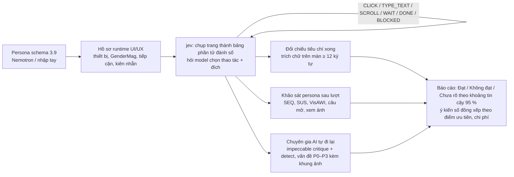

# Research: đánh giá UI/UX bằng persona (eval-insights) cho phase cuối EduPilot

Tech Lead, 2026-11-14, theo yêu cầu của chủ dự án qua PM. **Quyết định P-11-12 (PM):** dùng để **bổ sung** ở sprint 11. Không thay QC / E2E / axe, không đưa vào CI. Phiên bản công cụ được ghim: eval-insights `f0fa8ae0934c609f5fbf21b30fbdbfda7c5fd995`, jev-ultrafast `ea6887c919a6fadc26d344b98d54ac6662074efa`. Muốn đổi bản thì chạy lại PoC trước.
- Nguồn: repo private `Meihkod/eval-insights`, nhánh `tobicooo-20261111/uiux-crowd` @`f0fa8ae`. Bản clone chỉ đọc ở `~/Documents/eval-insights-ro`; không push, không đọc `.env` thật.
- Agent điều khiển trình duyệt dùng repo công khai `Kaistory/jev-ultrafast` @`ea6887c`.
- PoC ở `docs/research/poc/persona-eval/`.

## 0. Kết luận

**Nên dùng để bổ sung, không thay QC.** Đặt nó ở P10 thành một đợt chạy persona trên bản demo, chạy như công cụ ngoài, LLM đi qua 9router. Kết quả đưa vào cổng UX và luận văn. Công sức **M**: khoảng 2–3 ngày công cho một người, không đổi mã EduPilot.

Hệ thống chạy được trên Mac với 9router mà **không cần khoá trả phí**, nhưng phải có bốn miếng vá đặt **ngoài** mã của họ:
- shim 9router;
- tự ghi phiên đăng nhập;
- proxy đổi tên máy;
- nạp tác vụ có URL nội bộ.

Bốn miếng này nêu ở §3. Giá trị mới so với Playwright, axe và QC là phát hiện **chỗ người lạ bối rối**: không tìm thấy, hiểu sai chữ, bỏ cuộc. Nó còn cho **thang đo SUS / SEQ / VisAWI có khoảng tin cậy**. Đổi lại, nó không bắt lỗi chức năng tin cậy bằng E2E. Hệ thống cũng còn non: nhánh mới 6 ngày tuổi, thay đổi rất nhanh.

**PoC (2 persona, 5 lượt, chạy trên `ep-qc`):**
- **Sinh viên:** xong việc sau khi vòng qua 4 màn.
- **Giảng viên:** kẹt ở «Chấm bài».

Tech Lead đã kiểm bằng mã và ảnh: 8 vấn đề **thật**, chưa có spec / TC nào bắt. Gồm:
- «Hàng chờ» ghi «Chưa có bài nộp.» dù có 16 bài;
- lọc mất khi đổi tab;
- Markdown thô ở đề bài;
- mốc giờ mâu thuẫn trên trang bài tập;
- sinh viên không có mục «Bài tập».

Tổng 21 vấn đề khác nhau do công cụ nêu: 8 thật, 11 cần người kiểm, 2 ảo hoặc có thể ảo. Phải có người lọc trước khi thành việc.

## 1. Hệ thống làm gì

«Eval Platform V2» là nền tảng đánh giá **hành vi**: persona người Việt giả lập đi dùng một sản phẩm web, chatbot hoặc voicebot, rồi chấm điểm và tổng hợp báo cáo. Nhánh `uiux-crowd` thêm **nghiên cứu UI/UX số đông**: nhiều nhóm persona × nhiều tác vụ → một báo cáo gộp. Repo này còn nhiều mảng khác (red team, chấm chatbot, coding agent, voicebot SIP / ElevenLabs, Android). Research này chỉ xét mảng UI/UX.

### 1.1 Kiến trúc

| Lớp | Công nghệ | Ghi chú |
| --- | --- | --- |
| Backend | FastAPI, SQLAlchemy async, **SQLite** (WAL), Alembic, Jinja2 | Khoảng 45 nghìn dòng Python, 98 tệp test; việc nền chạy bằng `ThreadPoolExecutor` |
| Frontend | React 18, Vite 5, Tailwind, TanStack Query, Recharts | Khoảng 19 nghìn dòng TS; có màn live monitor qua WebSocket |
| Agent trình duyệt | `jev-ultrafast` + `browser-harness`, **Chrome DevTools Protocol** | **Không** dùng Playwright. Chrome headless riêng, cổng debug riêng |
| Docker | Chỉ ảnh `docker/streaming`: Chromium có giao diện + VNC | Dùng để xem trực tiếp và cho người dùng **đăng nhập tay** để lưu phiên. Bản thân ứng dụng chạy bằng `run.sh` (uv + npm), không có compose |
| Dữ liệu persona | Nemotron-Personas-Vietnam (NVIDIA, 1 triệu người, khoảng 2,2 GB parquet) | Bắt buộc cho nghiên cứu số đông (rút persona theo nghề, tuổi). Chạy lẻ thì nhập JSON tay |

### 1.2 Luồng persona → trải nghiệm → đánh giá → báo cáo



- **Persona:** dùng schema 3.9 gồm nhân khẩu, tính cách hội thoại, xu hướng quyết định. Phần UI/UX bổ sung:
  - `digital`: thiết bị, GenderMag (self-efficacy, xử lý thông tin, cách học), tiếng Anh, lo ngại riêng tư;
  - `accessibility`: thị lực, thính lực, vận động, nhận thức;
  - `behavior`: kiên nhẫn, chấp nhận rủi ro.

  Mỗi lượt chạy chỉ gửi đi những trường cần dùng.
- **Trải nghiệm:** mỗi vòng, jev đọc trang thành danh sách phần tử, mỗi phần tử có `role`, nhãn và thao tác hợp lệ. Sau đó nó hỏi một model «typed questions» (`choice` / `noul` / `score`) để chọn thao tác. Chữ cần gõ do một text model sinh. Lượt dừng khi `DONE`, `BLOCKED`, lặp ≥ 4 lần trên cùng trang hoặc hết ngân sách thao tác. **Ô mật khẩu, ô tệp, ô ẩn bị loại khỏi danh sách** (`snapshot.js`), nên persona không tự đăng nhập được.
- **Đánh giá:**
  - Xong việc: chỉ tính khi tiêu chí khớp với chữ trích trên màn.
  - SEQ 1–7, mốc 5,5.
  - SUS 0–100, mốc 68.
  - VisAWI 1–7 (18 câu), mốc 4,5.

  Kết luận theo khoảng tin cậy Wilson hoặc t. Dưới 5 mẫu thì ghi «Chưa đủ mẫu». Có thêm một «chuyên gia AI» đi lại tác vụ không mang persona và chạy bộ dò tất định của skill impeccable.
- **Báo cáo:**
  - Nhận xét được gom thành bảng mã. Điểm ưu tiên = 100 × (0,35·P + 0,30·S + 0,20·T + 0,15·E): tỉ lệ gặp (cận dưới Wilson), độ nặng, liên hệ với việc không xong, có ảnh dẫn chứng.
  - So sánh giữa các nhóm.
  - Chi phí theo từng lời gọi.
  - Xuất được một tệp HTML để mở offline.

### 1.3 Model

| Việc | Mặc định của họ | Thay được bằng |
| --- | --- | --- |
| Chọn thao tác | `jev-latest` của TypeSafe (**khoá trả phí**, 0,042 USD / 1 triệu token vào) | `typed_fallback`: model thị giác của bước chấm trả lời cùng dạng (`JEV_FALLBACK=llm`) |
| Gõ chữ | Claude Haiku 5.5 / OpenRouter / Antigravity / Claude CLI | Bất kỳ endpoint OpenAI-compatible nào (`TEXT_MODEL_BASE_URL`) |
| Khảo sát, chuyên gia, gom ý kiến | `uiux_llm`: V-LLM (VSF nội bộ), Claude API hoặc **Gemini trực tiếp** | Nhánh V-LLM là OpenAI-compatible + `json_schema` strict, nên trỏ sang 9router qua shim được (§3) |
| Báo cáo insight | Claude Code CLI (gói Pro / Max) | `CHAT_PROVIDER=antigravity` trỏ sang shim |

### 1.4 Đầu vào / đầu ra

- **Vào:** URL sản phẩm, vai (trang bắt đầu, cỡ màn), tác vụ (lời giao, ngân sách thao tác, tiêu chí xong chốt trước), nhóm persona, phiên đăng nhập đã lưu. Với nghiên cứu số đông, tất cả nằm trong `backend/app/data/studies/<tên>.json`.
- **Ra:**
  - Trace từng bước: ảnh trước thao tác có khung đánh số, phần tử đã chọn, độ tin.
  - Khảo sát của từng persona.
  - Đánh giá của chuyên gia AI: vấn đề P0–P3 có toạ độ khung trên ảnh.
  - Báo cáo gộp (web và HTML tĩnh), `data/usage/<eval>.jsonl`.

  Mọi thứ nằm ở `backend/data/` (SQLite + ảnh), git bỏ qua.

### 1.5 Độ trưởng thành

| Tín hiệu | Quan sát |
| --- | --- |
| Lịch sử nhánh | 89 commit từ 09/11 đến 10/11/2026, 4 người. Code đổi mỗi ngày: commit gần nhất sửa grammar VisAWI cho Claude, retry khi SQLite bận |
| Đã dùng thật | Vita Work (VSF), 10/11/2026: 60 persona × 10 tác vụ, 200 lượt, 46 phút, 0,35 USD. Đợt hai 230 lượt, 1,45 USD. Có so sánh người chấm (V-LLM với Haiku) |
| Kiểm thử | 98 tệp pytest; README và tài liệu kỹ (cách đo, công thức, giới hạn) |
| Điểm yếu | Một tiến trình; SQLite; bộ nhớ trong tiến trình. Nhiều mảng không liên quan trong cùng repo. Phụ thuộc repo agent ngoài theo đường dẫn tương đối `../../jev-ultrafast`. **`GEMINI.md` của nhánh có commit một khoá proxy cục bộ dạng rõ.** Tech Lead không chép khoá đó ra đây; nên báo chủ repo xoay khoá |
| Đánh giá | Công cụ nghiên cứu nội bộ còn đang lớn nhanh, không phải sản phẩm ổn định. Phương pháp đo (SUS, SEQ, VisAWI, Wilson, tiêu chí xong chốt trước) thì chặt và có nguồn |

## 2. Có triển khai được ở phase cuối EduPilot không

| Ràng buộc | Thực tế | Cách xử lý |
| --- | --- | --- |
| D46: EduPilot chỉ có Go + `docling` | Đây là ứng dụng Python + Node riêng, chạy trên máy dev, chỉ nói chuyện với EduPilot qua trình duyệt | **Đạt**, nếu coi nó là công cụ ngoài như `benchmarks/`: không vào compose, không thành service, không vào `deploy/` |
| LLM chỉ qua 9router, không Gemini trực tiếp | Họ không có nhánh 9router. Nhánh Gemini của họ gọi thẳng Google | Shim `router_shim.py` (thư viện chuẩn) giả làm V-LLM: cấp token giả, chép schema vào lời nhắc, ép `stream:false`. Đặt `UIUX_LLM_PROVIDER=vllm` và **không** đặt `GEMINI_API_KEYS` |
| Không khoá trả phí | jev của TypeSafe trả phí | Để trống `TYPESAFE_API_KEY`; agent tự chuyển sang `typed_fallback` (model 9router). Chậm hơn và kém hơn jev |
| PII | Persona là người giả. EduPilot chạy bằng tài khoản seed | **Đạt.** Ảnh chụp chỉ nằm trên máy. Tác vụ phải là đọc hoặc thao tác lên dữ liệu seed |
| Đăng nhập | jev giấu ô mật khẩu. Họ lưu phiên bằng container VNC (cần dựng ảnh Docker riêng). **Lỗi của họ:** `auth_sessions.load_for` dò tệp phiên bằng `range(len(parts) - 1)`, nên host một nhãn như `localhost` không bao giờ khớp. PoC đã gặp: persona luôn bị đưa về `/login` | `seed_session.py` đăng nhập EduPilot qua API, ghi cookie làm mới `ep_rt` vào tệp phiên đúng dạng của họ. `host_proxy.py` phục vụ EduPilot ở `http://ep.localhost:5800` (Chrome coi `*.localhost` là ngữ cảnh an toàn nên cookie `Secure` vẫn chạy; proxy đặt lại `Host` / `Origin` cho Caddy) |
| URL nội bộ | `url_guard` chặn `localhost` / mạng riêng khi tạo tác vụ qua API (chống SSRF cho SaaS) | PoC chèn tác vụ thẳng vào SQLite chạy của họ. Dùng thật thì xin họ một cờ cho phép URL cục bộ, hoặc dùng định nghĩa nghiên cứu |
| RAM Mac (18 GB; demo + 1 stack) | Backend khoảng 250 MB, Chrome khoảng 300–600 MB mỗi lượt song song | 1–2 lượt song song là vừa. Họ nói máy 16 GB chịu được khoảng 10 lượt khi không có stack khác |
| Nghiên cứu số đông | Cần 2,2 GB Nemotron để rút persona theo nghề | Tải một lần (dữ liệu mở). Chạy nhỏ thì nhập persona JSON tay |

## 3. PoC trên Mac (9router, không khoá trả phí)

Cách dựng, không sửa một dòng mã nào của họ:
1. `uv sync` trong `backend/`, Python 3.12, `.venv` khoảng 233 MB. Clone `jev-ultrafast` cạnh repo.
2. `router_shim.py` trên `127.0.0.1:20129`. Khoá 9router đọc từ `~/.9router`, không in, không ghi tệp. Model `ag/gemini-3.8-flash`.
3. Chạy `uvicorn` với biến môi trường: `UIUX_LLM_PROVIDER=vllm`, `VLLM_BASE_URL` / `VLLM_TOKEN_URL` trỏ shim, `JEV_FALLBACK=llm`, `TEXT_MODEL_BASE_URL` trỏ shim, `CHAT_PROVIDER=antigravity` trỏ shim, `ALLOW_SIGNUP=true`. Không đặt khoá TypeSafe, Anthropic, Gemini.
4. Nhập persona: dùng mẫu sẵn `PER-03` (sinh viên 21 tuổi, «gặp khó dễ bỏ ngang»), thêm `EP-GV-01` (giảng viên 47 tuổi, ngại công nghệ, ít kiên nhẫn).
5. `host_proxy.py` (`ep.localhost:5800` → `localhost:580`, stack `ep-qc`, dữ liệu seed). Chạy `seed_session.py <email> <workspace>` trước mỗi lượt.
6. Chèn tác vụ có `site_url = http://ep.localhost:5800/`. Rồi `POST /api/evaluations` với `config.eval_focus = "uiux"`, `uiux_engine = "vllm"`.

### 3.1 Kết quả

| Lượt | Persona | Kết quả | Ghi chú |
| --- | --- | --- | --- |
| 1 | PER-03, tự đăng nhập | `BLOCKED` sau 3 thao tác | Gõ được email, nhưng ô mật khẩu không có trong action space nên agent bỏ cuộc |
| 2–3 | PER-03, phiên lưu, host `localhost` | `BLOCKED` ở `/login` | Lỗi host một nhãn của họ (§2); token chưa bị dùng (đã thử `refresh` bằng tay: 200) |
| 4 | PER-03, phiên lưu, `ep.localhost` | **`DONE`**: 7 thao tác, 6 trang, 114 s | Hôm nay → Bài thi → Kết quả của tôi → Lịch → «Bài tập 03 … Đã nộp» → trang bài tập |
| 5 | EP-GV-01, giảng viên, phiên lưu | `BLOCKED` sau 42 thao tác, 952 s | Đổi lớp mặc định (KC106) sang 761987 → Chấm bài → **lặp 18 vòng giữa tab «Hàng chờ» và «Bài tập»** → phiên hết, bị đưa về `/login` |

**Lượt sinh viên (4).** Thang đo: SEQ 4/7, SUS 72,5. Persona tự nêu: «Thanh điều hướng bên trái không có mục Bài tập riêng khiến tôi phải bấm thử nhiều trang». Chuyên gia AI (cùng model, tự đi lại) nêu 9 vấn đề. Tech Lead đối chiếu từng vấn đề với ảnh và chữ trên trang:

| Vấn đề do công cụ nêu | Mức | Tech Lead kiểm | Kết luận |
| --- | --- | --- | --- |
| Sinh viên không có mục «Bài tập» trên thanh bên | P1 | Đúng: vai sinh viên trong `nav.ts` chỉ có Hôm nay, Chat riêng, Hỏi đáp, Luyện đề, Bài thi, Thư viện, Lịch, Kết quả của tôi. Đây là **thiết kế có chủ ý**: `shell.spec.ts` khoá đúng danh sách này | **Thật, nhưng là quyết định thiết kế**, nên QC không thể bắt. Cả persona lẫn chuyên gia đều vấp; chuyển PM / BA cân nhắc |
| Đề bài hiện Markdown thô (`# Bài tập 03`, `## Yêu cầu nộp`) | P2 | Đúng: chữ trên trang và ảnh đều có `##`. `markdown.spec.ts` chỉ thử bộ phân tích, không thử trang bài tập của sinh viên | **Thật** |
| Đầu trang ghi «Thứ Ba, 10/11 · 18:46 · đã quá hạn 4 ngày», cuối trang ghi «Đã nộp Thứ Ba, 10/11 · 18:46 · Nộp muộn 1 ngày» | P2 | Đúng: hai dòng dùng cùng một mốc giờ cho hai nghĩa khác nhau | **Thật**, loại «số liệu mâu thuẫn» |
| Nút ở «Việc nên làm tiếp» lặp nguyên tiêu đề thay vì là động từ | P3 | Đúng (ảnh màn Hôm nay) | **Thật**, trái `DESIGN.md` («nút là động từ») |
| «Kết quả của tôi» hiện chuỗi công thức thô | P3 | Chưa kiểm hết | Cần QC xem |
| Trang bài tập thiếu khối trạng thái nộp / điểm ở đầu trang | P1 | Trạng thái có, nhưng ở cuối trang | Một phần: đặt chỗ, không phải thiếu |
| Vẫn cho «Nộp lại» khi đã quá hạn nộp muộn tối đa | P2 | Nút đang mờ vì chưa chọn tệp; chưa rõ máy chủ có nhận không | Cần QC kiểm, có thể ảo |
| Không có liên kết tới tệp đã nộp | P2 | Đúng là không có | Cần BA xác nhận có phải yêu cầu không |
| Trang 404 khi mở đầu | P2 | Do Tech Lead đặt URL bắt đầu sai (`/today`) | **Ảo do cách chạy** |

Tỉ lệ: 9 vấn đề → 4 thật, 4 cần người kiểm, 1 ảo. Lỗi Markdown thô và lỗi mốc giờ lọt qua E2E vì không spec nào mở trang này bằng vai sinh viên. axe / Lighthouse cũng không bắt được hai lỗi này. Lỗi thiếu mục «Bài tập» thì spec còn **khẳng định** là đúng, nên chỉ phép thử bằng người lạ mới làm nó lộ ra.

**Lượt giảng viên (5).** Đây đúng là loại lỗi `giaovien` vừa gặp:
- Tab «Hàng chờ» với lọc mặc định «Chưa duyệt» ghi «**Chưa có bài nộp.**».
- Tab «Bài tập» ngay bên cạnh ghi BT03 «Đã nộp / Tổng **16 / 30**», «Đã chấm 0 / 0».

Persona đi qua đi lại giữa hai tab để tìm cách khớp hai con số, rồi hết thao tác. Tech Lead đã đọc mã: `QueueTab.tsx:174` và `:420` hiện «Chưa có bài nộp.» mỗi khi danh sách **sau lọc** rỗng, bất kể đã có bài nộp chưa được chấm. **Thật**: đây là trạng thái rỗng sai nghĩa, loại «số liệu mâu thuẫn giữa các màn».

Lượt này cũng phơi ra hai điểm yếu của công cụ:
- Agent dự phòng kẹt vòng lặp hai trạng thái, mà bộ dò lặp của họ (≥ 4 lần một thao tác trong 8 lần) không bắt được, nên tốn 42 lời gọi.
- Phiên EduPilot bị đăng xuất sau khoảng 15 phút. Tech Lead nghi do xoay vòng refresh token, chưa xác minh.

Khảo sát của persona: SEQ 2/7, SUS 40. Câu tự nêu: «Tab Hàng chờ hiển thị "Chưa có bài nộp" dù danh sách Bài tập ghi nhận có 16 bài nộp». Chuyên gia AI nêu 11 vấn đề. Tech Lead kiểm các vấn đề chính:

| Vấn đề do công cụ nêu | Mức | Tech Lead kiểm | Kết luận |
| --- | --- | --- | --- |
| «Hàng chờ» báo «Chưa có bài nộp.» dù đã có 16 bài | P1 | Đúng (mã + ảnh) | **Thật** (cả persona lẫn chuyên gia) |
| Lọc «Bài tập» ở «Hàng chờ» về mặc định mỗi khi đổi tab | P2 | Trace: persona phải chọn lại BT03 sau mỗi lần quay về tab | **Thật**, và chính là lý do của vòng lặp |
| Hai nút «Tải bài lên» cùng lúc khi hàng chờ rỗng | P3 | Đúng (ảnh) | **Thật**, trái luật «một hành động chính» |
| «Đã công bố» vừa là trạng thái bài tập, vừa là cột điểm | P2 | Đúng (ảnh tab Bài tập) | **Thật** (chữ gây nhầm) |
| «Hôm nay» ghi 9 việc nhưng danh sách có 7 | P1 | Chưa kiểm | Cần QC xem |
| «Chấm tất cả» bị khoá mà không có lý do | P2 | Mã có `disabledReason`, nhưng ảnh không thể hiện tooltip | Có thể ảo |
| Thanh bên quá nhiều mục ngang hàng; bảng điểm hẹp | P2 | Ý kiến thiết kế | Cần BA / PM xem |

**Độ tin của người chấm.** Ở lượt 1, persona chưa vào được trong mà vẫn cho SUS 82,5 và khen «giao diện sáng sủa». Khảo sát sau một lượt hỏng nên bị loại khỏi thống kê. Họ đã loại lỗi hạ tầng và `tool_stuck`, nhưng chưa loại `BLOCKED` ở trang đăng nhập.

**Chi phí đo được** (`shim-usage.jsonl`, 5 lượt + 5 lần khảo sát / chuyên gia):
- 137 lời gọi 9router (`ag/gemini-3.8-flash`), 1,67 triệu token vào, 95 nghìn token ra.
- Trễ p50 12 s / lời gọi, p90 37 s.
- Lượt sinh viên thành công mất khoảng 2 phút đi + khoảng 4 phút chấm / chuyên gia; lượt giảng viên kẹt mất 16 phút.
- Log backend (mức WARNING) không có lỗi; không lượt nào hỏng vì JSON qua shim.
- Không tốn tiền: 9router `ag/*` theo gói.

Bộ dò tất định của họ (`impeccable detect`) không chạy vì máy thiếu skill ở `~/.claude/skills/impeccable`; phần chuyên gia vẫn chạy bằng ảnh. Ước cho đợt P10 (khoảng 80 lượt): khoảng 1.500–2.500 lời gọi, 6–10 giờ với 1–2 lượt song song.

## 4. Giá trị so với cách kiểm hiện tại

| Loại lỗi | Playwright E2E | axe / Lighthouse | QC agent (đọc TC, chạy E2E) | Đợt 9.1 (chuyên gia rà theo `DESIGN.md`) | **Persona** |
| --- | --- | --- | --- | --- | --- |
| Hỏng chức năng trên đường đã biết | **Mạnh** | – | **Mạnh** | Yếu | Yếu: không biết là lỗi hay persona bấm sai |
| WCAG máy đo được (tương phản, nhãn, vai ARIA) | – | **Mạnh** | Có, qua spec a11y | Có | Một phần (persona khiếm thị là mô phỏng) |
| Hiệu năng, LCP, CLS | Một phần | **Mạnh** | – | – | – |
| Lệch spec / AC | Theo TC | – | **Mạnh** | Có | – |
| **Không tìm thấy chức năng**: nhãn lạ, chỗ đặt sai, lọc mặc định che dữ liệu | – | – | Yếu: biết trước đường đi | Có, theo cảm nhận một người | **Mạnh**: người lạ không biết đường, có tỉ lệ «không xong» kèm khoảng tin cậy |
| **Chữ khó hiểu / từ kỹ thuật** lọt tới sinh viên (`DESIGN.md` §13) | – | – | Theo danh sách cấm | Có | **Mạnh**: persona ít rành công nghệ nói thẳng chỗ khó |
| **Số liệu mâu thuẫn giữa các màn** | Chỉ khi có assert | – | Chỉ khi TC hỏi | Tình cờ | Có, khi tác vụ buộc đối chiếu (tiêu chí xong trích chữ trên màn) |
| Ngõ cụt, vòng lặp, không có phản hồi sau khi bấm | Khi assert | – | Một phần | Có | **Mạnh**: trace phát hiện lặp ≥ 4 lần, `BLOCKED` |
| Số đo hài lòng cho luận văn (SUS / SEQ) | – | – | – | – | **Chỉ có ở đây** (mô phỏng, phải ghi rõ giới hạn) |

**Không thay QC**, vì ba lẽ:
- **Âm tính giả:** persona bỏ cuộc vì agent kém, không vì UI. Họ phải dành hẳn mã `AGENT_ARTIFACT` cho trường hợp này.
- **Dương tính ảo:** model chấm có thể «chê» khi không có căn cứ.
- **Không chạy được mọi luồng:** tải tệp (ô tệp bị giấu), camera, mật khẩu đều không đi được.

Loại lỗi `giaovien` vừa gặp (lọc mặc định che bài, số đếm sai) đúng là vùng mạnh của persona. Nhưng muốn bắt được, tác vụ phải được viết thành **câu hỏi có đáp án trên màn**. Ví dụ «Bài tập 03 còn bao nhiêu bài chờ duyệt?», với tiêu chí xong là con số đúng.

## 5. Khuyến nghị

**Dùng, ở mức bổ sung. Công sức M.** Không đổi mã EduPilot; không thêm thư viện vào EduPilot.

1. **P10, sau khi demo đóng băng tính năng.** Mỗi vai một nhóm: sinh viên 375 px, giảng viên 1440 px, TA, admin. Mỗi vai 3–5 tác vụ lấy từ `FLOWS.md`, ưu tiên các luồng chỉ đọc hoặc chỉ ghi lên dữ liệu seed. Mỗi nhóm 5–10 persona, tổng khoảng 60–100 lượt.
   - Tác vụ viết dạng «tìm / trả lời», tiêu chí xong là chữ trên màn.
   - Tránh tải tệp và mật khẩu.
2. **Đưa vào repo EduPilot** thư mục `benchmarks/persona/`, chỉ gồm công cụ ngoài:
   - `router_shim.py`, `seed_session.py`;
   - định nghĩa nghiên cứu `edupilot.json`;
   - `run.sh` dựng clone và ghim commit của họ;
   - README.

   Báo cáo HTML xuất về `benchmarks/reports/persona/`.
3. **Ai làm gì:**
   - Tech Lead dựng công cụ (S–M).
   - BA viết tác vụ và tiêu chí xong từ `FLOWS.md`.
   - QC đọc báo cáo, lọc `AGENT_ARTIFACT` / ảo, rồi chuyển thành lỗi.
   - PM duyệt việc nào vào P10.
4. **Luận văn:** trình bày như «đánh giá khả dụng mô phỏng», cạnh E2E và axe. Không thay khảo sát người thật.

| Rủi ro | Mức | Giảm |
| --- | --- | --- |
| Công cụ không phải của ta: repo private, nhánh đổi hằng ngày | Cao | Ghim commit; chỉ dùng qua HTTP API và thư mục dữ liệu; không vá mã họ |
| Ba miếng vá (shim, phiên, URL nội bộ) vỡ khi họ đổi mã | Trung bình | Xin họ hỗ trợ chính thức: provider OpenAI-compatible có khoá tĩnh, cờ cho URL nội bộ |
| Agent dự phòng kém hơn jev, ra tỉ lệ «không xong» do agent | Cao | Đọc trace trước khi tin số; gắn `AGENT_ARTIFACT`; chạy thử 1 persona mỗi tác vụ trước |
| Hạn mức 9router: mỗi bước 1 lời gọi thị giác | Trung bình | ≤ 2 lượt song song; 100 lượt × khoảng 15 bước = khoảng 1.500 lời gọi, cần vài giờ; chạy qua đêm |
| Phiên đăng nhập: `ep_rt` xoay vòng, một token cho nhiều lượt có thể bị thu hồi | Trung bình | Ghi phiên trước mỗi lượt (`seed_session.py`), hoặc mỗi persona một tài khoản seed |
| Khoá lộ trong repo của họ (`GEMINI.md`) | Thấp với ta | Không chép, không dùng; báo chủ repo |
| Ghi dữ liệu lên demo | Thấp | Chạy trên stack test (`ep-qc`), không chạy trên `edupilot` demo; tác vụ chỉ đọc |

**Không khuyến nghị:**
- Thay QC hoặc E2E bằng persona.
- Gắn công cụ này vào CI. Nó chậm, không tất định và cần 9router.
- Dùng jev trả phí.

## Phụ lục: chạy lại PoC

```bash
# một lần
gh repo clone Meihkod/eval-insights ~/Documents/eval-insights-ro -- -b tobicooo-20261111/uiux-crowd --single-branch
git -C ~/Documents/eval-insights-ro checkout -q f0fa8ae0934c609f5fbf21b30fbdbfda7c5fd995   # ghim (P-11-12)
git clone -b feat/custom-url-scenario https://github.com/Kaistory/jev-ultrafast ~/Documents/jev-ultrafast
git -C ~/Documents/jev-ultrafast checkout -q ea6887c919a6fadc26d344b98d54ac6662074efa         # ghim
(cd ~/Documents/eval-insights-ro/backend && UV_PYTHON=3.12 uv sync)
# mỗi lần (ba tiến trình)
P=docs/research/poc/persona-eval
SHIM_MODEL=ag/gemini-3.8-flash python3 $P/router_shim.py &   # :20129 → 9router
python3 $P/host_proxy.py &                                    # ep.localhost:5800 → localhost:580
cd ~/Documents/eval-insights-ro/backend && ALLOW_SIGNUP=true UIUX_LLM_PROVIDER=vllm \
  VLLM_BASE_URL=http://127.0.0.1:20129/v1 VLLM_TOKEN_URL=http://127.0.0.1:20129/oauth/token \
  VLLM_CLIENT_ID=shim VLLM_CLIENT_SECRET=shim VLLM_MODEL=ag/gemini-3.8-flash JEV_FALLBACK=llm \
  TEXT_MODEL_PROVIDER=openrouter TEXT_MODEL_BASE_URL=http://127.0.0.1:20129/v1 TEXT_MODEL_API_KEY=shim \
  TEXT_MODEL=ag/gemini-3.8-flash CHAT_PROVIDER=antigravity ANTIGRAVITY_BASE_URL=http://127.0.0.1:20129/v1 \
  ANTIGRAVITY_API_KEY=shim ANTIGRAVITY_MODEL=ag/gemini-3.8-flash INTENT_VERIFIER_PROVIDER=chat \
  MAX_CONCURRENT_TRIALS=1 CHROME_DEBUG_PORT=9333 JEV_VIEWPORT_WIDTH=1440 JEV_VIEWPORT_HEIGHT=900 \
  CHAT_TURNS_MIN=0 CHAT_TURNS_MAX=0 .venv/bin/uvicorn app.main:app --port 8000
# đăng ký tài khoản eval-insights (POST /api/auth/register), lấy workspace (GET /api/auth/me), rồi trước mỗi lượt:
python3 $P/seed_session.py sv.kha@edupilot.local <workspace_id>
# tác vụ: chèn hàng vào backend/data/eval_platform.db (bảng tasks, site_url http://ep.localhost:5800/), rồi
# POST /api/evaluations {task_id, persona_ids, config:{eval_focus:"uiux", uiux_engine:"vllm"}}
```

Mỗi tác vụ cần một tài khoản eval-insights riêng cho từng vai: phiên lưu theo (workspace, host).
