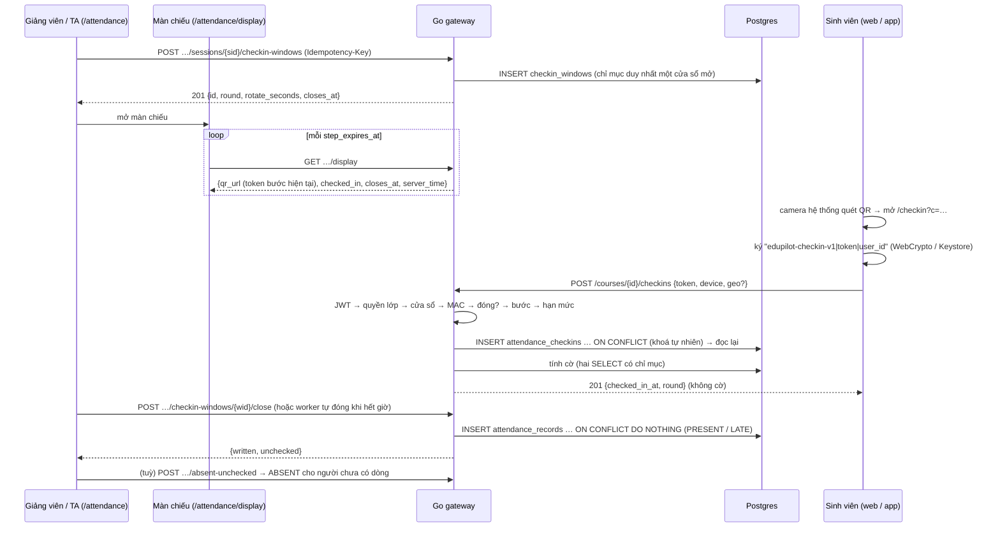
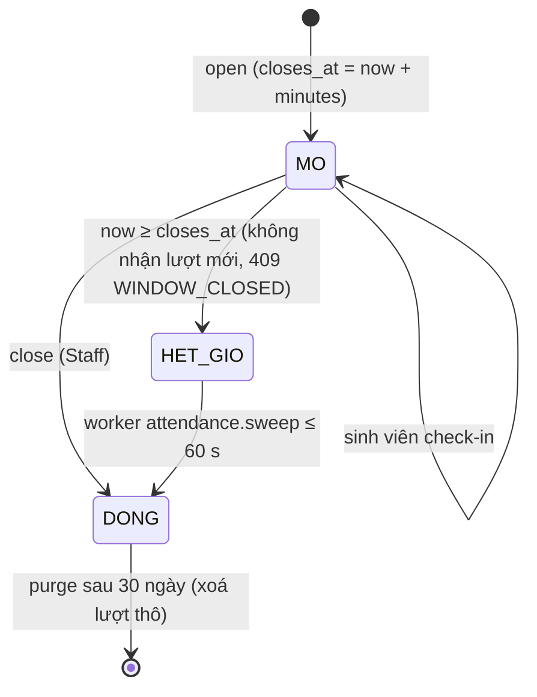

# SRS FEAT-attendance-selfcheck Điểm danh tự phục vụ chống gian lận (web + app Android)
Phiên bản 1.0 · 2026-11-14 · Trạng thái: **DRAFT** (chờ PM duyệt; câu CHỜ PM ở `QUESTIONS.md` Q-A-1, Q-A-2)

Nguồn: `US.md` (US-AS-01…14), PRD M5, FLOWS F7 + F7b, `docs/sprints/10.8/techlead.md` TL-1, `docs/research/2026-11-14-attendance-anti-cheat.md` (viết tắt «research»), **P-108-1**. Phần lệch có chủ đích so với research ghi ở mục 10.

## 1. Mục đích và phạm vi

Cho sinh viên tự điểm danh trong giờ bằng điện thoại (web hoặc app Android), với 5 lớp chống gian lận mà **chỉ gắn cờ, không tự phạt**:
1. mã QR xoay vòng 10 s kiểm bằng HMAC, không trạng thái;
2. khoá thiết bị ký từng lượt (WebCrypto trên web; Android Keystore + Key Attestation trong app);
3. vị trí / IP trường **tuỳ chọn theo lớp, mặc định tắt**;
4. đối chiếu do người làm: đếm đầu người, vòng 2, gọi tên ngẫu nhiên;
5. cờ bất thường cho giảng viên / TA.

Kết quả đóng cửa sổ ghi vào `attendance_records` có sẵn; lưới điểm danh tay, khoá `version` và `audit_log` của `FEAT-crm-360` giữ nguyên. Web và app dùng **một** API; không service mới (D46), không thư viện Go mới.

**Trong phạm vi:** migration `00024_attendance_checkin.sql` (3 bảng), package `internal/attendance`, 12 route mới + mở rộng `PUT …/settings`, `GET /courses/{id}/me/attendance`, `GET /me/today`; màn `/attendance` (mở rộng), `/attendance/display`, `/checkin`; PWA manifest; vỏ Capacitor Android `mobile/`; plugin Kotlin; kiểm Key Attestation bằng stdlib; việc nền `attendance.sweep`, `attendance.purge`; seed, E2E, k6.

**Ngoài phạm vi:** selfie / sinh trắc, chặn chụp màn hình, NFC, BLE, mã số đọc to, iOS native, Play Integrity, App Attest, ML Kit, thông báo đẩy, SSE, tự phạt, đọc «cùng máy với ai».

**Mục tiêu tải (T1):** 200 SV / 30 s ≈ 7 req/s; dồn 5 s ≈ 40 req/s. PoC: 200 lượt kiểm mã + chữ ký song song 1,7 ms.

## 2. Người dùng và quyền

`Member` / `Staff` theo guard lớp (`FEAT-course-foundation` 4.1). **ADMIN bị từ chối ở mọi route lớp** (D39).

| # | Hành động | STUDENT | TA | TEACHER | ADMIN |
| --- | --- | --- | --- | --- | --- |
| 1 | `PUT …/settings {attendance}` | 403 | 403 | ✓ | 403 |
| 2 | `GET /courses/{id}` — chính sách đầy đủ | chỉ `self_checkin`, `require` | ✓ | ✓ | 403 |
| 3 | Mở / đóng cửa sổ, `display`, `PATCH headcount`, liệt kê cửa sổ | 403 | ✓ | ✓ | 403 |
| 4 | `spot-check`, `absent-unchecked` | 403 | ✓ | ✓ | 403 |
| 5 | `GET …/checkins`, `clear-flags` | 403 | ✓ | ✓ | 403 |
| 6 | `POST /courses/{id}/checkins` | ✓ (chính mình) | 403 | 403 | 403 |
| 7 | `POST /me/devices/challenge`, `POST /me/devices` | ✓ (chính mình) | 403 | 403 | 403 |
| 8 | `GET /courses/{id}/me/attendance` (`checked_in_at`) | ✓ (chính mình) | 403 | 403 | 403 |
| 9 | Mục `CHECKIN_REVIEW` ở `GET /me/today` | không có | ✓ | ✓ | – |
| 10 | Thấy cờ, mức tin cậy, `geo_distance_m`, `in_campus` | **không bao giờ** | ✓ | ✓ | – |

Người ngoài lớp: `404` cho mọi route có `{id}` của lớp (không lộ lớp tồn tại). Không JWT: `401`.

**Nguyên tắc dữ liệu (luật cứng, kiểm bằng test):**
- Sinh viên không thấy cờ / `assurance` / thiết bị / vị trí đã lưu qua API, giao diện, AI (`get_my_attendance` không đổi), thông báo, thư.
- Danh tính lấy từ JWT; thân yêu cầu không có `student_id`.
- Không toạ độ, IP, `token`, `signature`, `public_key` trong DB (trừ khoá công khai của thiết bị), log, `audit_log`.
- Điểm danh là dữ liệu điểm: audit mọi thay đổi do Staff; **không cache phía máy chủ** (luật 15): `Cache-Control: no-store` ở `display`, `checkins`, `me/attendance`.
- `internal/grade` không đọc dữ liệu của feature này (chỉ `attendance_records` như cũ).

## 3. Luồng chính và các nhánh lỗi

### 3.1 Mở cửa sổ → quét → đóng



### 3.2 Vòng 2 và cờ `RECHECK_MISS`

```mermaid
sequenceDiagram
  participant GV as Giảng viên
  participant GW as Go gateway
  participant SV as Sinh viên
  GV->>GW: mở vòng 2 (lúc tuỳ ý; không thông báo cho sinh viên)
  SV->>GW: POST checkins (vòng 2)
  GV->>GW: close vòng 2
  GW->>GW: UPDATE lượt vòng 1 của người không có lượt vòng 2: thêm cờ RECHECK_MISS
  GW-->>GV: danh sách «Cần xem» cập nhật
```

### 3.3 Đăng ký thiết bị app và chứng thực

```mermaid
sequenceDiagram
  participant APP as App Android
  participant GW as Go gateway
  participant RD as Redis
  APP->>GW: POST /me/devices/challenge
  GW->>RD: SET ep:dev:chal:{uid} nonce EX 300
  GW-->>APP: {nonce}
  APP->>APP: sinh khoá Keystore, setAttestationChallenge(nonce)
  APP->>GW: POST /me/devices {kind, public_key, attestation_chain[]}
  GW->>RD: GETDEL ep:dev:chal:{uid}
  GW->>GW: chuỗi → gốc Google · challenge = nonce · gói + vân tay APK · TEE/StrongBox · rootOfTrust · thu hồi
  GW-->>APP: 201 {key_id} (boot_verified lưu lại; UNVERIFIED vẫn đăng ký)
```

### 3.4 Vòng đời cửa sổ



### 3.5 Bảng nhánh lỗi

| Tình huống | Hệ thống phản ứng | Người dùng thấy |
| --- | --- | --- |
| Lớp tắt `self_checkin` | `409 SELF_CHECKIN_DISABLED` | SV: «Lớp này không điểm danh bằng mã.» · Staff: không có nút |
| MAC sai / cửa sổ lạ / lớp khác / sai cú pháp | `422 TOKEN_INVALID` (không phân biệt) | «Mã không đúng. Quét lại mã trên màn chiếu.» |
| MAC đúng, `step` ngoài hai bước | `422 TOKEN_EXPIRED` | «Mã đã hết hạn. Quét lại mã trên màn chiếu.» |
| Cửa sổ đã đóng / quá `closes_at` (MAC đúng) | `409 WINDOW_CLOSED` | «Đã đóng điểm danh.» |
| SV chưa ghi danh `ACTIVE` | `403 NOT_IN_COURSE` | «Bạn không thuộc lớp này.» |
| TA / TEACHER / ADMIN gọi route SV | `403` | Màn chặn chuẩn |
| Quá 10 lượt / phút / người | `429` + `Retry-After` | «Thử lại sau {n} giây.» |
| Gửi lại cùng lượt (F5, hai tab, mạng chập chờn) | `200` cùng bản ghi cũ | «Đã điểm danh 07:03» |
| Tín hiệu bất thường (máy, vị trí, IP, app) | **Vẫn `201`**, thêm cờ | Giống hệt lượt bình thường |
| Chữ ký hỏng / không có WebCrypto | `201`, cờ `DEVICE_UNTRUSTED` / `NO_DEVICE_KEY` | Giống hệt |
| Mở cửa sổ khi đã có cửa sổ mở | `409 WINDOW_ALREADY_OPEN {window_id}` | «Đang có cửa sổ mở» + `Mở màn chiếu` |
| Mở vòng thứ 4 | `409 ROUND_LIMIT` | Nút ẩn / báo một dòng |
| `close` lần hai | `200` kết quả cũ | Như lần đầu |
| `absent-unchecked` khi còn cửa sổ mở / chưa có cửa sổ | `409 WINDOW_OPEN` / `409 NO_WINDOW` | Một dòng tại nút |
| `PUT …/attendance complete:true` còn SV chưa có dòng (buổi có cửa sổ) | `422 CHECKIN_UNRESOLVED {count}` | `InlineNotice` «Còn {n} sinh viên chưa điểm danh» + `Đánh vắng {n} SV chưa điểm danh` |
| Lưới: `version` cũ | `409 VERSION_CONFLICT` (như cũ) | Giữ / lấy theo từng dòng (như cũ) |
| Lớp lưu trữ | `409 COURSE_ARCHIVED` ở mọi ghi | Một dòng |
| Nonce thiết bị sai / hết hạn | `422 DEVICE_CHALLENGE_INVALID` | App thử lại tự động một lần |
| Chuỗi chứng thực giả / APK lạ / bị thu hồi | `422 ATTESTATION_FAILED` | App điểm danh như web (mức 1) |
| Danh sách thu hồi không tải được, chưa có bản đệm | `503 ATTESTATION_UNAVAILABLE` (chỉ đăng ký) | App điểm danh như web, thử đăng ký lại sau |
| Mất mạng khi `close` | Hàng đợi cục bộ, `Idempotency-Key` cũ | «Chưa đóng» + tự thử lại |
| Mất mạng ở màn chiếu | Giữ QR cuối, thử lại | «Mất kết nối» |
| Gateway khởi động thiếu `ATTENDANCE_TOKEN_KEY` (cờ bật) | Gateway không chạy, nêu tên biến | – |

## 4. Yêu cầu chức năng

### 4.1 Hằng số và cấu hình (mỗi giá trị có tên; sai kiểu → gateway không chạy và nêu tên biến)

| Biến | Mặc định | Ý nghĩa |
| --- | --- | --- |
| `ATTENDANCE_SELF_CHECKIN_ENABLED` | `true` | công tắc cứng toàn hệ thống (cờ lớp vẫn mặc định tắt) |
| `ATTENDANCE_TOKEN_KEY` | (bắt buộc khi bật; 32 byte, base64) | khoá gốc suy ra `K_w`; xoay khoá chỉ làm hỏng cửa sổ đang mở; compose dev có giá trị cố định, production phải khác |
| `CHECKIN_ROTATE_DEFAULT` / `_MIN` / `_MAX` | `10` / `5` / `60` (giây) | chu kỳ đổi mã |
| `CHECKIN_WINDOW_MINUTES_R1` / `_R2` / `_MAX` | `10` / `3` / `60` | thời lượng mở mặc định vòng 1 / vòng ≥ 2 / trần |
| `CHECKIN_MAX_ROUNDS` | `3` | số vòng tối đa mỗi buổi |
| `CHECKIN_LATE_AFTER_DEFAULT_MIN` | `15` (miền 0–120) | quá `starts_at + N phút` → `LATE` |
| `TOKEN_LATE_EXTRA_MS` | `5000` | cờ `TOKEN_LATE` khi tuổi mã > `rotate × 1000 + 5000` (hiệu chỉnh ở L1 theo dữ liệu thật) |
| `GEO_MAX_ACCURACY_M` | `100` | quá ngưỡng → `GEO_WEAK` |
| `GEO_RADIUS_MIN_M` / `_MAX_M` | `20` / `2000` | miền `geofence.radius_m` |
| `CAMPUS_CIDR_MAX` | `10` | số CIDR mỗi lớp |
| `HEADCOUNT_TOLERANCE` | `max(2, ⌈5 % × headcount⌉)` | dung sai `OVER_HEADCOUNT` |
| `SPOT_CHECK_DEFAULT` / `_MAX` | `5` / `10` | số người gọi ngẫu nhiên |
| `CHECKIN_RATE_PER_MIN` | `10` | lượt / người / phút (`POST …/checkins`) |
| `DISPLAY_RATE_PER_MIN` | `30` | `GET …/display` / người / phút |
| `DEVICE_CHALLENGE_RATE_PER_MIN` / `DEVICE_CHALLENGE_TTL_S` | `5` / `300` | thử thách đăng ký thiết bị |
| `CHECKIN_SWEEP_INTERVAL_S` | `60` | nhịp worker đóng cửa sổ hết giờ |
| `CHECKIN_REVIEW_DAYS` | `7` | mục «Hôm nay» `CHECKIN_REVIEW` tồn tại tối đa bấy nhiêu ngày sau khi đóng |
| `CHECKIN_RAW_RETENTION_DAYS` | `30` | giữ lượt thô / thiết bị (P-108-1 Q9) |
| `ATTESTATION_PACKAGE` / `ATTESTATION_CERT_SHA256` | (bắt buộc khi `mobile/` được dựng) | tên gói và vân tay chứng chỉ ký APK mong đợi |
| `ATTESTATION_REVOCATION_TTL_H` | `24` | thời gian đệm danh sách thu hồi |
| `APP_PUBLIC_URL` | có sẵn | gốc của `qr_url` |
| `APP_SERVER_URL` | (chỉ `mobile/`) | `server.url` của Capacitor; = gốc web |

### 4.2 `internal/attendance` — cửa sổ và mã

**FR-1 (chính sách lớp).** Hệ thống phải lưu `courses.settings.attendance = {self_checkin:false, rotate_seconds:10, late_after_min:15, require:"WEB", geofence?:{lat,lng,radius_m}, campus_cidrs?:[]}` qua `PUT …/settings` có sẵn (khoá `version`, `audit_log` không chứa toạ độ, outbox `course.settings_changed`); mở rộng `SettingsIn` với con trỏ `*AttendanceIn`. → US-AS-01 AC1–AC6.

**FR-2 (mở cửa sổ).** `POST …/sessions/{sid}/checkin-windows {minutes?}`: kiểm quyền Staff; lớp không lưu trữ, `self_checkin=true`; buổi thuộc lớp; **một giao dịch**: nếu cửa sổ trước đã quá `closes_at` mà chưa đóng → đóng nó bằng FR-6 trong cùng giao dịch; `round = max(round)+1` ≤ `CHECKIN_MAX_ROUNDS`; `INSERT` (chỉ mục duy nhất một phần `(course_id, session_id) WHERE closed_at IS NULL` ⇒ `WINDOW_ALREADY_OPEN`); ghim `rotate_seconds` từ chính sách; `Idempotency-Key` bắt buộc (khoá Redis như `FEAT-assignments`); `audit_log` `checkin_window.open`. Vòng ≥ 2: **không** phát outbox / thông báo nào tới sinh viên. → US-AS-02 AC1–AC3.

**FR-3 (mã).** `token = window_id + "." + step + "." + base32(HMAC-SHA256(K_w, decimal(step)))[:16]`, `K_w = HMAC-SHA256(ATTENDANCE_TOKEN_KEY, "att-v1|" + window_id)`, `step = ⌊unix_s / rotate_seconds⌋`; nhận `step ∈ {s, s−1}`; `token_age_ms = now_ms − step × rotate × 1000`. Không lưu bí mật theo buổi; so MAC bằng `hmac.Equal`. → US-AS-03 AC2.

**FR-4 (màn chiếu).** `GET …/checkin-windows/{wid}/display` → `{qr_url, step_expires_at, server_time, rotate_seconds, round, checked_in, headcount, closes_at}`; `qr_url = APP_PUBLIC_URL + "/checkin?c=" + courseId + "#" + token`; `checked_in` = `count(distinct student_id)` của cửa sổ; `no-store`; cửa sổ đã đóng / quá hạn → `409 WINDOW_CLOSED`; hạn mức `DISPLAY_RATE_PER_MIN`. Không SSE. → US-AS-02 AC4, AC8.

**FR-5 (số đầu người, liệt kê).** `PATCH …/checkin-windows/{wid} {headcount}`; `GET …/sessions/{sid}/checkin-windows`; `over_headcount` tính khi đọc. → US-AS-02 AC5–AC6; US-AS-07 AC1.

**FR-6 (đóng).** `close(wid)`: `SELECT … FROM class_sessions WHERE course_id AND id FOR UPDATE` (cùng thứ tự khoá với `PUT …/attendance`), khoá hàng cửa sổ; đã đóng → trả kết quả đã lưu; chưa → đặt `closed_at`, `closed_by`; chạy **một câu**:

```sql
INSERT INTO attendance_records (course_id, session_id, student_id, status, marked_by, version)
SELECT c.course_id, c.session_id, c.student_id,
       CASE WHEN min(c.created_at) > s.starts_at + make_interval(mins => $late) THEN 'LATE' ELSE 'PRESENT' END,
       $actor, 1
FROM attendance_checkins c JOIN class_sessions s ON s.course_id = c.course_id AND s.id = c.session_id
WHERE c.course_id = $1 AND c.session_id = $2
GROUP BY c.course_id, c.session_id, c.student_id, s.starts_at
ON CONFLICT (course_id, session_id, student_id) DO NOTHING;
```

Vòng ≥ 2: thêm `RECHECK_MISS` (FR-14). Trả `written{present,late}`, `unchecked`, `skipped_existing`; `audit_log` `checkin_window.close` (số đếm). `$actor` = `closed_by`, hoặc `opened_by` khi tự đóng. **Không bao giờ** tạo `ABSENT`. → US-AS-05 AC1–AC4, AC8.

**FR-7 (tự đóng).** Việc nền `attendance.sweep` mỗi `CHECKIN_SWEEP_INTERVAL_S`: với cửa sổ `closed_at IS NULL AND closes_at < now()` chạy FR-6 (`closed_by NULL`, `audit_log` `checkin_window.auto_close`); idempotent, an toàn trên N gateway (`FOR UPDATE SKIP LOCKED`). → US-AS-02 AC7.

**FR-8 (đánh vắng).** `POST …/sessions/{sid}/absent-unchecked` (`Idempotency-Key`): buổi có ≥ 1 cửa sổ (`NO_WINDOW`), không cửa sổ mở (`WINDOW_OPEN`); `INSERT … SELECT` từ `enrollments ACTIVE` không có dòng, `ABSENT`, `marked_by = actor`, `ON CONFLICT DO NOTHING`; `audit_log` `attendance`/`absent_unchecked` (số đếm + `[{student_id,to}]`, không tên); outbox `crm.attendance_saved`. → US-AS-05 AC5, AC7.

**FR-9 (chặn hoàn tất — Q-A-2).** Trong `PUT …/sessions/{sid}/attendance` (4.3.3 `FEAT-crm-360`): nếu `complete:true` và buổi có ≥ 1 cửa sổ và sau khi áp thân vẫn còn sinh viên `ACTIVE` không có dòng → `ROLLBACK`, `422 CHECKIN_UNRESOLVED {count}` (**thay** cho bước «điền `PRESENT`»). Buổi không có cửa sổ: hành vi cũ không đổi. → US-AS-05 AC6.

### 4.3 `internal/attendance` — lượt điểm danh

**FR-10 (điểm danh).** `POST /courses/{id}/checkins {token, device?, geo?, app?}` (STUDENT, `CourseAccessGuard`, `student_id` = `sub`). Thứ tự: hạn mức `CHECKIN_RATE_PER_MIN` (middleware có sẵn, theo `uid`) → cú pháp thân (`422`) → lớp bật `self_checkin` → cửa sổ theo `window_id` **và** `course_id` → MAC → `closed_at`/`closes_at` (`409`) → `step` (`422 TOKEN_EXPIRED`) → `SELECT` lượt hiện có `(course, window, student)` → có ⇒ `200` bản cũ → chưa ⇒ kiểm chữ ký, tính cờ (FR-11…FR-13), `INSERT … ON CONFLICT (course_id, window_id, student_id) DO NOTHING RETURNING`; mất cuộc đua ⇒ đọc lại, `200`. Phản hồi `{checked_in_at, round}` — **cùng hình dạng** mọi trường hợp. → US-AS-03.

**FR-11 (chữ ký và thiết bị).** Chuỗi ký `"edupilot-checkin-v1|" + token + "|" + user_id`. `WEB_KEY`: nhận `public_key` (SPKI, ≤ 512 byte), `key_sha256 = sha256(public_key)`, `INSERT user_devices … ON CONFLICT (key_sha256) DO NOTHING`, kiểm ECDSA P-256 (chữ ký 64 byte `r‖s` hoặc DER). `ANDROID_KEY`: `key_id` (= base64url `key_sha256`) phải có trong `user_devices` với `attested`; kiểm chữ ký bằng `public_key` đã lưu. Không có `device` ⇒ `NO_DEVICE_KEY`; có nhưng sai / chưa đăng ký ⇒ `DEVICE_UNTRUSTED`. **Không bao giờ** từ chối vì chữ ký. → US-AS-04 AC1, AC9.

**FR-12 (cờ thiết bị / mã).** `DEVICE_SHARED`: tồn tại hàng `attendance_checkins` cùng `course_id`, cùng `device_id`, `student_id` khác (chỉ mục `(course_id, device_id)`); khi có, thêm cờ vào lượt mới **và** vào mọi lượt của những sinh viên đó trong cùng buổi (`UPDATE … SET flags = array_append(...) WHERE NOT 'DEVICE_SHARED' = ANY(flags)` trong cùng giao dịch, khoá hàng `user_devices` `FOR UPDATE` để hai lượt đồng thời không mất cờ). `DEVICE_NEW`: sinh viên có lượt với thiết bị khác và chưa có lượt nào với thiết bị này. `TOKEN_LATE`: `token_age_ms > rotate × 1000 + TOKEN_LATE_EXTRA_MS`. `NOT_APP`: `require = APP` và `assurance < 3`. → US-AS-04 AC3–AC7.

**FR-13 (vị trí, mạng).** Chỉ khi lớp khai `geofence` / `campus_cidrs`: `geo` → haversine → `geo_distance_m`, `geo_accuracy_m` (`GEO_OUT` nếu `d − accuracy > radius_m`; `GEO_WEAK` nếu `accuracy > GEO_MAX_ACCURACY_M`; `GEO_DENIED` nếu `denied` hoặc thiếu `geo`; `GEO_MOCK` nếu `mock=true`); IP máy khách lấy bằng hàm client-IP của middleware hạn mức (tin proxy đã khai) → `in_campus`; `OFF_CAMPUS` nếu ngoài mọi CIDR. Toạ độ / IP không vào DB, log, audit; biến cục bộ bị bỏ ngay sau khi tính. Lớp không khai ⇒ bỏ qua `geo`. → US-AS-10.

**FR-14 (vòng 2).** `close` vòng ≥ 2: `UPDATE attendance_checkins SET flags = array_append(flags,'RECHECK_MISS') WHERE course_id AND session_id AND window_id IN (vòng trước) AND student_id NOT IN (lượt vòng này) AND NOT ('RECHECK_MISS' = ANY(flags))`. → US-AS-07 AC2.

**FR-15 (mức tin cậy).** `assurance` theo 4.5. → US-AS-04 AC7; US-AS-12 AC5.

**FR-16 (đọc cho Staff).** `GET …/sessions/{sid}/checkins?flagged=&round=&cursor=&limit=`; `POST …/checkins/{cid}/clear-flags`; `POST …/checkin-windows/{wid}/spot-check {n}` (ưu tiên lượt còn cờ chưa bỏ, bù ngẫu nhiên bằng `crypto/rand`); nhãn tiếng Việt ở 4.4.1. → US-AS-06, US-AS-07.

**FR-17 (sinh viên đọc).** `GET /courses/{id}/me/attendance` thêm `checked_in_at` (hoặc `null`) theo buổi; không thêm gì khác. Tool `get_my_attendance` không đổi. → US-AS-03 AC7.

**FR-18 (Hôm nay).** Mục `CHECKIN_REVIEW` (bậc **13** — dev xác nhận chưa trùng hằng `Tier*` trong `internal/today/today.go`; chọn số chưa dùng khác nếu trùng) cho TA / TEACHER: «Buổi {no}: {k} lượt điểm danh cần xem · {mã lớp}». → US-AS-06 AC3.

### 4.4 Cờ

| Cờ | Điều kiện | Nhãn cho Staff (4.4.1) |
| --- | --- | --- |
| `DEVICE_SHARED` | FR-12 | Cùng máy với bạn khác |
| `DEVICE_NEW` | FR-12 | Máy mới |
| `NO_DEVICE_KEY` | không gửi chữ ký | Không xác minh được máy |
| `DEVICE_UNTRUSTED` | chữ ký sai / khoá app chưa đăng ký / `boot_verified=false` | Máy không đáng tin |
| `TOKEN_LATE` | FR-12 | Quét mã trễ |
| `GEO_OUT` | FR-13 | Ngoài khu vực lớp |
| `GEO_WEAK` | FR-13 | Vị trí không chắc |
| `GEO_DENIED` | FR-13 | Không cho dùng vị trí |
| `GEO_MOCK` | app báo `mock=true` | Vị trí có dấu hiệu giả |
| `OFF_CAMPUS` | FR-13 | Ngoài mạng trường |
| `NOT_APP` | FR-12 | Không dùng app |
| `RECHECK_MISS` | FR-14 | Vắng ở lượt kiểm lại |
| (cấp buổi) `OVER_HEADCOUNT` | FR-5 | Số điểm danh nhiều hơn số người đếm |

`label` không chứa từ kỹ thuật (token, HMAC, key, device, attestation). Cờ là mã máy lưu trong `flags text[]` có `CHECK` giới hạn tập mã.

### 4.5 Mức tin cậy (`assurance`)

| Mức | Điều kiện | Staff thấy |
| --- | --- | --- |
| 1 | không có khoá hợp lệ (`NO_DEVICE_KEY` / `DEVICE_UNTRUSTED`), hoặc lớp bật vị trí và có `GEO_OUT` / `GEO_WEAK` / `GEO_DENIED` | chip «Chưa xác minh» |
| 2 | khoá hợp lệ (web, hoặc app có `boot_verified=false`) và (lớp không bật vị trí hoặc vị trí trong vùng) | không dấu |
| 3 | `ANDROID_KEY` đã chứng thực, `boot_verified=true`, không `GEO_MOCK`, vị trí trong vùng nếu lớp bật | không dấu |

(Mức 0 = Staff ghi tay, không có hàng `attendance_checkins`.)

### 4.6 Thiết bị và chứng thực (L5)

**FR-19.** `POST /me/devices/challenge` → `{nonce}` (32 byte `crypto/rand`; Redis `ep:dev:chal:{uid}` TTL 300 s; hạn mức 5 / phút). **FR-20.** `POST /me/devices {kind, public_key, attestation_chain[]}`: `GETDEL` nonce; `crypto/x509` xác minh chuỗi tới gốc nhúng ở `internal/attendance/attest/roots.pem` (nguồn: `android.googleapis.com/attestation/root`, gồm gốc mới ký từ 01/02/2026); `encoding/asn1` đọc `KeyDescription` (thẻ 704 `rootOfTrust`, 709 `attestationApplicationId`); kiểm challenge, gói + vân tay, `attestationSecurityLevel` ∈ {TEE, StrongBox}, `verifiedBootState`; danh sách thu hồi tải từ `android.googleapis.com/attestation/status` (đệm `ATTESTATION_REVOCATION_TTL_H`); `INSERT user_devices … ON CONFLICT (key_sha256) DO NOTHING`; trả `{key_id}` (200 nếu đã có). Chỉ kiểm **một lần khi đăng ký**; đường nóng không gọi dịch vụ ngoài. → US-AS-12.

### 4.7 Việc nền và dữ liệu

**FR-21 (`attendance.purge`).** Hằng ngày: lô ≤ 1.000 hàng — xoá `attendance_checkins` của cửa sổ có `closed_at < now() − 30 ngày`; sau đó xoá `user_devices` mồ côi quá 30 ngày; log chỉ có số hàng. Xoá tài khoản xoá ngay hàng của người đó. → US-AS-13.

**FR-22 (mobile).** `mobile/` (Capacitor 8, Android): `capacitor.config.ts` (`server.url = APP_SERVER_URL`, `allowNavigation`, không cleartext), `android/` với intent filter `autoVerify` cho `/checkin`, plugin Kotlin `EduPilotAttest` (`sign`, `isMockLocation`, `registerDevice`), `README.md` (dựng, ký, cài, bật «Mở liên kết được hỗ trợ»); `frontend/public/.well-known/assetlinks.json`. → US-AS-11.

**FR-23 (frontend).** Xem mục 7. **FR-24 (seed, E2E, k6).** Xem mục 9. **FR-25 (openapi).** Mọi route mới, thân, mã lỗi, `CourseSettingsInput.attendance`, `MeAttendance.checked_in_at` có trong `openapi.yaml`; test hợp đồng khớp.

### 4.8 Danh sách FR

| FR | Nội dung | AC |
| --- | --- | --- |
| FR-1 | chính sách lớp | AS-01 AC1–7 |
| FR-2 | mở cửa sổ | AS-02 AC1–3 |
| FR-3 | mã HMAC | AS-03 AC2 |
| FR-4 | màn chiếu (poll) | AS-02 AC4, AC8 |
| FR-5 | headcount, liệt kê | AS-02 AC5–6; AS-07 AC1 |
| FR-6 | đóng + ghi `attendance_records` | AS-05 AC1–4 |
| FR-7 | tự đóng | AS-02 AC7 |
| FR-8 | đánh vắng | AS-05 AC5, AC7 |
| FR-9 | chặn hoàn tất | AS-05 AC6 |
| FR-10 | điểm danh | AS-03 |
| FR-11 | chữ ký thiết bị | AS-04 AC1, AC9 |
| FR-12 | cờ máy / mã / app | AS-04 AC3–7 |
| FR-13 | vị trí, mạng | AS-10 |
| FR-14 | vòng 2 | AS-07 AC2 |
| FR-15 | mức tin cậy | AS-04 AC7; AS-12 AC5 |
| FR-16 | đọc cho Staff, bỏ cờ, gọi tên | AS-06; AS-07 |
| FR-17 | sinh viên đọc | AS-03 AC7 |
| FR-18 | Hôm nay | AS-06 AC3 |
| FR-19–20 | đăng ký thiết bị, chứng thực | AS-12 |
| FR-21 | purge, xoá tài khoản | AS-13 |
| FR-22 | app Android | AS-11 |
| FR-23 | giao diện | AS-08, AS-09, AS-10 AC4 |
| FR-24 | seed, E2E, k6 | AS-14 |
| FR-25 | openapi | tất cả |

## 5. Dữ liệu

Migration **`00024_attendance_checkin.sql`** (một tệp, một giao dịch; chỉ `CREATE`; không sửa migration đã merge; 00021–00023 giữ chỗ). Chính sách lớp **không** cần bảng: `courses.settings.attendance` (jsonb có sẵn từ `00003`).

```sql
CREATE TYPE checkin_channel AS ENUM ('WEB', 'APP');
CREATE TYPE device_kind     AS ENUM ('WEB_KEY', 'ANDROID_KEY');

CREATE TABLE checkin_windows (                      -- một buổi tối đa 3 vòng
  id uuid PRIMARY KEY DEFAULT uuidv7(),
  course_id uuid NOT NULL, session_id uuid NOT NULL,
  round smallint NOT NULL CHECK (round BETWEEN 1 AND 3),
  rotate_seconds smallint NOT NULL CHECK (rotate_seconds BETWEEN 5 AND 60),
  headcount integer CHECK (headcount BETWEEN 0 AND 2000),
  opened_by uuid NOT NULL REFERENCES users (id), opened_at timestamptz NOT NULL DEFAULT now(),
  closes_at timestamptz NOT NULL,
  closed_by uuid REFERENCES users (id), closed_at timestamptz,
  FOREIGN KEY (course_id, session_id) REFERENCES class_sessions (course_id, id),
  UNIQUE (course_id, session_id, round)
);
CREATE UNIQUE INDEX checkin_windows_one_open ON checkin_windows (course_id, session_id) WHERE closed_at IS NULL;
CREATE INDEX checkin_windows_sweep_idx ON checkin_windows (closes_at) WHERE closed_at IS NULL;
CREATE INDEX checkin_windows_purge_idx ON checkin_windows (closed_at) WHERE closed_at IS NOT NULL;

CREATE TABLE user_devices (                         -- KHÔNG có user_id: một máy dùng cho nhiều tài khoản chính là tín hiệu
  id uuid PRIMARY KEY DEFAULT uuidv7(),
  key_sha256 bytea NOT NULL UNIQUE, public_key bytea NOT NULL CHECK (octet_length(public_key) <= 512),
  kind device_kind NOT NULL, attested boolean NOT NULL DEFAULT false, boot_verified boolean,
  security_level text, label text CHECK (label IS NULL),       -- luôn NULL (US-AS-12 AC7)
  created_at timestamptz NOT NULL DEFAULT now()
);

CREATE TABLE attendance_checkins (
  id uuid PRIMARY KEY DEFAULT uuidv7(),
  course_id uuid NOT NULL, session_id uuid NOT NULL,
  window_id uuid NOT NULL REFERENCES checkin_windows (id),
  student_id uuid NOT NULL, device_id uuid REFERENCES user_devices (id),
  channel checkin_channel NOT NULL,
  assurance smallint NOT NULL CHECK (assurance BETWEEN 1 AND 3),
  token_age_ms integer NOT NULL CHECK (token_age_ms >= 0),
  geo_distance_m integer, geo_accuracy_m integer, in_campus boolean,   -- không toạ độ, không IP
  flags text[] NOT NULL DEFAULT '{}'
    CHECK (flags <@ ARRAY['DEVICE_SHARED','DEVICE_NEW','NO_DEVICE_KEY','DEVICE_UNTRUSTED','TOKEN_LATE','GEO_OUT','GEO_WEAK','GEO_DENIED','GEO_MOCK','OFF_CAMPUS','NOT_APP','RECHECK_MISS']::text[]),
  flags_cleared_by uuid REFERENCES users (id), flags_cleared_at timestamptz,
  created_at timestamptz NOT NULL DEFAULT now(),
  FOREIGN KEY (course_id, session_id) REFERENCES class_sessions (course_id, id),
  FOREIGN KEY (course_id, student_id) REFERENCES enrollments (course_id, user_id),
  UNIQUE (course_id, window_id, student_id)
);
CREATE INDEX attendance_checkins_session_idx ON attendance_checkins (course_id, session_id, created_at, id);
CREATE INDEX attendance_checkins_device_idx  ON attendance_checkins (course_id, device_id) WHERE device_id IS NOT NULL;
CREATE INDEX attendance_checkins_student_idx ON attendance_checkins (course_id, student_id, created_at);
```

- Mọi bảng có `course_id` đứng đầu chỉ mục (luật 13); khoá duy nhất `(course_id, window_id, student_id)` là cơ chế khử trùng (luật 14).
- `attendance_records` **không đổi** (cột, ràng buộc, `version`).
- `courses.settings.attendance` — schema jsonb (kiểm ở service): `{self_checkin bool, rotate_seconds 5–60, late_after_min 0–120, require "WEB"|"APP", geofence {lat −90..90, lng −180..180, radius_m 20–2000}?, campus_cidrs[≤10]}`; CIDR không `/0`, IPv4 tiền tố ≥ 8, IPv6 ≥ 32. `audit_log` ghi geofence dưới dạng «bật, bán kính» (không lat / lng).
- **Redis:** `ep:dev:chal:{uid}` (nonce, TTL 300 s, `GETDEL`); khoá `Idempotency-Key` theo cơ chế chung; không khoá nào khác cho đường điểm danh.
- **Giữ dữ liệu:** `attendance_checkins` / `user_devices` 30 ngày sau `closed_at` (FR-21); `checkin_windows` giữ (không dữ liệu cá nhân); `audit_log` theo chính sách chung. `PRODUCTION_READINESS.md` §1.1 thêm 3 dòng (Tech Lead).

## 6. API

Dưới `/api/v1`; `…` = `/courses/{id}`. Mọi ghi quan trọng: `Idempotency-Key` hoặc khoá tự nhiên như ghi chú. Mã lỗi theo `ARCHITECTURE.md` §5.

| # | Route | Quyền | Ghi chú |
| --- | --- | --- | --- |
| 1 | `PUT …/settings {attendance:{…}, version}` | TEACHER | route có sẵn; `409 VERSION_CONFLICT`; `422 VALIDATION_FAILED` |
| 2 | `POST …/sessions/{sid}/checkin-windows {minutes?}` | Staff | `Idempotency-Key`; `201 {id, round, rotate_seconds, closes_at}`; `409 WINDOW_ALREADY_OPEN`, `ROUND_LIMIT`, `SELF_CHECKIN_DISABLED`, `COURSE_ARCHIVED` |
| 3 | `GET …/sessions/{sid}/checkin-windows` | Staff | tối đa 3 cửa sổ |
| 4 | `GET …/sessions/{sid}/checkin-windows/{wid}/display` | Staff | `no-store`; `409 WINDOW_CLOSED`; `429` |
| 5 | `PATCH …/checkin-windows/{wid} {headcount}` | Staff | `422` |
| 6 | `POST …/checkin-windows/{wid}/close` | Staff | idempotent tự nhiên; `{window, written, unchecked, skipped_existing}` |
| 7 | `POST …/checkin-windows/{wid}/spot-check {n?}` | Staff | `{students:[{student_id, full_name, student_code, reason: FLAGGED\|RANDOM}]}`; không ghi |
| 8 | `POST …/sessions/{sid}/absent-unchecked` | Staff | `Idempotency-Key`; `409 WINDOW_OPEN`, `NO_WINDOW`; `{marked}` |
| 9 | `GET …/sessions/{sid}/checkins?flagged=&round=&cursor=&limit=` | Staff | con trỏ, `limit ≤ 100` |
| 10 | `POST …/checkins/{cid}/clear-flags` | Staff | `audit_log`; idempotent |
| 11 | `POST …/checkins {token, device?, geo?, app?}` | STUDENT | `201`/`200 {checked_in_at, round}`; `409 SELF_CHECKIN_DISABLED`, `WINDOW_CLOSED`, `COURSE_ARCHIVED`; `422 TOKEN_INVALID`, `TOKEN_EXPIRED`, `VALIDATION_FAILED`; `403 NOT_IN_COURSE`; `429` |
| 12 | `POST /me/devices/challenge` → `{nonce}` | STUDENT | `429` |
| 13 | `POST /me/devices {kind, public_key, attestation_chain[]}` | STUDENT | `201`/`200 {key_id}`; `422 DEVICE_CHALLENGE_INVALID`, `ATTESTATION_FAILED`; `503 ATTESTATION_UNAVAILABLE` |
| 14 | `GET …/me/attendance` | STUDENT | thêm `checked_in_at` |
| 15 | `GET /me/today` | mọi vai | thêm `CHECKIN_REVIEW` cho Staff |
| 16 | `PUT …/sessions/{sid}/attendance` | Staff | thêm `422 CHECKIN_UNRESOLVED {count}` (FR-9) |

Thân `device`: `{kind:"WEB_KEY", public_key, signature}` hoặc `{kind:"ANDROID_KEY", key_id, signature}`; `geo`: `{lat, lng, accuracy_m, mock?, denied?}`; `app`: `{version}` (chỉ để chẩn đoán, không đổi quyết định). Ghi chú `403`: STUDENT khác lớp ở route Staff → `404`.

Mã lỗi mới: `SELF_CHECKIN_DISABLED`, `WINDOW_ALREADY_OPEN`, `WINDOW_CLOSED`, `WINDOW_OPEN`, `NO_WINDOW`, `ROUND_LIMIT`, `TOKEN_INVALID`, `TOKEN_EXPIRED`, `NOT_IN_COURSE`, `CHECKIN_UNRESOLVED`, `DEVICE_CHALLENGE_INVALID`, `ATTESTATION_FAILED`, `ATTESTATION_UNAVAILABLE`. Không có tool agent mới.

## 7. Giao diện

Tech Lead bổ sung `DESIGN.md` §14 cho `/attendance/display` và `/checkin` (nợ; BA không viết). Mọi màn: chỉ token `--ep-*`, primitive `shared/`, `PageState` / `InlineNotice` / `useUndoableAction` / `useAutosaveDraft`; không card lồng; không gamify; chữ theo luật cứng PO (không câu giải thích, tooltip chỉ khi thiếu nó người dùng làm sai).

| Route | Khung nhìn đầu | Trạng thái | Mobile |
| --- | --- | --- | --- |
| `/attendance` (Staff, mở rộng 7.2 `FEAT-crm-360`) | Dòng trạng thái cửa sổ «Đang mở · k/n · còn mm:ss» + `Mở màn chiếu`, `Đóng`; hành động phụ `Mở điểm danh` (chính vẫn `Lưu điểm danh`); hàng có «Điểm danh lúc», chip nhãn cờ, «Chưa điểm danh», bộ lọc `Cần xem (k)`, `Đã xem`; menu `⋯`: `Mở vòng 2`, `Nhập số đầu người`, `Gọi ngẫu nhiên 5 người` (`Drawer`) | tải = khung xương; lỗi = nguyên nhân + `Thử lại`; `WINDOW_ALREADY_OPEN` → «Đang có cửa sổ mở»; `CHECKIN_UNRESOLVED` → `InlineNotice` + `Đánh vắng n SV chưa điểm danh` (xác nhận chuẩn) | danh sách hàng, nút ≥ 44 px |
| `/attendance/display?course=&session=` (Staff) | toàn màn hình: QR (`uqr`, SVG), số đã điểm danh (chữ lớn), đồng hồ đếm ngược, vòng; `Đóng điểm danh`, `Thoát`; poll theo `step_expires_at`, bù lệch bằng `server_time` | mất mạng: giữ QR cuối + «Mất kết nối»; hết giờ: «Đã đóng»; STUDENT → màn chặn | tối thiểu 1280×720 (chiếu); trên điện thoại vẫn dùng được |
| `/checkin?c=…#token` (STUDENT) | một màn: đang gửi → «Đã điểm danh 07:03» (chữ lớn, một dấu xác nhận đỏ — «đã xác nhận»); không nút khi thành công | lỗi một câu theo bảng 3.5; mất mạng: «Chưa có mạng.» + `Thử lại`; geofence bật: dòng «Lớp này kiểm tra vị trí khi điểm danh.» trước khi xin quyền; TA / TEACHER / ADMIN → màn chặn | 375 px một màn; nút ≥ 44 px |
| `/me` (STUDENT) | hàng buổi hiện «Điểm danh lúc hh:mm» nếu `checked_in_at` | rỗng = như cũ | như cũ |
| `/courses/{id}` cài đặt (TEACHER) | khối «Điểm danh bằng mã»: công tắc, `Chu kỳ mã`, `Tính muộn sau`, `Yêu cầu`; mục «Vị trí» (công tắc + vị trí hiện tại / bán kính) và «Mạng trường» (CIDR) mở dần; dòng «Lớp này kiểm tra vị trí khi điểm danh.» khi bật vị trí | lỗi `422` tại ô | một cột |

- `/checkin` tự gửi một lần khi tải; xoá `#token` bằng `history.replaceState`; token chờ đăng nhập ở `sessionStorage` ≤ 60 s.
- Khoá web: IndexedDB `edupilot.device.v1` (một khoá cho cả trình duyệt); `navigator.storage.persist()`; đăng xuất **không** xoá.
- App: `Capacitor.isNativePlatform()` → plugin `EduPilotAttest`; không WebCrypto.
- PWA: `app/manifest.ts` (không service worker đệm API).
- Màu «đỏ = đã xác nhận» chỉ ở dấu xác nhận; cờ dùng nhãn chữ + dấu hổ phách mảnh, không nền đỏ.

## 8. Phi chức năng áp dụng

- **Hiệu năng (`SYSTEM_DESIGN.md`):** đường nóng `POST …/checkins` không gọi dịch vụ ngoài, không LLM, không Redis (trừ hạn mức): JWT + HMAC + ECDSA + 2 `SELECT` có chỉ mục + 1 `INSERT`; mục tiêu p95 ≤ 500 ms ở 200 SV / 30 s và 200 lượt / 5 s (đo bằng k6 — `[SUY LUẬN]` tới khi đo). `display` poll 1 req / 10 s / máy chiếu; T1 ≤ 20 lớp ≈ 2 req/s.
- **Gateway không trạng thái (luật 10):** không bộ đếm nhịp, không bí mật theo buổi; khoá `K_w` suy ra từ `ATTENDANCE_TOKEN_KEY` nên mọi gateway kiểm được; nonce ở Redis.
- **Việc nền (luật 12):** `sweep` và `purge` là việc worker, idempotent, `SKIP LOCKED`; đóng cửa sổ là một câu SQL trong request vì nhỏ (không phải việc nặng).
- **Idempotency (luật 14):** mở cửa sổ, `absent-unchecked` dùng `Idempotency-Key`; điểm danh dùng khoá tự nhiên; `close` idempotent; `clear-flags` idempotent.
- **Phân trang (luật 13):** `GET …/checkins` con trỏ `(created_at, id)`, `limit ≤ 100`; không OFFSET; liệt kê cửa sổ ≤ 3.
- **Cache (luật 15):** không cache phía máy chủ dữ liệu điểm danh; `no-store`.
- **Riêng tư (Luật 91/2025):** không sinh trắc; vị trí = dữ liệu cá nhân → thông báo một câu + tuỳ chọn theo lớp + chỉ lưu khoảng cách / độ chính xác; IP chỉ `in_campus`; không IMEI; thiết bị không gắn người; 30 ngày rồi xoá; sinh viên không thấy cờ (đúng luật «không thấy nhãn rủi ro của mình»).
- **Bảo mật:** `hmac.Equal`; mã sau `#`; không log bí mật; `Idempotency-Key`; hạn mức; CSP chặt cho `/checkin` (plugin gọi được từ mọi trang cùng tên miền); APK ký bằng khoá ngoài repo; không secret trong repo.
- **Rủi ro còn lại (chấp nhận, ghi cho PM):**
  - **T2** người trong lớp chuyển mã thời gian thực: giảm bằng vòng 2, đếm đầu người, gọi tên, cờ vị trí — không loại bỏ.
  - **T10** TA / lớp trưởng mở màn chiếu trên máy khác: chỉ Staff mở được `display`; không chặn hai máy.
  - Lượt **đầu tiên** của một tài khoản với khoá web mới (trình duyệt ẩn danh) không bị `DEVICE_NEW`; từ lượt thứ hai trở đi mới lộ.
  - Web chỉ có khoá phần mềm; mức 3 chỉ có ở app Android.
  - `isMock()` do app tự báo; APK sửa có thể nói dối — giảm bằng chứng thực gói + chữ ký APK.
  - Demo cần HTTPS (Cloudflare Tunnel); App Links cần tên miền ổn định (Q-A-4).
- **Cách lùi:** tắt `ATTENDANCE_SELF_CHECKIN_ENABLED` hoặc `self_checkin` của lớp → về điểm danh tay như cũ (không đụng `attendance_records`); bỏ L5 → còn web mức 1–2.

## 9. Kiểm thử

**Go (`internal/attendance`, table-driven, `-race`):** `TestTokenMAC`, `TestTokenStepWindow`, `TestCheckinHappyPath`, `TestCheckinIdempotent` (F5 / hai tab / đua), `TestCheckinRejectOrder` (thứ tự kiểm + mã lỗi), `TestCheckinNeverRejectsOnSignals` (bảng ca: mọi tổ hợp tín hiệu → 2xx), `TestCheckinResponseHidesFlags` (so byte), `TestCheckinIdentityFromJWT`, `TestCheckinRBAC` (STUDENT ✓; TA / TEACHER / ADMIN 403; ngoài lớp), `TestCheckinRateLimit`, `TestSelfCheckinDisabled`, `TestWindowOpenIdempotent`, `TestWindowSingleOpen` (hai mở song song), `TestRoundLimit`, `TestRound2NoNotification`, `TestDisplayNoStore`, `TestCloseWritesRecords` (PRESENT / LATE, không ghi đè, không ABSENT), `TestCloseIdempotent`, `TestCloseVsGridRace`, `TestSweepAutoClose`, `TestAbsentUnchecked`, `TestCompleteBlockedByUnresolved`, `TestCompleteUnchangedWithoutWindow`, `TestFlagDeviceShared` + `TestDeviceSharedRace`, `TestFlagDeviceNew`, `TestFlagTokenLate`, `TestFlagGeo` + `TestFlagCampus`, `TestFlagRecheckMiss`, `TestOverHeadcount`, `TestAssuranceLevels`, `TestSpotCheck`, `TestClearFlagsAudit`, `TestCheckinsListCursor`, `TestSettingsAttendanceValidation`, `TestSettingsAttendanceAuditNoCoords`, `TestAttestChain` (hai chuỗi mẫu `caiman…` / `akita…` + chứng chỉ giả), `TestAttestChallenge`, `TestAttestPackageMismatch`, `TestAttestRevocation`, `TestDeviceChallengeOnce`, `TestPurge30Days`, `TestPurgeSkipsOpenWindow`, `TestAccountDeleteRemovesCheckins`, `TestNoCoordsOrIPStored` (kiểm lược đồ + dump), `TestLogsNoCheckinSecrets`, `TestTodayCheckinReview`, `TestMeAttendanceCheckedAt`, `TestAgentToolNoCheckinFlags`, `TestOpenapiCheckinRoutes` (contract).

**Tích hợp:** kiểm migration `00024` chạy trên DB sạch + DB đã có dữ liệu; `sqlc diff` sạch.

**Frontend / E2E (Playwright):** `attendance-checkin.spec.ts` (US-AS-14 AC2), `attendance-display.spec.ts` (QR đổi theo bước, mất mạng, vai sai), `checkin-token-leak.spec.ts` (US-AS-09 AC9). `ui-antipatterns.sh` sạch. Lighthouse / axe cho `/checkin`, `/attendance/display`.

**Tải:** `k6 run benchmarks/load/checkin.js` (US-AS-14 AC3).

**Android:** `docs/sprints/10.8/qc/android-checklist.md` — dựng APK, cài, quét QR, App Links, đăng ký thiết bị, điểm danh mức 2 (emulator) / 3 (máy thật nếu có); `go test ./internal/attendance/attest` dùng chuỗi mẫu cho mức 3.

**Seed (US-AS-14 AC1):** lớp 761988, một buổi riêng; không đổi `seed/expected_crm.csv`; `gateway admin seed-checkin-demo --course 761988` chỉ `APP_ENV ∈ {dev,test}`, in số dòng đã đổi, chạy lại không nhân đôi.

## 10. Câu hỏi mở và quyết định đã chốt

`QUESTIONS.md`: Q-A-1, Q-A-2 **CHỜ PM** (dữ liệu cá nhân; đổi hành vi hợp đồng cũ); Q-A-3…Q-A-9 BA chốt theo đề xuất, PM xác nhận khi duyệt.

**Đã chốt bởi P-108-1 (PM, 2026-11-14):** 5 lớp chỉ gắn cờ; QR HMAC 10 s dạng URL; khoá thiết bị; vị trí tuỳ chọn mặc định tắt; không selfie / chặn chụp / NFC / BLE; app Capacitor Android tải web từ máy chủ, APK cài trực tiếp, iPhone dùng web / PWA; **Q1** hết buổi không tự ghi vắng, giảng viên bấm «Đánh vắng các SV chưa điểm danh»; **Q2** lớp «chỉ app» nhận lượt từ web: ghi + cờ; **Q3** đổi máy: cho đổi + cờ; **Q4** `uqr` + Capacitor 8; **Q5** geofence tuỳ chọn, một câu xin quyền; **Q6/Q7** không mua tài khoản Apple / Play; **Q8** Cloudflare Tunnel; **Q9** tín hiệu thô giữ 30 ngày; migration 00024; lát L1–L5, L7.

**BA lệch / bổ sung so với research (cần Tech Lead nhìn):**
1. Bỏ enum `CODE` và cờ `CODE_SPOKEN` (mã số đọc to) — P-108-1 không liệt kê; ghi nợ (Q-A-3).
2. `checkin_channel` chỉ `WEB`/`APP`; `device_kind` bỏ `IOS_ATTEST` (iOS ngoài 10.8).
3. Thêm chỉ mục duy nhất một phần «một cửa sổ mở mỗi buổi» và việc nền `attendance.sweep`.
4. Thêm `POST …/absent-unchecked` và guard `CHECKIN_UNRESOLVED` (hệ quả Q1; Q-A-2).
5. Bỏ tham số `round` ở request mở: vòng = kế tiếp.
6. Thêm `purge` xoá hàng thay vì để null (Q-A-1).
7. `assurance` mức 2/3 có điều kiện vị trí (theo research §4.2); cờ vị trí vẫn độc lập.

## 11. Truy vết

| PRD | FLOWS | Phase | US | FR | Test |
| --- | --- | --- | --- | --- | --- |
| M5 (AC mới) | F7b | P5 mở rộng / 10.8 L1 | US-AS-01 | FR-1 | `TestSettingsAttendance*` |
| M5 | F7b | L1 | US-AS-02 | FR-2, 4, 5, 7 | `TestWindow*`, `TestRound*`, `TestDisplayNoStore`, `TestSweepAutoClose` |
| M5 | F7b | L1 | US-AS-03 | FR-3, 10, 17 | `TestToken*`, `TestCheckin*`, `TestMeAttendanceCheckedAt` |
| M5 | F7b | L1 | US-AS-04 | FR-11, 12, 15 | `TestFlag*`, `TestAssuranceLevels`, `TestDeviceSharedRace` |
| M5 | F7, F7b | L1 | US-AS-05 | FR-6, 8, 9 | `TestClose*`, `TestAbsentUnchecked`, `TestComplete*` |
| M5, F14 | F14, F7b | L1 | US-AS-06 | FR-16, 18 | `TestCheckinsListCursor`, `TestClearFlagsAudit`, `TestTodayCheckinReview` |
| M5 | F7b | L1 + L2 | US-AS-07 | FR-5, 14, 16 | `TestOverHeadcount`, `TestFlagRecheckMiss`, `TestSpotCheck` |
| M5 | F7b | L2 | US-AS-08 | FR-23 | `attendance-display.spec.ts`, `attendance-checkin.spec.ts` |
| M5 | F7b | L3 | US-AS-09 | FR-23 | `attendance-checkin.spec.ts`, `checkin-token-leak.spec.ts` |
| M5, §5 riêng tư | F7b | L4 | US-AS-10 | FR-13 | `TestFlagGeo`, `TestFlagCampus`, `TestNoCoordsOrIPStored` |
| M5 | F7b | L5 | US-AS-11 | FR-22 | `android-checklist.md` |
| M5 | F7b | L5 | US-AS-12 | FR-19, 20 | `TestAttest*`, `TestDeviceChallengeOnce` |
| §5 riêng tư | F7b | L1 + L7 | US-AS-13 | FR-21 | `TestPurge*`, `TestAccountDeleteRemovesCheckins` |
| M5 | F7b | L7 | US-AS-14 | FR-24, 25 | seed, E2E, k6, contract |
