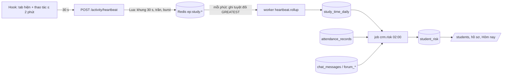

# SRS FEAT-crm-360 Lịch buổi học, điểm danh, phát biểu, thời gian học, hồ sơ 360, at-risk, `/me`, seed sprint 7
Phiên bản 1.1 · 2026-10-13 · Trạng thái: **APPROVED** (PM, 2026-10-13; thay đổi sau mốc này chỉ qua `proposals.md`) (đã sửa theo `TL-REVIEW.md` TLR-1…14, trả lời chủ dự án Q1–Q12 và Q1 cập nhật, quyết định PM Q13–Q24, `proposals.md` #5 #6 #7; chờ PM đánh APPROVED).

Nguồn: `docs/phases/P5.md` (L1, L2, L3); `docs/sprints/7/plan.md` story 8–14; PRD M5, M6, M13-C, M14, §3, §5; FLOWS F7, F8, F14; `ARCHITECTURE.md` §4 (`00013`, `00014`), §5 (Điểm danh, Tham gia, Observation SV, Hồ sơ, Thời gian học), §7 (route), §9 (Seed); `SYSTEM_DESIGN.md` 3.3 (heartbeat write-behind), §5 (SLO); `DECISIONS.md` D17, D44, D45, D51, D59; `design/DESIGN.md` §13, §14.6–14.9; `UX.md` mục 1, 2, 5, 6; `CLAUDE.md` (luật chữ UI; luật cứng thời gian học); spec đã có `FEAT-course-foundation` v1.8 (`class_sessions`, `sessions/generate` tối thiểu, Guard, "Hôm nay" 4.7), `FEAT-private-chat-pii` v1.7 (tool seam `AttendanceSource` / `ParticipationSource`, chat, Threads), `FEAT-docs-calendar` (`/calendar`), `FEAT-escalation-notify` v1.0 (`CreateOutreach`, `notify`, mail); mã `backend-go/internal/{agent,course,today,thread,chat,httpapi/*}` và `frontend/src/features/{attendance,students,me,calendar}` (mock) ở `main` + `sprint/7-p4-p5` (đọc để biết cái đã làm, không sửa).

## 1. Mục đích và phạm vi

Giảng viên điểm danh 30 sinh viên ≤ 60 s trên điện thoại và ghi phát biểu ngay trên dòng; xem hồ sơ 360 từng sinh viên và biết ai cần chú ý (có lý do bằng lời); sinh viên hỏi AI ra đúng số chuyên cần và điểm cộng của chính mình và xem ở `/me`; thời gian học được đo công bằng, minh bạch và **không bao giờ** thành điểm. Sáu story + seed (`US.md`).

**Hiện trạng đã đối chiếu (đọc mã) — spec chỉ viết phần còn thiếu:**

| Hạng mục | Đã có | Thiếu → làm ở sprint 7 |
| --- | --- | --- |
| Lịch buổi học | `class_sessions` (`00003`); `GET …/sessions`; `POST …/sessions/generate` tối thiểu (≤ 60 buổi, bỏ buổi trùng, `Staff`); việc "Tạo lịch buổi học" của "Thiết lập lớp mới" (`Href=/calendar?course=`) | `dry_run` xem trước; `PUT` / `DELETE` một buổi; buổi bù; ngăn kéo giao diện ở `/calendar`; cột hoàn tất điểm danh |
| Tool AI | `get_my_attendance`, `get_my_participation` + seam `AttendanceSource` / `ParticipationSource` (`internal/agent/tools.go`), hiện **nil → "chưa có dữ liệu"** | cài đặt nguồn thật trong `internal/crm` |
| Giao diện | mock `features/{attendance,students,me}` + `frontend/src/mock/*` | thay bằng API thật, xoá mock (D51) |
| "Hôm nay" nhân viên | `attention: []`; không nguồn điểm danh / chú ý | `SESSION_UNMARKED` (**12**), `STUDENT_ATTENTION` (95), khối "Lớp cần chú ý" |
| Heartbeat / thời gian học | chỉ có cột `users.tracking_notice_ack_at` (`00001`) | toàn bộ `internal/activity`, hook, hộp thoại, `00014` |
| `internal/grade` | **chưa có** (P6) | test kiến trúc phải xanh khi gói chưa tồn tại |
| `PUT …/settings` của lớp | **chưa có** (US-P4-05 AC12 tạo cho ngưỡng escalation) | mở rộng thân nhận `risk` |
| Điểm / công thức | chưa có (P6) | tín hiệu "điểm", cột / chip điểm **không** làm; giữ chỗ `signals.grade = null` |

**Ngoài phạm vi:** xem `US.md` (đầu tệp). **Migration:** `00013_crm`, `00014_observation` (số `00008` / `00009` trong `P5.md` đã bị dùng / bỏ trống — `plan.md`; `00009` **không** tái sử dụng).

## 2. Người dùng và quyền

`Member` / `Staff` / `Teacher` theo guard lớp (`FEAT-course-foundation` 4.1); **ADMIN bị từ chối ở mọi route lớp dưới đây** (D39). `Staff` = TA + TEACHER `ACTIVE`.

| # | Hành động | STUDENT | TA | TEACHER | ADMIN |
| --- | --- | --- | --- | --- | --- |
| 1 | `generate` (kể cả `dry_run`), `PUT` / `DELETE` buổi | 403 | ✓ | ✓ | 403 |
| 2 | `GET …/sessions` | ✓ (Member) | ✓ | ✓ | 403 |
| 3 | `GET` / `PUT …/sessions/{sid}/attendance` | 403 | ✓ | ✓ | 403 |
| 4 | `POST` / `GET …/participation` | 403 | ✓ | ✓ | 403 |
| 5 | `DELETE …/participation/{id}` | 403 | chỉ sự kiện mình tạo | ✓ | 403 |
| 6 | `GET /courses/{id}/me/attendance`, `…/me/participation`, `…/me/study-time` | ✓ (chính mình) | 403 | 403 | 403 |
| 7 | `POST /activity/heartbeat`, `POST /me/tracking-notice/ack` | ✓ (chính mình) | bỏ qua (`204`, không đo) | bỏ qua | bỏ qua |
| 7a | `PUT /me/settings {track_study_time}` | ✓ (chính mình; chỉnh được khi lớp cho tắt, khoá khi lớp không cho tắt) | lưu, không tác dụng | lưu, không tác dụng | lưu, không tác dụng |
| 7b | `allow_study_time_opt_out` — `PUT /courses/{id}/settings` (Q25 PM chốt): chỉ TEACHER của lớp, **chỉ tới khi lớp có sinh viên ghi danh đầu tiên**; sau đó `409 COURSE_HAS_STUDENTS` | 403 | 403 | ✓ (trước sinh viên đầu tiên) | 403 (cả `POST/PUT /admin/courses` không nhận trường này) |
| 8 | `GET …/students`, `GET …/students/{uid}/profile` (+ `attendance`, `study-time`) | **403** (kể cả `uid` của mình) | ✓ | ✓ | 403 |
| 9 | `GET` / `POST …/students/{uid}/observations` | 403 | ✓ | ✓ | 403 |
| 10 | `PUT` / `DELETE …/observations/{oid}` | 403 | chỉ ghi chú của mình | chỉ ghi chú của mình | 403 |
| 11 | `POST …/students/{uid}/ai-summary` | 403 | ✓ | ✓ | 403 |
| 12 | `POST …/students/{uid}/outreach` | 403 | ✓ | ✓ | 403 |
| 13 | `PUT /courses/{id}/settings` (`risk`, `escalation_threshold`, `allow_study_time_opt_out`) | 403 | 403 | ✓ | 403 |

**Nguyên tắc dữ liệu (luật cứng, kiểm bằng test):**
- Sinh viên **không bao giờ** thấy ghi chú quan sát, nhãn rủi ro, câu nhận định rủi ro của mình — qua API (mọi route của sinh viên), qua giao diện, qua AI (tool không có đường đọc `student_observations` / `student_risk`; lời nhắc không chứa chúng).
- Mọi lần mở hồ sơ một sinh viên ghi `audit_log` **trong cùng giao dịch** với việc đọc; lỗi audit → không trả dữ liệu (fail-closed).
- "Nhận xét tổng hợp" của AI **không** nhận tên / MSSV / email / nội dung ghi chú / nội dung chat; chỉ số liệu.
- `internal/grade` **không bao giờ** dùng thời gian học (luật cứng `CLAUDE.md`): không import `activity` / `crm`, không đọc `study_time_daily`.
- Điểm danh / điểm cộng là dữ liệu điểm: audit mọi thay đổi; dữ liệu điểm danh **không cache** phía máy chủ (luật 15).
- Giảng viên không đọc chat riêng: "Hoạt động hỏi AI" chỉ là **số đếm** mỗi tuần (Q3), không nội dung.

## 3. Luồng chính và các nhánh lỗi

### 3.1 Điểm danh (F7)

```mermaid
sequenceDiagram
  participant GV as Giảng viên (điện thoại)
  participant FE as /attendance
  participant G as Gateway
  participant W as Worker
  participant SV as Sinh viên (/me, chat)
  GV->>FE: mở (buổi đang diễn ra)
  FE->>G: GET …/sessions/{sid}/attendance
  G-->>FE: lưới (record null = mặc định Có mặt)
  GV->>FE: chạm Vắng ×3, Muộn ×1, "+ phát biểu"
  FE->>FE: đổi UI ngay + "Hoàn tác" 5 s; lưu nháp cục bộ
  FE->>G: PUT attendance (sau 2 s yên lặng, complete=false) + POST participation(client_event_id)
  GV->>FE: Lưu điểm danh
  FE->>G: PUT attendance (complete=true)
  G->>G: tx: lock buổi → so version → ghi lưới → done_at → audit → outbox
  G-->>FE: 200 {records, done_at} → "Đã lưu điểm danh · 30 · vắng 3"
  W->>W: crm.attendance_saved → today.invalidate
  SV->>G: /me hoặc hỏi AI → số đúng DB
```

### 3.2 Thời gian học và at-risk



### 3.3 Bảng nhánh lỗi

| Tình huống | Hệ thống phản ứng | Người dùng thấy |
| --- | --- | --- |
| Hai người cùng điểm danh, đổi cùng một sinh viên | `409 VERSION_CONFLICT` + `details.conflicts`; không ghi gì | "Thầy Nam vừa đổi 2 dòng. Giữ của tôi / Lấy của thầy Nam" |
| Mất mạng khi điểm danh | (AC13) dùng lại `shared/lib/saveQueue.ts` (US-PE-05: ghi ngay vào kho, debounce 2 s, gửi lại khi có mạng / tab hiện lại, backoff 1→15 s, dừng khi `409`), **khoá theo người dùng** `ep:draft:<userId>:attendance:<course>:<session>`; (AC13b nếu cắt) khoá lưu + báo rõ | dải "Chưa có mạng · 3 thay đổi chờ lưu" |
| `PUT` 5xx | hoàn lại hiển thị bằng nút `Thử lại`; thay đổi giữ ở máy | "Chưa lưu được. Thử lại" |
| Sinh viên không `ACTIVE` trong thân | `422 STUDENT_NOT_IN_COURSE` | thông báo ở dòng |
| Xoá buổi đã có điểm danh | `409 SESSION_HAS_ATTENDANCE` | "Buổi này đã có điểm danh, chỉ sửa được giờ" |
| Tạo lịch vượt 60 buổi | `422 VALIDATION_FAILED` + `details[0].code = TOO_MANY_SESSIONS` (hợp đồng P2, `proposals.md` #20) | "Sẽ tạo 74 buổi, tối đa 60" |
| Redis lỗi lúc heartbeat | `204`, bỏ nhịp, đếm `activity_heartbeat_dropped_total` | không thấy gì |
| Tab ẩn / idle 2 phút | hook ngừng gửi | không thấy gì |
| Chưa xác nhận thông báo theo dõi | hook không gửi; server `204` không cộng | hộp thoại một lần |
| Mở hồ sơ mà ghi audit lỗi | `503`, không trả dữ liệu | `PageState` lỗi + `Thử lại` |
| AI tóm tắt lỗi / quá tải | `503` / `504` / `429` | "Chưa soạn được nhận xét. Thử lại"; chữ đang gõ giữ nguyên |
| Lớp mới chưa có dữ liệu | số 0, `risk NONE`, không chia 0 | danh sách đủ người, chuyên cần "—" |
| Job `crm.risk` chưa chạy | `risk.level='NONE'`, `computed_at` rỗng | không hiện cột rủi ro |
| Seed gãy giữa chừng | chạy lại tiếp tục, không đôi | – |

## 4. Yêu cầu chức năng

### 4.1 Hằng số và cấu hình (mọi giá trị có tên; sai → gateway không chạy và nêu tên biến)

| Tên | Mặc định | Miền | Dùng ở |
| --- | --- | --- | --- |
| `SESSIONS_MAX_PER_GENERATE` | `60` (đã có) | 1–200 | 4.2 |
| `ATTENDANCE_MAX_ROWS` | `1000` | 100–5000 | 4.3 |
| `PARTICIPATION_DEFAULT_POINTS` | `0.25` | −5…5 (`decimal`) | 4.4 |
| `SESSION_UNMARKED_GRACE` | `24h` | 1h–168h | 4.9 |
| `HEARTBEAT_SECONDS` | `30` | cố định | 4.6 |
| `HEARTBEAT_IDLE_SECONDS` (client) | `120` | cố định | 4.6 |
| `HEARTBEAT_MAX_PER_MINUTE` | `4` | 2–10 | 4.6 |
| `STUDY_DAILY_CAP` | `43200` (12 giờ) | 3600–86400 | 4.6 |
| `HEARTBEAT_COUNTER_TTL` | `192h` (8 ngày) | ≥ 48h | 4.6 |
| `ROLLUP_TICK` | `1m` | 10s–5m | 4.6 |
| `RISK_JOB_AT` | `02:00` (`Asia/Ho_Chi_Minh`) | `HH:MM` | 4.7 |
| `RISK_DEFAULTS` | `attendance_ok_min=0.70, activity_min_per_week=1, study_min_minutes=60, signals_required=2, absent_alert=3` | khoảng ở 4.7.3 | 4.7 |
| `AI_SUMMARY_TIMEOUT` / `AI_SUMMARY_PER_HOUR` | `20s` / `10` | | 4.8 |
| `OUTREACH_PER_DAY` | `3` | 1–20 | 4.8 |
| `TRACKING_AREAS` | `CHAT, THREADS, PRACTICE, LIBRARY, CALENDAR` | cố định | 4.6 |

### 4.2 `internal/course` — lịch buổi học (mở rộng P2)

1. **Xem trước.** `POST …/sessions/generate?dry_run=true` (cùng thân) chạy toàn bộ kiểm hợp lệ và sinh danh sách trong **giao dịch chỉ đọc**; **không** đòi `Idempotency-Key` (chỉ đọc — middleware idempotency băm thân + query, nên cùng một khoá cho `Xem trước` rồi `Tạo N buổi` sẽ bị từ chối; TLR-12); trả `200 {would_create:[{session_no,starts_at,ends_at}], skipped:[{date,reason}]}`; **không** ghi `class_sessions`, `audit_log`, `outbox`, Redis. `session_no` xem trước = số sẽ được cấp nếu chạy ngay (`max+1…`). `reason` ∈ {`EXCLUDED`, `DUPLICATE`}; **chỉ bản xem trước** liệt kê `skipped` dạng mảng (cả `EXCLUDED` lẫn `DUPLICATE`).
2. **Tạo thật** như P2 (≤ `SESSIONS_MAX_PER_GENERATE`; vượt → `422 VALIDATION_FAILED` với `details[0] = {field:"to", code:"TOO_MANY_SESSIONS", message:"Khoảng ngày này có 74 buổi, mỗi lần tạo tối đa 60"}` — hợp đồng P2 đã ghim, không đổi, `proposals.md` #20; `Idempotency-Key` **bắt buộc**, giao diện sinh khoá mới mỗi lần bấm `Tạo N buổi`); `201 {created, first_session_no, last_session_no, skipped}` với `skipped` là **số** buổi trùng đã bỏ (`SessionGenerateResult.skipped: integer`); thêm trong **cùng giao dịch**: `audit_log` (`class_sessions`, `generate`, số buổi) và outbox `course.changed` (`today.invalidate`, ETag lịch).
3. **Sửa một buổi** `PUT …/sessions/{sid} {starts_at, ends_at, room?, topic?, version}` (`Staff`): `version` sai → `409`; `ends_at ≤ starts_at` → `422`; trùng `(course_id, starts_at)` → `409 SESSION_DUPLICATE`; `session_no` không đổi; có `audit_log`.
4. **Huỷ một buổi** `DELETE …/sessions/{sid}` (`Staff`): chỉ khi không có `attendance_records` của buổi đó (`409 SESSION_HAS_ATTENDANCE`); `audit_log`. Cấp số = `max(session_no) + 1`: khoảng trống **ở giữa** do xoá không được lấp; xoá buổi **cuối cùng** thì số đó được cấp lại (buổi đã xoá chưa từng có điểm danh nên không dữ liệu nào trỏ tới số cũ — TLR-4, PM chọn phương án rẻ; không thêm cột đếm vào `courses`). "Nghỉ" = xoá buổi (Q9).
5. **Buổi bù** = tạo một buổi một ngày bằng `generate` rồi `PUT` đặt `topic` "Học bù" (API generate không có `topic`).
6. Việc "Tạo lịch buổi học" của `COURSE_SETUP` (đã có) tự tick khi có ≥ 1 buổi — không đổi.

### 4.3 `internal/crm` — điểm danh

**4.3.1 Mô hình.** Một dòng `attendance_records` cho mỗi (buổi, sinh viên) khi có thao tác ghi; "chưa có dòng" = hiển thị mặc định `PRESENT` chưa lưu. Buổi **hoàn tất** khi `class_sessions.attendance_done_at` có giá trị. Bất biến: sau `complete:true`, mọi sinh viên `ACTIVE` **tại thời điểm đó** đều có dòng (sinh viên bị bỏ trong thân được ghi `PRESENT` v1 cùng giao dịch). Sinh viên vào lớp sau không có dòng cho buổi cũ (không bịa); sinh viên bị mời ra giữ nguyên dòng (F2).

**4.3.2 `GET …/sessions/{sid}/attendance`** (`Staff`): đọc buổi (`course_id` + `id`), danh sách sinh viên `ACTIVE` (`enrollments`) LEFT JOIN `attendance_records` và số `participation_events SPEAK` của buổi; sắp theo `vn_fold(full_name), id`.

**4.3.3 `PUT …/sessions/{sid}/attendance {records:[{student_id,status,note?,version?}], complete?}`** (`Staff`; ghi cả lưới bằng **một** giao dịch):
1. Kiểm thân: ≤ `ATTENDANCE_MAX_ROWS`, không trùng `student_id`, `status` ∈ enum, `note` ≤ 200, mọi `student_id` là sinh viên `ACTIVE` của lớp (`422 STUDENT_NOT_IN_COURSE` kèm danh sách).
2. `SELECT … FROM class_sessions WHERE course_id AND id FOR UPDATE` (tuần tự hoá hai lần lưu cùng buổi); nạp dòng hiện có.
3. Với mỗi hàng: chưa có dòng → `INSERT` (`version=1`); có dòng và `(status, note)` **giống hệt** → bỏ qua (không đổi `version`, không `audit`); có dòng và khác → bắt buộc `version` bằng bản trong DB, sai / thiếu → ghi vào danh sách xung đột.
4. Có xung đột → `ROLLBACK`, `409 VERSION_CONFLICT`, `details.conflicts:[{student_id, mine:{status,note}, current:{status,note,version,marked_by:{full_name},marked_at}}]` (không ghi gì).
5. Không xung đột → áp dụng, `version+1`, `marked_by`=người gọi; `complete:true` → điền `PRESENT` cho sinh viên `ACTIVE` còn thiếu, đặt `attendance_done_at/by` (chỉ lần đầu); `audit_log` (`attendance`, `<session_id>`, action = `complete` khi lần đầu hoàn tất / `edit_after_complete` khi buổi đã hoàn tất / `save` khác; `before` / `after` = số đếm theo trạng thái + mảng `{student_id, from, to}` của hàng đổi; **không** tên, **không** ghi chú); outbox `crm.attendance_saved{course_id,session_id}`; `COMMIT`.
6. Trả `200 {records:[{student_id,status,version}], done_at}`. Gửi lại cùng nội dung: mọi hàng "giống hệt" → `200`, không audit mới, không outbox.

**4.3.4 Lớp lưu trữ** → mọi ghi `409 COURSE_ARCHIVED`. **Hạn sửa:** không giới hạn thời gian (Q8); khi sổ điểm đã chốt (P6) việc sửa phải qua "mở khoá có lý do" — ngoài sprint này.

**4.3.5 Ghi chú điểm danh (`note`)** chỉ nhân viên thấy; **không** vào kết quả tool AI, `/me/*`, thông báo hay thư (Q7).

### 4.4 `internal/crm` — sự kiện tham gia

`POST …/participation {student_id, session_id?, type, points?, note?, client_event_id}` (`Staff`): `type` ∈ {`SPEAK`, `BONUS`, `PENALTY`}; `points` bỏ trống → `SPEAK` dùng `PARTICIPATION_DEFAULT_POINTS`; `BONUS` > 0, `PENALTY` < 0, `SPEAK` ≥ 0, mọi giá trị ∈ [−5, 5] bước 0,01 (`decimal`, **cấm `float64`**); `INSERT … ON CONFLICT (client_event_id) DO NOTHING RETURNING`; **khi trùng (TLR-8):** `SELECT … WHERE client_event_id = $1 AND course_id = $2 AND created_by = $3` và trả bản đó (`200`); không có hàng (khoá thuộc lớp / người khác) → `409 IDEMPOTENCY_KEY_REUSED` (cùng mã của middleware idempotency; `client_event_id` duy nhất toàn cục nhưng không bao giờ trả sự kiện của lớp hay người khác); sinh viên phải `ACTIVE`; `session_id` (nếu có) thuộc lớp; `audit_log` (`participation`, id, loại, điểm). `DELETE …/participation/{id}`: người tạo hoặc TEACHER; `audit_log`. `GET …/participation?student_id=&session_id=&cursor=`. Sprint này **chỉ** giao diện `SPEAK` (nút "+ phát biểu"); `BONUS` / `PENALTY` có API, chưa có giao diện (ghi điểm thủ công — P6/P7). "Điểm cộng đã ghi" = Σ `points` (thuần code, `decimal`); **không** áp trần hay quy tắc nào — công thức điểm là việc của P6 (Q10).

### 4.5 Tool AI (`internal/agent` — nối dây thật)

`crm.Service` cài `agent.AttendanceSource` và `agent.ParticipationSource`; đọc **chỉ** theo `tc.UserID`, `tc.CourseID` (truy vấn có `student_id = $1 AND course_id = $2`; không nhận id từ ngoài). `Facts` chuẩn:
- `attendance`: `{"recorded":9,"present":6,"late":1,"excused":0,"absent":2,"recent_absent":[{"session_no":6,"date":"2026-11-02"},…]}` (≤ 5, mới nhất trước); `(nil,false)` khi `recorded = 0` → câu mẫu "Hệ thống chưa có dữ liệu điểm danh của bạn.".
- `participation`: `{"speak_count":2,"points_total":"0.50","recent":[{"date":"…","type":"SPEAK","points":"0.25"}]}` (`points` là chuỗi `decimal`); `(nil,false)` khi không có sự kiện nào.
Không có `note`, `marked_by`, tên người khác. Một lượt sinh chữ như các tool khác (D47). Bảng mô tả `Facts` cho lời nhắc dùng dấu phẩy khi hiển thị.

### 4.6 `internal/activity` — thời gian học

**4.6.1 `POST /activity/heartbeat {course_id, area, tab_id}`** (JWT; thêm `course_id` so với `ARCHITECTURE.md` §5 vì sinh viên học nhiều lớp):
1. Bỏ qua im lặng (`204`) khi vai không phải STUDENT, hoặc `users.tracking_notice_ack_at IS NULL`. Ack đọc **chỉ** từ `ep:trk:{uid}` (cache 60 s; trượt cache → `SELECT`); **không** đọc từ claim JWT (token cũ sau `Đã hiểu` vẫn mang claim rỗng nên mọi nhịp bị bỏ tới lần xoay token — TLR-9); `POST /me/tracking-notice/ack` xong thì `DEL ep:trk:{uid}`.
2. `403` khi sinh viên không `ACTIVE` ở `course_id` (kiểm bằng bộ nhớ đệm `ep:enr:{uid}:{course}` TTL 60 s — giá trị mang cả `allow_study_time_opt_out` của lớp —, **không** truy DB mỗi nhịp); `422` khi `area` ∉ `TRACKING_AREAS` hoặc thân sai.
3. **Cấu hình đo (Q1):** `tracked = NOT courses.allow_study_time_opt_out OR user_settings.track_study_time` (cờ lớp từ `ep:enr`, cờ sinh viên từ `ep:trk:{uid}` cùng ack); `PUT /me/settings` đổi `track_study_time` thì `DEL ep:trk:{uid}`. `tracked = false` → `204`, **không** đo. Máy chủ quyết định; hook chỉ là tối ưu.
4. Một lời gọi Lua duy nhất, nguyên tử, mọi khoá truyền qua `KEYS`: (a) giới hạn `INCR ep:hb:rate:{uid}` EX 60 ≤ `HEARTBEAT_MAX_PER_MINUTE`; (b) khung 30 s: `SET ep:hb:win:{uid}:{floor(unix/30)} NX EX 40` — đã có → bỏ (`tab` thứ hai cùng khung); (c) trần ngày: đọc `ep:study:total:{uid}:{yyyymmdd ICT}` (tổng mọi lớp × khu vực) ≥ `STUDY_DAILY_CAP` → bỏ; (d) `INCRBY ep:study:total:{uid}:{yyyymmdd ICT} 30` (TTL `HEARTBEAT_COUNTER_TTL`), `INCRBY ep:study:{course}:{uid}:{yyyymmdd ICT}:{AREA} 30`, `EXPIRE` `HEARTBEAT_COUNTER_TTL`, `SADD ep:study:dirty <khoá>` (TLR-9: có khoá tổng ngày vì khoá đếm tách theo lớp × khu vực).
5. Redis lỗi → `204` + `activity_heartbeat_dropped_total`. **Không** ghi Postgres. Không log `area` kèm `uid` ở mức info.

**4.6.2 `heartbeat.rollup`** (worker, `ROLLUP_TICK`, khoá leader `ep:lock:heartbeat.rollup`): quét `ep:study:dirty` (`SSCAN`), đọc giá trị tích luỹ `V` của các khoá **đổi từ lần trước** (so băm `ep:study:flushed`), ghi lô ≤ 500 hàng: `INSERT INTO study_time_daily (course_id, student_id, date, area, active_seconds) … ON CONFLICT (course_id, student_id, date, area) DO UPDATE SET active_seconds = GREATEST(study_time_daily.active_seconds, EXCLUDED.active_seconds)`; sau khi ghi thành công cập nhật `flushed`; khoá của ngày đã qua > 1 ngày được `SREM` khỏi `dirty` **và `HDEL` trường tương ứng ở `flushed`** (không để hash phình mãi — TLR-9). Ghi **tuyệt đối** (không cộng dồn) nên giao đôi / chết giữa chừng / chạy lại **không đổi kết quả**; Redis mất dữ liệu → DB giữ giá trị cũ, số đo ngày đó có thể thấp hơn thật (chấp nhận — dữ liệu tham khảo, D17; `SYSTEM_DESIGN.md` 3.3).

**4.6.3 Hook `useActivityHeartbeat(area)`** (`frontend/src/shared/data`, gắn ở layout; `area` suy từ đường dẫn: `/chat`→CHAT, `/threads*`→THREADS, `/practice*`→PRACTICE, `/library*`→LIBRARY, `/calendar`→CALENDAR; mọi route khác — kể cả `/exams/**` và `/me` — **không** gửi): gửi theo chu kỳ **cố định 30 s**, chỉ ngẫu nhiên hoá **pha** lúc bắt đầu (0–30 s) nên mỗi nhịp rơi đúng một khung 30 s của máy chủ (nhịp lệch ± 3 s trên khung cố định làm đếm thiếu có hệ thống vài % — TLR-9), khi `document.visibilityState==='visible'` **và** có thao tác (`pointerdown`, `keydown`, `scroll`, `touchstart`, `mousemove` có throttle) trong 120 s gần nhất; ẩn tab → ngừng ngay; mạng đứt → bỏ nhịp (không xếp hàng); `403` / `422` → ngừng im lặng; dọn timer khi đổi route / gỡ. `tab_id` = UUID mỗi tab (để chẩn đoán; việc khử trùng theo `user_id` + khung, không theo `tab_id`). Hook **không** biết cấu hình lớp; máy chủ bỏ nhịp khi `tracked=false` (4.6.1).

**4.6.4 Hộp thoại minh bạch.** `users.tracking_notice_ack_at IS NULL` ⇒ STUDENT thấy `Dialog` một lần (nội dung 7.5); `POST /me/tracking-notice/ack` đặt `now()` (idempotent, giữ lần đầu) rồi `DEL ep:trk:{uid}`. TA / TEACHER / ADMIN không có hộp thoại và không bị đo.

**4.6.5 Đọc.** `GET /courses/{id}/me/study-time?weeks=` (STUDENT, của mình; **cùng nhóm** `…/me/attendance`, `…/me/participation` nên đi qua `CourseAccessGuard` — TLR-11) và `GET …/students/{uid}/study-time?weeks=` (`Staff`): `weeks` ∈ [1, 20] (mặc định 8); tuần ISO bắt đầu thứ Hai `Asia/Ho_Chi_Minh`; `minutes = floor(Σ active_seconds / 60)`; `by_area`; `this_week_minutes`; bản của sinh viên kèm `tracking:{enabled, locked}` (`locked = NOT courses.allow_study_time_opt_out`; `enabled = tracked` của 4.6.7), bản của nhân viên kèm `tracked` (bool). Dữ liệu đã đo giữ nguyên khi tắt đo; chỉ dừng ghi thêm.

**4.6.6 Luật cứng (TLR-2).** Ba lớp kiểm, xanh khi chưa có `internal/grade` (P6 chưa làm), đỏ ngay khi P6 vi phạm: (a) **phụ thuộc bắc cầu** — `go list -deps ./internal/grade/...` không chứa `/internal/activity` hay `/internal/crm` (bắt cả trường hợp `grade` import gói trung gian như `today`, `agent` mà gói đó import `crm` / `activity`); không có gói nào khớp → xanh; (b) **quét AST** `internal/grade/**` (`go/parser`): không lời gọi phương thức `*store.Queries` nào có tên nằm trong tập hàm sinh ra ở `store/activity.sql.go`, `store/crm.sql.go` (đọc tập tên bằng `go/parser`; vì sqlc gom mọi truy vấn vào một gói `store`) và không chuỗi SQL thô nào chứa `study_time_daily`, `student_risk`, `heartbeat`; (c) các tệp `store/queries/grade*.sql` và mọi view / hàm SQL của sổ điểm không tham chiếu `study_time_daily`, `heartbeat`, `student_risk`, `v_student_360`. Test: `TestGradeNeverImportsActivity` (a, b), `TestGradeQueriesNeverReadStudyTime` (b, c).

**4.6.7 Cấu hình đo thời gian học (Q1 cập nhật — chủ dự án 2026-10-13; Q25 — PM chốt 2026-10-13).** (a) `courses.allow_study_time_opt_out boolean NOT NULL DEFAULT true` ("Cho sinh viên tắt đo thời gian học"): **lớp mới mặc định cho tắt** (an toàn cho dữ liệu cá nhân); form `Mở lớp` của Admin **không** có trường này (`POST` / `PUT /admin/courses` không nhận — thân có trường lạ bị từ chối như hiện có). **TEACHER của lớp** chọn ở `/class/settings` (đích `Href` của việc `COURSE_SETUP`; bốn bước của việc đó **không** đổi) bằng `PUT /courses/{id}/settings {allow_study_time_opt_out, version}` **cho tới khi lớp có sinh viên ghi danh đầu tiên** (`EXISTS (SELECT 1 FROM enrollments WHERE course_id = $1 AND role = 'STUDENT')`, mọi trạng thái); từ đó **khoá**: `409 COURSE_HAS_STUDENTS`, `/class/settings` chỉ hiện giá trị. Kiểm và ghi trong **một** giao dịch (`SELECT … FROM courses … FOR UPDATE`, rồi kiểm không có ghi danh sinh viên, rồi `UPDATE … WHERE version = $v`) và ghi danh đầu tiên cũng lấy khoá hàng `courses` nên hai việc tuần tự hoá — không sinh viên nào vào lớp dưới luật cũ mà không biết. TA / STUDENT / ADMIN → `403`; có `audit_log` (giá trị cũ / mới, không nội dung). (b) `user_settings.track_study_time boolean NOT NULL DEFAULT true` là **một cờ toàn tài khoản** ("học sinh tự config"; lớp không cho tắt thì bỏ qua cờ này; không có cờ theo từng ghi danh); `PUT /me/settings {track_study_time?, version}` lưu được ở mọi vai nhưng chỉ có tác dụng với STUDENT (cùng tiền lệ `notify_ticket_by_mail`). (c) Lớp **không cho tắt** → luôn đo (sau khi sinh viên bấm `Đã hiểu`); công tắc của lớp đó ở `/settings` hiện bật và **khoá**, tooltip lý do ở chính công tắc. Lớp **cho tắt** → sinh viên tự bật / tắt (`track_study_time`). (d) Sinh viên học nhiều lớp: đo ở lớp X khi `tracked(X) = NOT allow_study_time_opt_out(X) OR track_study_time` — nên một sinh viên tắt vẫn được đo ở lớp không cho tắt và không được đo ở lớp cho tắt. (e) `GET /me/settings` trả thêm `study_time:{courses:[{course_id, class_code, locked}]}` (chỉ lớp sinh viên `ACTIVE`; `locked = NOT allow_study_time_opt_out`) để dựng giao diện. (f) Tắt đo **không** làm sinh viên bị coi là thấp ở tín hiệu `STUDY` (4.7.1) và không bị mất dữ liệu đã đo. (g) `GET /courses/{id}` (Member) trả giá trị; giao diện `/class/settings` thêm nhóm "Đo thời gian học" (7.8); `FEAT-course-foundation` chỉ cần thêm nhóm này vào `/class/settings` (mục 10).

### 4.7 At-risk (`crm.risk`)

**4.7.1 Tín hiệu theo tuần.** Tuần ISO thứ Hai–Chủ nhật (`Asia/Ho_Chi_Minh`). Với mỗi sinh viên `ACTIVE` và mỗi **tuần trọn** `W` (đã kết thúc):

| Tín hiệu | Có dữ liệu khi | Giá trị | "Thấp" khi |
| --- | --- | --- | --- |
| `ATTENDANCE` (neo) | sinh viên có ≥ 1 `attendance_records` ở buổi thuộc tuần `W` | `(PRESENT+LATE+EXCUSED) / số buổi đã ghi trong tuần` (vắng có phép **không** tính là thiếu) | `< attendance_ok_min` |
| `ACTIVITY` | luôn | số tin `USER` ở phiên chat riêng chưa xoá mềm + số thread + số bình luận `HUMAN` chưa xoá của sinh viên trong tuần | `< activity_min_per_week` |
| `STUDY` | `tracking_notice_ack_at ≤ đầu tuần W` **và** lớp không cho tắt đo **hoặc** `user_settings.track_study_time = true` lúc job chạy (Q1: sinh viên đã tắt đo ở lớp cho phép tắt → `STUDY = null`, **không** bị coi là thấp) | `Σ study_time_daily.active_seconds / 60` | `< study_min_minutes` |
| `GRADE` (neo) | **chưa có** (P6) — giữ chỗ `null` | – | – |

**4.7.2 Quy tắc.** Tuần `W` là **yếu** khi (i) số tín hiệu có dữ liệu và thấp ≥ `signals_required` **và** (ii) có ≥ 1 tín hiệu **neo** (`ATTENDANCE` hoặc `GRADE`) thấp. Lý do cho (ii): thời gian học và hoạt động chỉ khuếch đại, không tự gây rủi ro (D17: tham khảo + tín hiệu at-risk, không tính điểm; nhiều sinh viên giỏi không dùng app). Tuần không đủ dữ liệu hoặc không có neo thấp → **không** yếu (và cắt chuỗi). Gọi `W1` = tuần trọn gần nhất, `W2` = tuần trước nó: `AT_RISK` khi `W1` và `W2` đều yếu; `WATCH` khi chỉ `W1` yếu; còn lại `NONE`. Hàm thuần `risk.Evaluate(weeks, thresholds) → Result{Level, Reasons[], Weeks[]}`; truy vấn tổng hợp là SQL tập hợp theo lớp (một lượt, không N+1). Hoạt động đếm `chat_messages` đã lọc `course_id` + khoảng thời gian: job chạy ngoài giờ cao điểm nên chấp nhận quét theo lớp (`ponytail:` đếm tuần bằng quét `chat_messages` của lớp mỗi đêm; thêm chỉ mục `(course_id, user_id, created_at)` nếu một lớp vượt ≈ 50.000 tin).

**4.7.3 Ngưỡng theo lớp.** `courses.settings.risk` (`jsonb`), hợp với `RISK_DEFAULTS`: `attendance_ok_min` ∈ [0,50; 1,00] (bước 0,05); `activity_min_per_week` ∈ [0, 20]; `study_min_minutes` ∈ [0, 600]; `signals_required` ∈ [1, 3]; `absent_alert` ∈ [1, 20] (cho chip `Vắng nhiều`). Đặt qua `PUT /courses/{id}/settings {risk:{…}, version}` (TEACHER; cùng route với ngưỡng escalation của `FEAT-escalation-notify` 4.2.8 — thân nhận `escalation_threshold?` **và** `risk?`); lưu → outbox `course.settings_changed` → handler chạy `crm.risk` cho riêng lớp đó.

**4.7.4 Job (TLR-6, TLR-13).** `crm.risk` chạy **đúng một lần mỗi ngày**: mỗi tick (1 phút), khi `now ≥ RISK_JOB_AT` hôm nay (`Asia/Ho_Chi_Minh`) và `SET ep:crm.risk:done:{yyyymmdd} 1 NX EX 48h` thành công thì chạy (có chạy bù khi worker lên lại; lỗi giữa chừng → `DEL` khoá để tick sau thử lại; khoá leader `ep:lock:crm.risk` chỉ chống hai bản chạy cùng lúc). Mỗi lớp `ACTIVE` một lượt: `UPSERT student_risk` (`level`, `reasons`, `weeks` (4 tuần gần nhất để hiển thị), `last_week_asks`, `last_week_posts`, `computed_at`); `entered_at = CASE WHEN student_risk.level = 'AT_RISK' AND EXCLUDED.level = 'AT_RISK' THEN student_risk.entered_at WHEN EXCLUDED.level = 'AT_RISK' THEN now() END` (giữ `entered_at` khi sinh viên đã `AT_RISK` từ trước — ghi đè `now()` mỗi đêm thì `STUDENT_ATTENTION` báo cùng sinh viên mãi; rời `AT_RISK` → `NULL`); xoá dòng của sinh viên không còn `ACTIVE`. Đếm hoạt động theo tuần lọc bằng `created_at` (**không** khoảng `id`: `seed-age` lùi `created_at` nên uuidv7 không còn khớp thời gian). Idempotent (cùng dữ liệu → cùng kết quả); lớp 1.000 sinh viên ≤ 30 s.

**4.7.5 Câu nhận định (sinh từ dữ liệu, tiếng Việt, chỉ nhân viên thấy).**
- `ATTENDANCE_LOW` → "vắng {a}/{n} buổi trong {k} tuần gần nhất" (`a` = số `ABSENT` không phép, `n` = số buổi đã ghi, `k` = số tuần yếu, 1–2).
- `STUDY_LOW` → "học trên EduPilot khoảng {m} phút mỗi tuần" (`m` = trung bình các tuần yếu).
- `ACTIVITY_LOW` → "không hỏi AI hay đăng bài ở Threads trong {k} tuần".
- Câu: `AT_RISK` → "Cần chú ý: " + các cụm theo thứ tự chuyên cần, thời gian học, hoạt động, nối bằng "; " + "."; `WATCH` → "Đang theo dõi: …"; `NONE` → không có câu. **Cấm:** nêu điểm AI, nội dung chat, tên người khác, từ "AI chấm", "rủi ro cao" kiểu nhãn gây hại.

### 4.8 Hồ sơ 360, ghi chú, nhận xét AI, nhắn sinh viên

**4.8.1 Views (`00013`; `00014` thay một view — `proposals.md` #20).** `v_attendance_summary(course_id, student_id, recorded, present, late, excused, absent, last_marked_at)` = `GROUP BY course_id, student_id` trên `attendance_records`. `v_student_360(course_id, student_id, full_name, student_code, joined_at, recorded, present, late, excused, absent, speak_count, points_total, study_seconds_7d, last_week_asks, last_week_posts, risk_level, risk_entered_at, risk_computed_at)` = `enrollments` (`role=STUDENT`, `status=ACTIVE`) ⋈ `users` ⟕ `v_attendance_summary` ⟕ tổng `participation_events` theo `(course_id, student_id)` ⟕ `study_time_daily` 7 ngày gần nhất ⟕ `student_risk`. **Vì `study_time_daily` chỉ tồn tại từ `00014`:** ở `00013` view dựng với `0::bigint AS study_seconds_7d` (không join bảng đó); `00014` chạy `CREATE OR REPLACE VIEW v_student_360` thay bằng bản join (cùng tên, thứ tự và kiểu cột nên không phải `DROP`), và `Down` của `00014` trả lại bản `0`. Mọi nhóm gộp có `course_id` ở khoá nhóm để vị từ `course_id = $1` được đẩy xuống (không quét cả bảng); hai view **không** có `chat_messages` (đếm hoạt động đã vật chất hoá vào `student_risk`).

**4.8.2 `GET …/students`** (`Staff`): `v_student_360` + lọc / tìm / sắp xếp ở 4.8.6; phân trang con trỏ bằng khoá `(risk_rank, vn_fold(full_name), student_id)` (mã hoá base64, `INVALID_CURSOR` khi sai).

**4.8.3 `GET …/students/{uid}/profile`** (`Staff`; "một lần mở" = **một lần gọi** route này — TLR-7): một giao dịch — `INSERT audit_log` (`student_profile`, `<uid>`, `view`, actor, course) rồi đọc `v_student_360` + `student_risk` + 8 tuần thời gian học; lỗi audit → rollback, `503`, không trả dữ liệu. Trả `Cache-Control: no-store`, không `ETag`; giao diện buộc gọi mỗi lần vào trang (query hồ sơ đặt `staleTime: 0`, `refetchOnMount: "always"`, `gcTime: 0`) để mỗi lần mở thật sự sinh một dòng audit. Trả `{student, risk:{level,sentence,reasons,computed_at}, attendance, participation, study:{minutes_7d, weeks[], tracked}, activity:{asks_last_week, posts_last_week}}` (`activity` lấy từ `student_risk` — **tuần trọn trước**, giao diện ghi "Tuần trước"; không đường nào đọc `chat_messages` cho danh sách / hồ sơ — TLR-14); sinh viên không `ACTIVE` ở lớp → `404`. Các tab đọc thêm: `GET …/students/{uid}/attendance?cursor=` (buổi × trạng thái × `note`, **có** `note` vì nhân viên), `GET …/students/{uid}/study-time`, `GET …/students/{uid}/observations` (ghi `view_observations`).

**4.8.4 Ghi chú quan sát.** `POST …/observations {tags[], body, kind:"NOTE"}` (`tags` ≤ 5, mỗi cái 1–30 ký tự; `body` 1–2000); `PUT {tags, body, version}` / `DELETE` chỉ **tác giả**; mọi nhân viên của lớp đọc được; `audit_log` mọi ghi, **không** nội dung. Không có đường đọc của STUDENT; không vào lời nhắc nào của chat / threads / RAG.

**4.8.5 Nhận xét tổng hợp.** `POST …/students/{uid}/ai-summary` (`Staff`; ≤ `AI_SUMMARY_PER_HOUR` mỗi người; hạn `AI_SUMMARY_TIMEOUT`): dựng đầu vào **chỉ số liệu**: `{attendance:{recorded,present,late,excused,absent}, participation:{speak_count,points_total}, study_minutes_by_week:[4 số], asks_by_week:[4], posts_by_week:[4], risk_reason_codes:[…]}` (gọi sinh viên là "sinh viên", không có danh tính); đúng **một** `llm.Structured` (task `INSIGHT`, làn `NEAR_REALTIME`, `json_schema`: `summary` ≤ 600 ký tự, `strengths`, `concerns`, `suggestions` ≤ 3 mục mỗi mảng); đầu ra quét `privacy.Detect` theo roster rồi `Redact`; `200 {draft}` **không** lưu. Lưu = `POST …/observations {kind:"AI_SUMMARY", body, ai_edited}`. Hiển thị nhãn `AI` / "Đã sửa bởi giảng viên" (UX quy tắc 7). Lớp chưa có dữ liệu nào của sinh viên → `409 NOT_ENOUGH_DATA` (không gọi LLM). Lỗi LLM → `503 LLM_UNAVAILABLE` / `OVERLOADED` kèm `retry_after`; quá hạn → `504`.

**4.8.6 Danh sách — lọc.** `filter=attention` ⇒ `risk_level='AT_RISK'`; `filter=absent` ⇒ `absent ≥ absent_alert`; `filter=inactive` ⇒ `last_week_asks + last_week_posts = 0 AND study_seconds_7d < study_min_minutes × 60`; nhiều `filter` = giao; `q` = `vn_fold(full_name) LIKE '%' || vn_fold(q) || '%'` hoặc `student_code LIKE q || '%'`; `risk_rank` = `NONE 0 < WATCH 1 < AT_RISK 2`, sắp giảm. (Chip `Điểm giảm` và cột điểm — P6.)

**4.8.7 `Nhắn sinh viên`.** `POST …/students/{uid}/outreach {body}` (`Staff`, `Idempotency-Key` bắt buộc, `body` 1–2000): gọi `escalation.CreateOutreach` (`FEAT-escalation-notify` 4.2.7) trong **một** giao dịch cùng `audit_log` (`outreach`, id ticket, không nội dung); `Detect` thân tin theo roster (định danh sinh viên **khác** → `422 PII_IN_ANSWER`); ≤ `OUTREACH_PER_DAY` tin/ngày tới một sinh viên (cộng mọi nhân viên → `429 OUTREACH_LIMIT`); sinh viên không `ACTIVE` → `409 STUDENT_NOT_ACTIVE`. Sinh viên **không** nhận nhãn / lý do rủi ro ở bất kỳ nơi nào (tin, chuông, thư).

### 4.9 `Hôm nay` — nguồn việc P5

Khoá xếp và khuôn `Item` theo `FEAT-course-foundation` 4.7. Bảng bậc dưới đây **dựng lại từ hằng `Tier*` trong `internal/today/today.go`** (nguồn sự thật, không chép từ PRD — TLR-10); số nhỏ = gấp hơn; mục "dự kiến" là phase sau chưa có hằng:

| Bậc | Kind | Phase | Ghi chú |
| --- | --- | --- | --- |
| 8 | `EXAM_OPEN` | PE (có) | `TierExamOpen` |
| 10 | `TICKET` | P4 | `FEAT-escalation-notify` 4.8 |
| **12** | **`SESSION_UNMARKED`** | **P5** | **chọn bậc chưa dùng: 15 đã là `TierExamGradeError`** (hai mục cùng bậc xếp theo tuổi, mất thứ tự chủ đích — TLR-10). "Điểm danh buổi {no} đang diễn ra · {mã lớp}" (`now ∈ [starts_at, ends_at]`) / "Buổi {no} đã kết thúc, chưa điểm danh · {mã lớp}" (`Overdue=true`); điều kiện `attendance_done_at IS NULL AND now ≤ ends_at + SESSION_UNMARKED_GRACE`; ≤ 3 mục / lớp; `Href=/attendance?course=…&session=…` |
| 15 | `EXAM_GRADE_ERROR` | PE (có) | `TierExamGradeError` |
| 20 | `APPEAL` | P7 (dự kiến) | |
| 22 | `EXAM_APPEAL` | PE (có) | `TierExamAppeal` |
| 30 | `GRADING_REVIEW` | P7 (dự kiến) | |
| 32 | `EXAM_PUBLISH_HOLD` | PE (có) | `TierExamPublishHold` |
| 40 | `EMAIL_MISMATCH` | P2 (có) | `TierEmailMismatch` |
| 45 | `JOIN_REQUEST` | P2 (có) | `TierJoinRequest` |
| 47 | `POST_REPORTED` | P4 | |
| 50 | `AI_CONFIRM` | P3 (có) | `TierAIConfirm` |
| 55 | `EXAM_SIMILARITY` | PE (có) | `TierExamSimilarity` |
| 60 | `UNMATCHED_SUBMISSION` | P7 (dự kiến) | |
| 70 | `GRADE_SCHEME_UNCONFIRMED` | P6 (dự kiến) | |
| 80 | `COURSE_SETUP` | P2 (có) | `TierCourseSetup` |
| 90 | `QUESTION_REVIEW` | PE (có — không phải P9) | `TierQuestionReview` |
| **95** | **`STUDENT_ATTENTION`** | **P5** | "{n} sinh viên mới vào diện cần chú ý · {mã lớp}" (`student_risk.entered_at ≥ now() − 7 ngày`, `level='AT_RISK'`); `Href=/students?filter=attention&course=…` |

**Khối `attention` (nợ 5.5 #2).** `GET /me/today` / `…/today` của TA / TEACHER: `attention:[{student:{id,full_name}, course:{id,class_code}, reason:"vắng 3/4 buổi; học ít"}]` tối đa **5** sinh viên `AT_RISK` (mới vào trước), kèm `attention_total`; không có `AT_RISK` → `attention:[]` và giao diện **không** hiện khối. Chỉ nhân viên; sinh viên / ADMIN không có. Làm mới theo `today.invalidate` (sự kiện `crm.risk_updated`).

### 4.10 Seed và lệnh quản trị (US-S7-SEED)

Seed (`scripts/seed.mjs`) gọi **API thật**; hai việc không thể dùng API (thời gian quá khứ) dùng lệnh `gateway admin …` (`cmd/gateway/admin.go`). **Cả ba lệnh chỉ chạy khi `APP_ENV ∈ {local, test}`** (danh sách cho phép — không phải "≠ production" — TLR-13), từ chối với mã thoát khác 0 ở môi trường khác, và **in số dòng đã đổi**:
- `gateway admin seed-study-time --course <class_code> --weeks 10 --profile seed/study_profile.json`: ghi `study_time_daily` trực tiếp (`ON CONFLICT … GREATEST`, chạy lại không nhân đôi).
- `gateway admin seed-age --course <class_code> [--tickets|--activity]`: lùi `created_at` / `answered_at` **và `waiting_since`** của `escalation_tickets` cho ca "quá hạn" (nếu không lùi `waiting_since` thì ca quá hạn không bao giờ quá hạn — `FEAT-escalation-notify` TLR-3) và (tuỳ chọn) rải `created_at` của tin chat / thread seed qua 10 tuần để hoạt động theo tuần có nghĩa; **không** đổi nội dung. Lùi `created_at` làm `id` (uuidv7, mang dấu thời gian) không còn khớp thời gian: mọi truy vấn đếm theo tuần lọc bằng `created_at`, **không** bằng khoảng `id`.
- `gateway admin crm-risk-run --course <class_code>`: chạy `crm.risk` một lần.

**4.10.1 Số liệu mục tiêu lớp 1 (`761987`, tuần 10 là tuần hiện tại; buổi 1–9 một buổi mỗi tuần; `W1` = tuần 9, `W2` = tuần 8):**

| Mục | Giá trị |
| --- | --- |
| `attendance_records` | 270 (buổi 1–9 × 30); buổi 10 (hôm nay 09:00–11:30) **chưa** điểm danh; `attendance_done_at` có ở buổi 1–9 |
| Sinh viên A (`sv.gioi`) | vắng 0; ≈ 300 phút/tuần |
| Sinh viên B (`sv.kha`) | vắng **2** (buổi 3, 6), muộn 1; 2 sự kiện `SPEAK` = **+0,50**; ≈ 150 phút/tuần |
| Sinh viên C (`sv.nguyco`) | vắng **5** (buổi 2, 5, 7, 8, 9), muộn 1 (buổi 3); phút học tuần 7–9 ∈ [20, 40]; tuần 1–6 ≈ 120 |
| Vắng ở buổi 8 và 9 | **chỉ** C (cả hai buổi), `sv12` và `sv19` (chỉ buổi 9, và học < 60 phút tuần 9) — để kết quả at-risk xác định |
| ABSENT cả lớp | 18–26 (≈ 8 %) |
| `participation_events` | ≈ 60, lệch (A nhiều nhất) |
| `study_time_daily` | 10 tuần × 30 sinh viên (≈ 70 ngày × 1–3 khu vực); lớp 2: 3 tuần |
| Kết quả `crm.risk` | lớp 1: `AT_RISK` = {C}; `WATCH` = {sv12, sv19}; A, B `NONE`; lớp 2: không `AT_RISK` |
| `seed/expected_crm.csv` | A, B, C: `recorded,present,late,excused,absent,speak_count,points_total` (đối chiếu tự động) |
| Ticket / báo cáo | `FEAT-escalation-notify` SRS 9.4 (5 ticket đủ trạng thái; 2 + 3 báo cáo; 1 ghim; 1 tri thức) |
| Cờ đo thời gian học (Q1, Q25) | lớp 1 (`761987`): `allow_study_time_opt_out = true` (mặc định); lớp 2 (`761988`): `= false`, đặt bằng TEACHER qua `PUT /courses/{id}/settings` **sau khi gán giảng viên và trước khi import sinh viên** (lớp đã có sinh viên thì khoá); ít nhất `sv.gioi` ghi danh cả hai lớp (để bước tự kiểm thấy công tắc ở lớp 2 bị khoá); mọi sinh viên seed giữ `track_study_time = true` (số liệu 10 tuần không đổi) |

Bảng này là ràng buộc cho dev; cách rải chi tiết (RNG cố định `SEED_RNG`) do dev chọn miễn kết quả khớp.

### 4.11 Sự kiện outbox và handler

| Topic | Payload | Handler → việc |
| --- | --- | --- |
| `course.changed` (có) | `{course_id}` | `today.invalidate`, ETag lịch (khi tạo / sửa / xoá buổi) |
| `crm.attendance_saved` | `{course_id,session_id}` | `today.invalidate` (buổi hết "chưa điểm danh") |
| `course.settings_changed` | `{course_id}` | `crm.risk` cho lớp đó |
| `crm.risk_updated` | `{course_id}` | `today.invalidate` (`STUDENT_ATTENTION`, `attention`) |

Mọi handler idempotent; lỗi → thử lại 1 s / 5 s / 30 s rồi dead-letter.

### 4.12 Danh sách FR

| FR | Hệ thống phải… | AC |
| --- | --- | --- |
| FR-1 | `00013` đúng danh sách; một `ALTER` duy nhất ở `class_sessions` | P5-01-AC1 |
| FR-2 | Lược đồ `attendance_records`, `participation_events` (CHECK, FK phức hợp) | P5-01-AC2 |
| FR-3 | Lược đồ `student_observations`, `student_risk`, hai view, chỉ mục bắt đầu `course_id` | P5-01-AC3 |
| FR-4 | `generate` xem trước (`dry_run`, không đòi `Idempotency-Key`) không ghi gì, khớp bản thật | P5-01-AC4 |
| FR-5 | Tạo hàng loạt một giao dịch, idempotent, audit | P5-01-AC5, AC11 |
| FR-6 | Sửa / huỷ một buổi, buổi bù; số buổi giữa không lấp, xoá buổi cuối thì số được cấp lại | P5-01-AC6, AC7 |
| FR-7 | Phân quyền và trạng thái lớp của lịch buổi học | P5-01-AC8 |
| FR-8 | Ngăn kéo "Lịch buổi học" ở `/calendar`; bước thiết lập tick | P5-01-AC9 |
| FR-9 | `Hôm nay`: buổi chưa điểm danh | P5-01-AC10 |
| FR-10 | Đọc lưới điểm danh | P5-02-AC1 |
| FR-11 | Ghi cả lưới một giao dịch + audit; no-op giữ `version`; dữ liệu sai bị từ chối | P5-02-AC2, AC4 |
| FR-12 | Khoá lạc quan `version` → 409 hiển thị rõ, tất cả hoặc không | P5-02-AC3 |
| FR-13 | Hoàn tất buổi; sửa sau buổi học có audit | P5-02-AC5 |
| FR-14 | Giao diện điện thoại (hàng, ≥ 44 px, mặc định Có mặt) | P5-02-AC6 |
| FR-15 | Giao diện máy tính (lưới radio, phím 1–4, dính) | P5-02-AC7 |
| FR-16 | Tự lưu lạc quan, hoàn tác tĩnh lặng, `Lưu điểm danh` | P5-02-AC8, AC9 |
| FR-17 | Bộ chọn buổi, trạng thái rỗng | P5-02-AC10 |
| FR-18 | `+ phát biểu` idempotent theo `client_event_id`, hoàn tác | P5-02-AC11 |
| FR-19 | 30 sinh viên ≤ 60 s, một lời gọi ghi | P5-02-AC12 |
| FR-20 | Hàng đợi ghi (`SaveQueue` dùng lại, khoá có `userId`, xoá khi đăng xuất, hỏi trước khi đăng xuất nếu còn thay đổi chờ; chỉ gửi hàng đã chạm; `409` là `fatal` → luồng xung đột AC3) / phương án cắt không mất dữ liệu | P5-02-AC13, AC13b |
| FR-21 | Nối dây thật `get_my_attendance`, `get_my_participation` | P5-02-AC14 |
| FR-22 | RBAC CRM; trạng thái tải / rỗng / lỗi; thay mock `/attendance` | P5-02-AC15, AC16 |
| FR-23 | `00014`: `study_time_daily`, `insight_reports`, hai `ALTER` (`user_settings.track_study_time`, `courses.allow_study_time_opt_out`) | P5-03-AC1 |
| FR-24 | Heartbeat chỉ ghi Redis; lỗi Redis / lớp / lạm dụng; trần ngày bằng khoá tổng; ack chỉ từ `ep:trk` | P5-03-AC2, AC10 |
| FR-25 | Chống đếm đôi hai tab | P5-03-AC3 |
| FR-26 | Hook: Page Visibility, idle 2 phút, đo đúng, chỉ khu vực | P5-03-AC4, AC5 |
| FR-27 | `heartbeat.rollup` tuyệt đối, idempotent, chịu crash | P5-03-AC6 |
| FR-28 | Hộp thoại minh bạch + ack; chưa ack không đo; ack xong nhịp kế tiếp đo ngay | P5-03-AC7 |
| FR-29 | `internal/grade` không bao giờ dùng thời gian học | P5-03-AC8 |
| FR-30 | Đọc thời gian học đúng người (`/courses/{id}/me/study-time` qua guard lớp) | P5-03-AC9 |
| FR-31 | Danh sách sinh viên: cột, lọc, tìm, phân trang, lớp mới | P5-04-AC1, AC2, AC10 |
| FR-32 | Hiệu năng danh sách / hồ sơ: lớp 100 SV không `Seq Scan` bảng lớn; lớp 1.000 SV p95 ≤ 300 ms, hồ sơ ≤ 3 s, hồ sơ một SV dùng chỉ mục; SLO | P5-04-AC3 |
| FR-33 | At-risk: tín hiệu, neo, hai tuần liền, job đêm, idempotent | P5-04-AC4 |
| FR-34 | Câu nhận định bằng lời, chỉ nhân viên | P5-04-AC5 |
| FR-35 | Ngưỡng ở cài đặt lớp, tính lại ≤ 60 s | P5-04-AC6 |
| FR-36 | `Hôm nay`: `STUDENT_ATTENTION` và khối "Lớp cần chú ý" | P5-04-AC7 |
| FR-37 | Giao diện `/students` | P5-04-AC8 |
| FR-38 | Sinh viên không thấy nhãn / ghi chú / nhận định — API, giao diện, AI | P5-04-AC9; P5-06-AC2 |
| FR-39 | Hồ sơ: audit mỗi lần mở (fail-closed), RBAC, nhánh lỗi | P5-05-AC1, AC2, AC9 |
| FR-40 | Ghi chú riêng tư (CRUD tác giả, nháp) | P5-05-AC3 |
| FR-41 | Giao diện hồ sơ 360 (câu nhận định, năm tab, không KPI) | P5-05-AC4 |
| FR-42 | Nhận xét tổng hợp AI: không danh tính, một lần gọi, sửa rồi lưu, nhánh lỗi | P5-05-AC5, AC6 |
| FR-43 | `Nhắn sinh viên` → ticket `TEACHER_OUTREACH` | P5-05-AC7 |
| FR-44 | AI / chat không bao giờ đọc ghi chú / nhãn | P5-05-AC8 |
| FR-45 | Xoá mock `/students`, `/attendance`, `/me` | P5-02-AC16; P5-05-AC10; P5-06-AC9 |
| FR-46 | API `/me` chỉ của mình | P5-06-AC1 |
| FR-47 | `/me`: nội dung, không gamify, 375 px, trạng thái, phân quyền | P5-06-AC3, AC6, AC7, AC8 |
| FR-48 | Số `/me` khớp AI; thời gian học của mình | P5-06-AC4, AC5 |
| FR-49 | Seed sprint 7: điểm danh, phát biểu, 10 tuần, ticket, báo cáo, cổng, E2E; cờ đo thời gian học của hai lớp | S7-SEED-AC1…AC9 |
| FR-50 | Cấu hình đo thời gian học: `courses.allow_study_time_opt_out` (mặc định cho tắt; TEACHER chọn tới khi có sinh viên ghi danh đầu tiên rồi khoá — `409 COURSE_HAS_STUDENTS`; TA / ADMIN không đổi được), `user_settings.track_study_time` (một cờ toàn tài khoản); lớp không cho tắt → luôn đo, công tắc khoá; lớp cho tắt → sinh viên tự chỉnh; sinh viên 2 lớp khác cấu hình | P5-03-AC11, AC12, AC13; P5-06-AC10 |

## 5. Dữ liệu

### 5.1 Migration `00013_crm.sql` (một tệp, một giao dịch)

`CREATE`: enum `attendance_status` (PRESENT, LATE, EXCUSED, ABSENT), `participation_type` (SPEAK, BONUS, PENALTY), `observation_kind` (NOTE, AI_SUMMARY), `risk_level` (NONE, WATCH, AT_RISK — thứ tự khai báo = thứ tự sắp); bảng `attendance_records`, `participation_events`, `student_observations`, `student_risk`; hai view; chỉ mục; trigger `set_updated_at`. **Một `ALTER` duy nhất** (`proposals.md` #5):

```sql
ALTER TABLE class_sessions
    ADD COLUMN attendance_done_at timestamptz,
    ADD COLUMN attendance_done_by uuid REFERENCES users (id),
    ADD CONSTRAINT class_sessions_course_id_key UNIQUE (course_id, id),
    ADD CONSTRAINT class_sessions_done_chk CHECK ((attendance_done_at IS NULL) = (attendance_done_by IS NULL));
```

Lý do: khoá ngoại phức hợp `(course_id, session_id)` của điểm danh (như `00006` / `00007`) cần `UNIQUE (course_id, id)`; "hoàn tất buổi" cần một cờ có người và thời điểm (suy từ "có dòng" làm lần lưu đầu tiên thành "xong" và làm sai việc `Hôm nay`). `Down` bỏ ba mục đó rồi `DROP` bảng / view / enum.

### 5.2 `attendance_records`

| Cột | Kiểu | Null | Mặc định | Ghi chú |
| --- | --- | --- | --- | --- |
| `id` | `uuid` | NOT NULL | `uuidv7()` | PK |
| `course_id` | `uuid` | NOT NULL | – | thêm so với `ARCHITECTURE.md` (mọi bảng nghiệp vụ có `course_id`) |
| `session_id` | `uuid` | NOT NULL | – | FK phức hợp `(course_id, session_id) → class_sessions (course_id, id)` |
| `student_id` | `uuid` | NOT NULL | – | FK phức hợp `(course_id, student_id) → enrollments (course_id, user_id)` |
| `status` | `attendance_status` | NOT NULL | – | |
| `note` | `text` | NULL | – | `CHECK (char_length(note) <= 200)`; chỉ nhân viên đọc |
| `marked_by` | `uuid` | NOT NULL | – | FK `users` |
| `version` | `integer` | NOT NULL | `1` | `CHECK (version >= 1)` |
| `created_at`, `updated_at` | `timestamptz` | NOT NULL | `now()` | trigger |

Chỉ mục: PK · `UNIQUE (course_id, session_id, student_id)` (**có `course_id` đứng đầu** — TLR-3; khoá duy nhất này đã phục vụ đọc lưới một buổi nên **không** có `attendance_course_session_idx`) · `attendance_course_student_idx (course_id, student_id, session_id)`.

### 5.3 `participation_events`

`id uuid PK`; `course_id`; `student_id` (FK phức hợp → `enrollments (course_id, user_id)`); `session_id uuid NULL` (FK phức hợp → `class_sessions (course_id, id)`); `type participation_type NOT NULL`; `points numeric(4,2) NOT NULL`; `note text NULL ≤ 200`; `client_event_id uuid NOT NULL UNIQUE` (thêm so với `ARCHITECTURE.md`: khử trùng khi thử lại — mỗi lần bấm là một sự kiện hợp lệ nên không thể khử bằng nội dung); `created_by uuid NOT NULL`; `created_at`, `updated_at`. CHECK: `points BETWEEN -5 AND 5`; `type='SPEAK' ⇒ points ≥ 0`; `type='BONUS' ⇒ points > 0`; `type='PENALTY' ⇒ points < 0`. Chỉ mục: `participation_course_student_idx (course_id, student_id, created_at DESC, id DESC)` · `participation_course_session_idx (course_id, session_id) WHERE session_id IS NOT NULL`.

### 5.4 `student_observations`

`id uuid PK`; `course_id`; `student_id` (FK phức hợp → `enrollments`); `author_id uuid NOT NULL` FK `users`; `kind observation_kind NOT NULL DEFAULT 'NOTE'`; `tags text[] NOT NULL DEFAULT '{}'` (`CHECK (forum_tags_valid(tags))` — dùng lại hàm sẵn có của `00007`: ≤ 5 phần tử, 1–30 ký tự); `body text NOT NULL CHECK (char_length(body) BETWEEN 1 AND 2000)`; `ai_edited boolean NOT NULL DEFAULT false` (`kind='NOTE' ⇒ false`); `version integer NOT NULL DEFAULT 1`; `created_at`, `updated_at`. Chỉ mục: `observations_student_idx (course_id, student_id, created_at DESC, id DESC)`. Cột `kind`, `ai_edited` thêm so với `ARCHITECTURE.md`.

### 5.5 `student_risk` (bảng mới — `proposals.md` #5)

`course_id uuid NOT NULL`; `student_id uuid NOT NULL`; PK `(course_id, student_id)`; FK phức hợp `(course_id, student_id) → enrollments (course_id, user_id)`; `level risk_level NOT NULL DEFAULT 'NONE'`; `reasons jsonb NOT NULL DEFAULT '[]'` (mảng `{code, values}`; `jsonb_typeof='array'`); `weeks jsonb NOT NULL DEFAULT '[]'` (≤ 4 tuần: `{week_start, attendance:{recorded,ok,ratio}|null, activity:{count}, study:{minutes}|null, weak, low[]}`); `last_week_asks integer NOT NULL DEFAULT 0`; `last_week_posts integer NOT NULL DEFAULT 0`; `entered_at timestamptz NULL` (`level='AT_RISK'` ⇔ NOT NULL); `computed_at timestamptz NOT NULL`; `created_at`, `updated_at`. Chỉ mục: `student_risk_level_idx (course_id, level, student_id)`; `student_risk_entered_idx (course_id, entered_at DESC) WHERE entered_at IS NOT NULL`. Lý do bảng riêng: "job đêm" (PRD M6, `P5.md` L3) cần kết quả đã vật chất hoá để danh sách phân trang / lọc / sắp xếp ≤ 300 ms trên 1.000 sinh viên, và để phát hiện "mới vào diện cần chú ý".

### 5.6 Views (cột ghim ở test lược đồ)

`v_attendance_summary`: `course_id, student_id, recorded, present, late, excused, absent, last_marked_at`. `v_student_360`: `course_id, student_id, full_name, student_code, joined_at, recorded, present, late, excused, absent, speak_count, points_total, study_seconds_7d, last_week_asks, last_week_posts, risk_level, risk_entered_at, risk_computed_at` (4.8.1). Cả hai chỉ chứa sinh viên `ACTIVE` (view thứ hai) / theo dòng điểm danh (view thứ nhất). Ở `00013`, `study_seconds_7d` là `0::bigint`; `00014` thay view bằng bản join `study_time_daily` (`proposals.md` #20).

### 5.7 Migration `00014_observation.sql` — `study_time_daily` và cấu hình đo thời gian học

`id uuid PK`; `course_id`; `student_id` (FK phức hợp → `enrollments`); `date date NOT NULL`; `area text NOT NULL CHECK (area IN ('CHAT','THREADS','PRACTICE','LIBRARY','CALENDAR'))`; `active_seconds integer NOT NULL CHECK (active_seconds BETWEEN 0 AND 86400)`; `created_at`, `updated_at`. `UNIQUE (course_id, student_id, date, area)` (**có `course_id`** — `ARCHITECTURE.md` ghi `UNIQUE(student, date, area)` làm sinh viên học hai lớp xung đột); `study_time_course_date_idx (course_id, date, student_id)`; `study_time_student_idx (course_id, student_id, date DESC)`.

**Hai `ALTER` có chủ ý ở `00014` (Q1 cập nhật; `proposals.md` #5 ACCEPTED, chủ dự án duyệt schema):**
```sql
ALTER TABLE user_settings ADD COLUMN track_study_time boolean NOT NULL DEFAULT true;
ALTER TABLE courses ADD COLUMN allow_study_time_opt_out boolean NOT NULL DEFAULT true;
```
`track_study_time`: công tắc của sinh viên, toàn tài khoản (4.6.7). `allow_study_time_opt_out`: TEACHER chọn tới khi lớp có sinh viên ghi danh đầu tiên rồi khoá (Q25); mặc định `true` (cho phép tắt — an toàn cho dữ liệu cá nhân). Cũng ở `00014`: `CREATE OR REPLACE VIEW v_student_360` thay `study_seconds_7d = 0` bằng tổng `active_seconds` 7 ngày gần nhất (4.8.1; **không** phải `ALTER TABLE`, nên số `ALTER` vẫn là hai). `Down` trả lại view bản `0`, bỏ hai cột trước, rồi `DROP` bảng.
### 5.8 `insight_reports` (P10 chỉ đọc / ghi)

`id uuid PK`; `course_id`; `kind text NOT NULL CHECK (kind IN ('KNOWLEDGE_GAP'))`; `period_from date`, `period_to date`; `payload jsonb NOT NULL` (`jsonb_typeof='object'`); `data_watermark timestamptz NOT NULL`; `generated_by uuid NOT NULL` FK `users`; `version integer NOT NULL DEFAULT 1`; `created_at`, `updated_at`. Chỉ mục `insight_reports_course_kind_idx (course_id, kind, created_at DESC)`. `ALTER` bảng cũ ở `00014` chỉ có hai câu ở 5.7.

### 5.9 Redis

| Khoá | Dùng | TTL |
| --- | --- | --- |
| `ep:study:{course}:{uid}:{yyyymmdd}:{AREA}` | giây tích luỹ | `HEARTBEAT_COUNTER_TTL` |
| `ep:study:total:{uid}:{yyyymmdd}` | tổng giây trong ngày của người đó (mọi lớp × khu vực) — so với `STUDY_DAILY_CAP` (TLR-9) | `HEARTBEAT_COUNTER_TTL` |
| `ep:study:dirty` (set), `ep:study:flushed` (hash; `HDEL` khi `SREM` khỏi `dirty`) | rollup | – |
| `ep:hb:win:{uid}:{window}` | khử trùng khung 30 s | 40 s |
| `ep:hb:rate:{uid}` | giới hạn nhịp / phút | 60 s |
| `ep:trk:{uid}` (`{ack, track_study_time}`; `DEL` khi ack / đổi cờ), `ep:enr:{uid}:{course}` (có `allow_study_time_opt_out`) | đệm ack + cờ đo / ghi danh | 60 s |
| `ep:lock:heartbeat.rollup`, `ep:lock:crm.risk` | leader | 2 × tick |
| `ep:crm.risk:done:{yyyymmdd}` | dấu "đã chạy hôm nay" (TLR-6) | 48 h |

## 6. API

Thân lỗi `{code, message, details?, retry_after?}`. Mọi route lớp qua `CourseAccessGuard` (`TestAllCourseRoutesGuarded`). Phân trang con trỏ `?cursor=&limit=` (≤ 100). **Route mới ngoài `ARCHITECTURE.md` §5** (`proposals.md` #6 ACCEPTED; `ARCHITECTURE.md` §5 đã cập nhật; mọi route vào `backend-go/api/openapi.yaml` cùng commit — luật 7): `…/sessions/{sid}` `PUT`/`DELETE`; `GET /courses/{id}/me/attendance`, `…/me/participation`, `…/me/study-time` (TLR-11); `PUT …/observations/{oid}` / `DELETE`; `POST …/students/{uid}/outreach`; `GET …/students/{uid}/study-time`; `PUT /courses/{id}/settings` thêm `risk` và `allow_study_time_opt_out` (Q25); `?dry_run=true` của `generate`; `PUT /me/settings` thêm `track_study_time`, `GET /me/settings` thêm `study_time.courses`. **Đổi nghĩa:** hàng "Hồ sơ" của `ARCHITECTURE.md` ghi `GET /me/profile` cho hồ sơ 360 — đã bị `FEAT-course-foundation` dùng cho hồ sơ tài khoản; hồ sơ 360 của sinh viên là `…/students/{uid}/profile` (Staff) và dữ liệu cá nhân của sinh viên là `…/me/*`.

### 6.1 Lịch buổi học

| # | Route | Quyền | `Idempotency-Key` | Thành công | Lỗi chính |
| --- | --- | --- | --- | --- | --- |
| 1 | `POST …/sessions/generate[?dry_run=true]` | `Staff` | **bắt buộc khi chạy thật; `dry_run=true` không đòi** (TLR-12) | `201 {created,first_session_no,last_session_no,skipped:<số>}` / `200 {would_create,skipped:[{date,reason}]}` | `422 VALIDATION_FAILED` (`details[].code = TOO_MANY_SESSIONS` khi > 60 buổi), `409 COURSE_ARCHIVED` |
| 2 | `PUT …/sessions/{sid} {starts_at,ends_at,room?,topic?,version}` | `Staff` | – | `200 {session}` | `409 VERSION_CONFLICT`, `409 SESSION_DUPLICATE`, `422`, `404` |
| 3 | `DELETE …/sessions/{sid}` | `Staff` | – | `204` | `409 SESSION_HAS_ATTENDANCE`, `404` |

### 6.2 Điểm danh, tham gia

| # | Route | Quyền | Ghi chú |
| --- | --- | --- | --- |
| 4 | `GET …/sessions/{sid}/attendance` | `Staff` | 4.3.2 |
| 5 | `PUT …/sessions/{sid}/attendance {records[],complete?}` | `Staff` | PUT idempotent tự nhiên; 4.3.3; `409 VERSION_CONFLICT` / `422 STUDENT_NOT_IN_COURSE` |
| 6 | `GET …/students/{uid}/attendance?cursor=` | `Staff` | có `note` |
| 7 | `GET …/me/attendance?cursor=`, `GET …/me/participation?cursor=` | STUDENT | chỉ của mình; không `note` |
| 8 | `POST …/participation`, `GET …/participation`, `DELETE …/participation/{id}` | `Staff` | 4.4 |

### 6.3 Thời gian học

| # | Route | Quyền | Ghi chú |
| --- | --- | --- | --- |
| 9 | `POST /activity/heartbeat {course_id,area,tab_id}` | JWT | `204`; không Postgres |
| 10 | `GET /courses/{id}/me/study-time?weeks=` | STUDENT | của mình; qua `CourseAccessGuard` (TLR-11); kèm `tracking:{enabled,locked}` |
| 11 | `GET …/students/{uid}/study-time?weeks=` | `Staff` | 4.6.5 |
| 12 | `POST /me/tracking-notice/ack` | STUDENT | idempotent; `DEL ep:trk:{uid}` |
| 12a | `GET /me/settings`, `PUT /me/settings {track_study_time?, version}` | JWT | thêm `track_study_time` (STUDENT có tác dụng; vai khác lưu, không tác dụng) và `GET` thêm `study_time:{courses:[{course_id,class_code,locked}]}`; sai `version` → `409` |
| 12b | `PUT /courses/{id}/settings {allow_study_time_opt_out, version}` (cùng route 18) | `Teacher` | `200 {course}`; chỉ khi lớp **chưa có** sinh viên ghi danh; `409 COURSE_HAS_STUDENTS` khi đã có (kể cả đua với ghi danh đầu tiên); TA / STUDENT / ADMIN → `403`; `POST/PUT /admin/courses` không nhận trường này; `GET /courses/{id}` (Member) trả giá trị |

### 6.4 Hồ sơ 360

| # | Route | Quyền | Thành công | Lỗi chính |
| --- | --- | --- | --- | --- |
| 13 | `GET …/students?q=&filter=&cursor=&limit=` | `Staff` | `200 {items,next_cursor,total}` | `422` (filter), `INVALID_CURSOR` |
| 14 | `GET …/students/{uid}/profile` | `Staff` | `200` (+ audit) | `404`, `503` (audit lỗi) |
| 15 | `GET/POST …/students/{uid}/observations`, `PUT/DELETE …/observations/{oid}` | `Staff` (ghi: tác giả) | `200/201/204` | `409 VERSION_CONFLICT`, `403` |
| 16 | `POST …/students/{uid}/ai-summary` | `Staff` | `200 {draft}` | `409 NOT_ENOUGH_DATA`, `429`, `503`, `504` |
| 17 | `POST …/students/{uid}/outreach {body}` | `Staff` | `201 {ticket}` | `422 PII_IN_ANSWER`, `429 OUTREACH_LIMIT`, `409 STUDENT_NOT_ACTIVE` |
| 18 | `PUT /courses/{id}/settings {risk?,escalation_threshold?,allow_study_time_opt_out?,version}` | `Teacher` | `200 {course}` | `409 VERSION_CONFLICT`, `409 COURSE_HAS_STUDENTS`, `422` |

### 6.5 Mã lỗi mới

`SESSION_DUPLICATE` (409), `SESSION_HAS_ATTENDANCE` (409), `STUDENT_NOT_IN_COURSE` (422), `NOT_ENOUGH_DATA` (409), `OUTREACH_LIMIT` (429), `STUDENT_NOT_ACTIVE` (409), `COURSE_HAS_STUDENTS` (409). `TOO_MANY_SESSIONS` **không** phải mã lỗi cấp trên: đó là `details[].code` dưới `422 VALIDATION_FAILED` (giữ hợp đồng P2, `proposals.md` #20). Dùng lại: `VALIDATION_FAILED`, `VERSION_CONFLICT`, `COURSE_ARCHIVED`, `RATE_LIMITED`, `LLM_UNAVAILABLE`, `OVERLOADED`, `DEADLINE_EXCEEDED`, `PII_IN_ANSWER`, `INVALID_CURSOR`, `IDEMPOTENCY_KEY_REUSED` (middleware idempotency; `participation` khi `client_event_id` thuộc lớp / người khác).

## 7. Giao diện

Chữ theo `CLAUDE.md` (luật chữ UI): không câu mô tả dưới tiêu đề khối / dòng; tooltip chỉ cho cú pháp / lý do khoá / hệ quả; nhãn + điều khiển + giá trị; trạng thái 1–2 từ; ví dụ ở `placeholder`. Chỉ token `--ep-*` và primitive `frontend/src/shared/ui`; thành phần miền mới `StudentRiskSummary`, `AttendanceGrid` (`shared/domain`, ARCH §7). `bash scripts/ui-antipatterns.sh` sạch. D59: mỗi vùng làm việc một `Panel`.

### 7.1 `/calendar` — ngăn kéo "Lịch buổi học" (Staff)

Nút chính của vùng: `Tạo lịch buổi học`. `Drawer`: Thứ (chọn nhiều) · Giờ (hai ô) · Phòng (`placeholder` "P.302") · Từ ngày – Đến ngày · Ngày nghỉ (thêm nhiều ngày) → `Xem trước` → `DataTable` (Buổi · Ngày · Giờ; ≤ 60 dòng) + dòng "Sẽ tạo 11 buổi · bỏ 1 ngày nghỉ" → `Tạo 11 buổi` (nút chính, sau xem trước). Dưới: danh sách buổi đã có, menu `…` mỗi dòng (`Sửa`, `Xoá`; `Xoá` hiện lý do khoá nếu đã có điểm danh). Lỗi 422 tại ô. 375 px: ngăn kéo toàn màn hình. Việc "Tạo lịch buổi học" (Hôm nay) mở `/calendar?course=…` với ngăn kéo đã mở (`?new=sessions`).

### 7.2 `/attendance` (thay mock — `DESIGN.md` §14.8, `UX.md` mục 1 và 5)

- **Đầu:** `PageHeader` "Điểm danh" + bộ chọn buổi (`Select`, mặc định buổi đang diễn ra) + chỉ báo lưu ("Đang lưu…" / "Đã lưu 14:02") + nút chính `Lưu điểm danh`.
- **Điện thoại (< 720 px):** danh sách **hàng** ngăn đường kẻ 1 px (không card): tên · MSSV rút gọn · trạng thái bằng chữ; bấm hàng mở bốn nút (`Có mặt` · `Muộn` · `Vắng phép` · `Vắng`, cao ≥ 44 px) ngay dưới hàng; "+ phát biểu · +0,25" ở cuối hàng; người không chạm giữ "Có mặt". `OfflineBanner` dính đầu danh sách.
- **Máy tính (≥ 1100 px):** `AttendanceGrid` — bốn cột radio + cột `Phát biểu`; cột tên và hàng tiêu đề dính; `1`–`4` đặt trạng thái hàng focus rồi xuống hàng; `↑`/`↓` đổi hàng; vòng focus nhìn thấy; bản đồ phím trong `CommandPalette`.
- **Hành vi:** đổi lạc quan ≤ 100 ms; dòng tĩnh "Đã đánh Vắng · Hoàn tác" 5 giây tại hàng; tự lưu `PUT` sau 2 s yên lặng (`complete:false`); `Lưu điểm danh` → "Đã lưu điểm danh · 30 sinh viên · vắng 3" tại chỗ, không toast, không hộp thoại; xung đột 409 → `InlineNotice` một dòng + chọn giữ / lấy theo từng dòng.
- **Trạng thái:** tải = khung xương; rỗng (lớp chưa có buổi) = "Lớp chưa có lịch buổi học." + `Tạo lịch buổi học`; lỗi = nói chuyện gì xảy ra, dữ liệu đang chọn còn nguyên, `Thử lại`.
- Không banner "công thức điểm" (nợ P6).

### 7.3 `/students` (thay mock — `DESIGN.md` §14.6)

Ô tìm + chip `Cần chú ý` · `Vắng nhiều` · `Ít hoạt động` + `DataTable` (ảo hoá, con trỏ): Sinh viên · Chuyên cần ("Vắng 2/9") · Phát biểu ("2 · +0,50") · Hoạt động học ("45 phút · 3 câu hỏi") · Rủi ro ("Cần chú ý" đỏ / "Theo dõi" hổ phách / trống). Không nút trên dòng; bấm dòng mở hồ sơ; giữ ô tìm / chip khi quay lại; `?filter=` bật chip. Rỗng "Không có sinh viên nào khớp." + `Bỏ lọc`.

### 7.4 `/students/[id]` (thay mock — `DESIGN.md` §14.7)

Đầu: tên · MSSV · lớp; `StudentRiskSummary` (câu ở 4.7.5, chỉ `WATCH` / `AT_RISK`); hành động phụ `Thêm ghi chú`, `Nhắn sinh viên` (hộp thoại một ô nhập + `Gửi`, nháp tự lưu). `Tabs`: **Tổng quan** (đoạn tóm tắt bằng lời + danh sách `term/value`; không KPI), **Chuyên cần** (bảng buổi × trạng thái × ghi chú), **Điểm** ("Điểm cộng đã ghi" + EmptyState "Lớp chưa có công thức điểm đã xác nhận." + `Xác nhận công thức` cho TEACHER), **Hoạt động học** (`TrendChart` phút học 8 tuần + số câu hỏi / bài đăng mỗi tuần; câu hỏi / bài đăng ghi **"Tuần trước"** vì lấy từ `student_risk` — TLR-14; khi sinh viên đã tắt đo ở lớp cho phép tắt: dòng "Đã tắt đo" thay biểu đồ, Q1), **Ghi chú** (`PrivateMark` "Chỉ giảng viên/TA thấy"; composer; `Soạn nhận xét tổng hợp` → ô nháp nhãn `AI`, sửa được, `Lưu`). Nhãn ghi chú AI: "Nhận xét tổng hợp · AI" / "· Đã sửa bởi giảng viên". Mỗi lần vào trang gọi lại `GET …/profile` (`staleTime: 0`, `refetchOnMount: "always"`, `gcTime: 0`) để mỗi lần mở sinh một dòng audit (TLR-7).

### 7.5 Hook và hộp thoại theo dõi (STUDENT)

`Dialog` một lần: tiêu đề "Thời gian học trên EduPilot"; ba dòng: "EduPilot ghi thời gian bạn dùng Chat, Threads, Luyện đề, Thư viện và Lịch khi tab đang mở và bạn đang thao tác." · "Không ghi nội dung bạn xem hay gõ." · "Giảng viên xem được; không dùng để tính điểm."; **dòng thứ tư (Q1)** — nếu sinh viên có lớp cho phép tắt: "Bạn có thể tắt ở Cài đặt." (lớp nào không cho tắt thì nói rõ ở `/settings`, không lặp ở đây); nút `Đã hiểu`. Đây là thông tin bắt buộc về hệ quả (minh bạch), không phải dòng giải thích trang trí.

### 7.6 `/me` (thay mock — `DESIGN.md` §14.9)

Tiêu đề "Kết quả của tôi" + bộ chọn lớp (thanh trên). Khối **Chuyên cần**: một câu + các buổi vắng / muộn; khối **Điểm cộng đã ghi**: một câu + sự kiện gần đây; cuối trang **Thời gian học**: `TrendChart` nhỏ 8 tuần + "Tuần này: 45 phút"; khi sinh viên đã tắt đo ở lớp cho phép tắt: "Đang tắt" thay biểu đồ (dữ liệu cũ vẫn đọc được ở lịch sử); khi lớp không cho tắt: biểu đồ như thường, không dòng giải thích. Không streak, xếp hạng, so sánh, vòng tiến độ, huy hiệu, câu động viên; số thập phân dấu phẩy. Khối chưa có dữ liệu thật (điểm, giải trình, "nếu cuối kỳ", việc sắp tới có điểm) **không hiển thị**.

### 7.7 `/class/settings` — nhóm "Ngưỡng cần chú ý" (TEACHER)

Năm dòng nhãn + điều khiển + giá trị: Tỷ lệ có mặt tối thiểu (0,50–1,00), Hoạt động tối thiểu mỗi tuần (0–20), Phút học tối thiểu mỗi tuần (0–600), Số tín hiệu thấp để tính (1–3), Vắng nhiều từ (1–20 buổi); lưu lạc quan, 409 hoàn lại + `InlineNotice`; TA chỉ đọc.

### 7.8 `/settings` — nhóm "Thời gian học" (STUDENT) và `/class/settings` (Q1)

- **`/settings` (STUDENT):** mỗi lớp sinh viên đang `ACTIVE` một dòng: nhãn = mã lớp (+ tên học phần), công tắc "Ghi thời gian học", giá trị Bật / Tắt. Lớp **không cho tắt** (`locked`): công tắc **bật và khoá**, **tooltip lý do ở chính công tắc** ("Lớp này luôn ghi thời gian học") — không dòng mô tả. Lớp **cho tắt**: công tắc đổi được; mọi dòng cho tắt phản ánh **cùng một** giá trị `user_settings.track_study_time` (cờ toàn tài khoản — Q25 PM chốt); lưu lạc quan, không toast, sai `version` → `409` hoàn lại + `InlineNotice`. Không có dòng nào khi sinh viên chưa `Đã hiểu` hộp thoại minh bạch (chưa đo).
- **`/class/settings` — nhóm "Đo thời gian học" (Q25):** một dòng "Cho sinh viên tắt đo thời gian học" + công tắc. **TEACHER, khi lớp chưa có sinh viên ghi danh:** công tắc đổi được (lưu lạc quan; `409 COURSE_HAS_STUDENTS` do đua với sinh viên đầu tiên → hoàn lại + `InlineNotice` "Lớp đã có sinh viên"). **Khi lớp đã có sinh viên (khoá):** chỉ hiện giá trị Có / Không, công tắc `disabled` với tooltip lý do ("Lớp đã có sinh viên") ở chính công tắc. **TA:** luôn chỉ đọc. Không câu mô tả dưới tiêu đề.
- **Form `Mở lớp` của Admin:** không thêm trường (lớp mới mặc định cho tắt); bốn bước của `COURSE_SETUP` không đổi.

## 8. Phi chức năng áp dụng

| Hạng mục | Yêu cầu | Đo |
| --- | --- | --- |
| Điểm danh | 30 sinh viên ≤ 60 s thao tác, 0 hộp thoại, một lời gọi ghi cả lưới; mỗi chạm phản hồi ≤ 100 ms | tay + `attendance.spec.ts` |
| Ghi lưới | 30 hàng p95 ≤ 500 ms (SLO ghi) | `TestPutGrid30Under500ms` |
| Đọc | `GET …/students` trang đầu p95 ≤ 300 ms; hồ sơ 360 ≤ 3 s với 1.000 SV | `TestStudentsListP95Under300ms`, `TestProfileUnder3s` |
| Chỉ mục | Lớp 100 SV: `EXPLAIN` không `Seq Scan` trên `attendance_records`, `study_time_daily`, `participation_events`, `student_risk`, `student_observations`; lớp 1.000 SV: trang đầu p95 ≤ 300 ms, hồ sơ ≤ 3 s, hồ sơ một SV dùng chỉ mục (9.4, TLR-1); `chat_messages` **không** thuộc danh sách (danh sách / hồ sơ không chạm bảng này) | `TestStudents360ExplainNoSeqScan`, `TestStudents360LargeCoursePerf` |
| Heartbeat | ≈ 10 req/s (300 SV / 30 s), p95 ≤ 20 ms, **không** ghi Postgres | `heartbeat.js`, `TestHeartbeatNeverWritesPostgres` |
| Rollup | ≤ 2 s cho 5.000 khoá; idempotent | `TestRollup*` |
| Job at-risk | lớp 1.000 SV ≤ 30 s | `TestRiskJobPerf` (dữ liệu giả lập) |
| Phân trang | con trỏ mọi danh sách (`students`, `participation`, `observations`, `attendance` của SV, `me/attendance`); cấm `OFFSET` | review + test |
| Idempotency | `generate` / `outreach`: `Idempotency-Key`; `PUT attendance` idempotent tự nhiên; `participation`: `client_event_id`; ack: idempotent | các test AC |
| Khoá lạc quan | `attendance_records.version`, `class_sessions.version`, `student_observations.version`, `courses.version` | `TestPutGridConflict*` |
| Không trạng thái | không giữ gì trong tiến trình; job bằng khoá leader Redis; heartbeat ở Redis | review |
| Hạn mức LLM | ≤ 1 lời gọi `Structured` mỗi lượt "Nhận xét tổng hợp"; không lời gọi nào khác | `TestAISummaryOneLLMCall` |
| Riêng tư | bảng quyền 2; không nội dung ở `audit_log` / log; payload LLM không danh tính; dữ liệu điểm danh không cache máy chủ | quét canary; `TestMeNotCached` |
| Toàn vẹn điểm | `decimal` cho điểm cộng; không `float64`; audit mọi ghi | review + `TestPointsDecimal` |
| Giữ dữ liệu | điểm danh / điểm cộng / ghi chú / `study_time_daily` giữ tới khi PR định chính sách; Redis heartbeat thô ≤ 8 ngày | – |

## 9. Kiểm thử

**9.1 Biến shell dùng ở `Kiểm:`** (như `FEAT-escalation-notify` 9.1): `GW`; `Q=$GW/api/v1/courses/$C1` (lớp 1, `761987`); `SVA` / `SVB` / `SVC` = `Authorization` của `sv.gioi@` / `sv.kha@` / `sv.nguyco@edupilot.local`; `TA_`, `TCH`, `ADM`; `j` = `curl -sk` + `-H "Content-Type: application/json"`; `idem`; `$PSQL`, `$RDS`; `$MP` (Mailpit); `$PW` = `pnpm -C frontend exec playwright test`; `$C1` uuid lớp 1; `$S10` uuid buổi 10 của lớp 1.

**9.2 Test tự động.**

| Tầng | Gói / tệp | Phủ |
| --- | --- | --- |
| Đơn vị | `internal/crm` | `risk.Evaluate` (bảng 9.3), câu nhận định, so sánh lưới (no-op / đổi / xung đột), mô hình `decimal` điểm cộng |
| Tích hợp | `internal/crm` (`-tags integration`) | lưới, `PUT` một giao dịch + audit, 409, hoàn tất / sửa sau, tham gia idempotent, hồ sơ + audit fail-closed, ghi chú, AI tóm tắt, outreach, danh sách + `EXPLAIN`, `/me/*` |
| Tích hợp | `internal/activity` | heartbeat không Postgres, hai tab, khung, trần (khoá tổng ngày), burst, rollup tuyệt đối / crash / nửa đêm / `HDEL flushed`, ack ngay sau `Đã hiểu`, đọc, **cờ đo (Q1):** `TestHeartbeatRespectsStudyTimeOptOut`, `TestHeartbeatLockedCourseIgnoresOptOut`, `TestHeartbeatTwoCoursesDifferentConfig` |
| Kiến trúc | `internal/activity`, `internal/crm`, `internal/agent` | `TestGradeNeverImportsActivity` (`go list -deps` bắc cầu + quét AST lời gọi `store.Queries` sinh từ `activity.sql.go` / `crm.sql.go`), `TestGradeQueriesNeverReadStudyTime`, `TestSensitiveQueriesOnlyFromCRM`, `TestAgentHasNoRiskOrObservationAccess` |
| Tích hợp | `internal/course` | `generate` `dry_run` / một giao dịch / song song, `PUT` / `DELETE` buổi, settings `risk`, `allow_study_time_opt_out` (TEACHER-only, khoá `409 COURSE_HAS_STUDENTS` sau sinh viên đầu tiên, đua với ghi danh) |
| Tích hợp | `internal/today` | `SESSION_UNMARKED`, `STUDENT_ATTENTION`, khối `attention` |
| Agent | `internal/agent` | `TestToolMyAttendance`, `TestToolMyParticipation` (gate), `TestPersonalToolsHaveNoIdentityParam` (giữ xanh) |
| Lược đồ | `internal/store` | `TestSchemaAttendance`, `TestSchemaParticipation`, `TestSchemaObservations`, `TestSchemaStudentRisk`, `TestSchemaStudyTimeDaily`, `TestSchemaInsightReports`, `TestViewsColumns`, `TestIndexesStartWithCourseID` (chỉ mục **phức hợp** trên bảng **có** `course_id` — không áp cho `UNIQUE (client_event_id)` một cột), `TestMigration00013SingleAlter`, `TestMigration00014TwoAlters` |
| Hợp đồng | `internal/contract` | route mới; projection sinh viên không có `risk*` / `observation*` |
| Tích hợp | `internal/integration` | `TestSeedCRMExpected`, `TestSeedIsolation`, `TestSeedAdminForbidden` |
| E2E | `frontend/e2e/attendance.spec.ts` (mới, **có bước ngắt mạng**), `activity.spec.ts` (mới), `students.spec.ts` (mới), `me.spec.ts` (mới); mở rộng `calendar.spec.ts`, `class-join.spec.ts`, `today.spec.ts`, `a11y.spec.ts` | F7, F8, 375 px, mạng 3G + ngắt mạng, hai ngữ cảnh trình duyệt |
| Tải | `benchmarks/load/heartbeat.js` (k6) | p95 < 20 ms ở 10 req/s |
| Cổng | `scripts/gate-p5.sh` | `go test -race ./internal/crm/... ./internal/activity/...`; `go test ./internal/agent -run 'TestToolMyAttendance|TestToolMyParticipation'`; `attendance.spec.ts` |

Thêm vào 9.2: `TestRiskJobRunsOncePerDay` (`ep:crm.risk:done` — chạy bù khi worker lên lại, mỗi ngày đúng một lần, lỗi giữa chừng thì chạy lại), `TestRiskEnteredAtKept` (hai đêm liền `AT_RISK` → `entered_at` không đổi), `TestParticipationReplayOtherCourse409` (`client_event_id` của lớp khác → `409 IDEMPOTENCY_KEY_REUSED`), `TestProfileOpenWritesOneAuditPerCall`, `TestProfileNoStoreHeader`, `TestGenerateDryRunNoIdempotencyKey`, `TestSessionNoReuseAfterDeleteLast`, `TestStudyTimeRouteGuarded`.

**9.3 Bảng ca at-risk** (`TestRiskTable`; mặc định `attendance_ok_min=0,70`, `activity_min=1`, `study_min=60`, `signals_required=2`, anchor bắt buộc; `A`=tỷ lệ chuyên cần hoặc `n/a`, `Act`=số hoạt động, `S`=phút hoặc `n/a`; `W1` mới hơn):

| # | `W2` (A / Act / S) | `W1` | Kết quả |
| --- | --- | --- | --- |
| 1 | 0,5 / 0 / 30 | 0,5 / 0 / 30 | `AT_RISK` |
| 2 | 1,0 / 0 / 30 | 0,5 / 0 / 30 | `WATCH` (`W2` không có neo thấp) |
| 3 | 0,5 / 3 / 200 | 0,5 / 3 / 200 | `NONE` (chỉ 1 tín hiệu thấp) |
| 4 | 0,5 / 0 / 200 | 0,5 / 0 / 200 | `AT_RISK` (neo + hoạt động) |
| 5 | n/a / 0 / 30 | n/a / 0 / 30 | `NONE` (không có neo) |
| 6 | n/a / 0 / 30 | 0,5 / 0 / 30 | `WATCH` |
| 7 | 0,5 / 0 / 30 | n/a / 0 / 30 (tuần nghỉ) | `NONE` (tuần không đủ dữ liệu cắt chuỗi) |
| 8 | 0,5 / 0 / n/a | 0,5 / 0 / n/a (chưa ack) | `AT_RISK` (neo + hoạt động) |
| 9 | 0,5 / 2 / n/a | 0,5 / 2 / n/a | `NONE` (chỉ 1 thấp) |
| 10 | 0,70 / 1 / 60 | 0,70 / 1 / 60 | `NONE` (đúng ngưỡng không phải thấp: so sánh `<`) |
| 11 | `signals_required=1`: 0,5 / 5 / 200 | 0,5 / 5 / 200 | `AT_RISK` |
| 12 | `signals_required=3`: 0,5 / 0 / n/a | 0,5 / 0 / n/a | `NONE` |
| 13 | không có dữ liệu (vào lớp giữa kỳ) | 0,5 / 0 / 30 | `WATCH` |
| 14 | vắng có phép: 4 buổi `EXCUSED` → A = 1,0 | tương tự | `NONE` |
| 15 | Q1: 0,5 / 0 / `null` (sinh viên đã tắt đo ở lớp cho tắt) | 0,5 / 0 / `null` | `AT_RISK` (neo + hoạt động; `STUDY=null` không bị coi là thấp) |
| 16 | Q1: 0,5 / 5 / `null` | 0,5 / 5 / `null` | `NONE` (chỉ 1 tín hiệu thấp; `STUDY=null` không thành tín hiệu thứ hai) |

**9.4 Dữ liệu `EXPLAIN` và "bạn tự kiểm".** *Dữ liệu giả lập:* sinh bằng `generate_series` trong test (không cần seed đầy đủ): **1 lớp 1.000 SV + 19 lớp 100 SV**; 15 buổi, 15.000 + 28.500 dòng điểm danh, ≥ 280.000 dòng `study_time_daily`, ≥ 5.000 `participation_events`; `ANALYZE` trước khi `EXPLAIN`. **Hai vế đo (TLR-1):** (a) **lớp 100 SV** (≤ 5 % mỗi bảng lớn): `EXPLAIN` trang đầu, trang giữa (cursor), `filter=attention`, `q=` và hồ sơ một SV **không có `Seq Scan`** trên năm bảng `attendance_records`, `study_time_daily`, `participation_events`, `student_risk`, `student_observations`; (b) **lớp 1.000 SV** (chiếm ≈ 34 % `attendance_records` / `student_risk`, 72 % `participation_events`, 75 % `study_time_daily`, nên `Seq Scan` là lựa chọn **đúng** của planner — AC "không `Seq Scan`" ở độ chọn lọc đó sẽ đỏ mãi hoặc ép dev dùng `enable_seqscan=off`): trang đầu p95 ≤ 300 ms, hồ sơ ≤ 3 s, và hồ sơ một SV dùng chỉ mục (`Index Scan` theo `(course_id, student_id…)`, độ chọn lọc 1/1.000); **cấm** `enable_seqscan=off` / gợi ý planner làm cách "sửa". PoC của Tech Lead (PG 18.6): lớp 1.000 trang đầu 11,8 ms, lớp 100 trang đầu 2,2 ms, hồ sơ một SV 0,38 ms. `chat_messages` **không** nằm trong danh sách kiểm. *Bạn tự kiểm (P5):* (1) bấm giờ điểm danh 30 sinh viên ≤ 60 s trên **điện thoại thật** và bằng bàn phím; (2) bật chế độ máy bay giữa lúc điểm danh, đánh vắng 3 người, tắt chế độ máy bay: dữ liệu tự lên, không mất (hoặc, nếu AC13 bị cắt, báo rõ "chưa lưu" và còn nguyên khi có mạng); (3) Sinh viên C hiện trong "Cần chú ý" với đúng lý do; (4) đăng nhập sinh viên: không thấy ghi chú / nhãn, thấy thời gian học của mình; (5) Q1: ở lớp không cho tắt công tắc `/settings` bị khoá; ở lớp cho tắt, tắt công tắc rồi mở `/chat` 1 phút: `study_time_daily` không tăng.

## 10. Câu hỏi mở và quyết định đã chốt

**Câu hỏi mở:** `QUESTIONS.md` — Q1…Q25. Chủ dự án đã trả lời Q1–Q12 (**Q1 cập nhật:** có cờ cấp lớp `courses.allow_study_time_opt_out` — mặc định cho phép; lớp không cho thì luôn đo, công tắc khoá; lớp cho thì sinh viên tự chỉnh — `user_settings.track_study_time`); PM chốt TLR-1…14, Q13–Q24 và **Q25** (Admin không chọn; TEACHER chọn tới khi có sinh viên ghi danh đầu tiên rồi khoá; cờ sinh viên toàn tài khoản). Góp ý kiến trúc: `docs/sprints/7/proposals.md` #5 (schema), #6 (route), #7 (seed) — **cả ba ACCEPTED**.

**Đã chốt (không mở lại):** D17 (thời gian học chỉ tham khảo + tín hiệu at-risk, không tính điểm); D44 (dữ liệu mô phỏng); D45 (không ALTER cho cột đã biết — nên mọi cột nằm trong `CREATE`; ngoại lệ có chủ ý ghi ở 5.1); D51 (xoá mock khi thay); luật cứng `CLAUDE.md` (sinh viên không thấy ghi chú / nhãn; `internal/grade` không dùng thời gian học; điểm = code thuần, `decimal`); mặc định điểm danh "Có mặt" và nút chính `Lưu điểm danh` (`DESIGN.md` §14.8, `INTEGRATION.md` mục 2); heartbeat write-behind (`SYSTEM_DESIGN.md` 3.3); số migration `00013` / `00014` (`plan.md`); `mail_inbound` không ở sprint này.

**Đề xuất đổi tài liệu nền (đã chấp nhận). BA sửa `ARCHITECTURE.md` §4 (`00013`, `00014`), §5, §9 cùng đợt với phiên bản này (#5, #6, #7); các mục còn lại do PM / dev sửa khi thi công:**
1. `ARCHITECTURE.md` §4: dòng `00013` — thêm `attendance_records.course_id`, `participation_events.client_event_id`, `student_observations.kind` + `ai_edited`, bảng mới `student_risk`, một `ALTER class_sessions`, `UNIQUE (course_id, session_id, student_id)`; dòng `00014` — `study_time_daily` khoá duy nhất có `course_id`, hai `ALTER` (`user_settings.track_study_time`, `courses.allow_study_time_opt_out`); ghi ánh xạ số migration (`proposals.md` #5, Q1) — **đã sửa**.
2. `ARCHITECTURE.md` §5: thêm / đổi các route ở đầu mục 6 (`proposals.md` #6); `POST /activity/heartbeat` thêm `course_id` — **đã sửa**.
3. `ARCHITECTURE.md` §9 (Seed): "10 đã diễn ra / 300 bản ghi điểm danh" → 9 buổi đã điểm danh = 270 + buổi hôm nay chưa điểm danh; "3 ticket ở ba trạng thái" → 5 ticket đủ trạng thái (`proposals.md` #7) — **đã sửa**.
4. `FEAT-course-foundation` SRS 4.7 bảng bậc: thêm `SESSION_UNMARKED` **12** và `STUDENT_ATTENTION` 95; dựng lại bảng từ hằng `Tier*` (TLR-10); cập nhật phần "Lớp cần chú ý". **`/class/settings` thêm nhóm "Đo thời gian học"** (Q25) và `PUT /courses/{id}/settings` nhận `allow_study_time_opt_out` (khoá khi có sinh viên đầu tiên); form `Mở lớp` của Admin **không** đổi; `/settings` thêm nhóm "Thời gian học" (7.8).
5. `FEAT-docs-calendar` / `/calendar`: Staff có nút `Tạo lịch buổi học` (ngăn kéo — Q16 PM chốt).
6. `P5.md`: số `00008` / `00009` → `00013` / `00014`; "Provider 'sinh viên mới vào diện cần chú ý'" nằm ở US-P5-04.
7. `FEAT-escalation-notify` SRS 6.4 / 4.2.8: thân `PUT …/settings` nhận cả `risk` (trong spec này, 4.7.3).
8. `frontend/src/shared/lib/saveQueue.ts` (US-PE-05): tổng quát kiểu `Dirty` thành generic cho điểm danh; lỗi `409` là `fatal` (TLR-5).

## 11. Truy vết

| PRD | FLOWS | Phase / lát | US | FR | Test chính |
| --- | --- | --- | --- | --- | --- |
| M5 (lịch buổi học, sửa / bù) | F7 b1, F14 | P5 L1 | US-P5-01 | FR-1…FR-9 | `TestGenerateDryRunNoWrites`, `TestGenerateOneTxAndAudit`, `TestSessionDeleteBlockedWithAttendance`, `TestSessionUnmarkedProvider` |
| M5 (lưới điểm danh, ≤ 60 s, 409, audit, mất mạng), M1 (tool) | F7 b3–5 + nhánh lỗi | P5 L1 | US-P5-02 | FR-10…FR-22 | `TestPutGridOneTxWithAudit`, `TestPutGridConflictAllOrNothing`, `TestToolMyAttendance`, `attendance.spec.ts` |
| M13-C (heartbeat, idle, minh bạch, luật cứng) | – (D17) | P5 L2 | US-P5-03 | FR-23…FR-30 | `TestHeartbeatNeverWritesPostgres`, `TestHeartbeatTwoTabsNoDoubleCount`, `TestRollupAbsoluteGreatest`, `TestGradeNeverImportsActivity` |
| M6 (danh sách, at-risk, ngưỡng), M14 | F8 b1, F14 | P5 L3 | US-P5-04 | FR-31…FR-38 | `TestStudents360ExplainNoSeqScan`, `TestRiskTable`, `TestStudentAttentionProvider`, `TestStudentNeverSeesRisk` |
| M6 (hồ sơ, observation, AI, outreach), M3 | F8 b2–5 | P5 L3 | US-P5-05 | FR-39…FR-45 | `TestProfileWritesAuditEachOpen`, `TestAISummaryPayloadHasNoIdentity`, `TestOutreachCreatesTicketAndMessage` |
| M5, M13-C (`/me`) | F7 b5, F8 (ràng buộc) | P5 L3 | US-P5-06 | FR-46…FR-48 | `TestMeAttendanceOwnOnly`, `TestStudentCrawlNoCanary`, `me.spec.ts` |
| M5, M6, M13-C, M3, M2 (dữ liệu seed) | F5, F7, F8 | P4, P5 (seed) | US-S7-SEED | FR-49 | `TestSeedCRMExpected`, `gate-p4.sh`, `gate-p5.sh` |
