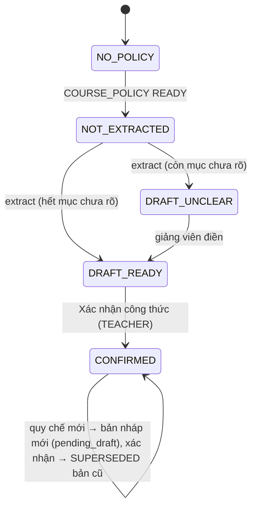

# SRS FEAT-gradebook Công thức điểm từ quy chế, Grade Engine, sổ điểm, chốt / mở khoá, điểm của sinh viên và seed sprint 8
Phiên bản 1.1 · 2026-10-31 · Trạng thái: **APPROVED** (PM, 2026-10-31; thay đổi sau mốc này chỉ qua `proposals.md`) (đã sửa theo `TL-REVIEW.md` TLR-1…19 — PM chấp nhận cả 19, chủ dự án chốt TLR-1, 2, 7, 17 —, `proposals.md` #3, #4, #5 (sửa: ghim lại số `WATCH`), #6; chủ dự án trả lời Q1–Q6; chờ PM đánh APPROVED)

Nguồn: `docs/phases/P6.md` (L1–L4), `docs/sprints/8/plan.md` story 1–11; PRD M7, M13-C, §3, §5; FLOWS F10, F14, F3; `ARCHITECTURE.md` §4 (`00016`), §5, §7, §9; `SYSTEM_DESIGN.md` (job nền, không cache điểm, SLO ghi); `DECISIONS.md` D5, D9, D17, D19, D33, D38, D39, D44, D45, D51, D54, D56; `design/DESIGN.md` §13, §14.9–§14.11; `UX.md` mục 1, 2, 5, 6; `AGENTS.md` luật 2, 5, 7, 10–15.

## 1. Mục đích và phạm vi

Công thức điểm đến từ **file quy chế môn học**: AI chỉ **trích bản nháp** (có trích dẫn trang), **bộ kiểm bằng code** chỉ ra chỗ chưa rõ, **giảng viên điền và xác nhận**, **code Go tính** (decimal, không `float64`, không LLM). Điểm cuối kỳ phải đúng tuyệt đối và giải trình được từng thành phần; hệ thống nhắc khi lớp chưa có công thức. Nguồn điểm đổ về sổ: bài thi PE đã công bố (nợ PE (5)), điểm cộng / vắng từ P5, nhập XLSX, sửa ô. Chốt điểm → snapshot bất biến; mở khoá có lý do → chốt lại phiên bản mới.

Trong phạm vi: `00016_gradebook`; `internal/grade` (đọc nguồn, Grade Engine, sổ điểm, chốt / mở khoá, nhập / xuất XLSX, trạng thái, nhắc, nguồn cho tool agent) và `internal/grading.ExtractGradeScheme` (LLM); `/gradebook`, `/gradebook/scheme`, phần điểm của `/me`, tab "Điểm" của `/students/[id]`, banner và cảnh báo ở `/attendance`; Provider "Hôm nay" `GRADE_SCHEME_UNCONFIRMED`; thông báo `GRADE_SCHEME_REMINDER`, `GRADE_FINALIZED`, `GRADE_CHANGED`; tín hiệu `GRADE` của at-risk; nối dây `get_my_grade_summary`, `what_if_final_grade`, intent `GRADE_FORMULA`; seed + đáp án 30/30; `scripts/gate-p6.sh`; `gradebook.spec.ts`.

Ngoài phạm vi: xem đầu `US.md`. Không có thay đổi hành vi tính điểm nào ngoài `phases/P6.md` mà chưa được đánh **[ĐIỂM]** ở `QUESTIONS.md` (mặc định BA đã áp vào đáp án; chủ dự án đảo → BA tính lại đáp án).

Bất biến: (1) mọi phép tính điểm là Go + `shopspring/decimal`; (2) không prompt nào tính hay làm tròn điểm; (3) chỉ TEACHER `Xác nhận công thức` / `Chốt điểm` / `Mở khoá`; không job, agent, seed script nào làm thay; (4) sinh viên không thấy điểm nháp, chỉ thấy điểm của mình; (5) thời gian học không bao giờ vào điểm; (6) danh tính sinh viên ở tool lấy từ JWT.

## 2. Người dùng và quyền

`Staff` = TA + TEACHER `ACTIVE` của lớp; ADMIN bị từ chối ở mọi route lớp (D39); **người ngoài lớp (mọi vai, kể cả uuid lớp không tồn tại) → `403`; id không phải uuid → `404`** (hành vi sẵn có của `CourseAccessGuard`, `proposals.md` sprint 8 #11). Mọi route lớp qua `CourseAccessGuard`.

| # | Hành động | STUDENT | TA | TEACHER | ADMIN |
| --- | --- | --- | --- | --- | --- |
| 1 | Tải quy chế mới / `extract` / sửa bản nháp / `confirm` | 403 | 403 | ✓ | 403 |
| 2 | Đọc công thức (`GET …/grade-scheme`, `…/status`, `…/impact`) | 403 | ✓ (chỉ đọc) | ✓ | 403 |
| 3 | Đọc sổ điểm, xem trước cả lớp, giải trình, lịch sử, bản chốt | 403 | ✓ | ✓ | 403 |
| 4 | Sửa ô, nhập XLSX, công bố / gỡ công bố cột | 403 | 403 | ✓ | 403 |
| 5 | Xuất XLSX | 403 | 403 | ✓ | 403 |
| 6 | `Chốt điểm` / `Mở khoá` | 403 | 403 | ✓ | 403 |
| 7 | `GET …/me/grades`, `POST …/me/grades/what-if` | ✓ (chính mình) | 403 | 403 | 403 |
| 8 | Tool `get_my_grade_summary`, `what_if_final_grade` (chat riêng) | ✓ (chính mình) | – | – | – |
| 9 | Nhận chuông `GRADE_SCHEME_REMINDER` | – | – | ✓ | – |
| 10 | Nhận chuông `GRADE_FINALIZED` / `GRADE_CHANGED` | ✓ (sinh viên liên quan) | – | – | – |
| 11 | Thấy banner / mục "Hôm nay" `GRADE_SCHEME_UNCONFIRMED` | – | ✓ | ✓ | – |

PRD §3 ghi ADMIN "Xem điểm: cả lớp" và TA chưa nêu quyền ghi điểm; mặc định ở bảng trên theo D39 và nguyên tắc "chỉ TEACHER đổi điểm" — Q7.

## 3. Luồng chính và nhánh lỗi

```mermaid
sequenceDiagram
  autonumber
  participant T as Giảng viên
  participant GW as Gateway (internal/grade)
  participant W as Worker (jobs: grade_scheme.extract)
  participant L as internal/llm (UTILITY, NEAR_REALTIME)
  participant DB as Postgres
  participant S as Sinh viên
  T->>GW: tải quy chế (COURSE_POLICY, P8) → ingest READY
  T->>GW: POST grade-scheme/extract {document_id}
  GW-->>T: 202 {job_id}
  W->>L: một llm.Structured (văn bản theo trang)
  L-->>W: {components, rules, citations, unclear_items}
  W->>W: bộ kiểm bằng code: tổng 100, đủ luật, trích dẫn có thật → unclear_items
  W->>DB: grade_schemes DRAFT (+components, rules, items)
  W-->>T: SSE job.progress 100
  T->>GW: PUT grade-scheme (điền chỗ chưa rõ) · POST impact (xem thử 3 sinh viên)
  T->>GW: POST grade-scheme/confirm (ConfirmIrreversible, Idempotency-Key)
  GW->>DB: DRAFT→CONFIRMED, mang điểm sang item cùng key, audit, outbox
  T->>GW: nhập XLSX / sửa ô · bài thi PE công bố · phát biểu / vắng (P5)
  GW->>GW: Compute (decimal) cho xem trước + giải trình
  T->>GW: POST gradebook/finalize (409 nếu chưa CONFIRMED / thiếu điểm)
  GW->>DB: final_grade_snapshots version N + khoá + audit
  GW-->>S: chuông GRADE_FINALIZED; /me/grades lấy từ snapshot
  T->>GW: POST gradebook/unlock {reason} → sửa → finalize lại
  GW->>DB: snapshot version N+1 (unlock_reason); bản N bất biến
  GW-->>S: chuông GRADE_CHANGED (chỉ người bị đổi)
```



| Tình huống | Hệ thống phản ứng | Người dùng thấy |
| --- | --- | --- |
| Lớp chưa có `COURSE_POLICY` / chưa xác nhận | `state ≠ CONFIRMED`; `finalize` → `409 SCHEME_NOT_CONFIRMED`; tool điểm → câu mẫu | Banner "Công thức điểm chưa xác nhận"; `Chốt điểm` khoá (tooltip lý do); chuông tuần; "Hôm nay"; AI nói chưa có công thức + ticket `AUTO_NO_FORMULA` (GRADE_FORMULA) |
| Quy chế sai định dạng / quá dài / không phải `COURSE_POLICY` | `422 DOCUMENT_NOT_POLICY` / `409 DOCUMENT_NOT_READY` / `422 POLICY_TOO_LONG` | Lỗi tại chỗ + hướng xử lý |
| LLM lỗi / đầu ra sai schema | Thử lại ≤ 3 lần; `FAILED` `LLM_UNAVAILABLE` / `EXTRACTION_INVALID`; không bản nháp rác; bản `CONFIRMED` giữ nguyên | Khối lỗi + `Thử lại` |
| Trích dẫn LLM không có trong tài liệu | `unclear_items = CITATION_NOT_FOUND` | Mục chặn xác nhận tới khi sửa / tự điền |
| Tổng trọng số ≠ 100, thiếu luật | `unclear_items` (mã ở 4.2.5) | Mục chưa rõ tại chỗ thiếu; `Xác nhận` khoá + lý do |
| Hai người sửa cùng bản nháp / cùng ô | `409 VERSION_CONFLICT` + giá trị hiện tại | Popover "{Tên} vừa nhập …" + `Giữ của tôi` / `Dùng của họ` |
| Điểm ngoài thang / chữ | `422 SCORE_OUT_OF_RANGE` | Lỗi tại ô, giữ chữ đã gõ |
| Sửa ô item bài thi | `409 ITEM_NOT_EDITABLE` | Tooltip "Điểm lấy từ bài thi, sửa ở bài thi" |
| Nhập XLSX có dòng lỗi | Xem trước liệt kê; ghi chỉ khi hết lỗi hoặc `skip_errors` (`409 IMPORT_HAS_ERRORS`) | Danh sách dòng lỗi + `Bỏ qua N dòng lỗi và ghi M dòng` |
| Chốt khi thiếu điểm | `409 GRADES_INCOMPLETE` (tất cả hoặc không) | Danh sách sinh viên thiếu + liên kết tới ô |
| Ghi điểm khi đã chốt | `409 GRADEBOOK_LOCKED` | Ô khoá; "Đã chốt v{n}"; `Mở khoá` |
| Mở khoá thiếu lý do / khi đang mở | `422` / `409 NOT_LOCKED` | Lỗi tại ô lý do |
| Tài liệu quy chế bị xoá sau khi xác nhận | Công thức vẫn `CONFIRMED` (`source_title` đã sao chép) | Trích dẫn "Tài liệu nguồn đã gỡ" |
| Sinh viên hỏi khi chưa có công thức | Câu mẫu (0 lời gọi LLM), nút `Nhờ giảng viên` | Câu "Lớp chưa có công thức điểm chính thức do giảng viên xác nhận." |
| Mất mạng khi sửa | Hàng đợi cục bộ, tự gửi lại | Nhãn tại ô, không mất chữ |

## 4. Yêu cầu chức năng

### 4.1 Hằng số (mọi giá trị có tên; sai → gateway không chạy và nêu tên biến)

| Tên | Mặc định | Ý nghĩa |
| --- | --- | --- |
| `GRADE_EXTRACT_MAX_CHARS` | 60000 (rune) | Giới hạn văn bản quy chế đưa vào một lần trích |
| `GRADE_EXTRACT_TIMEOUT` | 90s | Hạn cả việc trích (kèm mọi lần thử lại) |
| `GRADE_EXTRACT_ATTEMPT_TIMEOUT` | 45s | `ctx` con của **mỗi lần thử** gọi `llm.Structured` (gateway mặc định 30 s khi `ctx` không có hạn; không truyền thẳng `ctx` 90 s của cả job — TLR-18) |
| `GRADE_IMPORT_MAX_BYTES` | 2 MiB | Cỡ tệp XLSX nhập |
| `GRADE_IMPORT_MAX_ROWS` | 5000 | Số dòng tối đa |
| `GRADE_IMPORT_UNZIP_MAX` | 20 MiB | Giới hạn giải nén (chống zip bomb) |
| `GRADE_REMIND_AT` | 08:00 thứ Hai `Asia/Ho_Chi_Minh` | Giờ job nhắc tuần |
| `UNLOCK_REASON_MIN` / `MAX` | 10 / 500 (rune) | Độ dài lý do mở khoá |
| `GRADE_PAGE_MAX` | 100 | `limit` tối đa của bảng điểm |
| `WHATIF_STEP` | 0.01 | Bước quét của `MinFinalFor` |
| `GRADE_IMPACT_SAMPLES` | 3 | Số sinh viên mẫu ở xem thử |
| `GRADE_LOW_BELOW_DEFAULT` | 5.0 | Ngưỡng "điểm quá trình thấp" của tín hiệu `GRADE` (ghi đè ở `courses.settings.risk.grade_low_below`) |

### 4.2 Trích công thức (`internal/grading.ExtractGradeScheme`) — FR-8…FR-14

**4.2.1 Kích hoạt.** `POST …/grade-scheme/extract {document_id, replace_draft?}` (TEACHER, `Idempotency-Key`): tài liệu thuộc lớp, `type = COURSE_POLICY`, `status = READY`, độ dài ≤ `GRADE_EXTRACT_MAX_CHARS`; có `DRAFT` với chỉnh tay (`filled_by_user` hoặc `version > 1`) và không `replace_draft=true` → `409 DRAFT_EXISTS {edited_items}`. Ghi `jobs` kind `grade_scheme.extract` (`job_id` → `grade_schemes.extract_job_id UNIQUE` khi lưu) rồi `202 {job_id}`. Tải quy chế ở `/gradebook/scheme` dùng `uploads/presign` + `uploads/complete` (`purpose = document`, `type = COURSE_POLICY`, `FEAT-docs-calendar`), sau khi ingest `READY` giao diện gọi `extract` (không tự trích ở backend khi mọi `COURSE_POLICY` được tải lên — tránh tốn lời gọi LLM).

**4.2.2 Việc nền.** `jobs.Runner` (không thêm hạ tầng): dựng văn bản = `content_chunks` của tài liệu theo `(page_no, ord)`, nhóm theo trang, mỗi trang mở đầu bằng `[Trang N]`; đưa qua `internal/privacy` như mọi lời gọi LLM; **mỗi lần chạy đúng một** `llm.Structured` (task `UTILITY` → làn `NEAR_REALTIME`, `temperature 0`, `max_tokens` đủ cho schema, `ctx` con `GRADE_EXTRACT_ATTEMPT_TIMEOUT`, cả job ≤ `GRADE_EXTRACT_TIMEOUT`). Việc dự phòng provider khi đầu ra sai schema là của gateway (đầu ra sai schema đã được gateway tính vào mạch và chuyển provider dự phòng); `internal/grading` **không** gọi lại kèm "nhắc schema" (TLR-11). Tiến độ SSE `job.progress`: 5 (nhận) → 15 (dựng văn bản) → 20–80 (gọi LLM) → 90 (bộ kiểm) → 100 (ghi). Consumer idempotent (khoá `extract_job_id`), nhận lại sau khi worker chết không tạo bản nháp thứ hai; **chỉ lỗi tạm** (`ErrUnavailable`, mất kết nối) thử lại ở mức job (≤ 3 lần); đầu ra sai schema sau khi gateway đã dự phòng → `FAILED` mã `EXTRACTION_INVALID`, **không** thử lại ở mức job; hết lần → `FAILED`; không bản nháp rác.

**4.2.3 Prompt.** Chỉ dẫn hệ thống cố định: trích công thức từ văn bản; **không tính, không làm tròn, không suy đoán** mục không có; mục không thấy → đưa vào `unclear_items`; văn bản quy chế nằm trong khối dữ liệu có ranh giới và được nói rõ là dữ liệu, không phải chỉ dẫn; mỗi mục kèm `citation_ids`. Test dựng prompt (`TestPromptDelimitsDocument`).

**4.2.4 Schema đầu ra** (`llm.Structured`, `additionalProperties:false`; số là **chuỗi** decimal `^\d+(\.\d+)?$`):

```json
{ "components": [{ "key": "midterm", "name": "Giữa kỳ", "group": "QT|CK", "weight": "20", "kind_hint": "MANUAL|EXAM|ASSIGNMENT", "citation_ids": ["c1"] }],
  "rules": [{ "kind": "BONUS|PENALTY|ROUNDING|LETTER_SCALE|FAIL_CONDITION|MISSING_SCORE", "applicable": true, "params": { "…": "theo `kind`, xem bảng dưới" }, "citation_ids": ["c3"] }],
  "citations": [{ "id": "c1", "page": 1, "quote": "…" }],
  "unclear_items": [{ "message": "…", "target": "rules.ROUNDING" }] }
```

**Tương thích `json_schema` strict (TLR-4).** Với provider loại `openai`, gateway gửi `strict: true`: mọi object phải liệt kê đủ `properties` và **mọi khoá đều `required`**, `additionalProperties:false`. Vì vậy `params` là **`anyOf` sáu nhánh theo `kind`** (mỗi nhánh một object đủ `required`, `additionalProperties:false`; `kind` trong nhánh là `const`); trường tuỳ chọn (`kind_hint`, `source_quote`…) khai `type:["string","null"]` và vẫn `required`; **mọi số điểm / ngưỡng là chuỗi** decimal (`"7"`, `"3.0"`), chỉ `free` (số buổi miễn) là số nguyên. `ValidateJSON` của gateway đã hỗ trợ `anyOf` và `type:[…,"null"]`. Test `TestExtractSchemaStrictCompatible` duyệt schema: mọi object có `required` = mọi khoá của `properties`. Kiểm bằng schema Go, tham số lạ / thiếu = `PARAM_INVALID`:

| `kind` | `params` | Nghĩa |
| --- | --- | --- |
| `BONUS` | `{source:"PARTICIPATION", per_speak:"0.25", cap:"1.0"}` | Điểm cộng = Σ điểm `SPEAK` + `BONUS` ghi ở P5, tối đa `cap`; `per_speak` để hiển thị và đối chiếu (Q6) |
| `PENALTY` | `{source:"ABSENCE", free:2, per:"0.5"}` | Trừ `per` mỗi buổi `ABSENT` vượt `free` |
| `ROUNDING` | `{step:"0.5", mode:"HALF_UP"}` | `step` ∈ {0.01, 0.1, 0.25, 0.5, 1}; chỉ `HALF_UP` |
| `LETTER_SCALE` | `{bands:[{min:"9.0",letter:"A+"},…,{min:"0",letter:"F"}]}` | Giảm dần theo `min`; cuối cùng `min = 0` |
| `FAIL_CONDITION` | `{kind:"FINAL_BELOW", value:"3.0"}` hoặc `{kind:"ABSENT_AT_LEAST", value:"7"}` (`value` luôn là chuỗi; số buổi nguyên dương) | Nhiều dòng được; điểm chữ F |
| `MISSING_SCORE` | `{zero_components:["weekly"]}` | Thành phần (theo `key`) được tính 0 khi thiếu điểm |

**4.2.5 Bộ kiểm bằng code (FR-9, FR-10).** Chạy sau khi nhận đầu ra và **mỗi lần** giảng viên sửa bản nháp. Thêm `unclear_items {source:"CODE", code, target, message}`:

| `code` | Khi nào | Giảng viên xử lý |
| --- | --- | --- |
| `NO_COMPONENTS` | không có thành phần | thêm thành phần |
| `WEIGHT_SUM` | Σ `weight` ≠ 100 (ghi tổng thật) | sửa trọng số |
| `BONUS_MISSING` | không có luật `BONUS` và chưa `applicable:false` | điền hoặc `Không áp dụng` |
| `BONUS_CAP_MISSING` | `BONUS` thiếu `cap` | điền trần |
| `ABSENCE_RULE_MISSING` | không có `PENALTY` và chưa `applicable:false` | điền hoặc `Không áp dụng` |
| `ROUNDING_MISSING` | không có `ROUNDING` (không có "không áp dụng": điểm học phần luôn cần quy tắc — nhập bước 0,01 nếu không làm tròn) | điền bước |
| `LETTER_SCALE_MISSING` / `LETTER_SCALE_INVALID` | không có / hở / không tăng dần / không có mức `min = 0` | điền / sửa thang |
| `PARAM_INVALID` | tham số sai kiểu, âm, ngoài miền (`weight` ∉ [0;100], `step` ∉ tập cho phép); `FAIL_CONDITION FINAL_BELOW` khi tổng trọng số nhóm CK = 0 (TLR-9) | sửa |
| `CITATION_NOT_FOUND` | `quote` không có ở đúng `page` (4.2.6) hoặc `page` không tồn tại | sửa trích dẫn hoặc tự điền (xoá trích dẫn, `filled_by_user = true`) |

`unclear_items` do LLM đưa vào (`source:"LLM"`) cũng chặn. Mục chưa rõ **tự hết** khi dữ liệu bản nháp thoả điều kiện (không có trạng thái "đã giải quyết" riêng).

**4.2.6 So khớp trích dẫn.** Chuẩn hoá cả hai vế: NFC → gộp mọi khoảng trắng → bỏ dấu bằng `vn_fold` → hạ chữ thường; `quote` (đã chuẩn hoá) phải là chuỗi con của văn bản trang `page` (đã chuẩn hoá, gộp các đoạn của trang). Chịu được lỗi dấu của OCR (quy chế scan), không chịu được đổi từ. **Làm trong SQL, không viết lại `vn_fold` ở Go** (TLR-18): `position(vn_fold(normalize($quote, NFC)) in vn_fold(normalize(string_agg(text, ' ' order by ord), NFC)))` trên `content_chunks` của đúng `document_id` và `page_no`; `> 0` là khớp. So khớp trên đầu ra **đã gỡ placeholder** (giá trị `Structured` trả về, sau bước gỡ che danh tính của gateway), không so trước bước gỡ (TLR-19: quy chế có thể chứa tên giảng viên).

**4.2.7 Lưu.** Một giao dịch: `grade_schemes` `DRAFT` (`scheme_no = max+1`, `extraction` = đầu ra thô + `unclear_items` + `model` + `trace_id`), `grade_components` (+ **một** `grade_items` mặc định mỗi thành phần: `key = component.key`, `max_score = 10`, `source = MANUAL`), `grade_rules` (`source_quote`/`source_page` từ trích dẫn đầu tiên; `filled_by_user = false`); bản `DRAFT` cũ bị thay khi `replace_draft`; `audit_log`; **ghi kết quả bộ kiểm 4.2.5 lên `grade_schemes.unclear_codes` / `unclear_count` trong cùng giao dịch** (#16: nơi duy nhất lưu kết quả này; đọc không tính lại). **Kiểm lại ngay trong giao dịch lưu** (TLR-10; việc nền chạy 20–90 s nên giảng viên có thể đã sửa bản nháp trong lúc đó): còn `DRAFT` có `version > 1` hoặc `filled_by_user` mà yêu cầu **không** có `replace_draft` → job `FAILED` mã `DRAFT_EXISTS` (giao diện: "Bản nháp vừa được sửa; trích lại sẽ thay bản đó" + `Thay bản nháp`); có `replace_draft` thì so `version` của `DRAFT` lúc gọi `extract` với `version` lúc lưu, **khác nhau thì cũng `FAILED` `DRAFT_EXISTS`** — không bao giờ ghi đè chữ người dùng vừa gõ. **Không** có đường mã đổi `DRAFT → CONFIRMED` ngoài 4.4.4 (`TestConfirmOnlyFromHandler`).

### 4.3 Grade Engine (`internal/grade`) — FR-1…FR-7

**4.3.1 Nguyên tắc.** Hàm thuần `Compute(Scheme, Input) Result` — không `context`, không I/O, không đọc đồng hồ. `shopspring/decimal`; cấm `float32/64`, `math.Round`, `ParseFloat` (kiểm bằng AST); điểm vào / ra JSON là **chuỗi**. `internal/grade` không import `internal/activity`, `internal/crm`, `internal/llm`, `internal/grading`, `internal/privacy`, `internal/agent` (`go list -deps`); đọc P5 bằng truy vấn sqlc của `internal/store`.

**4.3.2 Công thức** (trọng số `w` là % của điểm học phần; `Σ w = 100`):

1. Điểm item `i`: `s_i = score_i ÷ max_i × 10` (decimal; **mọi phép chia dùng `DivRound(·, 20)`** — TLR-1).
2. Điểm thành phần `c`: `s_c` = trung bình cộng `s_i` của các item **đã có điểm đủ** (thiếu → 4.3.3).
3. `w_QT = Σ_{c∈QT} w_c`, `w_CK = Σ_{c∈CK} w_c`; `QT₀ = Σ_{c∈QT} w_c·s_c ÷ w_QT`; `CK = Σ_{c∈CK} w_c·s_c ÷ w_CK`. **Nhóm có `w = 0` thì số hạng của nhóm bị bỏ (không chia — TLR-9):** `w_QT = 0` ⇒ không có `QT₀`, `QT`, điểm cộng / trừ không có tác dụng (cảnh báo không chặn `BONUS_NO_EFFECT` ở `warnings[]` của công thức) và `HP_thô = CK`; `w_CK = 0` ⇒ không có `CK`, thiếu cuối kỳ không làm `INCOMPLETE`, và `FAIL_CONDITION FINAL_BELOW` bị bộ kiểm báo `PARAM_INVALID`.
4. `B = min(bonus_points, cap)`; `P = max(0, absent − free) × per + penalty_event_points`. **Luật không áp dụng (TLR-17, chủ dự án chốt):** `PENALTY.applicable = false` ⇒ `P = 0` — cả buổi vắng lẫn sự kiện `PENALTY` ghi tay ở P5 **không** bị trừ; sổ hiện cảnh báo không chặn `PENALTY_NOT_IN_SCHEME` khi còn sự kiện `PENALTY` khác 0 chưa được tính. Cùng nguyên tắc: `BONUS.applicable = false` ⇒ `B = 0` (sự kiện `SPEAK` / `BONUS` không được cộng) và sổ cảnh báo `BONUS_NOT_IN_SCHEME`.
5. `QT = clamp(QT₀ + B − P, 0, 10)` (trần 10 theo công thức PRD; sàn 0 mặc định — Q4).
6. `HP_thô = (w_QT·QT + w_CK·CK) ÷ 100`, rồi **chuẩn hoá độ chính xác máy: `HP_thô = HP_thô.Round(10)` ngay trước bước 7** (TLR-1; không phải làm tròn nghiệp vụ). Lý do: điểm vào có ≤ 2 chữ số thập phân và `max ≤ 999,99`, nên khoảng cách thật tới một biên làm tròn (nếu khác 0) lớn hơn sai số chia ~1e-15 rất nhiều; không có chuẩn hoá thì item `10/30` làm `HP_thô` đúng 6,25 thành 6,2499… và làm tròn **xuống** (ca S16). `QT` và `HP_thô` được lưu, hiển thị và so sánh ở dạng đã chuẩn hoá. Phương án chặt hơn (lõi `math/big.Rat`) **không** dùng: lệch chữ của luật 5.
7. `HP = HP_thô.Div(step).Round(0).Mul(step)` (**một lần ở cuối**; không làm tròn trung gian). `Round` của `shopspring/decimal` làm tròn nửa xa 0, bằng nửa lên vì `HP ≥ 0`; mã **không** có hằng `0,5` cho bước này (TLR-13). Cấm `RoundBank`, `StringFixedBank`, `StringFixed` cho số trung gian.
8. `letter` = mức đầu tiên (giảm dần) có `min ≤ HP`.
9. Liệt: mọi `FAIL_CONDITION` đang đúng (`CK < value` · `absent ≥ value`) → `letter = F`, `verdict = LIET:<kind>`; `HP` giữ nguyên số đã tính.

`Input{ Scores: map[itemID]*Decimal (nil = thiếu), BonusPoints, PenaltyEventPoints Decimal, Absent int }`. `Result{ Status COMPLETE|INCOMPLETE, Missing[], Components[], QT0, Bonus, BonusApplied, Penalty, QTBeforeClamp, QT, CK, HPRaw, HP, Letter, Verdict, Lines[] }`.

**4.3.3 Thiếu điểm.** Thiếu một item của thành phần `c` ⇒ `Status = INCOMPLETE`, `Missing += c`, **không** có `HP` / `letter` (không bịa 0 — Q2). **Ngoại lệ duy nhất, chỉ khi nguồn đã chốt sổ cho item đó (TLR-2, chủ dự án chốt):** nếu `key(c) ∈ MISSING_SCORE.zero_components` thì item thiếu được coi là **0** (dòng giải trình "không dự → 0 theo quy chế") khi (a) item `EXAM`: bài thi `PUBLISHED` mà sinh viên không có lượt `GRADED`; (b) item `MANUAL`/`IMPORT`: cột đã công bố (`published_at`) mà ô trống. Bài thi chưa `PUBLISHED`, hoặc cột nhập tay chưa công bố → **`INCOMPLETE`** (giải trình "Bài thi chưa công bố" / "Cột chưa công bố"), nên giảng viên quên công bố không thể chốt điểm với cột = 0 cho cả lớp. Thiếu cuối kỳ luôn `INCOMPLETE` (không nằm trong `zero_components` của quy chế seed). Các ca: `cases-tong-hop.csv` S13…S15.

**4.3.4 Giải trình.** `Lines[] = {label, expr, value, source_quote, page, filled_by_user}` theo thứ tự: mỗi thành phần (trọng số, điểm) → điểm cộng (`n lần × điểm`, trần) → điểm trừ (số buổi vắng, miễn, mức) → `QT` (kèm "vượt trần/sàn → …" nếu kẹp) → `CK` → `HP_thô` (công thức với số thật) → làm tròn (bước, nửa lên) → điểm chữ (mức) → liệt. `source_quote` lấy từ `grade_rules` / `grade_components` (nguyên văn quy chế); mục giảng viên tự điền → `null`. **Giá trị trong `Lines[]` hiển thị đầy đủ chữ số, không làm tròn**, dấu phẩy, bỏ số 0 thừa (TLR-5; không dùng `StringFixed`/`StringFixedBank` cho số trung gian); chỉ dòng `HP` hiện theo bước làm tròn. Mỗi dòng có `expr` gồm **đúng các số đã hiển thị**: tính lại `expr` bằng decimal ra đúng `value`, và dòng `HP thô` bằng `Result.HPRaw` (TLR-13; kiểm được bằng máy — các dòng là từng bước, không phải số hạng cộng dồn).

**4.3.5 `WhatIf` và `MinFinalFor`.** `WhatIf(s, in, ck)` = `Compute` với `CK = ck` (0–10, decimal), không ghi gì; `ck < value` liệt vẫn áp. `MinFinalFor(s, in, target)` = `ck` nhỏ nhất ∈ {0; 0,01; …; 10} sao cho `letter ≥ target` (theo thứ tự thang) và không liệt; không có → "không đạt được". Hai hàm dùng cùng `Compute` (không đường tính thứ hai).

**4.3.6 Nguồn đầu vào (đọc trực tiếp lúc tính — FR-2).** Item `MANUAL`/`IMPORT`: `grade_entries.score`. Item `EXAM`: `COALESCE(adjusted_score, auto_score)` của `exam_attempts` `GRADED` **chỉ khi** `exams.status = 'PUBLISHED'`, quy thang `÷ exams.max_score × grade_items.max_score`; không có lượt / chưa công bố = thiếu. P5: `bonus_points = Σ points (SPEAK, BONUS)`; `penalty_event_points = |Σ points (PENALTY)|`; `absent = count(status = 'ABSENT')`; chỉ sinh viên `enrollments ACTIVE`. Không đọc `study_time_daily`, `student_risk`, `student_observations`.

### 4.4 Công thức: sửa, xem thử, xác nhận, so sánh — FR-15…FR-21

**4.4.1 Đọc.** `GET …/grade-scheme[?diff=confirmed]` (Staff): `{confirmed, draft, diff?}`; mỗi `scheme` có `components[{key,name,grp,weight,items[],citations[],filled_by_user}]`, `rules[{kind,applicable,params,citations,filled_by_user}]`, `unclear_items`, `warnings` (không chặn: `PER_SPEAK_MISMATCH`, `BONUS_NO_EFFECT`, `PENALTY_NOT_IN_SCHEME`, `BONUS_NOT_IN_SCHEME`). `diff` (code): thành phần thêm / bớt / đổi trọng số, luật đổi `params` (cũ → mới), tổng trọng số.

**4.4.2 Sửa bản nháp.** `PUT …/grade-scheme {version, components, rules}` (TEACHER): thay toàn bộ (validate → bộ kiểm 4.2.5 → trả bản nháp + `unclear_items`); `version + 1`, **và ghi lại `unclear_codes` / `unclear_count` từ kết quả bộ kiểm vừa chạy trong cùng giao dịch** (#16); sai `version` → `409 VERSION_CONFLICT` + bản hiện tại; không có `DRAFT` → `409 NO_DRAFT`; chỉ `DRAFT` sửa được (`409 SCHEME_NOT_DRAFT`). Mục giảng viên sửa / điền → `filled_by_user = true`, trích dẫn của mục đó bị gỡ nếu giá trị đổi. Giảng viên có thể gắn item `EXAM` (`exam_id` của lớp; một bài thi chỉ ở một item trong một công thức; bài thi `DRAFT` chưa lên lịch không gắn được — `422`) hoặc thêm item `MANUAL`. Cảnh báo không chặn `warnings[]`: `PER_SPEAK_MISMATCH` khi `BONUS.per_speak` khác điểm phát biểu mặc định của lớp (`PARTICIPATION_DEFAULT_POINTS`).

**4.4.3 Xem thử tác động.** `POST …/grade-scheme/impact {components, rules}` (Staff; chỉ đọc; không `Idempotency-Key`): chạy `Compute` cho mọi sinh viên **đủ điểm** theo công thức đang xét; trả `{students_total, students_computable, changed_vs_confirmed, entries_carried, entries_dropped:[{item_key, count, reason}], samples:[3 × {student:{id,full_name}, before:{hp,letter}|null, after:{hp,letter}}]}`; mẫu = `HP` cao nhất, gần trung vị, thấp nhất (hoà → `student_id` nhỏ nhất); không có sinh viên đủ điểm → `samples:[]`.

**4.4.4 Xác nhận.** `POST …/grade-scheme/confirm {version}` (TEACHER, `Idempotency-Key`; giao diện `<ConfirmIrreversible>` nêu số từ 4.4.3): trong một giao dịch, **theo thứ tự**: (1) `INSERT INTO gradebooks (course_id) … ON CONFLICT DO NOTHING` (lần xác nhận đầu tạo hàng — TLR-6) rồi `SELECT status FROM gradebooks … FOR SHARE`; `LOCKED` → `409 GRADEBOOK_LOCKED`; (2) kiểm `DRAFT` còn `unclear_items` → `422 SCHEME_HAS_UNCLEAR {codes}`; (3) bản `CONFIRMED` cũ → `SUPERSEDED` **trước**, rồi `DRAFT → CONFIRMED` (`confirmed_by/at`) — chỉ mục duy nhất một phần không `DEFERRABLE`, sai thứ tự là `23505` (Tech Lead, #3 (d)); (4) **mang điểm** (TLR-8): với mỗi item mới có `key` trùng item của bản cũ **và** cùng `source ∈ {MANUAL, IMPORT}` **và** cùng `max_score`, `UPDATE grade_entries SET item_id = <mới>`; ngược lại **không mang** (đổi `max_score` 10 → 100 sẽ biến 8,0 thành 8/100; đổi nguồn sang `EXAM` thì engine không đọc `grade_entries`): `impact` trả `entries_dropped` kèm lý do và `<ConfirmIrreversible>` nêu số đó; item cũ không còn / không mang giữ nguyên (ẩn khỏi bảng); `audit_log`; outbox `grade.scheme_confirmed` (xoá cache "Hôm nay", tắt banner).

**4.4.5 Quy chế mới.** Tải `COURSE_POLICY` khác rồi `extract`: tạo `DRAFT` mới cạnh `CONFIRMED` (`pending_draft`), **không** đổi bản đang dùng; giao diện có chế độ so sánh (`?diff=confirmed`).

### 4.5 Trạng thái, nhắc, nguồn việc — FR-22…FR-27

**4.5.1 `GET …/grade-scheme/status`** (Staff): `{state, unclear_count, has_policy, confirmed_at?, scheme_no?, pending_draft, gradebook:{status, snapshot_version}, finalize_blocked_reason?}`; `state` ∈ `NO_POLICY` · `NOT_EXTRACTED` · `DRAFT_UNCLEAR` · `DRAFT_READY` · `CONFIRMED` (4.4 sơ đồ). `finalize_blocked_reason` = "Chưa có công thức điểm đã xác nhận" khi `state ≠ CONFIRMED`. Đọc mỗi lần (không cache phía server — điểm không cache).

**4.5.2 Banner và cảnh báo.** `/gradebook`: một `InlineNotice` mỏng cố định khi `state ≠ CONFIRMED` ("Công thức điểm chưa xác nhận" + liên kết theo vai); `/attendance`: một `InlineNotice` mỏng phía trên bảng, không chặn thao tác; `/students/[id]` tab Điểm: EmptyState khi chưa có công thức. Mọi chỗ khác không có banner (luật chữ UI).

**4.5.3 Provider "Hôm nay"** `GRADE_SCHEME_UNCONFIRMED` (Staff, bậc 70 — `FEAT-course-foundation` 4.7): mỗi lớp `ACTIVE` có `state ≠ CONFIRMED` một mục; tiêu đề / lý do / `href` ở US-P6-05 AC5; hạn Provider 150 ms; **số mục chưa rõ của lý do `DRAFT_UNCLEAR` đọc từ `grade_schemes.unclear_count`** — Provider, `GradeStatusFacts` và `GET …/grade-scheme/status` **không** gọi lại bộ kiểm (`InspectDrafts`) khi đọc, nên số truy vấn là hằng số (`TestTodayQueryBudget` ≤ 7, kể cả giảng viên 2 lớp cùng có `DRAFT` có trích dẫn; #16); `state` suy từ cột này (`unclear_count > 0` → `DRAFT_UNCLEAR`, `= 0` → `DRAFT_READY`); xoá cache khi outbox `grade.scheme_confirmed` hoặc `document.changed`. Trích dẫn chỉ hỏng khi tài liệu nguồn đổi hoặc bị gỡ: handler của outbox `document.changed` (`{course_id, document_id}`; đã phát khi tạo / sửa / xoá tài liệu — `FEAT-docs-calendar` AC14; **không có** topic `course.policy_changed` trong mã) chạy lại bộ kiểm 4.2.5 (kiểm trích dẫn 4.2.6) cho `DRAFT` của lớp đó **chỉ khi** `document_id` là `source_document_id` của bản nháp (hoặc bản nháp vừa mất nguồn do tài liệu bị xoá) và ghi lại hai cột (không đổi `version` của bản nháp, không đụng chữ giảng viên đã điền).

**4.5.4 Job nhắc tuần `grade.scheme_reminder`.** Mỗi tick (1 phút): khi thứ Hai và `now ≥ GRADE_REMIND_AT` và `SET ep:grade.remind:{yyyyww} 1 NX EX 8d` (khoá leader `ep:lock:grade.remind`, chạy bù cả tuần nếu worker lên lại) → với mỗi lớp `ACTIVE` chưa có `CONFIRMED`: thông báo `GRADE_SCHEME_REMINDER` cho TEACHER (khử trùng `grade.scheme_reminder:{course}:{yyyyww}:{user}`; nội dung "Lớp {mã lớp} chưa có công thức điểm đã xác nhận."; liên kết `/gradebook/scheme?course={id}`). Lỗi giữa chừng → `DEL` khoá để tick sau thử lại.

**4.5.5 Tool điểm khi chưa `CONFIRMED`.** `GradeSource` / `GradeSchemeSource` (giao diện của `FEAT-private-chat-pii`) trả `NoFormula` → agent dùng câu mẫu "Lớp chưa có công thức điểm chính thức do giảng viên xác nhận." (0 lời gọi LLM), `ResponseMetadata.NoFormula = true`; ticket tự động `AUTO_NO_FORMULA` **chỉ** khi intent = `GRADE_FORMULA` (`FEAT-escalation-notify` 4.2.4, không đổi); nút `Nhờ giảng viên` luôn có.

### 4.6 Sổ điểm, nhập, xuất, công bố cột — FR-28…FR-38

**4.6.1 `GET …/gradebook?cursor=&limit=`** (Staff; `limit ≤ 100`; sắp `vn_fold(full_name), student_id`): `{scheme:{id,scheme_no}, state:{status,snapshot_version}, columns:[{item_id,key,name,component_key,grp,max_score,source,published}], rows:[{student:{id,full_name,student_code}, entries:{<item_id>:{score,version,source,updated_by?}}, bonus, penalty, result:{status,qt,hp,letter,verdict,missing[]}, locked?:{version}, drift?:bool}], next_cursor}`. Mỗi trang đúng **một** lượt truy vấn cho điểm / sự kiện / điểm danh theo `student_id = ANY($ids)`; `Compute` tính ở máy chủ. Lớp chưa `CONFIRMED`: `columns:[]`, `rows` chỉ có `student`. Trang đầu kèm `warnings[]` của sổ (`PENALTY_NOT_IN_SCHEME` / `BONUS_NOT_IN_SCHEME` khi luật `applicable = false` mà vẫn có sự kiện `PENALTY` / `SPEAK`/`BONUS` ≠ 0 — TLR-17). Đã `LOCKED`: `result` lấy từ snapshot mới nhất; `drift = true` nếu `Compute` hiện tại khác snapshot.

**4.6.2 `GET …/gradebook/preview?cursor=&limit=`** (Staff): `{summary?:{students, complete, incomplete, liet, distribution:{"A+":n,…}}, items:[{student_id,student_code,full_name,status,qt,hp_raw,hp,letter,verdict}], next_cursor}`; `summary` chỉ ở trang đầu. Là nguồn của hộp thoại chốt và của `check-grade-seed.mjs`.

**4.6.3 Sửa ô.** `PUT …/grade-entries {item_id, student_id, score|null, version|null}` (TEACHER): item `MANUAL` / `IMPORT` của công thức `CONFIRMED`; `score` ∈ [0; `max_score`] và **khớp `^\d{1,3}([.,]\d{1,2})?$` sau `TrimSpace`** (Go, **trước** DB — cùng luật với nhập XLSX; quá 2 chữ số thập phân → `422 SCORE_PRECISION` "Điểm có quá 2 chữ số thập phân", **không tự làm tròn**: `numeric(5,2)` của Postgres sẽ âm thầm làm tròn 8,333 → 8,33 — TLR-7, chủ dự án chốt), nhận `8,5` / `8.5` ở giao diện (gửi chuỗi `"8.50"`); **Khoá lớp ghi (TLR-6):** mọi giao dịch ghi (sửa ô, nhập, công bố cột, xác nhận) mở đầu bằng `SELECT status FROM gradebooks WHERE course_id = $1 FOR SHARE` rồi kiểm `LOCKED` trong cùng giao dịch (hàng luôn có vì được tạo lúc xác nhận công thức đầu tiên; trước `CONFIRMED` không có đường ghi điểm); `finalize` và `unlock` dùng `FOR UPDATE`. `version = null` cho ô mới (ô đã có mà `null` → `409 VERSION_CONFLICT`); đúng `version` → `UPDATE … WHERE version = $v`, `version + 1`; `score = null` xoá ô (cũng kiểm `version`); trong **một** giao dịch ghi `audit_log` (`entity='grade_entries'`, `action='set'`, `before`, `after`; audit lỗi → không ghi điểm). `200 {entry, row_result}` với `row_result` = `Compute` của hàng đó (xem trước tức thì). Item `EXAM` → `409 ITEM_NOT_EDITABLE`; sổ `LOCKED` → `409 GRADEBOOK_LOCKED`; sinh viên không `ACTIVE` → `422`.

**4.6.4 Nhập XLSX.** Tải qua `POST …/uploads/presign {purpose:"grade_import", …}` → `PUT` → `POST …/grade-entries/import {upload_id, item_id, mode:"preview"|"commit", mapping:{header_row, student_code_col, score_col}, skip_errors?}` (TEACHER; `commit` đòi `Idempotency-Key`). Không trạng thái trong tiến trình: cả hai chế độ **đọc lại** tệp từ object storage (kết quả tất định). Đọc `excelize.OpenReader(io.LimitReader(obj, GRADE_IMPORT_MAX_BYTES+1), excelize.Options{UnzipSizeLimit: 20<<20, UnzipXMLSizeLimit: 20<<20})` (mặc định thư viện là 16 GB, tức không chống zip bomb — TLR-14), trang tính đầu bằng `f.Rows(sheet)`, dừng ở dòng 5.001 → `TOO_MANY_ROWS`; khi đọc lại tệp, so `sha256` với giá trị đã khai ở `presign` (làm cho "xem trước = ghi" tất định). Với mỗi dòng: MSSV là **chuỗi** (ô số `20229002.0` → `20229002`); khớp **`enrollments.student_code_snapshot`** của dòng `ACTIVE` trong lớp (từ danh sách lớp, hoặc do giảng viên đã duyệt khi trùng → `EMAIL_MISMATCH`), **không** `users.student_code` (MSSV người dùng tự khai — nối điểm vào tài khoản theo MSSV tự khai là điều `AGENTS.md` cấm; TLR-3); chuẩn hoá ô MSSV: `TrimSpace` + chữ hoa + bỏ đuôi `.0` (CHECK của cột `^[A-Z0-9]{6,15}$`); sổ điểm, xuất XLSX và `AMBIGUOUS_STUDENT_CODE` cũng dùng đúng trường này; điểm chấp nhận `8,5` / `8.5` ∈ [0; `max_score`], cùng luật `SCORE_PRECISION` của 4.6.3 (quá 2 chữ số → dòng lỗi `SCORE_PRECISION`, không tự làm tròn); ô điểm đọc bằng giá trị **đã định dạng** (excelize mặc định, không `RawCellValue`) để ô công thức `=22/3` hay ô General ra `7.33` chứ không phải `7.333333333333333` (TLR-7); ô điểm trống = bỏ qua (không xoá); mã lỗi `STUDENT_NOT_IN_COURSE`, `DUPLICATE_IN_FILE`, `AMBIGUOUS_STUDENT_CODE`, `SCORE_OUT_OF_RANGE`, `SCORE_NOT_NUMBER`. Xem trước trả `{rows_total, rows_ok, overwrites, unchanged, errors[], sample[≤20]}`, không ghi. `commit`: còn lỗi mà không `skip_errors` → `409 IMPORT_HAS_ERRORS`; ghi **một giao dịch, một câu lệnh theo lô** (TLR-16): CTE `old AS (SELECT … FOR UPDATE)` → `INSERT … ON CONFLICT (item_id, student_id) DO UPDATE … WHERE score IS DISTINCT FROM EXCLUDED.score RETURNING` → `INSERT INTO audit_log SELECT …` (`RETURNING` không trả giá trị cũ nên cần CTE), `source = IMPORT`, `version + 1` khi đổi, một `audit_log` mỗi điểm đổi + một dòng tổng; điểm không đổi = `unchanged` (idempotent theo (item, sinh viên)); item `EXAM` → `409 ITEM_NOT_EDITABLE`; `LOCKED` → `409 GRADEBOOK_LOCKED`. Nhập không tự công bố cột (giao diện có tuỳ chọn `Công bố cột cho sinh viên`, mặc định tắt, gọi 4.6.6 sau khi ghi).

**4.6.5 Xuất XLSX.** `GET …/gradebook/export.xlsx` (TEACHER): `excelize`, `Content-Disposition: attachment`, `Cache-Control: no-store`; bố cục ở US-P6-07 AC7 (hàng đầu: tên lớp, mã lớp, thời điểm, "Bản chốt v{n}" hoặc "Bản xem trước — chưa chốt"; cột cố định; hàng cuối: "Điểm chính thức nằm ở hệ thống quản lý đào tạo của trường."); số điểm ghi **dạng số** (định dạng 2 chữ số thập phân); ô văn bản bắt đầu `=`, `+`, `-`, `@` ghi bằng `SetCellStr` (không thành công thức); mỗi lần xuất ghi `audit_log` (`action='export'`, số dòng); nguồn: snapshot mới nhất nếu `LOCKED`, `Compute` nếu `OPEN`. Mẫu cột cố định ở P6 (Q9).

**4.6.6 Công bố cột.** `POST …/grade-items/{itemId}/publish {published}` (TEACHER, idempotent): đặt / xoá `grade_items.published_at`; chỉ item `MANUAL`/`IMPORT` (`EXAM` theo bài thi: `409 ITEM_NOT_PUBLISHABLE`); `audit_log`; `LOCKED` → `409`. Mặc định chưa công bố.

**4.6.7 Giải trình và lịch sử.** `GET …/gradebook/students/{uid}/explain` (Staff): `{student, result, lines[]}` (bản sống; sổ `LOCKED` → thêm `snapshot:{version,lines}`); `GET …/gradebook/students/{uid}/history?cursor=` (Staff): ≤ 50 mục từ `audit_log` (`entity ∈ {grade_entries, grade_items}`), phân trang con trỏ.

### 4.7 Chốt, snapshot, mở khoá — FR-39…FR-46

**4.7.1 `POST …/gradebook/finalize`** (TEACHER, `Idempotency-Key`): giao dịch `SERIALIZABLE`-tương đương (khoá hàng `gradebooks` `FOR UPDATE` — hàng đã được tạo lúc xác nhận công thức đầu tiên, TLR-6): `LOCKED` → `409 GRADEBOOK_LOCKED`; không `CONFIRMED` → `409 SCHEME_NOT_CONFIRMED`; tính `Compute` mọi sinh viên `ACTIVE`; còn `INCOMPLETE` → `409 GRADES_INCOMPLETE {students[≤30], total}` (không ghi gì); ngược lại `INSERT final_grade_snapshots` cho **mọi** sinh viên **bằng một lô** (`pgx.CopyFrom` hoặc `INSERT … SELECT unnest(…)` — TLR-16, không `INSERT` từng dòng) (`version = snapshot_version + 1`, `scheme_id`, `breakdown` = `{scheme:{id,scheme_no,version}, components[], qt{…}, final, hp_raw, hp, letter, failed, lines[]}` — số là chuỗi, `lines` có `source_quote`; `numeric_grade = hp`, `letter`, `failed_reason`, `locked_at`, `locked_by`, `unlock_reason` = lý do của lần mở khoá gần nhất nếu `version > 1`, ngược lại `NULL`); `gradebooks.status = LOCKED`, `snapshot_version`, xoá `unlock_*`; `audit_log`; outbox `grade.finalized`; `200 {version, students, locked_at}`.

**4.7.2 Bất biến.** Trigger `BEFORE UPDATE OR DELETE` theo dòng **và `BEFORE TRUNCATE … FOR EACH STATEMENT`** (cùng hàm; TLR-15 — trigger theo dòng không chặn `TRUNCATE`) trên `final_grade_snapshots` → `RAISE EXCEPTION 'snapshot is immutable'`; chỉ mục `(course_id, version, student_id)` cho `…/snapshots/{version}?cursor=`; **nợ PR:** xoá / ẩn danh snapshot (quyền dữ liệu cá nhân, lưu trữ lớp) đi qua một hàm `SECURITY DEFINER` có `audit_log`, không tắt trigger; `(course_id, student_id, version)` duy nhất; bản cũ đọc được qua `GET …/gradebook/snapshots` (danh sách phiên bản) và `…/snapshots/{version}?cursor=` (Staff).

**4.7.3 Khoá.** `LOCKED` ⇒ `PUT …/grade-entries`, `…/grade-entries/import`, `…/grade-items/{id}/publish`, `…/grade-scheme/confirm` → `409 GRADEBOOK_LOCKED`; thay đổi ở nguồn sống không đổi snapshot; hàng có `Compute` khác snapshot → `drift` (chỉ Staff thấy nhãn "Khác bản chốt").

**4.7.4 `POST …/gradebook/unlock {reason}`** (TEACHER, `Idempotency-Key`; giao diện `<ConfirmIrreversible>`): `reason` 10–500 rune (`422 VALIDATION_FAILED`); đang `OPEN` → `409 NOT_LOCKED`; `gradebooks.status = OPEN`, `unlock_reason`, `unlocked_by/at`; `audit_log`. Bản cũ không đổi.

**4.7.5 Thông báo.** Outbox `grade.finalized` → handler: lần đầu (`version = 1`) `GRADE_FINALIZED` cho mọi sinh viên "Điểm học phần lớp {mã lớp} đã được chốt."; `version > 1` → `GRADE_CHANGED` **chỉ** cho sinh viên có `numeric_grade` hoặc `letter` khác bản trước "Điểm học phần lớp {mã lớp} đã được cập nhật."; **không có con số** trong thông báo; khử trùng `grade.finalized:{course}:v{n}:{user}`; chỉ chuông. Handler phát thông báo cả lớp bằng **một** `INSERT … SELECT` (TLR-16), so `numeric_grade` / `letter` giữa hai phiên bản bằng một câu `JOIN` — không vòng lặp theo sinh viên.

### 4.8 Phía sinh viên, tool, at-risk — FR-47…FR-52

**4.8.1 `GET /courses/{cid}/me/grades`** (STUDENT; qua `CourseAccessGuard`; `user_id` từ JWT; mọi tham số định danh bị bỏ qua; `Cache-Control: no-store`): `{status, scheme?:{scheme_no, confirmed_at, components:[{key,name,grp,weight}]}, components:[{key,name,weight,status:"PUBLISHED"|"PENDING",score?}], bonus:{applied, raw, cap}, penalty:{value, absent, free, per}, qt?, final?:{numeric_grade, letter, failed_reason?, version, locked_at}, calculation:[{label,expr,value,source_quote?,page?}], official_note}`. `status`: `NO_SCHEME` (chỉ trả `status`) · `IN_PROGRESS` · `FINAL` (từ snapshot mới nhất). Quy tắc thấy: item chỉ có `score` khi đã công bố (4.6.6; bài thi `PUBLISHED`); `qt` chỉ khi **mọi** item của thành phần quá trình đã công bố; `final` chỉ sau chốt; điểm cộng / vắng là dữ liệu P5 đã hiển thị ở `/me`. DTO sinh viên là **struct riêng** + allowlist khoá JSON; **không** có `hp_raw`, `breakdown` nội bộ, `unclear_items`, tên người sửa, `drift`, `unlock_reason`.

**4.8.2 What-if.** `POST /courses/{cid}/me/grades/what-if {final_exam_score? | target_letter?}` (STUDENT, chỉ đọc, không `Idempotency-Key`): chỉ khi `status = IN_PROGRESS` và mọi thành phần quá trình đã công bố (`WhatIf` / `MinFinalFor` của engine); `final_exam_score` ∈ [0;10] (`422` ngoài thang); trả `{hp, letter, failed?, calculation[]}` hoặc `{min_final_exam_score|null}`; không ghi gì; thiếu thành phần → `409 NOT_ENOUGH_GRADES`; `FINAL` → `409 FINAL_ALREADY_LOCKED`.

**4.8.3 Tool agent.** `get_my_grade_summary()` (không tham số) và `what_if_final_grade({assumed:{final:số}} | {target_letter})` (LLM chỉ cung cấp giả định — không `user_id`, không `student_code`); `user_id`, `course_id` từ `trusted_context`; cài đặt `GradeSource` / `GradeSchemeSource` trong `internal/agent` (gọi `grade.Service`; `grade` không import `agent`); chỉ đăng ký ở `PrivateRegistry`. Một lời gọi LLM sinh chữ (D47), số trong khối dữ liệu do code đưa vào, LLM không tính. Intent `GRADE_FORMULA` khi `CONFIRMED`: khối cấu trúc `{components[], bonus, penalty, rounding, letter_scale}` từ công thức đã xác nhận + nguồn "Quy chế học phần, tr. N".

**4.8.4 Tín hiệu `GRADE` của at-risk** (`FEAT-crm-360` 4.7; nợ sprint 7): trong `crm.risk`, với lớp có `CONFIRMED`, `GRADE` = `qt` hiện tại (thang 10) của sinh viên **nếu tính được** (mọi thành phần quá trình đủ điểm theo 4.3.3) dùng `Compute` qua giao diện chỉ đọc `grade.RiskInput` (đọc đầu vào **cả lớp** bằng đúng bộ truy vấn `ANY($ids)` của 5.2 rồi `Compute` trong bộ nhớ — không truy vấn riêng từng sinh viên, TLR-16) (không import engine ngược: `crm` gọi hàm của `grade`; **`grade` không import `crm`**); "thấp" khi `< grade_low_below` (mặc định 5,0 ∈ [0;10] bước 0,5 ở `courses.settings.risk`; `PUT …/settings {risk:{grade_low_below}}` do `FEAT-crm-360` 4.7.3 nhận thêm khoá này); tín hiệu **neo**; câu lý do `GRADE_LOW` → "điểm quá trình hiện tại {x}/10"; lớp chưa `CONFIRMED` hoặc không tính được → `null`. Không có thời gian học trong phép tính. Đáp án lớp 1: `seed/expected_risk.csv` (`WATCH` = {sv12, sv19, sv26}).

### 4.9 Seed (US-S8-SEED) — FR-54, FR-55

Mở rộng `scripts/seed.mjs` (HTTP API thật, không ghi DB, idempotent, chặn production): (1) dựng `seed/demo/quy-che-lop1.pdf`, `quy-che-lop2.pdf` từ `fixtures/*.md` (đúng chữ, ngắt trang theo dấu trang, có lớp chữ; script không thêm thư viện ngoài bảng — Q15); (2) `Quyche.pdf` → `OTHER`/`Quy chế trường` (đổi vai trò, `proposals.md` #2); (3) lớp 1: tải `quy-che-lop1.pdf` (`COURSE_POLICY`) → `extract` (provider giả: `extraction-lop1.json`) → `confirm` bằng TEACHER; nối item `weekly` với bài thi `Kiểm tra tuần 9 — Mật mã`; nhập hai tệp XLSX (giữa kỳ, cuối kỳ) từ `inputs-lop1.csv`; công bố hai cột; sổ **chưa chốt**; (4) lớp 2 không có quy chế; (5) `fake_llm.json` có bản ghi cho `quy-che-lop1`, `quy-che-lop2`; (6) `scripts/check-grade-seed.mjs preview|abc|counts`; (7) `scripts/gate-p6.sh`. Đáp án: `seed/expected_final_grades.csv` (30 dòng) và `seed/expected_risk.csv` (BA). **At-risk sau khi có điểm (#5):** thứ tự seed: điểm lớp 1 vào trước, rồi `gateway admin crm-risk-run`. Kết quả pin: `AT_RISK` = {C}; `WATCH` = {`sv12`, `sv19`, `sv26`}; mọi sinh viên khác `NONE`. `sv26` vào `WATCH` vì điểm quá trình 2,125 < 5,0 (tín hiệu `GRADE` thấp) **và** không có hoạt động nào ở tuần 9 (W1) nhưng có ≥ 1 ở tuần 8 (W2). Sinh viên có điểm quá trình < 5,0 còn lại (`sv24`, `sv25`, `sv27`, `sv29`; `sv30` đúng 5,0 **không** thấp) phải có ≥ 1 hoạt động mỗi tuần 8 và 9 (dev rải bằng `seed-age --activity`, cột `activity_week9` / `activity_week8` của `expected_risk.csv`) để không thành `WATCH` / `AT_RISK` ngoài đáp án. `scripts/check-crm-seed.mjs` (dev) đổi ghim `levels.WATCH === 2` thành đối chiếu với `expected_risk.csv` — thay đổi hợp lệ theo `proposals.md` #5, không phải nới assertion. `seed/expected_crm.csv` **không đổi** (điểm danh / phát biểu không đổi; tệp do `scripts/crm-plan.mjs --csv` sinh và `gate-p5.sh` so `cmp`).

### 4.10 Danh sách FR

| FR | Nội dung | AC |
| --- | --- | --- |
| FR-1 | Engine thuần decimal, công thức 4.3.2, 30/30 khớp đáp án | P6-02-AC1, AC2, AC3 |
| FR-2 | Nguồn đọc trực tiếp: bài thi `PUBLISHED`, P5 | P6-01-AC4, AC5 |
| FR-3 | Cấm `float64`; kiến trúc không import `activity`/`crm`/LLM | P6-02-AC4, AC5 |
| FR-4 | Mọi quy tắc từ `grade_rules.params` | P6-02-AC6 |
| FR-5 | Thiếu điểm = `INCOMPLETE` (trừ `MISSING_SCORE`) | P6-02-AC7 |
| FR-6 | Điều kiện liệt | P6-02-AC8 |
| FR-7 | Giải trình có `source_quote`; `WhatIf` / `MinFinalFor` cùng engine | P6-02-AC9, AC10 |
| FR-8 | `extract` 202 + job + SSE, một `llm.Structured` | P6-03-AC1 |
| FR-9 | Bộ kiểm bằng code, mã `unclear_items` | P6-03-AC3, AC4 |
| FR-10 | Trích dẫn phải có thật | P6-03-AC5 |
| FR-11 | Quy chế seed trích đúng toàn bộ | P6-03-AC2 |
| FR-12 | AI không tự xác nhận | P6-03-AC6 |
| FR-13 | Lỗi tài liệu / LLM, idempotent, nhận lại việc | P6-03-AC7, AC8 |
| FR-14 | Prompt an toàn, riêng tư, phân quyền trích | P6-03-AC9, AC10 |
| FR-15 | `/gradebook/scheme` văn bản để duyệt | P6-04-AC1 |
| FR-16 | Mục chưa rõ chặn xác nhận kèm lý do | P6-04-AC2 |
| FR-17 | Sửa bản nháp, khoá phiên bản, mục tự điền | P6-04-AC3, AC8 |
| FR-18 | Xem thử 3 sinh viên mẫu | P6-04-AC4 |
| FR-19 | Xác nhận có hậu quả bằng số, idempotent, chỉ TEACHER | P6-04-AC5 |
| FR-20 | Mang điểm sang item cùng `key` | P6-04-AC6 |
| FR-21 | Quy chế mới → bản nháp mới + so sánh; thay mock | P6-04-AC7, AC9, AC10 |
| FR-22 | `status` | P6-05-AC1 |
| FR-23 | Banner, khoá `Chốt điểm`, cảnh báo `/attendance` | P6-05-AC2, AC3, AC4 |
| FR-24 | Provider `GRADE_SCHEME_UNCONFIRMED` | P6-05-AC5 |
| FR-25 | Job nhắc tuần | P6-05-AC6, AC9 |
| FR-26 | Tool điểm khi chưa `CONFIRMED` | P6-05-AC7 |
| FR-27 | Quy chế bị xoá không phá công thức | P6-05-AC8 |
| FR-28 | `/gradebook` bảng, cột dính, ảo hoá 1.000 dòng | P6-06-AC1, AC8 |
| FR-29 | Dòng ghi chú cố định | P6-06-AC2 |
| FR-30 | Sửa ô kiểu bảng tính, xem trước tức thì | P6-06-AC3, AC4 |
| FR-31 | 409 hiện giá trị người kia | P6-06-AC5 |
| FR-32 | Giải trình, lịch sử | P6-06-AC6, AC7 |
| FR-33 | Trạng thái lỗi, RBAC, audit, thay mock | P6-06-AC9, AC10, AC11 |
| FR-34 | Công bố cột | P6-06-AC12 |
| FR-35 | Nhập XLSX: tải, ánh xạ, xem trước, lỗi, ghi idempotent | P6-07-AC1…AC5, AC9 |
| FR-36 | An toàn tệp, hiệu năng | P6-07-AC6, AC8 |
| FR-37 | Xuất XLSX theo mẫu + ghi chú | P6-07-AC7 |
| FR-38 | Phân quyền nhập / xuất | P6-07-AC7 |
| FR-39 | `finalize` snapshot một giao dịch | P6-08-AC1 |
| FR-40 | Điều kiện chốt 409 | P6-08-AC2 |
| FR-41 | Khoá sau chốt, `drift` | P6-08-AC3 |
| FR-42 | Mở khoá có lý do | P6-08-AC4 |
| FR-43 | Chốt lại → phiên bản mới, bản cũ bất biến | P6-08-AC5 |
| FR-44 | Báo sinh viên bị đổi | P6-08-AC6 |
| FR-45 | Đồng thời, hiệu năng chốt | P6-08-AC7, AC8 |
| FR-46 | Giao diện chốt / mở khoá, RBAC | P6-08-AC9, AC10 |
| FR-47 | `/me/grades` chỉ của mình | P6-09-AC1, AC7 |
| FR-48 | Không điểm nháp | P6-09-AC2 |
| FR-49 | `/me`: câu nhận định, giải trình tuyến tính | P6-09-AC3, AC9 |
| FR-50 | What-if không lưu | P6-09-AC4 |
| FR-51 | Tool + `GRADE_FORMULA` | P6-09-AC5, AC6 |
| FR-52 | Tín hiệu `GRADE` at-risk | P6-09-AC8 |
| FR-53 | Lược đồ `00016` | P6-01-AC1, AC2, AC3, AC6, AC7 |
| FR-54 | Seed lớp 1 / lớp 2 | S8-SEED-AC1…AC5 |
| FR-55 | Cổng P6, E2E, RBAC seed | S8-SEED-AC6, AC7, AC8 |
| FR-56 | Luật chữ UI ba màn cũ | S8-UI-AC1…AC3 |

## 5. Dữ liệu

Migration **`00016_gradebook`** (số đã dời — `ARCHITECTURE.md` §4 sprint 7 #25). Mọi cột nằm trong `CREATE`; **không** câu `ALTER`. Bảng nghiệp vụ có `course_id`, `id uuid PK DEFAULT uuidv7()`, `created_at`, `updated_at` (trigger `set_updated_at`), chỉ mục phức hợp bắt đầu bằng `course_id`, FK phức hợp `(course_id, …)` (như P5). **Lược đồ khác `ARCHITECTURE.md` §4 `00016`** ở các cột đánh dấu † — đề xuất đổi (`proposals.md` #3, mục 10).

### 5.1 Enum và bảng

`CREATE TYPE`: `grade_scheme_status` (DRAFT, CONFIRMED, SUPERSEDED †), `grade_group` (QT, CK), `grade_rule_kind` (BONUS, PENALTY, ROUNDING, FAIL_CONDITION, LETTER_SCALE, MISSING_SCORE †), `grade_item_source` (MANUAL, EXAM †, ASSIGNMENT †), `grade_entry_source` (MANUAL, AI_GRADED, QUIZ, IMPORT), `gradebook_status` (OPEN, LOCKED) †.

| Bảng | Cột chính | Ràng buộc / chỉ mục |
| --- | --- | --- |
| `grade_schemes` | `course_id`, `scheme_no int` †, `status`, `source_document_id uuid NULL` (FK `documents` `ON DELETE SET NULL`) , `source_title text` †, `extraction jsonb`, `extract_job_id uuid NULL UNIQUE` †, `unclear_codes text[] NOT NULL DEFAULT '{}'` † (mã của **từng** mục chưa rõ do bộ kiểm 4.2.5 ra — có thể lặp mã —, gồm cả mục `source = LLM`), `unclear_count int NOT NULL DEFAULT 0` † (= số mục; `proposals.md` sprint 8 #16), `confirmed_by`, `confirmed_at`, `created_by`, `version int NOT NULL DEFAULT 1` | `UNIQUE (course_id, scheme_no)`; `UNIQUE (course_id) WHERE status='DRAFT'`; `UNIQUE (course_id) WHERE status='CONFIRMED'`; `UNIQUE (course_id, id)`; `CHECK ((status='CONFIRMED') = (confirmed_at IS NOT NULL))` hoặc `SUPERSEDED` có `confirmed_at`; `CHECK (unclear_count = cardinality(unclear_codes))`; `CHECK (status <> 'CONFIRMED' OR unclear_count = 0)` |
| `grade_components` | `course_id`, `scheme_id`, `key text`, `name`, `grp grade_group`, `weight numeric(5,2)`, `position`, `citations jsonb`, `filled_by_user bool` | `UNIQUE (scheme_id, key)`; `CHECK (weight BETWEEN 0 AND 100)`; FK `(course_id, scheme_id)` |
| `grade_rules` | `course_id`, `scheme_id`, `kind`, `applicable bool DEFAULT true`, `params jsonb`, `source_quote text`, `source_page int`, `filled_by_user bool` | `UNIQUE (scheme_id, kind) WHERE kind <> 'FAIL_CONDITION'` |
| `grade_items` | `course_id`, `scheme_id` †, `component_id`, `key text` †, `name`, `max_score numeric(5,2) DEFAULT 10`, `source grade_item_source` †, `exam_id uuid NULL` †, `assignment_id uuid NULL` (không FK ở `00016`; FK thêm ở `00017` — P7), `published_at timestamptz NULL` †, `position` | `UNIQUE (course_id, id)` (đích FK phức hợp của `grade_entries` — Tech Lead #3 (a)); `UNIQUE (scheme_id, key)`; `CHECK (max_score > 0)`; `CHECK ((source='EXAM') = (exam_id IS NOT NULL))`; `UNIQUE (scheme_id, exam_id)`; FK phức hợp `(course_id, exam_id) → exams(course_id,id)` |
| `grade_entries` | `course_id`, `item_id`, `student_id`, `score numeric(5,2)`, `source grade_entry_source`, `version int NOT NULL DEFAULT 1`, `entered_by` (`ARCHITECTURE` có `published` — † bỏ: công bố ở mức item) | `UNIQUE (item_id, student_id)`; `CHECK (score >= 0)`; FK `(course_id, item_id) → grade_items`, `(course_id, student_id) → enrollments(course_id, user_id)`; chỉ mục `(course_id, student_id)` |
| `gradebooks` † | `course_id PK`, `status gradebook_status DEFAULT 'OPEN'`, `snapshot_version int DEFAULT 0`, `unlock_reason`, `unlocked_by`, `unlocked_at`, `version int` | một dòng mỗi lớp, **tạo trong giao dịch xác nhận công thức đầu tiên** (`INSERT … ON CONFLICT DO NOTHING`, 4.4.4 — TLR-6; trước `CONFIRMED` không có đường ghi điểm nên luôn có hàng khi cần) |
| `final_grade_snapshots` | `course_id`, `student_id`, `version int`, `scheme_id` †, `breakdown jsonb`, `numeric_grade numeric(5,2)`, `letter text`, `failed_reason text`, `locked_at`, `locked_by` †, `unlock_reason text NULL` | `UNIQUE (course_id, student_id, version)`; `INDEX (course_id, version, student_id)` (TLR-15); trigger bất biến theo dòng **và `TRUNCATE`** (4.7.2); FK `(course_id, student_id) → enrollments` |

`courses.settings.risk.grade_low_below` (jsonb, không cột mới). `audit_log`, `outbox`, `notifications` dùng bảng sẵn có (`entity`: `grade_schemes`, `grade_entries`, `grade_items`, `gradebooks`; `type` thông báo mới: `GRADE_SCHEME_REMINDER`, `GRADE_FINALIZED`, `GRADE_CHANGED`).

### 5.2 Store (sqlc)

`internal/store/queries/grade.sql`: đọc đầu vào theo lô (`student_id = ANY($ids)`: điểm item, điểm bài thi `PUBLISHED`, Σ phát biểu / cộng / phạt, đếm `ABSENT`), CRUD scheme / components / rules / items, upsert entry (`ON CONFLICT … DO UPDATE … WHERE`), snapshot theo lô. Chỉ mục: `grade_entries (course_id, student_id)`, `(course_id, item_id)`; `final_grade_snapshots (course_id, student_id, version DESC)`; `grade_schemes (course_id, status)`.

### 5.3 Khoá Redis

| Khoá | Kiểu / TTL | Mục đích |
| --- | --- | --- |
| `ep:grade.remind:{yyyyww}` | String NX, 8 ngày | Job nhắc tuần chạy một lần mỗi tuần |
| `ep:lock:grade.remind` | khoá leader | Chống hai bản chạy cùng lúc |
| `ep:rl:upload:{uid}:{phút}` | (có sẵn) | `presign` `grade_import` |

Điểm **không** cache phía server (`AGENTS.md` luật 15).

## 6. API

Tiền tố `/api/v1`; `…` = `/courses/{cid}`; lỗi `{code, message, details?, retry_after?}`; **[K]** = `Idempotency-Key` bắt buộc. Mọi route vào `backend-go/api/openapi.yaml` cùng commit (luật 7). Route khác `ARCHITECTURE.md` §5 ghi chú ở mục 10 (`proposals.md` #4).

### 6.1 Công thức

| # | Route | Quyền | Phản hồi / lỗi |
| --- | --- | --- | --- |
| 1 | `POST …/grade-scheme/extract` **[K]** `{document_id, replace_draft?}` | TEACHER | `202 {job_id}`; 409 `DOCUMENT_NOT_READY` / `DRAFT_EXISTS`; 422 `DOCUMENT_NOT_POLICY` / `POLICY_TOO_LONG` |
| 2 | `GET …/grade-scheme[?diff=confirmed]` | Staff | `{confirmed, draft, diff?}` |
| 3 | `PUT …/grade-scheme {version, components, rules}` | TEACHER | 200 bản nháp + `unclear_items`; 409 `VERSION_CONFLICT` / `NO_DRAFT` / `SCHEME_NOT_DRAFT`; 422 |
| 4 | `POST …/grade-scheme/impact {components, rules}` | Staff | `{students_total, students_computable, changed_vs_confirmed, entries_carried, samples[3]}` |
| 5 | `POST …/grade-scheme/confirm` **[K]** `{version}` | TEACHER | 200; 409 `VERSION_CONFLICT` / `GRADEBOOK_LOCKED`; 422 `SCHEME_HAS_UNCLEAR` |
| 6 | `GET …/grade-scheme/status` | Staff | 4.5.1 |

### 6.2 Sổ điểm

| # | Route | Quyền | Ghi chú |
| --- | --- | --- | --- |
| 7 | `GET …/gradebook?cursor=&limit=` | Staff | 4.6.1 |
| 8 | `GET …/gradebook/preview?cursor=&limit=` | Staff | 4.6.2 |
| 9 | `PUT …/grade-entries {item_id, student_id, score, version}` | TEACHER | 200 `{entry, row_result}`; 409 `VERSION_CONFLICT {current}` / `ITEM_NOT_EDITABLE` / `GRADEBOOK_LOCKED`; 422 `SCORE_OUT_OF_RANGE` |
| 10 | `POST …/uploads/presign {purpose:"grade_import", …}` | TEACHER | thêm `purpose` cho route của `FEAT-docs-calendar`; 422 `FILE_TYPE_NOT_ALLOWED` / `FILE_TOO_LARGE` |
| 11 | `POST …/grade-entries/import {upload_id, item_id, mode, mapping, skip_errors?}` (`commit` **[K]**) | TEACHER | `200 {rows_total, rows_ok, overwrites, unchanged, errors[], sample?}`; 409 `IMPORT_HAS_ERRORS` / `ITEM_NOT_EDITABLE` / `GRADEBOOK_LOCKED`; 422 `FILE_INVALID` / `TOO_MANY_ROWS` |
| 12 | `POST …/grade-items/{itemId}/publish {published}` | TEACHER | idempotent; 409 `ITEM_NOT_PUBLISHABLE` / `GRADEBOOK_LOCKED` |
| 13 | `GET …/gradebook/students/{uid}/explain`, `…/history?cursor=` | Staff | 4.6.7 |
| 14 | `POST …/gradebook/finalize` **[K]** | TEACHER | `200 {version, students, locked_at}`; 409 `SCHEME_NOT_CONFIRMED` / `GRADES_INCOMPLETE` / `GRADEBOOK_LOCKED` |
| 15 | `POST …/gradebook/unlock` **[K]** `{reason}` | TEACHER | 200; 409 `NOT_LOCKED`; 422 |
| 16 | `GET …/gradebook/snapshots`, `…/snapshots/{version}?cursor=` | Staff | 4.7.2 |
| 17 | `GET …/gradebook/export.xlsx` | TEACHER | 4.6.5 |

### 6.3 Sinh viên

| # | Route | Quyền | Ghi chú |
| --- | --- | --- | --- |
| 18 | `GET /courses/{cid}/me/grades` | STUDENT | thay `GET /me/grades` của `ARCHITECTURE.md` (đi qua `CourseAccessGuard`, cùng nhóm `…/me/*` của P5 — mục 10) |
| 19 | `POST /courses/{cid}/me/grades/what-if {final_exam_score? \| target_letter?}` | STUDENT | chỉ đọc; 409 `NOT_ENOUGH_GRADES` / `FINAL_ALREADY_LOCKED`; 422 |

Có sẵn, dùng lại: `POST …/uploads/presign|complete` (tải quy chế), `GET /jobs/{id}`, SSE `job.progress`, `GET /me/today`.

### 6.4 Mã lỗi mới

`SCHEME_NOT_CONFIRMED`, `SCHEME_HAS_UNCLEAR`, `SCHEME_NOT_DRAFT`, `NO_DRAFT`, `DRAFT_EXISTS`, `DOCUMENT_NOT_POLICY`, `DOCUMENT_NOT_READY`, `POLICY_TOO_LONG`, `GRADEBOOK_LOCKED`, `GRADES_INCOMPLETE`, `NOT_LOCKED`, `ITEM_NOT_EDITABLE`, `ITEM_NOT_PUBLISHABLE`, `SCORE_OUT_OF_RANGE`, `SCORE_PRECISION`, `IMPORT_HAS_ERRORS`, `FILE_INVALID`, `TOO_MANY_ROWS`, `NOT_ENOUGH_GRADES`, `FINAL_ALREADY_LOCKED`; mã lỗi của **việc nền** trích: `LLM_UNAVAILABLE`, `EXTRACTION_INVALID`, `DRAFT_EXISTS`; dùng lại `VERSION_CONFLICT`, `VALIDATION_FAILED`, `FILE_TYPE_NOT_ALLOWED`, `FILE_TOO_LARGE`.

### 6.5 Tool agent

| Tool | Registry | Tham số từ LLM | Nguồn |
| --- | --- | --- | --- |
| `get_my_grade_summary` | PRIVATE | – | `GradeSource` → `grade.Service.MeGrades(user_id, course_id)` |
| `what_if_final_grade` | PRIVATE | `{assumed:{final}}` hoặc `{target_letter}` | `GradeSource` → `WhatIf` / `MinFinalFor` |
| (intent `GRADE_FORMULA`) | PRIVATE | – | `GradeSchemeSource` |

## 7. Giao diện

Chung: một `Panel` mỗi vùng làm việc; tiêu đề vùng ngoài panel; không card lồng card, không thẻ KPI; chỉ token `--ep-*` + primitive `shared/`; số thập phân dấu phẩy; nút là động từ; trạng thái 1–2 từ; **không** câu mô tả dưới tiêu đề, không icon Info; tooltip chỉ ở nhãn / nút khi thiếu nó người dùng sẽ làm sai (lý do nút khoá, cú pháp nhập, hệ quả); lưu lạc quan + dòng "Hoàn tác" tĩnh khi đảo ngược được; không toast "Thành công". Tải / rỗng / lỗi bằng `PageState`.

### 7.1 `/gradebook/scheme` (`DESIGN.md` §14.11, `GradeSchemeReview`; thay mock)

Khung nhìn đầu: tiêu đề "Công thức điểm" + bộ chọn lớp; nếu có `pending_draft` hai tab chữ `Đang dùng` / `Bản nháp mới` + nút `So sánh`. Cột chính — văn bản duyệt: các khối **Thành phần** (bảng gọn: tên · nhóm · trọng số · nguồn điểm), **Điểm cộng**, **Điểm trừ**, **Làm tròn**, **Thang chữ**, **Không đạt**, **Điểm trống**; mỗi khối có dòng trích ngắn (≤ 2 dòng) "tr. N" bấm để mở; mục chưa rõ nằm **trong khối của nó** (viền đỏ mảnh + một dòng nêu thiếu gì + ô điền / `Không áp dụng`). Cột phải (≥ 1.024 px): xem PDF mở đúng trang; dưới 1.024 px: `Drawer`. Cuối: một hành động chính cố định `Xác nhận công thức` (khoá cho tới khi hết chặn; tooltip lý do trên chính nút) và khối "Xem thử" (3 sinh viên: tên, điểm học phần, điểm chữ, "trước → sau"). Trạng thái: tải (skeleton); rỗng "Lớp chưa có quy chế." + `Tải quy chế`; lỗi tải / trích (nguyên nhân + `Thử lại`); đang trích: thanh tiến độ `job.progress`. Mobile 375 px: một cột, trích dẫn `Drawer`, xem thử dưới cùng. TA: chỉ đọc (ẩn `Tải quy chế`, `Xác nhận công thức`, ô điền).

### 7.2 `/gradebook` (`DESIGN.md` §14.10; thay mock)

Khung nhìn đầu: tiêu đề "Sổ điểm" + bộ chọn lớp; banner mỏng nếu `state ≠ CONFIRMED`; hành động `Xem công thức` (phụ), `Chốt điểm` (chính; khoá + tooltip lý do khi chưa `CONFIRMED`; thay bằng chữ "Đã chốt v{n} · {thời điểm}" và `Mở khoá` ở menu khi `LOCKED`); menu `⋯`: `Nhập từ XLSX`, `Xuất XLSX`, `Lịch sử chốt`, `Mở khoá`. Bảng là **`DataTableVirtual` mở rộng ở `shared/` bằng chế độ ô `cellNav`** (TLR-12; hiện là lưới chọn dòng ↑ ↓ Home End Enter, chưa có ô sửa, Tab sang ô kế, Enter xuống, cột dính ngang — **không** dựng bảng riêng cho `/gradebook`): ô đang sửa lưu ở **kho ngoài DOM** (khoá `(row, item)`, dùng lại `saveQueue` / `useAutosaveDraft`), không ở state của `<input>` (dòng cuộn ra khỏi cửa sổ ảo bị gỡ khỏi DOM sẽ mất chữ); `Enter` / `Tab` gọi `scrollToIndex` trước khi focus ô đích; cột **Sinh viên** (tên + MSSV) `position: sticky; left: 0` trong cùng bảng; nhóm cột theo thành phần (tiêu đề nhóm = tên + trọng số; dưới mỗi cột item: chữ nhỏ "Đã công bố" / "Chưa công bố" / "Từ bài thi"); `Điểm cộng`, `Điểm trừ`, `Quá trình`, `Điểm học phần`, `Điểm chữ`, `Trạng thái` ("Thiếu điểm" · "Đủ" · "Liệt" · "Đã chốt v{n}" · "Khác bản chốt"). Sửa tại chỗ: `Enter` xuống, `Tab` sang phải, `Esc` hoàn tác, gõ `8,5` / `8.5`; ô tính toán hiển thị "…" trong lúc chờ `row_result`. Menu dòng: `Giải trình`, `Lịch sử`. Menu cột: `Công bố cho sinh viên` / `Gỡ công bố`. Cuối bảng (cố định, không cuộn): "Điểm chính thức nằm ở hệ thống quản lý đào tạo của trường." Trạng thái: tải / rỗng ("Lớp chưa có sinh viên." · "Chưa có công thức điểm." + `Thiết lập công thức`) / lỗi; mất mạng: ô xếp hàng. `Chốt điểm` / `Mở khoá` dùng `<ConfirmIrreversible>` (số liệu từ `…/preview` `summary`). Màn là desktop-first; ở 375 px đọc được (cột dính, cuộn ngang trong bảng, không sửa ô — nhập cần desktop).

### 7.3 `/me` phần điểm (`DESIGN.md` §14.9; thay khối "chưa có dữ liệu")

Dưới khối Chuyên cần / Điểm cộng đã có: **câu nhận định** một dòng; `GradeCalculation` tuyến tính ("Giữa kỳ 7,5 × 20% + Kiểm tra hằng tuần 8,0 × 20% … = …"; mỗi dòng có `Căn cứ` mở đoạn trích quy chế); **what-if** một dòng "Nếu cuối kỳ được [ 8,0 ], điểm học phần sẽ là…" → kết quả tại chỗ (điểm + điểm chữ + một dòng phép tính) và liên kết `Hỏi trợ lý` mở chat riêng với câu gợi ý; dòng ghi chú cố định. Không streak, xếp hạng, so sánh, vòng tiến độ, huy hiệu, câu động viên; không từ kỹ thuật AI (`DESIGN.md` §13). 375 px: một cột, ô what-if rộng đủ ngón tay.

### 7.4 Khác

`/attendance`: một `InlineNotice` mỏng khi `state ≠ CONFIRMED` (không chặn). `/students/[id]` tab **Điểm** (Staff): `GradeCalculation` thật khi `CONFIRMED`, EmptyState khi chưa. "Hôm nay" (Staff): mục `GRADE_SCHEME_UNCONFIRMED`. Chuông: `GRADE_SCHEME_REMINDER`, `GRADE_FINALIZED`, `GRADE_CHANGED`.

### 7.5 Xoá mock (D51)

Xoá `frontend/src/mock/gradebook.ts` và mọi tham chiếu ở `mock/state.ts`, `mock/roster.ts`, `mock/staff.ts`; thay `features/gradebook/{Gradebook,GradeScheme}.tsx` bằng bản gọi API qua `services/`; `grep -rn "mock/gradebook" frontend/src` rỗng.

## 8. Phi chức năng áp dụng

| Hạng mục | Yêu cầu | Đo |
| --- | --- | --- |
| Đúng tuyệt đối | decimal; 30/30 khớp đáp án tính tay; không `float64` | `TestEngineExpected30`, `TestNoFloatInGrade` |
| Giải trình | mỗi con số có dòng + `source_quote`; tổng dòng = `HP_thô` | `TestExplainSumsToHPRaw` |
| Sửa ô → xem trước | p95 ≤ 300 ms máy chủ (SLO ghi ≤ 500 ms) | `TestPutEntryUnder300ms` |
| Bảng điểm | trang đầu 100 dòng p95 ≤ 500 ms; 1.000 sinh viên: ≤ 10 trang con trỏ; không N+1 | `TestGradebookPageP95`, `TestGradebookNoNPlusOne` |
| Engine | 1.000 sinh viên ≤ 200 ms (không tính truy vấn) | `BenchmarkCompute1000` |
| Xuất / nhập / chốt | 1.000 SV: xuất ≤ 3 s, nhập ghi ≤ 3 s, chốt ≤ 3 s | `TestExport1000Under3s`, `TestImport1000Under3s`, `TestFinalize1000Under3s` |
| Trích công thức | việc nền 202 + SSE; một lời gọi LLM; làn `NEAR_REALTIME`; thử lại ≤ 3 + dead-letter; idempotent | `TestExtractOneStructuredCall`, `TestExtractKillWorkerMidRun` |
| Phân trang | con trỏ mọi danh sách (`gradebook`, `preview`, `history`, `snapshots`); cấm `OFFSET` | review + test |
| Idempotency | `extract`, `confirm`, `finalize`, `unlock`, `import commit`: `Idempotency-Key`; `publish`, `PUT entries` idempotent tự nhiên (`version`) | test từng AC |
| Khoá lạc quan | `grade_schemes.version`, `grade_entries.version`, `gradebooks.version` | `TestPutEntryConflictBody`, `TestSchemeEditRace` |
| Riêng tư | điểm không vào ngữ cảnh LLM của sinh viên khác; tool lấy `user_id` từ JWT; quy chế đi qua che danh tính; không PII trong log; xuất XLSX no-store + audit | `TestToolGradeSummaryTrustedContext`, `TestExtractUsesPrivacyMask`, `canary-scan.sh` |
| Toàn vẹn | snapshot bất biến (trigger); audit mọi thay đổi điểm, fail-closed; chốt đồng thời đúng một người thắng | `TestSnapshotImmutable`, `TestPutEntryAuditFailClosed`, `TestFinalizeConcurrent` |
| Cache | điểm / điểm danh không cache phía server; "Hôm nay" xoá theo sự kiện | `TestMeGradesNoStore` |
| Giao diện | `ui-antipatterns.sh` sạch; 375 px; không toast "Thành công"; luật chữ UI | `gradebook.spec.ts`, `me.spec.ts` |

## 9. Kiểm thử

**9.1 Biến shell dùng ở `Kiểm:`** (định nghĩa trong `scripts/gate-lib.sh` — dev thêm cho P6): `GW=http://localhost:8080`; `C1`/`C2` = id lớp 761987 / 761988 (`psql`); `Q=$GW/api/v1/courses/$C1`, `Q2=$GW/api/v1/courses/$C2`; `TCH`, `TA_`, `SVA`, `SVB`, `SVC`, `ADM` = `Authorization: Bearer …` của tài khoản seed (`teacher@`, TA, `sv.gioi@`, `sv.kha@`, `sv.nguyco@`, `admin@edupilot.local`); `j` = `curl -s -H 'Content-Type: application/json'`; `idem` = `Idempotency-Key: $(uuidgen)`; `PSQL` = `psql "$DATABASE_URL" -tAc`; `POLICY1` = id tài liệu `quy-che-lop1.pdf`; `SVB_ID` = id Sinh viên B.

**9.2 Test**

| Tầng | Gói / tệp | Phủ |
| --- | --- | --- |
| Unit Go | `internal/grade` | Engine (30 dòng + 18 ca CSV, làm tròn, liệt, thiếu điểm, giải trình, `WhatIf`, `MinFinalFor`), cấm `float`/import, tham số |
| Unit Go | `internal/grading` | Bộ kiểm 4.2.5, so khớp trích dẫn 4.2.6, prompt, schema |
| Tích hợp | `internal/grade` (`-tags integration`) | Nguồn đọc, scheme CRUD / confirm / carry-over, entries, import / export, finalize / unlock, snapshot, `/me`, RBAC, đua, `EXPLAIN` |
| Tích hợp | `internal/grading`, `internal/crm`, `internal/agent`, `internal/today`, `internal/integration` | Trích end-to-end (provider giả), `GRADE` at-risk, tool điểm, Provider, seed |
| E2E | `frontend/e2e/gradebook.spec.ts` (mới), `me.spec.ts`, `attendance.spec.ts`, `private-chat.spec.ts` (thêm ca) | F10 trọn + nhánh lỗi (US-S8-SEED AC7) |
| Kiến trúc | `TestForbiddenImports`, `TestNoFloatInGrade`, `TestConfirmOnlyFromHandler`, `TestAllCourseRoutesGuarded` | Cấm tuyệt đối trong `AGENTS.md` |
| Cổng | `scripts/gate-p6.sh` | lệnh của `P6.md` + `-race` + E2E |

**9.3 Dữ liệu seed** — mục 4.9; đáp án và cách tính ở `fixtures/README.md`; `seed/expected_final_grades.csv` (30 dòng) + `fixtures/cases-tong-hop.csv` (18 ca) + `seed/expected_risk.csv` (at-risk lớp 1 sau tín hiệu `GRADE`, #5). Chỉ dùng provider giả; **không** gọi LLM thật ở bất kỳ đâu (Q13: PM chốt không chạy LLM thật ở sprint này).

**9.4 "Bạn tự kiểm" (cổng của chủ dự án, `P6.md`).** (1) Tự tính tay A, B, C bằng máy tính so với giải trình trên màn (`fixtures/README.md`: A 9,5 A+ · B 7,0 B · C 3,0 F). (2) Tải quy chế cố ý thiếu quy tắc (lớp 2, thiếu làm tròn) → hệ thống liệt kê mục chưa rõ, không cho xác nhận tới khi điền. (3) Lớp chưa có quy chế: banner hiện, `Chốt điểm` khoá.

## 10. Câu hỏi mở và quyết định

Câu hỏi: `QUESTIONS.md` (Q1–Q17; **[ĐIỂM]**: Q1–Q6 — PM bắt buộc hỏi chủ dự án; **[CHỦ DỰ ÁN]**: Q1, Q7–Q10, Q13, Q14, Q16; **[PM]**: Q11, Q12, Q15, Q17). Mặc định BA đã áp vào đáp án và spec; PM hỏi chủ dự án trước khi dev bắt đầu engine.

**Đề xuất đổi ARCHITECTURE / spec đã APPROVED** (PM quyết qua `proposals.md` của sprint 8; số # = dòng đã ghi ở đó):

| # | Đề xuất | Lý do |
| --- | --- | --- |
| #2 | **`Quyche.pdf` là hướng dẫn xét học vụ của trường (cảnh báo học vụ, buộc thôi học), không có công thức điểm môn học**; `FEAT-docs-calendar` 9.3 đang nạp nó là `COURSE_POLICY`. Đổi: `Quyche.pdf` → `OTHER`, `category = 'Quy chế trường'`; thêm `seed/demo/quy-che-lop1.pdf` (mô phỏng, từ `fixtures/quy-che-lop1.md`) là `COURSE_POLICY` của lớp 1; số liệu bám `ARCHITECTURE.md` §9 ("QT 40% / CK 60%; +0,25 mỗi lần phát biểu, trần +1,0; −0,5 mỗi buổi vắng không phép từ buổi thứ 3") | Đọc 5 trang `Quyche.pdf`: không có trọng số, điểm cộng, làm tròn, thang chữ → không thể "trích đúng toàn bộ trọng số" (PRD M7 AC) |
| #3 | Lược đồ `00016` thêm so với `ARCHITECTURE.md` §4: enum `SUPERSEDED`, `MISSING_SCORE`, `gradebook_status`, `grade_item_source (EXAM, ASSIGNMENT)`; cột `grade_schemes.{scheme_no, source_title, extract_job_id}`, `grade_components.{key, citations, filled_by_user, position}`, `grade_rules.{applicable, source_page, filled_by_user}`, `grade_items.{scheme_id, key, source, exam_id, published_at, position}`, `grade_entries.{course_id, entered_by}` (bỏ `published`), `final_grade_snapshots.{scheme_id, locked_by}`, bảng `gradebooks`; `assignment_id` không FK (P7 thêm ở `00017`) | Nối điểm bài thi (nợ PE 5), công bố cột, mở khoá có lý do, mang điểm khi công thức đổi, trích idempotent; đều nằm trong `CREATE` (không `ALTER`) |
| #4 | Route: `GET /me/grades` → `GET /courses/{cid}/me/grades` (+ `…/me/grades/what-if`); thêm `…/grade-scheme/impact`, `…/gradebook/students/{uid}/{explain,history}`, `…/gradebook/snapshots[/{version}]`, `…/grade-items/{id}/publish`; `uploads/presign` nhận `purpose = grade_import`; `GET …/grade-scheme`, `…/gradebook*` cho TA đọc | Route theo lớp cho phép `CourseAccessGuard` (sinh viên học hai lớp); TA xem điểm cả lớp (PRD §3) |
| #5 (đã sửa: **ghim lại**, không bỏ ghim) | `FEAT-crm-360` 4.7: thêm tín hiệu `GRADE` (neo) và khoá `risk.grade_low_below`; `US-S7-SEED` AC3 ("đúng hai `WATCH`") đổi thành "A, B `NONE`; C `AT_RISK`; `WATCH` = {sv12, sv19, sv26}" (đáp án `seed/expected_risk.csv`; điều kiện: hoạt động tuần 8 / 9 của sv24, sv25, sv27, sv29 ≥ 1, sv26 = 0 ở tuần 9) | Nợ sprint 7 giao cho P6; điểm quá trình thấp có thể đưa thêm sinh viên vào `WATCH` |
| #6 | `llm.Task` dùng `UTILITY` cho trích công thức (không thêm tác vụ mới); nếu cần định tuyến mô hình mạnh hơn cho quy chế tiếng Việt, thêm `POLICY_EXTRACT` ở `FEAT-llm-gateway` | Tránh đổi CHECK `llm_routes.task` đã APPROVED |

## 11. Truy vết

| PRD | FLOWS | Phase / lát | US | FR | Test |
| --- | --- | --- | --- | --- | --- |
| M7 (nguồn điểm), §5 | F10 b4 | P6 L1, L3 | US-P6-01 | FR-2, FR-53 | `TestExamScore*`, `TestInputsFromP5`, `TestSchemaGradebook` |
| M7 (tính điểm), §5 | F10 b5 | P6 L3 | US-P6-02 | FR-1…FR-7 | `TestEngineExpected30`, `TestEngineCases`, `TestRoundHalfUpTable`, `TestNoFloatInGrade`, `TestForbiddenImports` |
| M7 (AI trích nháp), M9 | F10 b1–2, F6 | P6 L1 | US-P6-03 | FR-8…FR-14 | `TestExtractGradeScheme`, `TestChecker*`, `TestCitation*`, `TestExtractNeverConfirms` |
| M7 (duyệt, xác nhận), §3 | F10 b3 + nhánh quy chế mới | P6 L1, L4 | US-P6-04 | FR-15…FR-21 | `TestConfirm*`, `TestImpact*`, `TestDiffAgainstConfirmed`, `gradebook.spec.ts` |
| M7 (nhắc nhở bắt buộc), M9 | F10 nhánh 1, F14, F3 | P6 L2 | US-P6-05 | FR-22…FR-27 | `TestStatus*`, `TestProviderGradeSchemeUnconfirmed`, `TestReminder*`, `TestGradeFormulaNoScheme` |
| M7 (sổ điểm, sửa ô), §5 | F10 b4–5, nhánh 409 | P6 L4 | US-P6-06 | FR-28…FR-34 | `TestPutEntry*`, `TestGradebook*`, `gradebook.spec.ts` |
| M7 (nhập / xuất XLSX) | F10 b4, b7 | P6 L3, L4 | US-P6-07 | FR-35…FR-38 | `TestImport*`, `TestExport*` |
| M7 (chốt, sửa sau khi chốt), §3 | F10 b6 + nhánh, F11 b5 | P6 L3, L4 | US-P6-08 | FR-39…FR-46 | `TestFinalize*`, `TestUnlock*`, `TestRefinalize*`, `TestSnapshotImmutable` |
| M13-C, M7 (`what_if_final_grade`), §3, §5 | F10 (ràng buộc), F3 | P6 L4 | US-P6-09 | FR-47…FR-52 | `TestMeGrades*`, `TestNoDraftLeak`, `TestToolGrade*`, `TestRiskGradeSignal`, `me.spec.ts` |
| M7 (AC seed), D44 | F10 | P6 L4 | US-S8-SEED | FR-54, FR-55 | `TestSeedGradebookExpected`, `check-grade-seed.mjs`, `gate-p6.sh`, `gradebook.spec.ts` |
| luật chữ UI (PO) | – | nợ sprint 7 #42 | US-S8-UI | FR-56 | `settings-llm.spec.ts`, `shell.spec.ts`, `ui-antipatterns.sh` |
