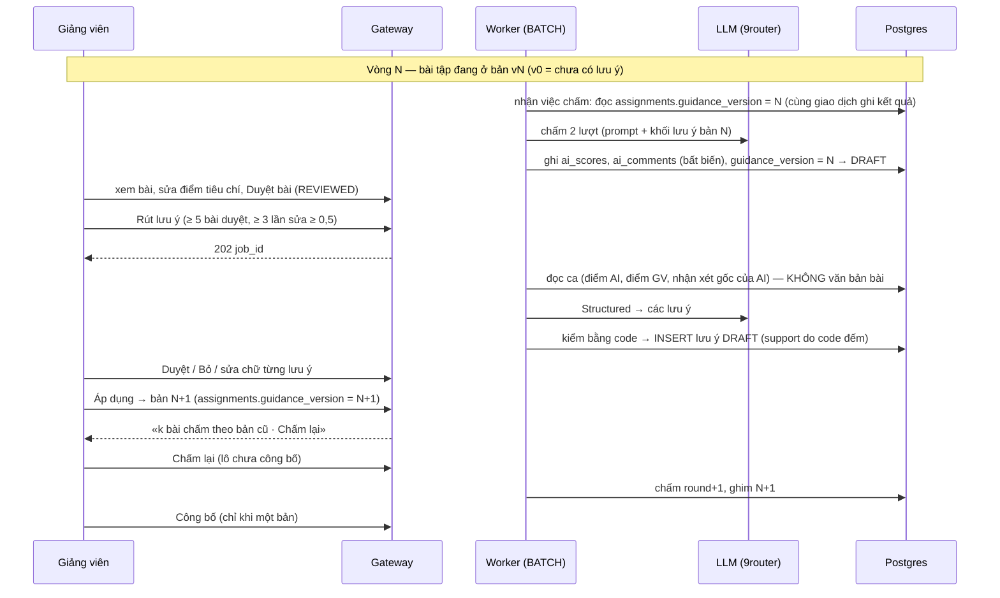
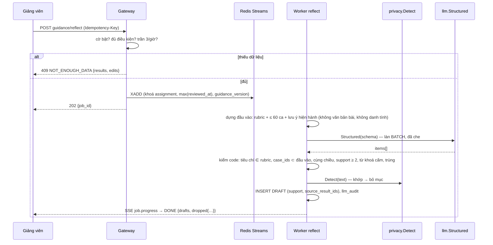
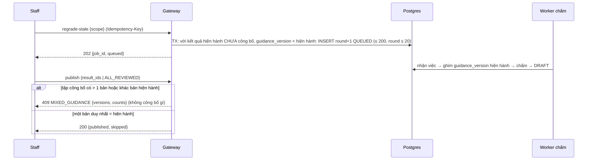
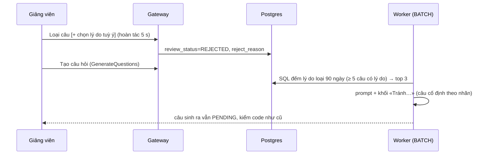
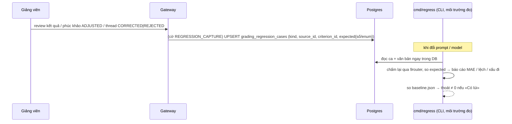

# SRS FEAT-grading-guidance Harness học từ lần giảng viên sửa (M1, M2, M4, M6)
Phiên bản 1.0 · 2026-11-14 · Trạng thái: **APPROVED** (PM uỷ quyền; các câu **CHỜ PM** ở `QUESTIONS.md` — Q-G-1, 2, 3, 5, 6, 10, S7 — viết theo phương án an toàn nhất và không chặn thi công phần không đụng chúng)

## 1. Mục đích và phạm vi
**Vấn đề.** Điểm nháp của AI lệch chuẩn của giảng viên (9.5 đo MAE tổng 0,94–1,27 / 10). Mỗi lần giảng viên sửa đã được lưu có cấu trúc (`grading_results.ai_scores` bất biến so với `criteria`), nhưng chưa được dùng lại: giảng viên sửa cùng một lỗi nhiều lần.

**Giải pháp.** Khép vòng bằng dữ liệu Postgres có người duyệt, không thêm hệ bộ nhớ (D61):
```text
AI chấm nháp (ghim bản vN) → GV duyệt + sửa điểm → job rút lưu ý (≥ 5 bài, không đọc bài làm)
   → GV duyệt từng lưu ý → Áp dụng = bản v(N+1) → chấm lại lô chưa công bố → …
```
PoC (mô phỏng, `docs/research/2026-11-14-agent-memory.md` mục 5): lưu ý **đã duyệt** giảm MAE điểm nháp ≈ 49 %, lưu ý **tự động** chỉ 17 % và làm sai thêm ở tiêu chí vốn đúng ⇒ **người duyệt là bắt buộc**.

| Trong phạm vi (gói «harness») | Ngoài phạm vi |
| --- | --- |
| **M1** Lưu ý chấm theo bài tập (rút → duyệt → bản → ghim → chấm lại), `ai_comments` bất biến, số đo | M3 «tài liệu còn thiếu», M5 bàn giao giữa kỳ, M7 giọng nhận xét, M8 hiệu chỉnh ngưỡng cascade, M9 |
| **M2** Mỗi lần sửa → ca hồi quy (theo tham chiếu) + chạy hồi quy | **M11** bộ nhớ theo sinh viên, **M12** nhớ hội thoại chat (không làm) |
| **M4** Threads: câu tương tự đã có đáp án xác nhận lúc soạn | Hindsight / hệ bộ nhớ ngoài (D61); few-shot bằng bài của sinh viên khác |
| **M6** Mẫu câu bị loại → prompt sinh câu hỏi | Tự áp lưu ý; đổi điểm tổng / trừ muộn / làm tròn |

**Thuật ngữ.** *Lưu ý* (guidance item): một câu hướng dẫn chấm cho một tiêu chí rubric. *Bản* (guidance version): tập lưu ý đã duyệt tại một thời điểm, đánh số `v0` (không có), `v1`, `v2`… theo bài tập. *Ghim*: lượt chấm lưu `guidance_version` đã dùng. *Chờ áp dụng*: lưu ý đã `Duyệt` nhưng chưa vào bản nào. *Ca hồi quy*: bản ghi tham chiếu một lần sửa, dùng để chạy lại khi đổi prompt / model.

**Ràng buộc luật.**
- AI chỉ nháp, người quyết: không lưu ý nào tự áp; không công bố tự động (CONTEXT mục 3, AGENTS nguyên tắc «Tự công bố điểm AI… cần thao tác giảng viên»).
- Tính điểm là code thuần (`shopspring/decimal`); lưu ý không có trường tổng / phạt (nguyên tắc 5).
- Mọi LLM qua `internal/llm` (Scheduler, che PII, `llm_audit`); sinh chữ qua 9router; embedding thật chỉ khi PM cho phép — dev / test / CI dùng provider `fake` và embedding giả.
- Danh tính từ JWT; không dữ liệu cá nhân trong lưu ý; sinh viên không thấy gì về feature (nguyên tắc 2, 4).
- Không chạm đường hỏi–đáp (D47); việc nặng chạy nền Redis Streams (nguyên tắc 12).

## 2. Người dùng và quyền
| Hành động | ADMIN | TEACHER (lớp) | TA (lớp) | STUDENT |
| --- | --- | --- | --- | --- |
| Bật / tắt cờ `GRADING_GUIDANCE`, `THREAD_SUGGEST`, `QUESTION_HINTS` | ✓ | ✓ | 403 | 403 |
| Bật / tắt cờ `REGRESSION_CAPTURE` | ✓ | 403 | 403 | 403 |
| `Rút lưu ý` (`reflect`) | 403 | ✓ | 403 | 403 |
| Xem danh sách lưu ý, số đo | 403 | ✓ | ✓ (chỉ đọc) | 403 |
| `Duyệt`, `Bỏ`, sửa chữ, `Cho nghỉ`, `Áp dụng` | 403 | ✓ | **403** | 403 |
| `Chấm lại` lô chưa công bố | 403 | ✓ | ✓ | 403 |
| Công bố (chặn lô trộn) | – | ✓ (như hiện hành) | 403 | – |
| Gợi ý câu tương tự lúc soạn (M4) | – | ✓ | ✓ | ✓ |
| Ghi lý do loại câu hỏi (M6) | – | ✓ | ✓ | 403 |
| Đọc / chạy / xuất ca hồi quy (CLI) | ✓ | 403 (chỉ thấy số ca) | 403 | 403 |
| Thấy lưu ý, bản, cờ, số đo, lý do loại | ✓ | ✓ | ✓ | **không bao giờ** |
Lớp khác → `404`; mọi API lớp qua `CourseAccessGuard`. **CHỜ PM (Q-G-2):** vai bật cờ và TA có duyệt không; viết theo cột trên (an toàn: TA chỉ đọc, chỉ ADMIN bật cờ dữ liệu).

## 3. Luồng chính và nhánh lỗi

### 3.1 Vòng học (tổng quan, một bài tập ESSAY)


### 3.2 Job `grading.reflect`


### 3.3 Duyệt và Áp dụng
```mermaid
sequenceDiagram
  participant T as Giảng viên (TEACHER)
  participant G as Gateway
  participant DB as Postgres
  T->>G: decide(item, APPROVE|REJECT [, text sửa], version)
  G->>G: text sửa → Detect + từ khoá cấm
  G->>DB: UPDATE status (APPROVED chờ áp dụng | REJECTED) + audit_log
  T->>G: apply(expected_version, Idempotency-Key)
  G->>DB: TX: các mục APPROVED chờ → approved_in_version = N+1; mục chờ nghỉ → RETIRED, retired_in_version = N+1; INSERT guidance_versions; UPDATE assignments.guidance_version = N+1; audit_log
  G-->>T: 200 {version: N+1, stale: k}
```

### 3.4 Chấm lại lô chưa công bố và chặn công bố lô trộn


### 3.5 M4 — câu tương tự lúc soạn
```mermaid
sequenceDiagram
  participant U as Sinh viên (đang soạn)
  participant G as Gateway
  participant E as Embed (dùng lại cache)
  participant DB as Postgres (pgvector)
  U->>G: GET threads/similar-confirmed?q= (debounce 600 ms, ≥ 3 từ)
  G->>G: cờ bật? rate limit 30/phút
  G->>E: nhúng q (1 lần)
  G->>DB: top 3 chunk knowledge_items(POST) cùng lớp, cosine ≥ 0,80 → thread VERIFIED/CORRECTED, chưa ẩn
  G-->>U: [{thread_id, title}] | []
  Note over U: đăng bình thường (không bắt buộc); lỗi → bỏ qua im lặng
```

### 3.6 M6 — mẫu âm cho sinh câu hỏi


### 3.7 M2 — ca hồi quy


### 3.8 Bảng lỗi và fallback
| Tình huống | Hệ thống phản ứng | Người dùng thấy |
| --- | --- | --- |
| Cờ tắt / `GUIDANCE_ENABLED=false` | Hành vi như trước 10.6; API ghi `409 GUIDANCE_DISABLED` | Khối ẩn |
| `reflect` thiếu dữ liệu | `409 NOT_ENOUGH_DATA {results, edits}` | «Cần thêm bài đã duyệt» |
| `reflect` LLM lỗi / sai schema | Thử lại ≤ 3 → dead-letter, job `FAILED`, không nháp nửa vời | «Chưa rút được lưu ý. Thử lại.» |
| `reflect` 0 mục hợp lệ | Job `DONE {drafts:0, dropped}` | «Không có lưu ý mới» |
| Mục chứa PII / từ khoá tổng-muộn / support < 2 / trùng | Bỏ mục, đếm vào `dropped` | Không thấy (chỉ số ở stats nội bộ) |
| Sửa chữ lưu ý không qua kiểm | `422 GUIDANCE_TEXT_REJECTED` | Báo tại ô |
| `Duyệt` mục không còn `DRAFT` | `409 ITEM_NOT_DRAFT` | Tải lại hàng |
| `Áp dụng` không có gì đổi | `409 NOTHING_TO_APPLY` | Nút khoá |
| `Áp dụng` / `PUT` version cũ | `409 VERSION_CONFLICT` | Tải lại + báo tại chỗ |
| Đang `Áp dụng` ở hai tab | Giao dịch tuần tự; người sau nhận 409 | Báo tại chỗ |
| Chấm lại, bài đã công bố | Bỏ qua, không bao giờ chấm lại | Không đổi |
| Chấm lại quá `round` 20 | Bỏ bài đó, báo số bài bỏ | «k bài đã chấm lại tối đa» |
| Worker chết giữa lô | Việc nhận lại, không chấm đôi (4.7 FEAT-assignments) | Tiến độ tiếp tục |
| Công bố lô trộn | `409 MIXED_GUIDANCE {versions, counts}` | Dòng báo + `Chấm lại` |
| Gợi ý M4 lỗi nhúng / DB | Bỏ qua im lặng | Không hiện gì |
| Cờ tắt giữa lúc chạy | Việc chưa nhận chạy với bản hiện hành (0) | Không đổi |
| `cmd/regress export` khi chưa cho phép | Từ chối, thoát ≠ 0 | – (CLI) |
| Xoá dữ liệu sinh viên | Bỏ id khỏi `source_result_ids`; `support < 2` → `needs_recheck`; xoá ca liên quan | Nhãn «Cần xem lại» |

## 4. Yêu cầu chức năng

### 4.1 Hằng số (mỗi giá trị có tên; sai kiểu → gateway không chạy và nêu tên biến)
| Biến | Mặc định | Ý nghĩa |
| --- | --- | --- |
| `GUIDANCE_ENABLED` | `true` | công tắc cứng toàn hệ thống (cờ lớp vẫn mặc định tắt) |
| `GUIDANCE_MIN_RESULTS` / `GUIDANCE_MIN_EDITS` / `GUIDANCE_MIN_DELTA` | `5` / `3` / `0.5` | điều kiện rút lưu ý |
| `GUIDANCE_MIN_SUPPORT` | `2` | số ca ủng hộ tối thiểu mỗi lưu ý |
| `GUIDANCE_MAX_ITEMS` / `GUIDANCE_MAX_CASES` | `8` / `60` | số lưu ý mỗi lần / số ca đầu vào |
| `GUIDANCE_TEXT_MAX` | `400` | ký tự tối đa mỗi lưu ý |
| `REFLECT_MAX_PER_HOUR` | `3` | trần việc `reflect` / bài tập / giờ |
| `REGRADE_MAX_BATCH` | `200` | số bài tối đa mỗi lần `regrade-stale` |
| `REGRESSION_MIN_DELTA` / `REGRESSION_MAX_REL` | `1.0` / `0.10` | ngưỡng ghi ca / ngưỡng «lùi» |
| `REGRESSION_EXPORT_ALLOWED` | `false` | cho phép `cmd/regress export` (Q-G-3) |
| `THREAD_SUGGEST_MIN` / `THREAD_SUGGEST_RPM` | `0.80` / `30` | cosine tối thiểu / lần gợi ý mỗi phút mỗi người |
| `QUESTION_HINTS_MIN_REJECTS` / `QUESTION_HINTS_WINDOW_DAYS` | `5` / `90` | điều kiện thống kê lý do loại |

### 4.2 M1 — Lưu ý chấm
**4.2.1 Ghim phiên bản.** Khi worker nhận việc `(submission_id, round)` (4.7 FEAT-assignments) đọc `assignments.guidance_version` trong **cùng giao dịch** ghi kết quả; cờ `GRADING_GUIDANCE` tắt → `0`. Giá trị lưu vào `grading_results.guidance_version`; lượt 1 và lượt 2 dùng cùng phiên bản. Việc thử lại trước `DONE` ghim lại; sau `DONE` bất biến (trigger).

**4.2.2 Khối lưu ý trong prompt.** `BuildEssayPrompt(…, guidanceSet)`; `guidanceSet` = mục của phiên bản ghim (4.2.3). Khối thêm **sau rubric**, **ngoài** vùng «bài làm là dữ liệu không tin cậy»:
```text
Lưu ý của giảng viên (bản v{N}) — chỉ về điểm từng tiêu chí:
[c2] {text}
[c4] {text}
```
Sắp theo vị trí tiêu chí trong rubric, rồi `approved_in_version`, rồi `id`. `v0` hoặc cờ tắt: **không** khối, prompt giống từng byte hiện hành.

**4.2.3 Tập lưu ý tại phiên bản `v`.** `status IN ('APPROVED','RETIRED') AND approved_in_version IS NOT NULL AND approved_in_version <= v AND (retired_in_version IS NULL OR retired_in_version > v)`. Hàm thuần theo `(assignment_id, v)`; không phụ thuộc thời điểm gọi.

**4.2.4 `ai_comments`.** Lưu cùng `ai_scores` khi ghi kết quả lượt 1 đã kiểm: `{criteria:{<id>:text}, overall:text}`; bất biến. Chỉ dùng cho `reflect`; không hiện cho sinh viên.

**4.2.5 Điều kiện và khoá `reflect`.** Đủ điều kiện khi: cờ bật, `ESSAY`, ≥ `GUIDANCE_MIN_RESULTS` kết quả hiện hành `REVIEWED`/`PUBLISHED`, ≥ `GUIDANCE_MIN_EDITS` điểm tiêu chí lệch ≥ `GUIDANCE_MIN_DELTA` so `ai_scores`. Khoá việc `(assignment_id, max(reviewed_at), guidance_version)`; chỉ nút bấm (Q-G-4). Trần `REFLECT_MAX_PER_HOUR` bằng `ep:rl:reflect:{assignment}`.

**4.2.6 Đầu vào lời gọi (không văn bản bài).** `{rubric:[{id,name,guidance}], cases:[{case_id (băm ngẫu nhiên theo lần chạy), criterion_id, ai_score, teacher_score, ai_comment}] (≤ GUIDANCE_MAX_CASES, mới nhất), existing:[{criterion_id,text}]}`. **Không**: văn bản bài, nhận xét sửa tay của giảng viên, id sinh viên / bài nộp, tên, MSSV (Q-G-10). `ai_comment` chỉ khi `ai_comments` khác `NULL`.

**4.2.7 Schema đầu ra (strict).** `items:[{criterion_id enum(id rubric), text string ≤ 400, direction enum{STRICTER,LENIENT,CLARIFY}, case_ids:[string] ≥ 2}] ≤ GUIDANCE_MAX_ITEMS`. Không trường tổng / phạt / làm tròn.

**4.2.8 Kiểm bằng code (thứ tự).** (i) `criterion_id` ∈ rubric; (ii) mọi `case_id` ∈ đầu vào; (iii) chiều: STRICTER ⇔ `ai_score > teacher_score`, LENIENT ⇔ `<`, CLARIFY không ràng buộc; **`support` = số `case_id` hợp lệ cùng chiều** (code đếm); (iv) bỏ nếu `support < GUIDANCE_MIN_SUPPORT`; (v) `fold(text)` chứa từ khoá {`tổng`, `trừ`, `muộn`, `làm tròn`, `phạt`} → bỏ; (vi) `privacy.Detect` khớp (roster lớp + regex MSSV / email / SĐT) → bỏ; (vii) Jaccard theo từ ≥ 0,8 với mục cùng tiêu chí đã có (mọi trạng thái trừ REJECTED lâu hơn 30 ngày) → bỏ; (viii) cắt còn `GUIDANCE_MAX_ITEMS`. `source_result_ids` = id kết quả của các ca hợp lệ.

**4.2.9 Trạng thái lưu ý.** `DRAFT` → (`Duyệt`) `APPROVED` chờ áp dụng (`approved_in_version IS NULL`) → (`Áp dụng`) có hiệu lực (`approved_in_version = N+1`) → (`Cho nghỉ`) chờ nghỉ (`pending_retire`) → (`Áp dụng`) `RETIRED` (`retired_in_version = N+1`). `DRAFT` → (`Bỏ`) `REJECTED`. Sửa chữ chỉ khi `DRAFT`; lưu `text_original`.

**4.2.10 `Áp dụng`.** Giao dịch: khoá `assignments` hàng `FOR UPDATE`; kiểm `expected_version = guidance_version` (`409 VERSION_CONFLICT`); có thay đổi (`APPROVED` chờ hoặc chờ nghỉ) hoặc `409 NOTHING_TO_APPLY`; gán `approved_in_version` / `retired_in_version = N+1`; `INSERT grading_guidance_versions`; `UPDATE assignments SET guidance_version = N+1`; `audit_log`. Không tự chấm lại.

**4.2.11 Chấm lại lô.** `regrade-stale {scope ∈ UNREVIEWED | ALL_UNPUBLISHED}`: chọn kết quả **hiện hành** `status ∈ {DRAFT}` (hoặc `{DRAFT,REVIEWED}`) có `guidance_version < assignments.guidance_version`, bài nộp còn là bản mới nhất, `round < 20`; tối đa `REGRADE_MAX_BATCH`; `INSERT round+1 QUEUED` + `jobs` trong một giao dịch rồi `XADD`; idempotent theo `Idempotency-Key` và `UNIQUE (course_id, submission_id, round)`; `REVIEWED` bị chấm lại quay về `DRAFT` mới (round cũ vẫn xem được).

**4.2.12 Chặn công bố lô trộn.** Trong `publish` (4.8.5 FEAT-assignments) thêm bước sau khi chọn tập: nếu `|DISTINCT guidance_version| > 1` hoặc có giá trị ≠ `assignments.guidance_version` → `409 MIXED_GUIDANCE {versions, counts}` trước mọi ghi. Hiệu lực chỉ khi cờ `GRADING_GUIDANCE` bật cho lớp (cờ tắt: như hiện hành). **CHỜ PM (Q-G-1).**

**4.2.13 Số đo.** `GET …/guidance/stats`: theo `guidance_version` của kết quả hiện hành `REVIEWED`/`PUBLISHED`: `n`, `mae_criterion`, `mae_total`, `bias_total` (có dấu), `edited_criteria`, `edited_rate`; `decimal`; `n < 5` → `null`. `mae_total = mean(|ai_total_before_late − total_before_late chốt|)`.

**4.2.14 Quên / xoá.** Job xoá dữ liệu sinh viên (PR): bỏ id kết quả khỏi `source_result_ids`; mục `support' < GUIDANCE_MIN_SUPPORT` → `needs_recheck = true` (hiện nhãn «Cần xem lại»; **không** tự nghỉ, không đổi hành vi chấm — Q-G-6); xoá ca hồi quy tham chiếu. Xoá lớp → `ON DELETE CASCADE`.

### 4.3 M2 — Ca hồi quy
- Ghi ca khi cờ `REGRESSION_CAPTURE` bật: (a) `review` kết quả có tiêu chí lệch ≥ `REGRESSION_MIN_DELTA` → `GRADING_EDIT` (`source_id` = id kết quả, `criterion_id`); (b) phúc khảo `ADJUSTED` → `GRADING_APPEAL`; (c) thread `CORRECTED` → `THREAD_CORRECTED`, `REJECTED` → `THREAD_REJECTED` (`source_id` = id bài). `expected` chỉ số / enum: `{ai_score, teacher_score, direction, rubric_hash}` hoặc `{state}`; **không** văn bản.
- `cmd/regress` (Go, CLI vận hành, môi trường đo; cùng module; không service thường trực): `run` đọc ca và nội dung **trong DB**, gọi `internal/llm` (9router), in báo cáo; so `benchmarks/guidance/baseline.json`; `export` mặc định từ chối (`REGRESSION_EXPORT_ALLOWED=false`); khi cho phép: `privacy.Mask` + `Detect`, id băm, ghi **ngoài repo**, `audit_log`.
- Ca `THREAD_*` phục vụ E2 (golden set escalation): `run` có chế độ `--e2` đọc câu hỏi + đáp án xác nhận trong DB để đối chiếu `confidence`/chuyển giảng viên; chi tiết chấm ở `benchmarks/e2/README.md`.

### 4.4 M4 — Câu tương tự lúc soạn
- Nguồn: `knowledge_items` với `source_type='POST'` (+ `content_chunks` đã nhúng) → thread của bài đó; điều kiện: thread công khai cùng lớp, không `hidden`, trả lời AI `VERIFIED`/`CORRECTED`, mục kho chưa lỗi thời. Truy vấn `ORDER BY embedding <=> $q` chỉ theo khoảng cách (dùng HNSW), lọc `course_id` trong cùng truy vấn, `LIMIT 3`, rồi lọc `cosine ≥ THREAD_SUGGEST_MIN` ở ứng dụng. Không `TICKET` (Q-G-5).
- Một lần nhúng chuỗi đang soạn (cache theo băm chuỗi, TTL 5 phút); 0 lời gọi sinh chữ; rate limit `THREAD_SUGGEST_RPM` (Redis); trả `[]` nếu cờ tắt / lỗi.

### 4.5 M6 — Mẫu âm cho sinh câu hỏi
- `question_bank.reject_reason` ∈ {`MO_HO`, `SAI_DAP_AN`, `TRUNG_LAP`, `LAC_DE`, `KHO_DE_BAT_THUONG`, `SAI_DINH_DANG`, `UNSPECIFIED`}; chỉ khi `review_status='REJECTED'`.
- Câu cố định (trong mã, ≤ 140 ký tự mỗi nhãn): `MO_HO`→«Mỗi câu chỉ một cách hiểu; tránh từ chung chung.» · `SAI_DAP_AN`→«Kiểm lại đáp án đúng bám sát tài liệu trích dẫn.» · `TRUNG_LAP`→«Không lặp ý với câu đã có trong ngân hàng.» · `LAC_DE`→«Chỉ hỏi nội dung có trong tài liệu được chọn.» · `KHO_DE_BAT_THUONG`→«Giữ độ khó đúng mức yêu cầu.» · `SAI_DINH_DANG`→«Đúng định dạng câu hỏi và số lựa chọn yêu cầu.»
- Thống kê tất định: lý do ≠ `UNSPECIFIED` của câu `REJECTED` trong `QUESTION_HINTS_WINDOW_DAYS`, `≥ QUESTION_HINTS_MIN_REJECTS` câu, lấy 3 lý do nhiều nhất.

### 4.6 Danh sách FR
| FR | Hệ thống phải… | AC |
| --- | --- | --- |
| FR-1 | Lưu và áp cờ theo lớp (mặc định tắt) + công tắc cứng `GUIDANCE_ENABLED` | GD-01 |
| FR-2 | Có bảng lưu ý / phiên bản; `guidance_version`, `ai_comments` bất biến; dựng lại tập lưu ý theo phiên bản | GD-02 |
| FR-3 | Ghim phiên bản trong giao dịch ghi kết quả, cả hai lượt cùng phiên bản | GD-02 AC2 |
| FR-4 | Job `grading.reflect` đúng điều kiện, khoá idempotent, trần, làn `BATCH` | GD-03 AC1–3, AC10 |
| FR-5 | Đầu vào không văn bản bài / danh tính; schema strict; kiểm code (support, chiều, từ khoá, PII, trùng) | GD-03 AC4–7 |
| FR-6 | API duyệt / bỏ / sửa / nghỉ / áp dụng; chỉ TEACHER; `audit_log` | GD-04 |
| FR-7 | Prompt chấm thêm khối lưu ý của phiên bản ghim, tất định, không đổi kiểm code | GD-05 AC1–2 |
| FR-8 | `regrade-stale` lô chưa công bố, giới hạn, idempotent | GD-05 AC3–5, 7–9 |
| FR-9 | Chặn công bố lô trộn `MIXED_GUIDANCE` | GD-05 AC6 |
| FR-10 | Số đo theo phiên bản và nhãn tiêu chí ở màn duyệt bài | GD-06 |
| FR-11 | Ghi ca hồi quy theo tham chiếu; `cmd/regress run/export` | GD-07 |
| FR-12 | Gợi ý câu tương tự đã xác nhận lúc soạn (chỉ POST công khai) | GD-08 |
| FR-13 | Lý do loại câu hỏi + khối «Tránh» trong prompt sinh câu | GD-09 |
| FR-14 | Seed, E2E, đo trên E3, guide | GD-10 |
| FR-15 | Ranh giới an toàn: không tự áp, không điểm tổng, không bài làm, cách ly, sinh viên không thấy, quên / xoá | GD-11 |

## 5. Dữ liệu
Migration goose kế tiếp sau migration cuối đã merge (dev lấy số từ nhánh gốc; một file; không sửa file cũ).
```sql
-- 5.1 lưu ý chấm
CREATE TYPE guidance_item_status AS ENUM ('DRAFT','APPROVED','REJECTED','RETIRED');
CREATE TABLE grading_guidance_items (
  id                  uuid PRIMARY KEY DEFAULT uuidv7(),
  course_id           uuid NOT NULL,
  assignment_id       uuid NOT NULL,
  criterion_id        text NOT NULL,
  text                text NOT NULL CHECK (char_length(text) BETWEEN 1 AND 400),
  text_original       text NULL,
  direction           text NOT NULL CHECK (direction IN ('STRICTER','LENIENT','CLARIFY')),
  support             smallint NOT NULL CHECK (support >= 0),
  source_result_ids   uuid[] NOT NULL DEFAULT '{}',        -- id kết quả chấm, KHÔNG id sinh viên
  needs_recheck       boolean NOT NULL DEFAULT false,
  status              guidance_item_status NOT NULL DEFAULT 'DRAFT',
  pending_retire      boolean NOT NULL DEFAULT false,
  approved_in_version smallint NULL,
  retired_in_version  smallint NULL,
  origin_job          uuid NULL,
  decided_by          uuid NULL REFERENCES users (id),
  decided_at          timestamptz NULL,
  version             integer NOT NULL DEFAULT 1,
  created_at          timestamptz NOT NULL DEFAULT now(),
  updated_at          timestamptz NOT NULL DEFAULT now(),
  FOREIGN KEY (course_id, assignment_id) REFERENCES assignments (course_id, id),
  CHECK ((status IN ('APPROVED','REJECTED','RETIRED')) = (decided_by IS NOT NULL)),
  CHECK (retired_in_version IS NULL OR (status = 'RETIRED' AND approved_in_version IS NOT NULL AND retired_in_version > approved_in_version)),
  CHECK (approved_in_version IS NULL OR status IN ('APPROVED','RETIRED'))
);
CREATE INDEX ggi_assignment_idx ON grading_guidance_items (course_id, assignment_id, status);

-- 5.2 các phiên bản (v0 ngầm định, không lưu)
CREATE TABLE grading_guidance_versions (
  course_id uuid NOT NULL, assignment_id uuid NOT NULL, version smallint NOT NULL CHECK (version >= 1),
  item_count smallint NOT NULL, created_by uuid NOT NULL REFERENCES users (id), created_at timestamptz NOT NULL DEFAULT now(),
  PRIMARY KEY (course_id, assignment_id, version),
  FOREIGN KEY (course_id, assignment_id) REFERENCES assignments (course_id, id)
);

-- 5.3 ghim + bất biến
ALTER TABLE assignments      ADD COLUMN guidance_version smallint NOT NULL DEFAULT 0;
ALTER TABLE grading_results  ADD COLUMN guidance_version smallint NOT NULL DEFAULT 0,
                             ADD COLUMN ai_comments jsonb NULL;
-- mở rộng trigger bất biến hiện có (00017): sau run_state='DONE' cấm đổi ai_scores, ai_comments, guidance_version

-- 5.4 cờ theo lớp
CREATE TABLE course_guidance_flags (
  course_id uuid NOT NULL REFERENCES courses (id),
  feature   text NOT NULL CHECK (feature IN ('GRADING_GUIDANCE','REGRESSION_CAPTURE','THREAD_SUGGEST','QUESTION_HINTS')),
  enabled   boolean NOT NULL DEFAULT false,
  version   integer NOT NULL DEFAULT 1,
  updated_by uuid REFERENCES users (id), updated_at timestamptz NOT NULL DEFAULT now(),
  PRIMARY KEY (course_id, feature)
);

-- 5.5 ca hồi quy (theo tham chiếu, không văn bản)
CREATE TABLE grading_regression_cases (
  id uuid PRIMARY KEY DEFAULT uuidv7(),
  course_id uuid NOT NULL REFERENCES courses (id),
  kind text NOT NULL CHECK (kind IN ('GRADING_EDIT','GRADING_APPEAL','THREAD_CORRECTED','THREAD_REJECTED')),
  source_id uuid NOT NULL,
  criterion_id text NULL,
  expected jsonb NOT NULL CHECK (jsonb_typeof(expected) = 'object'),   -- chỉ số / enum, service kiểm không có chuỗi dài
  created_at timestamptz NOT NULL DEFAULT now(), updated_at timestamptz NOT NULL DEFAULT now(),
);
CREATE UNIQUE INDEX grc_unique ON grading_regression_cases (course_id, kind, source_id, coalesce(criterion_id, ''));

-- 5.6 lý do loại câu hỏi
ALTER TABLE question_bank ADD COLUMN reject_reason text NULL
  CHECK (reject_reason IN ('MO_HO','SAI_DAP_AN','TRUNG_LAP','LAC_DE','KHO_DE_BAT_THUONG','SAI_DINH_DANG','UNSPECIFIED')),
  ADD CONSTRAINT question_bank_reject_reason_chk CHECK (reject_reason IS NULL OR review_status = 'REJECTED');
```
- Hàng đợi: `jobs(kind='grading.reflect')` + stream `ep:grading.reflect` (+ `.dead`); khoá giới hạn `ep:rl:reflect:{assignment}`; M4 `ep:rl:suggest:{user}:{phút}`.
- Không bảng nào lưu văn bản bài, đầu vào / đầu ra thô của LLM; `llm_audit` không nội dung.
- Chỉ mục: mọi chỉ mục phức hợp bắt đầu `course_id`; `grc_unique` xử lý `criterion_id NULL` bằng `coalesce(criterion_id,'')`.
- **Đề xuất đổi ARCHITECTURE (Tech Lead / PM):** các bảng / cột trên, job, env §8, cờ; `FEAT-assignments` vá 4.6.5 (khối lưu ý), 4.8.5 (`MIXED_GUIDANCE`), §5 (ba cột mới); `FEAT-practice` vá `bulk reject` nhận `reason`.

## 6. API
Tiền tố `/api/v1`; `…` = `/courses/{id}`. Mọi `PUT` / quyết định bắt buộc `version`; ghi có tác dụng phụ nhận `Idempotency-Key`; danh sách dùng cursor, `limit` ≤ 100.
| # | Endpoint | Quyền | Ghi chú / mã lỗi |
| --- | --- | --- | --- |
| 1 | `GET …/guidance-flags` | TEACHER, ADMIN | bốn cờ `{feature, enabled, version, can_edit}` |
| 2 | `PUT …/guidance-flags/{feature}` `{enabled, version}` | TEACHER (3 cờ), ADMIN (cả 4) | 409 `VERSION_CONFLICT`, 403, 422, 409 `GUIDANCE_DISABLED` |
| 3 | `GET …/assignments/{aid}/guidance` | TEACHER, TA | `{current_version, items[], counts, stale:{count,versions}, reflect:{eligible, results, edits}}` |
| 4 | `POST …/assignments/{aid}/guidance/reflect` | TEACHER | 202 `{job_id}`; 409 `NOT_ENOUGH_DATA`, `GUIDANCE_DISABLED`; 429 `RATE_LIMITED` |
| 5 | `POST …/assignments/{aid}/guidance/items/{iid}/decide` `{decision: APPROVE\|REJECT\|RETIRE, text?, version}` | TEACHER | 409 `ITEM_NOT_DRAFT`, `VERSION_CONFLICT`; 422 `GUIDANCE_TEXT_REJECTED` |
| 6 | `POST …/assignments/{aid}/guidance/apply` `{expected_version}` | TEACHER | 200 `{version, stale}`; 409 `VERSION_CONFLICT`, `NOTHING_TO_APPLY` |
| 7 | `POST …/assignments/{aid}/regrade-stale` `{scope}` | TEACHER, TA | 202 `{job_id, queued, skipped}`; 409 `GUIDANCE_DISABLED` |
| 8 | `GET …/assignments/{aid}/guidance/stats` | TEACHER, TA | theo phiên bản (4.2.13) |
| 9 | `POST …/grading-results/publish` (đã có) | TEACHER | thêm 409 `MIXED_GUIDANCE {versions, counts}` |
| 10 | `GET …/threads/similar-confirmed?q=` | thành viên lớp | `[{thread_id, title}]`; `[]` khi tắt / lỗi; 429 |
| 11 | `POST …/questions/bulk {action:"reject", ids[], reason?}` và `PUT …/questions/{id}/review {…, reject_reason?}` (đã có, mở rộng) | TEACHER, TA | 422 lý do lạ |
| 12 | `GET …/questions/gen-stats?job_id` (đã có) | TEACHER, TA | thêm `hints:[reason]` |
Mã lỗi mới: `GUIDANCE_DISABLED`, `NOT_ENOUGH_DATA`, `ITEM_NOT_DRAFT`, `NOTHING_TO_APPLY`, `GUIDANCE_TEXT_REJECTED`, `MIXED_GUIDANCE` (đều 409 / 422 như bảng). DTO sinh viên **không đổi**. Tất cả có trong `openapi.yaml`; `go test ./internal/contract/...` xanh. Tiến độ `reflect` / `regrade-stale` qua SSE sự kiện `job.progress`.

## 7. Giao diện
Nguồn: `DESIGN.md` §13, §14; `UX.md` mục 6; luật chữ UI (không dòng giải thích; tooltip chỉ cho cú pháp / lý do khoá / hệ quả). Chỉ primitive `shared/` và token `--ep-*`.
| Màn | Khung nhìn đầu | Primitive | Rỗng / tải / lỗi | Mobile 375 px |
| --- | --- | --- | --- | --- |
| `/assignments/[id]` (nhân viên) — khối «Lưu ý chấm» dưới rubric | dòng `bản v2 · 3 chờ duyệt` + `Rút lưu ý`; danh sách lưu ý (tiêu chí · chữ · `n lần sửa` · chiều · `Duyệt` / `Bỏ`); `Áp dụng` khi có thay đổi; bảng số đo nhỏ | `Panel`, `Section`, `DataTable` nhẹ, `useUndoableAction`, `useAutosaveDraft`, `InlineNotice` | `EmptyState` một dòng; `PageState` lỗi + `Thử lại`; đang rút: chỉ báo giai đoạn, rời trang được | xếp dọc, nút ≥ 44 px |
| `/grading` (Hàng chờ) | `InlineNotice`: «N bài chấm theo bản cũ · Chấm lại» (theo bài tập đang lọc); `ConfirmIrreversible` khi `ALL_UNPUBLISHED` | `InlineNotice`, `ConfirmIrreversible` | khi 409 `MIXED_GUIDANCE` báo tại chỗ + `Chấm lại` | như hiện hành |
| `/grading/[submissionId]` | phụ đề `meta` trên nhãn tiêu chí «bản v2 · 3 lần sửa»; popover liệt kê lưu ý áp dụng | `Popover` | không phụ đề với `v0` | như hiện hành |
| `/class/settings` — «Học từ lần sửa» | bốn công tắc | `Field`/switch | tooltip chỉ trên công tắc khoá «Chỉ quản trị viên bật» | công tắc ≥ 44 px |
| `/threads` (soạn câu hỏi) | danh sách ≤ 3 thread «Đã xác nhận» dưới ô tiêu đề; **không hiện gì khi trống** | danh sách liên kết | lỗi → không hiện | một cột |
| `/questions` (loại câu) | sau `Loại`: dãy nhãn lý do chọn nhanh (bỏ qua được) + «Hoàn tác» | `OverflowMenu`/chip | – | như hiện hành |
Nhãn: «Lưu ý chấm», `Rút lưu ý`, `Duyệt`, `Bỏ`, `Cho nghỉ`, `Áp dụng`, `Chấm lại`, «bản v2», «Chờ duyệt», «Chờ áp dụng», «Đã áp dụng», «Chờ nghỉ», «Đã bỏ», «Đã nghỉ», «Cần xem lại». Sinh viên: **không thay đổi gì**; không từ «AI / nháp / lưu ý chấm».

## 8. Phi chức năng áp dụng
| Mục | Yêu cầu |
| --- | --- |
| Hiệu năng | `GET …/guidance` p95 ≤ 300 ms (bài 1.000 kết quả); `stats` p95 ≤ 500 ms; M4 p95 ≤ 300 ms (embedding giả); khối lưu ý thêm ≤ 3 % token prompt chấm (PoC +3 %) |
| Làn LLM | `reflect` = `BATCH`, task `GRADING`, `llm.Structured`; chấm lại = làn `BATCH` như chấm; không làm chat treo (nguyên tắc 11) |
| Chi phí | `reflect`: 1 lời gọi / lần (≈ 3–6 k token vào); `regrade-stale`: N bài × 2 lượt như chấm (trần 200 bài / lần); M4: 1 nhúng / lần gõ (debounce); M6: 0 lời gọi thêm |
| Riêng tư | không văn bản bài ở `reflect`; đầu ra `Detect`; `source_result_ids` không map ra sinh viên ngoài quyền; ca hồi quy theo tham chiếu; sinh viên không thấy gì |
| Idempotency / đồng thời | `Idempotency-Key` cho `reflect`, `apply`, `regrade-stale`; `version` → 409; `UNIQUE (course_id, submission_id, round)` |
| Phân trang | cursor cho danh sách lưu ý / ca; `limit` ≤ 100 |
| Cache | không cache điểm; ảnh chụp cờ theo sự kiện + TTL 60 s (mẫu D60); cache nhúng M4 TTL 5 phút |
| Bất biến | `ai_scores`, `ai_comments`, `guidance_version` sau `DONE` (trigger) |
| Mở rộng ngang | gateway không trạng thái; job qua Redis Streams, idempotent, retry 3, dead-letter |
| Đo | ghi cấu hình «MacBook Apple Silicon, Colima 6 CPU / 10 GB» |

## 9. Kiểm thử
| Cấp | Test | Phủ |
| --- | --- | --- |
| Go unit | `TestGuidanceSetAtVersion`, `TestEssayPromptUnchangedAtV0`, `TestGuidanceBlockDeterministic`, `TestGuidanceIsolation`, `TestGuidanceNoTotalsInPrompt`, `TestGuidanceVersionOnlyViaApply` | GD-02, 05, 11 |
| Go unit | `TestReflectEligibility`, `TestReflectInputNoSubmissionText`, `TestReflectInputNoIdentity`, `TestReflectValidate` (support, chiều, từ khoá, trùng), `TestReflectOutputPII`, `TestReflectIdempotent` | GD-03 |
| Go | `TestApplyVersion`, `TestRegradeStale`, `TestRegradeKeepsLatePolicy`, `TestPublishMixedGuidance`, `TestGuidanceRBAC`, `TestGuidanceDeleteStudent` | GD-04, 05, 11 |
| Go | `TestGuidanceStats` (decimal, n < 5) | GD-06 |
| Go | `TestRegressionCaseNoText`, `TestRegressionCaseIdempotent`, `TestRegressCLIRefusesExport` | GD-07 |
| Go | `TestSimilarConfirmed` (chỉ POST, cùng lớp, không ẩn, ngưỡng, rate limit, cờ tắt), `TestRejectReasonHints` | GD-08, 09 |
| Contract | `go test ./internal/contract/...` | SRS 6 |
| E2E | `grading-guidance.spec.ts`, `thread-suggest.spec.ts`, `question-hints.spec.ts` (provider `fake`) | GD-03…09 |
| Đo | `benchmarks/guidance/run.py` → `guidance-before-after.{json,md,svg}`; `cmd/regress run` | GD-07, 10 |

**Giao thức đo trước / sau (US-GD-10 AC5, AC6).**
| Bước | Nội dung |
| --- | --- |
| Dữ liệu | Bộ E3 (≥ 60 bài BT03, nhãn người; hoặc nhãn «Giáo viên» tạm — ghi rõ nguồn nhãn). Chia theo thứ tự thời gian: 20 bài đầu = «học», 40 bài sau = «đo» (không dùng bài đo để rút lưu ý) |
| B0 | Chấm 40 bài đo ở `v0` (hai lần lặp); MAE tiêu chí, MAE tổng, lệch TB có dấu, số tiêu chí «vốn đúng» (|Δ| ≤ 0,25) |
| Học | Người duyệt sửa điểm 20 bài đầu → `Rút lưu ý` → người duyệt `Duyệt` / `Bỏ` → `Áp dụng` (v1) |
| B1 | Chấm lại 40 bài đo ở `v1` (hai lần lặp); cùng chỉ số |
| Báo cáo | MAE trước / sau, lệch TB, số xấu đi / tốt lên, số lưu ý được duyệt / bỏ, số lần sửa tay (đề xuất), nguồn nhãn, cỡ mẫu, nhà cung cấp + model + ngày, «Giới hạn» (mô phỏng, một model, một bài tập) |
| Quyết định | **Bật được** khi: MAE tổng giảm ≥ 20 %, |lệch TB| không xấu hơn B0 quá 0,20 điểm, tiêu chí vốn đúng nay sai ≤ 1,5× B0; còn lại **Giữ tắt** |
Chỉ gọi LLM qua 9router; không Gemini trực tiếp; không embedding thật. Lượt đo khi có nhãn người; thiếu nhãn → `WAITING_HUMAN`.

**Kiểm chứng với «Giáo viên» tạm (kế hoạch PM).** Agent tạm đóng vai giảng viên **chỉ** trong đợt kiểm chứng: chấm tay bộ E3, duyệt / bỏ lưu ý trên màn thật, sửa điểm nháp; không xem mã, không đọc nhãn kỳ vọng; QC ghi nguồn nhãn; kết quả dùng làm **bằng chứng kỹ thuật**, không thay nhãn người thật cho luận văn; PM tắt agent sau khi xong.

Seed: BT03 lớp 1 ≥ 8 kết quả `REVIEWED` với «sở thích» chấm gắt ở một tiêu chí; `SEED_GUIDANCE_DEMO=1` bật cờ + nháp mẫu; `scripts/check-guidance-seed.mjs`.

## 10. Câu hỏi mở và quyết định đã chốt
Xem `QUESTIONS.md` (Q-G-1…16, Q-G-S7). **Đã chốt (chủ dự án / PM):** gói M1 + M2 + M4 + M6; D61 (không dùng hệ bộ nhớ ngoài), D62 (lưu ý = phiên bản rubric do giảng viên duyệt, ghim theo lượt chấm); mặc định tắt theo lớp; không M11, M12; làm ngay sau 10.5. **CHỜ PM (đụng điểm / phân quyền / dữ liệu cá nhân; spec viết theo phương án an toàn):** Q-G-1 (công bố lô trộn, chấm lại bài đã duyệt), Q-G-2 (vai bật cờ, TA duyệt), Q-G-3 (ca hồi quy theo tham chiếu, xuất văn bản), Q-G-5 (M4 chỉ POST), Q-G-6 (xoá dữ liệu sinh viên), Q-G-10 (đầu vào reflect không có nhận xét tay), Q-G-S7 (nhãn S7). **Đề xuất vá tài liệu khác (Tech Lead / PM):** ARCHITECTURE (bảng, job, cờ, env), SYSTEM_DESIGN (làn BATCH, chi phí), FEAT-assignments (4.6.5, 4.8.5, §5), FEAT-practice (`bulk reject`), FLOWS F9 / F4 / F12 (đã vá trong cùng đợt này), PRD M8 / M1.

## 11. Truy vết
| PRD | FLOWS | Phase / quyết định | US | FR | Test |
| --- | --- | --- | --- | --- | --- |
| M8 (chấm tự luận, duyệt) | F9, F10 | D61, D62, P-10.6 | GD-02…06 | FR-2…10 | `TestGuidanceSetAtVersion`, `TestPublishMixedGuidance`, `grading-guidance.spec.ts` |
| M8 (phúc khảo, sửa điểm) | F9, F11 | D62 | GD-07 | FR-11 | `TestRegressionCase*` |
| M1 (Threads, kho tri thức) | F4 | D62 | GD-08 | FR-12 | `TestSimilarConfirmed`, `thread-suggest.spec.ts` |
| M4 (sinh câu hỏi, duyệt) | F12 | D57 | GD-09 | FR-13 | `TestRejectReasonHints`, `question-hints.spec.ts` |
| M13 (đo, E2/E3/E5) | – | E3, E5 | GD-06, GD-10 | FR-10, FR-14 | `benchmarks/guidance/run.py` |
| Bất biến an toàn | F9 | AGENTS 2, 4, 5, 11 | GD-01, GD-11 | FR-1, FR-15 | `TestGuidanceVersionOnlyViaApply`, `TestGuidanceIsolation` |
