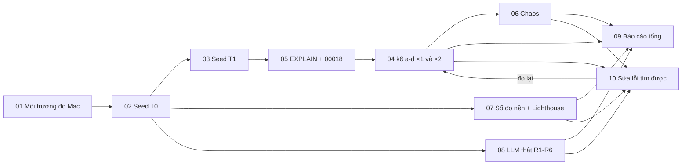

# SRS FEAT-nfr-eval Seed, yêu cầu phi chức năng và đánh giá LLM thật
Phiên bản 0.1 · 2026-11-12 · Trạng thái: **DRAFT**
Nguồn: `docs/sprints/ops-vps/plan.md` · `docs/sprints/ops-vps/prompts/tl-eval.md` · `docs/SYSTEM_DESIGN.md` §1–§6 · `docs/phases/P10.md` L3 · `docs/team/CONTEXT.md` mục 4 (2026-11-12) · `benchmarks/**` · `scripts/seed*.mjs` · PRD §5, §6
Truy vết: US ở `US.md` (US-NFR-01…10).

## 1. Mục đích và phạm vi
Sprint đo, không thêm tính năng. Trả lời bốn câu mà báo cáo sprint 8, 9 và PROGRESS còn ghi "chưa đo":
1. Seed có chạy qua sạch, lặp lại được không? (T0 demo, T1 1.000 SV)
2. Ở quy mô T1, hệ thống có đạt SLO của `SYSTEM_DESIGN.md` §5 không, kể cả khi nhân đôi gateway / worker?
3. Mất worker, Redis hoặc `docling-serve` thì có mất việc không?
4. Các việc LLM (trích công thức, chấm bài, che danh tính, chat, phân loại) hoạt động thế nào với mô hình thật?

**Trong phạm vi:** môi trường đo trên Mac; `seed.mjs` sạch + `seed-t1.mjs`; k6 (a)–(d); `EXPLAIN` + `00018_indexes_tuning`; chaos nhỏ; số đo nền (`docker stats`, image, khởi động, p95, Lighthouse); đo LLM thật bằng `real_llm.py`; báo cáo tổng; sửa lỗi do phép đo tìm ra (US-NFR-10).
**Ngoài phạm vi:** tính năng mới; observability UI, `/insights`, thống kê điểm thi, `make eval` E1–E6 đầy đủ, chấm tay E3, ≥ 2 provider cho E4, visual QA, chạy trọn `DEMO_SCRIPT.md` (đều thuộc P10, sprint 11); judge amd64 có seccomp (chỉ chạy được trên amd64 — chuyển PR); `docker-compose.prod.yml` (P10 L4).

## 2. Người dùng và quyền
| Vai | Việc |
| --- | --- |
| Dev | Viết / chạy script đo, seed, migration chỉ mục, sửa lỗi (US-NFR-10) |
| QC | Chạy lại một phần độc lập (smoke hộp đen, kiểm `meta`, kiểm số liệu báo cáo = tệp nguồn) |
| Research (Tech Lead) | Thẩm định phương pháp đo và đọc `llm_audit`; viết báo cáo US-NFR-09 nếu PM giao |
| Chủ dự án | Cấp khoá Gemini, đặt trần chi phí / hạn mức; chấm tay đối chiếu một mẫu kết quả trích công thức |
| Admin (trong hệ thống) | Cấu hình provider, đọc `llm_audit` có ghi `audit_log` |

Ma trận quyền **của sản phẩm** không đổi. Kiểm bắt buộc khi đo: STUDENT gọi API giảng viên → `403` (US-NFR-04 AC4); STUDENT hỏi điểm người khác → từ chối (US-NFR-08 AC11); TEACHER / STUDENT không đọc `llm_audit` payload; ADMIN đọc có `audit_log`.

## 3. Luồng chính và nhánh lỗi

**Quy tắc tài nguyên:** mỗi lúc một stack; mỗi lúc một phép đo nặng. Thứ tự đo nặng: 03 → 05 → 04 (×1 rồi ×2) → 06 → 07 → 08. Đo LLM thật (08) chạy trên stack T0 (không T1) để không đốt hạn mức.

| Tình huống | Hệ thống / script phản ứng | Người dùng (dev / QC) thấy |
| --- | --- | --- |
| `BASE` trỏ stack demo | Script ghi từ chối (kiểm cổng / tên project) | Một dòng lỗi, mã ≠ 0 |
| `SEED_DEFAULT_PASSWORD` thiếu | Dừng trước khi ghi | Một dòng tiếng Việt |
| RAM Colima > 90% / OOM | Dừng lượt, ghi sự kiện, hạ quy mô theo Q-NFR-3 | Báo cáo có dòng "hạ quy mô: …" |
| Khoá Gemini hết hạn mức / `429` kéo dài | Lùi theo `Retry-After`; lưu tiến độ; `--resume` | Kết quả "chưa hoàn tất" từng phần |
| Khoá hết hiệu lực / sai | Dừng ngay, không thử lại vô hạn | Một dòng lỗi, không in khoá |
| SLO trượt | Ghi FAIL + số thật + nghi ngờ; mở lỗi nếu có nguyên nhân mã | Bảng SLO có ô FAIL |
| Chaos để lại việc thất lạc | FAIL; giữ nguyên trạng thái chụp bằng chứng | `chaos.json` có danh sách việc |
| Migration chỉ mục làm ghi chậm > 20% | Bỏ chỉ mục đó | Bảng trước / sau có dòng "bỏ" |

## 4. Yêu cầu chức năng
| FR | Hệ thống / công cụ phải… | AC |
| --- | --- | --- |
| FR-1 | Có `benchmarks/README.md` quy trình Mac; `benchmarks/real-llm/README.md` bỏ mọi yêu cầu chạy trên VPS | US-NFR-01 AC1–AC2 |
| FR-2 | Mọi báo cáo JSON có khối `meta` (commit, thời điểm, máy, số lần chạy, cấu hình); có script kiểm | US-NFR-01 AC3 |
| FR-3 | Mọi script ghi dữ liệu từ chối chạy khi nhắm stack demo / DB `edupilot` ngoài ý muốn | US-NFR-01 AC4, US-NFR-03 AC6 |
| FR-4 | `seed.mjs` chạy qua trên stack trống, idempotent, dừng sạch khi thiếu cấu hình; các `check-*-seed.mjs` xanh | US-NFR-02 |
| FR-5 | `scripts/seed-t1.mjs`: 1.000 SV, 20 lớp, 5 TA, một học kỳ; tất định theo `SEED_RNG`; DB `edupilot_t1`; `--reset`, `--scale` | US-NFR-03 |
| FR-6 | Bốn kịch bản k6 (a)–(d) có ngưỡng = SLO §5; chạy ở ×1 và ×2; ghi p50/p95/p99, 5xx | US-NFR-04 AC1–AC3, AC5 |
| FR-7 | Kịch bản (c) có hai pha (`baseline`, `grading`) và so TTFT ≤ +20% | US-NFR-04 AC2 |
| FR-8 | Kịch bản k6 có bước kiểm `403` cho STUDENT gọi API giảng viên (≥ 100 lần) | US-NFR-04 AC4 |
| FR-9 | Có `00018_indexes_tuning.sql` (chỉ mục phức hợp bắt đầu bằng `course_id`; HNSW nếu cần), `down` được, `sqlc diff` sạch | US-NFR-05 |
| FR-10 | Báo cáo `EXPLAIN ANALYZE` 10 truy vấn trước / sau + kích thước chỉ mục | US-NFR-05 AC1–AC3, AC6 |
| FR-11 | Chaos: giết worker, dừng Redis 70 s, dừng `docling-serve` 2 phút; đối chiếu việc vào = xong + dead-letter | US-NFR-06 |
| FR-12 | `benchmarks/reports/baseline.{json,md}`: `docker stats`, image, khởi động, p95 ≥ 12 endpoint | US-NFR-07 AC1–AC3 |
| FR-13 | Lighthouse 6 route (mô phỏng + devtools) trên Mac; không nới ngưỡng | US-NFR-07 AC4 |
| FR-14 | `real_llm.py` chạy R1–R6 bằng model Gemini; có `--resume`; ghi hạn mức / token / chi phí | US-NFR-08 AC1–AC9 |
| FR-15 | Che danh tính: kiểm `llm_audit` không có tên / MSSV thật; đo tỷ lệ placeholder được giữ | US-NFR-08 AC4 |
| FR-16 | Báo cáo tổng `docs/research/…-nfr-real-llm.md`: bảng SLO → số đo → kết quả; danh sách câu cần vá ở báo cáo cũ | US-NFR-09 |
| FR-17 | Lỗi tìm được có dòng TL / proposal; sửa theo mức; test hồi quy; đo lại | US-NFR-10 |

## 5. Dữ liệu
- **Migration mới (duy nhất):** `00018_indexes_tuning.sql` — chỉ `CREATE INDEX` (có thể `CONCURRENTLY`; goose cần `-- +goose NO TRANSACTION` cho phần đó) và, nếu cần, `CREATE EXTENSION IF NOT EXISTS pg_stat_statements` **chỉ ở stack đo** (qua cấu hình compose đo, không qua migration sản phẩm). Không đổi cột, không đổi bảng. Số `00018` đang trống (`PROGRESS.md`: "số `00018` không dùng"); `00019` giữ cho P9 theo `ARCHITECTURE.md` §4.
- **DB `edupilot_t1`:** tạo / xoá bởi `seed-t1.mjs`; không có trong compose sản phẩm. Quy mô mục tiêu (từ `SYSTEM_DESIGN.md` §1.2): 1.000 SV · 20 lớp · 5 TA · 3 GV · `chat_messages` ≈ 90.000 · `study_time_daily` ≈ 525.000 · bài nộp ≈ 4 bài/SV.
- **Kết quả đo:** `benchmarks/reports/{load-a,load-b,load-c,load-d,chaos,baseline,explain}.json` + `.md`; `benchmarks/reports/real-llm/*.json`. Không vào DB.
- Dữ liệu đo LLM thật tạo ra: lớp `EVALLLM`, bài `EVAL03`, kết quả chấm nháp `BT03` (README harness). Chỉ ở stack `-p ep-research`, mất khi `down -v`.

## 6. API và công cụ
Không có API mới. Script dùng API công khai theo `openapi.yaml` (đăng nhập, đọc, chat SSE, "Chấm tất cả", cấu hình provider).
| Công cụ | Vị trí | Vào → ra |
| --- | --- | --- |
| Seed T0 | `scripts/seed.mjs` | API gateway → dữ liệu demo (đã có) |
| Seed T1 | `scripts/seed-t1.mjs` (mới) | SQL trực tiếp / COPY vào `edupilot_t1` (được phép: không qua đường nghiệp vụ; mật khẩu băm bằng cùng thuật toán của `auth`) |
| k6 | `benchmarks/load/*.js` | HTTP + SSE → JSON |
| Đo LLM thật | `benchmarks/real-llm/real_llm.py` | HTTP API → JSON; `llm_audit` đọc chỉ-đọc (`begin read only`) |
| Kiểm `meta` | `benchmarks/check-meta.mjs` (mới) | JSON → exit code |
| Lighthouse | `lighthouserc*.json` hiện có | URL stack đo → báo cáo |

**Giới hạn tần suất khi đo:** k6 chạy từ một IP nên chạm `RATE_LIMIT_IP_PER_MIN`. Dùng override có sẵn `benchmarks/load/k6-stack.yml` (nới hạn mức IP / người, `LLM_MAX_CONCURRENCY`, `FAKE_LLM_LATENCY=5000-15000`) **chỉ ở stack đo**; báo cáo ghi rõ các giá trị này (đo hiệu năng, không đo bộ giới hạn tần suất — bộ này đã có test riêng).

## 7. Giao diện
Không có màn hình mới. Ngoại lệ duy nhất: chủ dự án cấu hình provider Gemini ở màn Cấu hình LLM hiện có (`/settings/llm`) hoặc bằng API admin; không thêm màn.

## 8. Phi chức năng áp dụng
| Chủ đề | Yêu cầu |
| --- | --- |
| SLO | `SYSTEM_DESIGN.md` §5: đọc p95 ≤ 300 ms, ghi p95 ≤ 500 ms, SSE đầu ≤ 300 ms, TTFT ≤ 1,5 s (cache) / ≤ 4 s (RAG), dashboard / 360 ≤ 3 s trên 1.000 SV, chấm 1.000 bài ≤ 3 giờ **và** TTFT không xấu quá 20%, 0 việc thất lạc, 5xx < 0,5% |
| Trung thực số liệu | Ghi cả lần trượt; không chọn lần tốt nhất; nêu k6 và server dùng chung 6 CPU nên số đo là **cận trên bảo thủ** của độ trễ [INFERENCE: chưa kiểm bằng máy đo riêng] |
| Riêng tư | Seed mô phỏng (D44); không PII thật ở mọi báo cáo; `llm_audit` payload chỉ ADMIN; log không PII |
| Bí mật | Khoá Gemini: `.env.local` (đã `.gitignore`) / biến môi trường / cấu hình admin; không vào repo, log, báo cáo, ảnh chụp |
| Idempotency | Seed T0 chạy lại không tạo trùng; `seed-t1 --reset` an toàn; harness `--resume` không chấm lại bài đã chấm |
| Phân trang / N+1 | Truy vấn nặng nhất do (d) lộ ra được xét theo luật 13; N+1 phát hiện thì ghi lỗi (US-NFR-10) |
| Cache | Dữ liệu điểm / điểm danh không cache phía server (luật 15) — kịch bản (d) đo đúng đường không cache |
| Tài nguyên Mac | Một stack, một phép đo nặng; RAM Colima 10 GB; `--scale gateway=2 worker=2` cần đo RAM trước, hạ VU nếu > 90% |
| Chi phí LLM | Tổng lời gọi ≈ 330 (README harness); tôn trọng RPM mặc định thấp (≤ 20); không vượt trần Q-NFR-2 |

## 9. Kiểm thử
| Lớp | Kiểm |
| --- | --- |
| Script | `node scripts/check-*-seed.mjs` (có sẵn); thêm `check-t1-seed.mjs` (đếm dòng ≈ bảng §1.2, tất định, FK) |
| Tự kiểm harness | `real_llm.py` có tự kiểm offline với fixtures (đã có theo README); thêm kiểm `--resume` |
| Migration | `goose up/down/up` trên T1; `sqlc diff`; `go test` gói đụng truy vấn |
| Đo | k6 (a)–(d), chaos, baseline, Lighthouse, real-llm; QC chạy lại ≥ 1 kịch bản k6 và đối chiếu số `meta` |
| Regression sản phẩm | `go test -race ./...` + `playwright test` một lần trước handoff (CONTEXT mục 4: cả bộ một lần) |
| Dữ liệu seed cần | `seed.mjs` (T0) + `seed-t1.mjs`; bài `BT03` 22 bài; 2 quy chế PDF; `data/injection/*` của harness |

## 10. Câu hỏi mở và quyết định
Xem `QUESTIONS.md` (Q-NFR-1…8). **Quyết định đã chốt dùng lại:** D44 (dữ liệu mô phỏng), D45 (không đối chiếu hệ cũ), D46 (không service Python; script offline chỉ gọi HTTP), D47 (luật tốc độ), D58 (seccomp tắt trên arm64); CONTEXT 2026-11-12 (Mac, một stack, tiết kiệm token).

**Đề xuất đổi tài liệu nền (chờ PM):**
1. `ROADMAP.md`: thêm dòng sprint 9.5; chuyển khỏi P10 L3: `seed-t1`, k6 (a)–(d), chaos, EXPLAIN + chỉ mục; P10 giữ `make eval` E1–E6 (gồm E3 chấm tay, E4 ≥ 2 provider), `make load-t1` / `make chaos` chỉ còn là lệnh bọc gọi lại script của 9.5.
2. `P10.md` L3: sửa số migration `00015 indexes_tuning` → `00018` (số `00015` đã là `observation`).
3. `ARCHITECTURE.md` §4 bảng migration: thêm `00018 indexes_tuning | 9.5`.
4. `docs/team/CONTEXT.md` mục 2 và `benchmarks/real-llm/README.md`: bỏ VPS (đã có trong US-NFR-01).

## 11. Truy vết
| PRD / tài liệu | FLOWS | Phase / nguồn | US | FR | Kiểm |
| --- | --- | --- | --- | --- | --- |
| PRD §5 phi chức năng | – | SYSTEM_DESIGN §5 | NFR-01, 07 | 1–3, 12–13 | `baseline.json`, `check-meta.mjs` |
| PRD §2 (dữ liệu mô phỏng), D44 | – | ops-vps seed | NFR-02, 03 | 4–5 | `check-*-seed.mjs`, `check-t1-seed.mjs` |
| PRD §5 (T1) | F9, F10 | P10 L3 | NFR-04 | 6–8 | `load-a…d.json` |
| PRD §5 | – | P10 L3 (`EXPLAIN`) | NFR-05 | 9–10 | `explain.json`, `goose up/down/up` |
| PRD §5 (không mất việc) | F9, F6 | P10 L3 (chaos) | NFR-06 | 11 | `chaos.json` |
| PRD §6 E1, E3 (phần), E6 | F3, F9, F10 | `tl-eval.md` mục 1–6 | NFR-08 | 14–15 | `real-llm/*.json` |
| PRD §6 | – | ops-vps | NFR-09 | 16 | báo cáo `docs/research/` |
| – | – | – | NFR-10 | 17 | test hồi quy + đo lại |
