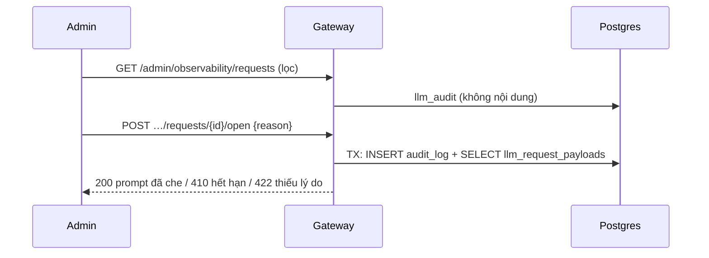
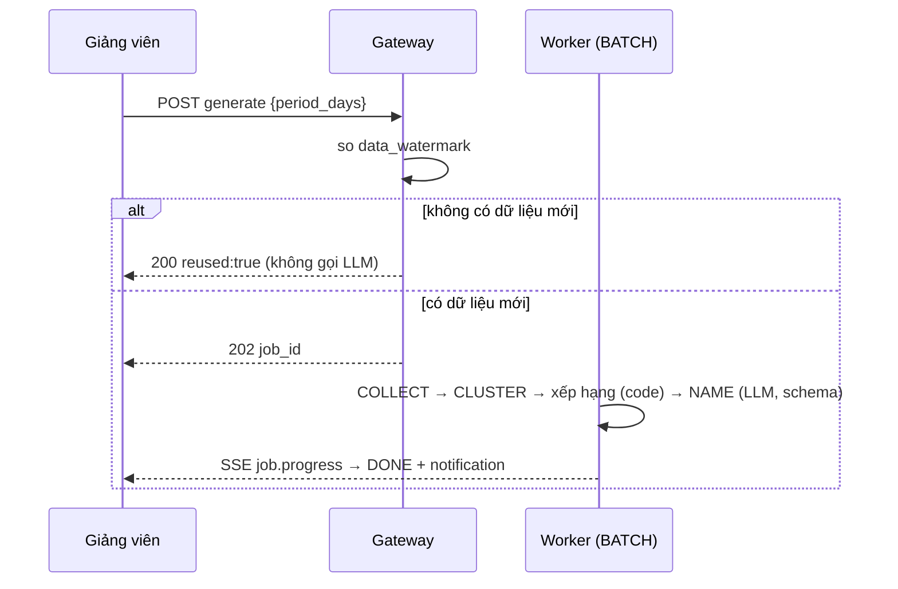

# SRS FEAT-p10-eval Observation A + B, đánh giá, hoàn thiện
Phiên bản 1.5 · 2026-11-14 · Trạng thái: **APPROVED** (PM uỷ quyền; Q-E-1, Q-E-4, Q-E-21 theo phương án **an toàn nhất**, PM xác nhận P-11-1 — `QUESTIONS.md`)

**v1.2 (P-11-2, P-11-5, P-11-6):** US-P10-10 AC1 biểu đồ PNG → SVG; US-P10-08 AC1 trạng thái đo, AC3a đổi chữ, AC6 route trượt ghi Nợ (không FAIL); FR-19, FR-20.

**v1.3 (P-11-9):** US-P10-12 AC14…AC18 — cờ chèn lệnh bằng `llm.Structured` trong luồng chấm (chỉ cờ, không đổi điểm; bắt ≥ 6/6 bộ 9.5); FR-24.

**v1.4 (P-11-10):** US-P10-13 «Decision cascade» (đợt 6); FR-25…FR-27; `llm_audit.path`; Q-E-23…25.

**v1.5 (P-11-11):** US-P10-13 còn **ba** cổng (bỏ lưới khủng hoảng, giữ US-P3-04 AC13 — Q-E-23); định tuyến chat fallback = luật (Q-E-24); bỏ bộ thử khủng hoảng (Q-E-25 → Nợ sau bảo vệ); AC đánh số lại AC1…AC13 (+ AC6a).

## 1. Mục đích và phạm vi
Hoàn tất M13 (Observation A: `/observability`; B: `/insights`), thống kê điểm thi PE trên `/analytics`, đóng Nợ (UX17-8/9, LCP, L6), đo đạc E1–E6, E2E F1–F17, rà bảo mật và hoàn thiện cho buổi bảo vệ.

| Trong phạm vi | Ngoài phạm vi |
| --- | --- |
| US-P10-01…12 (đợt 1–5 của `docs/sprints/11/plan.md`) | Tải T1 / chaos (đã ở 9.5, Q-E-20); chấm tay E3 (chủ dự án); quay video; triển khai VPS thật |
| Nối API thật cho hai màn đang mock; bảng `llm_request_payloads` | Biểu đồ Analytics sâu; cảnh báo qua mail / Teams; sửa `student_risk` |

Nguyên tắc nền: giảng viên **không** đọc chat riêng chưa escalate; nội dung prompt chỉ ADMIN, có lý do + `audit_log`; điểm tính bằng code thuần; không gamify; sinh viên không thấy gì ở các màn này.

## 2. Người dùng và quyền
| Hành động | ADMIN | TEACHER | TA | STUDENT |
| --- | --- | --- | --- | --- |
| Dải + bảng yêu cầu toàn hệ thống (`/admin/observability/summary`, `requests`) | ✓ | 403 | 403 | 403 |
| Mở chi tiết yêu cầu (prompt đã che) | ✓ (lý do + `audit_log`) | 403 | 403 | 403 |
| Tổng hợp một lớp (`…/observability/summary`) | ✓ (mọi lớp) | ✓ (lớp mình; lớp khác 404) | 403 | 403 |
| Nhận cảnh báo lỗi / chi phí | ✓ | – | – | – |
| Tạo / xem / xuất báo cáo lỗ hổng | 403 | ✓ lớp mình | ✓ lớp mình | 403 |
| Tạo thread ghim / buổi ôn tập từ báo cáo | – | ✓ | ✓ | – |
| Thống kê điểm thi lớp (`/analytics`, có danh tính) | chỉ số tổng, **không danh tính** | ✓ lớp mình | ✓ lớp mình | 403 |
| So sánh nhiều lớp | – | ✓ (lớp mình dạy) | 403 | 403 |
| `make eval`, `seed`, bảo mật, LCP | việc của đội (không phải tính năng sản phẩm) | | | |

Sinh viên lớp khác → `404`. Mọi handler lớp học qua `CourseAccessGuard`.

## 3. Luồng chính và nhánh lỗi


| Tình huống | Hệ thống phản ứng | Người dùng thấy |
| --- | --- | --- |
| Lý do mở chi tiết < 10 ký tự | `422 REASON_REQUIRED`, không `audit_log` | Báo tại ô lý do, nút khoá |
| Payload quá 30 ngày | `410 PAYLOAD_EXPIRED`, vẫn ghi `audit_log` | «Nội dung đã hết hạn lưu» + metadata |
| `audit_log` ghi lỗi | Cả giao dịch rollback, không trả nội dung | Lỗi chung + `Thử lại` |
| `generate`, không dữ liệu mới | `200 reused:true`, 0 lời gọi LLM | «Chưa có câu hỏi mới từ ngày …» |
| `generate`, < 20 câu hỏi | `409 NOT_ENOUGH_DATA` | «Chưa đủ câu hỏi để gom (cần ≥ 20)» |
| LLM lỗi khi đặt tên | Tên tạm từ từ khoá cụm, `named_by:"fallback"` | «Chưa đặt được tên chủ đề» |
| LLM lỗi trước `NAME` | Job `FAILED`, không bản ghi báo cáo | «Chưa tạo được báo cáo. Thử lại.» |
| `generate` vượt trần | `429 RATE_LIMITED` + `Retry-After` | Thông báo tại chỗ |
| Lớp chưa có báo cáo | `404` ở `latest` | `EmptyState` + `Tạo báo cáo mới` |
| Chủ đề < 3 SV | `examples=[]`, nhãn «Ít người hỏi» | Không mục gập câu mẫu |
| Cảnh báo cùng loại trong 6 giờ | Bỏ qua | Không thông báo lặp |
| LCP còn > 2.500 ms sau U1–U4 + (a) | Không nới ngưỡng, không SSR / đổi auth (P-11-6); ghi số thật + Nợ | Story không FAIL vì route đó |
| Gateway chưa chạy khi `make eval` | Thoát ≠ 0, không báo cáo rỗng | «Gateway chưa chạy» |

## 4. Yêu cầu chức năng
| FR | Hệ thống phải… | AC |
| --- | --- | --- |
| FR-1 | Tổng hợp từ `llm_audit` trong cửa sổ 24 giờ / 7 ngày: số yêu cầu, p50 / p95 `latency_ms`, tỷ lệ lỗi (status ∉ {`ok`,`degraded`,`cancelled`}), tỷ lệ chuyển dự phòng (`fallback_index > 0`), chi phí (`cost_est` theo ngày `Asia/Ho_Chi_Minh`, theo tác vụ) | P10-01 AC2, AC3 |
| FR-2 | Bổ sung chỉ số chất lượng: chuyển giảng viên (`escalation_tickets`), Helpful / Not helpful (`chat_messages.feedback`), Correct / Reject (Threads), tỷ lệ + độ lệch giảng viên sửa điểm AI, lần che thông tin (`pii_events`, chỉ đếm) | P10-01 AC1, AC5 |
| FR-3 | Liệt kê yêu cầu với bộ lọc (`all` / `problem` / `privacy`, lớp, tác vụ, khoảng giờ), phân trang con trỏ, **không** trả nội dung | P10-01 AC4, AC8 |
| FR-4 | Trả tổng hợp lớp cho TEACHER của lớp đó và ADMIN, không có nội dung, không chi phí theo nhà cung cấp | P10-01 AC5, AC6 |
| FR-5 | `POST …/requests/{id}/open {reason}`: kiểm 10–200 ký tự → trong **một giao dịch** ghi `audit_log` rồi đọc `llm_request_payloads` → trả prompt đã che, công cụ, độ tự tin, `trace_id`; mỗi lần mở một dòng | P10-02 AC1–AC4, AC9 |
| FR-6 | `internal/llm` ghi `llm_request_payloads` **chỉ bản đã che**; dọn bản ghi > 30 ngày bằng job hằng ngày; trả `410` khi hết hạn | P10-02 AC8, AC10 |
| FR-7 | Hiện liên kết Jaeger khi có `JAEGER_BASE_URL`, không thì `trace_id` + sao chép | P10-02 AC7 |
| FR-8 | Worker 5 phút / lần tính cảnh báo: lỗi > 5% (cửa sổ 1 giờ, ≥ 20 yêu cầu) và chi phí ngày ≥ 100% `llm_budgets`; tạo thông báo ADMIN, khử trùng 6 giờ, idempotent | P10-03 |
| FR-9 | `generate`: kiểm quyền + trần (3 việc / 60 phút / lớp) + `Idempotency-Key`; so `data_watermark` (cùng `period_days`); `202` hoặc `200 reused` | P10-04 AC1, AC8, AC11 |
| FR-10 | Gom 5 nguồn của **đúng lớp**, che / ẩn danh trước khi nhúng và trước khi gửi LLM | P10-04 AC2, AC6, AC7, AC13 |
| FR-11 | Gom cụm theo embedding (cosine), gắn chương / tuần theo metadata tài liệu của chunk gần nhất; xếp hạng bằng code với trọng số §4.1 | P10-04 AC3, AC4 |
| FR-12 | LLM (`Structured(json_schema)`, làn `BATCH`) đặt tên chủ đề + khuyến nghị; lỗi → tên tạm | P10-04 AC3, AC10 |
| FR-13 | Chủ đề < 3 sinh viên khác nhau: `examples=[]` + nhãn; ≥ 3: 3–5 câu mẫu ẩn danh, mỗi câu từ sinh viên khác nhau khi có thể | P10-04 AC5, AC6 |
| FR-14 | Mục «Tài liệu chưa đề cập» từ câu `chat_messages.no_context` | P10-04 AC2, P10-05 AC6 |
| FR-15 | `latest` trả báo cáo mới nhất + `previous` (chủ đề mới / đổi hạng) + `has_new_data`; `export?format=md` | P10-05 AC3, AC7, AC10 |
| FR-16 | `/insights`: danh sách biên tập, trạng thái rỗng / đang tạo / lỗi, nháp thread ghim, form buổi ôn tập, in PDF bằng trình duyệt | P10-05 |
| FR-17 | Thống kê điểm thi: phân bố, trung bình / trung vị / tỉ lệ đạt, xu hướng, câu sai nhiều, tụt 3 bài liên tiếp, so sánh lớp (≥ 5 bài nộp/lớp); chỉ bài `PUBLISHED`; ADMIN chỉ tổng | P10-06 |
| FR-18 | `StartIn.Count` phân biệt «thiếu» (mặc định 10) và «0 / âm / > 50» (`422`) | P10-09 |
| FR-19 | Bộ đo Lighthouse 8 route ở trạng thái người dùng quay lại (P-11-5), LCP trung vị ≤ 2.500 ms, ngưỡng không đổi; đổi chữ khối lớn nhất theo luật chữ UI (P-11-6a); route còn trượt → số thật + Nợ | P10-08 |
| FR-20 | `make eval` E1–E6 → JSON + MD + SVG (thư viện chuẩn, P-11-2); chỉ HTTP; `WAITING_HUMAN` khi thiếu chuẩn người | P10-10 |
| FR-21 | Bảng luồng × spec × kết quả F1–F17; spec bù cho luồng thiếu | P10-11 |
| FR-22 | Rà bảo mật, README, compose production, visual QA 2 lượt, 10 câu nghiệm thu, demo 15 phút | P10-12 |
| FR-24 | Gắn cờ `INJECTION_SUSPECTED` bằng `llm.Structured` (gộp lời gọi chấm nếu được, làn `BATCH`, đã che) OR regex; chỉ cờ, không đổi điểm; bài trống không gọi; LLM lỗi → chỉ regex | P10-12 AC14…AC18 |
| FR-25 | `internal/llm` thêm `Decide` (`net/http`, provider loại `decision`, chỉ `gemini-decision-1`, qua Scheduler + Masker) và `Cascade` với chính sách đối xứng `τ` / chỉ-thêm-cờ `ε`, lỗi → fallback → fail-closed, ghi `Path` | P10-13 AC1…3 |
| FR-26 | Áp cascade cho **ba** cổng: tường lửa Threads (chỉ thêm chặn), cờ chèn lệnh (regex OR `Structured` OR decision), định tuyến chat (ngưỡng; dưới ngưỡng giữ kết quả luật; cổng TTFT); tin khủng hoảng **không bao giờ** tới decision / LLM; **không** cho điểm / rubric / escalate | P10-13 AC4…8 |
| FR-27 | Đo + hiển thị tỉ lệ đường nhanh theo tác vụ (Admin), báo cáo `cascade.md`; cờ mặc định tắt | P10-13 AC9, AC13 |
| FR-23 | Seed A + B + điểm thi và `check-p10-seed.mjs` idempotent | P10-07 |

### 4.1 Xếp hạng chủ đề (code thuần, không LLM; hằng số ở cấu hình, đề xuất Q-E-6)
Với cụm *c*, mỗi tín hiệu chuẩn hoá về [0, 1] bằng chia cho giá trị lớn nhất trong báo cáo: `score(c) = 0,30·S + 0,20·Q + 0,20·L + 0,15·N + 0,15·P`, trong đó S = số sinh viên khác nhau, Q = số câu hỏi, L = tỷ lệ tự tin thấp / escalate, N = tỷ lệ Not helpful, P = tỷ lệ sai luyện đề của chủ đề tương ứng. Nguồn thiếu → trọng số của nó chia đều cho các tín hiệu còn lại. Hoà → thứ tự ổn định theo `S` rồi `Q`. Hiển thị tối đa 8 chủ đề đầu; còn lại gập «Chủ đề khác».

## 5. Dữ liệu
**Không tạo bảng cho báo cáo lỗ hổng:** `insight_reports` đã có (`00015`; `payload` jsonb: `{topics:[{rank,name,why,signals,recommendation,examples,named_by,chapter,week}],uncovered:[],counts,period_days}`; **không** `student_id` / tên / MSSV trong payload).

**Bảng mới (đề xuất đổi ARCHITECTURE, Q-E-1, PM xác nhận P-11-1):** migration kế tiếp sau migration cuối đã merge (số do dev lấy từ nhánh gốc, goose, không sửa file cũ).
```sql
llm_request_payloads(
  audit_id    uuid PRIMARY KEY,        -- = llm_audit.id (không FK để dọn độc lập)
  course_id   uuid,                    -- null cho việc ngoài lớp
  masked_prompt text NOT NULL,         -- CHỈ bản đã che
  tools       jsonb,                   -- tên công cụ + đối số đã che
  confidence  numeric(4,3),
  created_at  timestamptz NOT NULL DEFAULT now()
)
-- INDEX (created_at)  -- phục vụ dọn
```
- Ghi sau bước che trong `internal/llm`, cùng yêu cầu với `llm_audit`; ghi lỗi **không** làm hỏng lời gọi LLM (chỉ log, không PII).
- Dọn: job hằng ngày xoá `created_at < now() − 30 ngày`; `llm_audit` giữ nguyên.
- Quyền DB: bảng chỉ đọc qua API ADMIN; không view cho vai khác.

**Chỉ mục cần xác nhận trên T1 (`EXPLAIN ANALYZE`):** `llm_audit(created_at)`, `llm_audit(course_id, created_at)`, `llm_audit(status, created_at)`; thống kê điểm thi theo `(course_id, exam_id)`. Thiếu → thêm trong cùng migration (index phức hợp bắt đầu `course_id`).

**Cột mới (đề xuất đổi ARCHITECTURE, P-11-10):** `llm_audit.path text NULL` ∈ {`FAST`,`FALLBACK`,`FAIL_CLOSED`} (null cho lời gọi không qua cascade); task `DECIDE` thêm vào enum task / `llm_task_routes`; provider loại `decision`. Cùng migration với `llm_request_payloads` hoặc migration kế tiếp.

Không đổi: `audit_log`, `notifications`, `calendar_events`, `forum_threads.pinned_at`, `llm_budgets`.

## 6. API
Tiền tố `/api/v1`. Ghi chú: cursor / `limit` ≤ 100.
| # | Endpoint | Quyền | Mã lỗi chính |
| --- | --- | --- | --- |
| 1 | `GET /admin/observability/summary?window=24h\|7d` | ADMIN | 403 |
| 2 | `GET /admin/observability/requests?filter&course_id&task&from&to&cursor&limit` | ADMIN | 403, 422 |
| 3 | `POST /admin/observability/requests/{id}/open {reason}` | ADMIN | 403, 404, 410 `PAYLOAD_EXPIRED`, 422 `REASON_REQUIRED` |
| 4 | `GET /courses/{id}/observability/summary` | TEACHER lớp mình, ADMIN | 403, 404 |
| 5 | `POST /courses/{id}/insights/knowledge-gap/generate {period_days}` (`Idempotency-Key` bắt buộc) | TA, TEACHER | 202 `{job_id}`; 200 `{report_id,reused:true}`; 409 `NOT_ENOUGH_DATA`; 429; 403; 404 |
| 6 | `GET /courses/{id}/insights/knowledge-gap/latest` | TA, TEACHER | 404 (chưa có) |
| 7 | `GET /courses/{id}/insights/knowledge-gap/{rid}/export?format=md` | TA, TEACHER | 404 |
| 8 | `GET /courses/{id}/analytics/exams/overview?exam_id=\|week=` | TA, TEACHER; ADMIN chỉ tổng | 403, 404 |
| 9 | `GET /courses/{id}/analytics/exams/trend` | như trên | – |
| 10 | `GET /courses/{id}/analytics/exams/hard-items?exam_id&cursor&limit` | TA, TEACHER | – |
| 11 | `GET /courses/{id}/analytics/exams/declining?cursor&limit` | TA, TEACHER (ADMIN 403) | – |
| 12 | `GET /analytics/exams/compare` | TEACHER (lớp mình dạy) | 403 |

Ghi chú: (a) #3 đổi `GET` → `POST` so với `ARCHITECTURE.md` §5 vì có tác dụng phụ (`audit_log`) và lý do không nên nằm trong URL (Q-E-4); (b) #2 và #3 trả `Cache-Control: no-store`; (c) tiến độ tạo báo cáo qua SSE chung, sự kiện `job.progress`; (d) tạo thread ghim dùng API Threads sẵn có (`POST …/threads` rồi đặt ghim), tạo buổi ôn tập dùng `POST …/calendar/events` (type `OTHER`) — **không** endpoint mới; (e) `GET /jobs/{id}` cho trạng thái; (f) ADMIN không gọi #5–#7. Tool agent: không có. Cần có trong `openapi.yaml` (US-P10-07 AC6).

## 7. Giao diện
Nguồn: `DESIGN.md` §14.21, §14.22, §13; `UX.md` mục 6. Chỉ token `--ep-*` + primitive `shared/`; không khung lồng khung, không thẻ KPI.
| Route | Khung nhìn đầu | Primitive | Rỗng / tải / lỗi | Mobile 375 px |
| --- | --- | --- | --- | --- |
| `/observability` (ADMIN) | Dòng «24 giờ qua» → bảng 7 ngày → bảng yêu cầu có lọc → `Drawer` chi tiết (khoá → lý do → nội dung) | `PageHeader`, `DataTable`, `Drawer`, `SegmentedControl`, `Field`, `PageState` | `EmptyState` một dòng; `PageState` lỗi + `Thử lại` | Dải xếp dọc, bảng cuộn trong khung |
| `/observability` (TEACHER) | Một lớp, tổng hợp (không bảng yêu cầu) | `DefinitionList` / bảng | như trên | như trên |
| `/insights` | Ngày báo cáo + `Tạo báo cáo mới` → danh sách chủ đề biên tập (mục gập câu mẫu) → «Tài liệu chưa đề cập» → «So với báo cáo ngày …» | `Page`, `Panel`, `Section`, `DataTable` nhẹ, `useAutosaveDraft` | `EmptyState` + một nút; chỉ báo giai đoạn khi đang tạo; `PageState` lỗi | Xếp dọc, vùng chạm ≥ 44 px |
| `/analytics` tab `Điểm thi` | Chọn bài thi → dòng thống kê → histogram → bảng câu sai nhiều | recharts, `DataTable`, `SegmentedControl` | `EmptyState` «Chưa có bài thi công bố» | Biểu đồ co, bảng cuộn |

Lời văn theo §13: không «RAG / PII / provider / fallback / trace» ở màn sinh viên (các màn này không dành cho sinh viên). Quy tắc chữ UI: không dòng mô tả dưới tiêu đề; tooltip chỉ cho cú pháp / lý do khoá / hệ quả; dòng quyền riêng tư của `/insights` là `meta` một dòng. Nhãn Việt: `Tạo báo cáo mới`, `Xem chi tiết`, `Tạo thread ghim`, `Tạo buổi ôn tập`, `Xuất`.

## 8. Phi chức năng áp dụng
| Mục | Yêu cầu |
| --- | --- |
| Hiệu năng | `summary` p95 ≤ 500 ms; bảng yêu cầu ≤ 300 ms trên `llm_audit` ≥ 1 triệu hàng; thống kê điểm thi p95 ≤ 500 ms; LCP ≤ 2.500 ms (8 route); SSE đầu ≤ 300 ms (chat không đổi) |
| Làn LLM | `generate` = `BATCH`; không làm chat treo (nguyên tắc 11) |
| Riêng tư | Prompt chỉ bản đã che, chỉ ADMIN, có lý do + `audit_log` mỗi lần; câu mẫu k ≥ 3, ẩn danh; không `student_id` trong payload báo cáo; `Cache-Control: no-store` cho #2, #3 |
| Idempotency | `generate` + `Idempotency-Key`; cảnh báo khử trùng; mở chi tiết **không** idempotent có chủ ý (mỗi lần một dòng) |
| Phân trang | Cursor cho #2, #10, #11; cấm `OFFSET` trên `llm_audit` |
| Cache | Không cache điểm phía máy chủ (AGENTS #15); báo cáo vô hiệu theo `data_watermark`, không theo TTL |
| Truy cập lớp | `CourseAccessGuard`; lớp khác → `404` |
| Đo | Ghi cấu hình «MacBook Apple Silicon, Colima 6 CPU / 10 GB» |

## 9. Kiểm thử
| Cấp | Test | Phủ |
| --- | --- | --- |
| Go unit | `TestKnowledgeGap` (seed lệch → A, B đứng đầu; câu mẫu không tên / MSSV; lớp 1 ∌ câu lớp 2; k ≥ 3; watermark không gọi LLM; tên tạm khi LLM lỗi) | P10-04 |
| Go | `TestObservabilityDetailNoPII`, `TestObservabilityAuditEveryOpen`, `TestAlertDedup`, `TestObservabilityRBAC` | P10-01…03 |
| Go | `TestPayloadStoresMaskedOnly` (`internal/llm`) | P10-02 AC10 |
| Go | `TestExamStatsPublishedOnly`, `TestExamStatsAdminNoIdentity` | P10-06 |
| Go | `TestStartCountZero` (`internal/practice`) | P10-09 |
| Contract | `go test ./internal/contract/...` | mọi endpoint mới |
| E2E | `insights.spec.ts`, `observability.spec.ts`, `analytics-exam.spec.ts`; bảng F1–F17 | P10-05…07, 11 |
| E2E | `cascade.spec.ts` (provider `fake`: decision lỗi → fallback; cả hai lỗi → chặn / gắn cờ; tin khủng hoảng không có lời gọi decision); luồng ở `docs/FLOWS.md` «Decision cascade» | P10-13 |
| Go | `TestCascadeTable`, `TestCascadeFailClosed`, `TestDecidePayloadMasked`, `TestDecideCallersAllowlist`, `TestPrecheckAddOnly`, `TestCrisisNeverReachesDecide`, `TestRouteDecisionNoOverride` | P10-13 |
| Go | `TestInjectionFlagLLM` (fake: OR, không đổi điểm, bài trống không gọi, LLM lỗi → regex); chạy tay với LLM thật trên bộ 6 biến thể → ≥ 6/6 | P10-12 AC14…AC18 |
| Đo | `benchmarks/lighthouse/run.sh`; `make eval` | P10-08, 10 |
| Seed | `scripts/check-p10-seed.mjs`; idempotent | P10-07 |
Dữ liệu seed: lớp 1 ≈ 150 câu hỏi (chủ đề A, B lệch + 1 chủ đề đúng 2 sinh viên + 10 `no_context`), lớp 2 ≈ 40 câu (chủ đề C), ≥ 300 dòng `llm_audit` / 7 ngày, ≥ 4 bài thi PE đã công bố, ≥ 1 sinh viên tụt 3 bài liên tiếp, câu hỏi có PII mô phỏng để kiểm che.

## 10. Câu hỏi mở và quyết định
Xem `QUESTIONS.md` (Q-E-1…25). **Đề xuất đổi ARCHITECTURE (PM quyết):** (1) bảng `llm_request_payloads` (Q-E-1); (2) `GET …/requests/{id}` → `POST …/requests/{id}/open` (Q-E-4); (3) §5 thêm 5 endpoint thống kê điểm thi + `export` của Insight (US-P10-06); (4) `/analytics` thêm tab «Điểm thi» (§7 route); (5) `llm_audit.path`, task `DECIDE`, provider loại `decision` (P-11-10); (6) ADR D60, sửa D47(2), làm rõ luật 5, `PRODUCTION_READINESS` (Tech Lead). **PM xác nhận P-11-1:** Q-E-1, Q-E-4, Q-E-21; **PM xác nhận P-11-11:** Q-E-23, Q-E-24, Q-E-25; còn lại đã chốt theo đề xuất BA.

## 11. Truy vết
| PRD | FLOWS | Phase | US | FR | Test |
| --- | --- | --- | --- | --- | --- |
| M13-A | F16 | P10 L1 | P10-01, 02, 03 | FR-1…8 | `TestObservability*`, `TestAlertDedup`, `TestPayloadStoresMaskedOnly`, `observability.spec.ts` |
| M13-B | F17 | P10 L2 | P10-04, 05 | FR-9…16 | `TestKnowledgeGap`, `insights.spec.ts` |
| M13-B (điểm thi, yêu cầu chủ dự án 2026-10-09) | F17, F14 | P10 L2 | P10-06 | FR-17 | `TestExamStats*`, `analytics-exam.spec.ts` |
| M13 (dữ liệu) | F16, F17 | P10 L2, L3 | P10-07 | FR-23 | `check-p10-seed.mjs` |
| NFR hiệu năng | – | P10 L4, Nợ G7-23 / TL-2f | P10-08 | FR-19 | Lighthouse devtools |
| M4 (Nợ P-10-10) | F12 | P9 | P10-09 | FR-18 | `TestStartCountZero`, TC-05-16 |
| E1–E6 | – | P10 L3 | P10-10 | FR-20 | `make eval` |
| Tất cả | F1–F17 | P10 L3 | P10-11 | FR-21 | Bảng `e2e-matrix.md` |
| – | – | P10 đợt 6 (P-11-10) | P10-13 | FR-25…27 | `TestCascade*`, `cascade.md` |
| – | – | P10 L4 (rà bảo mật; P-11-9) | P10-12 | FR-22, FR-24 | Báo cáo rà bảo mật, README, `DEMO_SCRIPT.md` |
