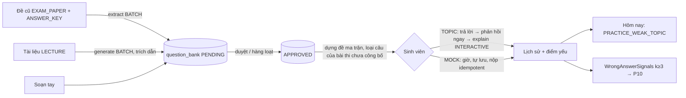

# SRS FEAT-practice Ngân hàng câu hỏi mở rộng, luyện đề, thi thử, form trắc nghiệm
Phiên bản 1.0 · 2026-11-12 · Trạng thái: **APPROVED** (PM chấp nhận P-10-1…6 và Q-P9-1…12; chủ dự án uỷ quyền làm liền mạch)
**v1.0:** áp Q-P9-8 (Forms: chỉ TEACHER import + xem trước + xác nhận, không tự công bố, không LLM — US-P9-11 AC10–AC12), Q-P9-10 (thi thử: `{đúng}/{tổng}` chính, thang 10 một chữ số phụ — FR-15, US-P9-07 AC7), Q-P9-3, 4, 7 giữ nguyên như đã viết.
Nguồn: PRD M4, M8, M15 · FLOWS F12, F14 · `docs/phases/P9.md` · `ARCHITECTURE.md` §4–§7 · `SYSTEM_DESIGN.md` §3.1, §3.4, §5 · `DESIGN.md` §13, §14.17–§14.20 · `UX.md` mục 6 · `FEAT-weekly-exam` SRS (4.1, 5.2, 6) · `FEAT-docs-calendar` SRS (loại tài liệu, `audience`) · `FEAT-crm-360` SRS (4.6, bảng bậc Hôm nay) · `FEAT-gradebook` SRS (4.3.6, 5)
Truy vết: US-P9-01…12 ở `US.md`.

## 1. Mục đích và phạm vi
P9 biến ngân hàng câu hỏi của PE thành nguồn **luyện đề** cho sinh viên và **thay mock** của `/practice*` bằng màn nối API thật (D51).
**Có:** (a) lược đồ luyện đề; (b) Quiz Engine: câu trả lời ngắn + bộ dựng đề theo ma trận; (c) `ExtractQuestions` (trích từ đề cũ + đáp án), `GenerateQuestions` (sinh từ chunk, có trích dẫn); (d) mở rộng `/questions`: luồng `Tạo câu hỏi`, duyệt hàng loạt; (e) luyện theo chủ đề với phản hồi ngay + `ExplainAnswer` stream; (f) thi thử có giờ, tự lưu, ngoại tuyến; (g) tự luận luyện (nhận xét, không điểm); (h) lịch sử, điểm yếu, gợi ý tài liệu, Hôm nay, tín hiệu tổng hợp cho P10; (i) liêm chính; (j) `FormsImportSource`; (k) seed, cổng, E2E.
**Không có:** điểm luyện đề vào sổ điểm; bài thi tính điểm (đã ở PE); xem luyện đề riêng từng sinh viên của giảng viên; `/insights` (P10); câu `CODE` trong luyện đề; thích nghi theo năng lực.

## 2. Người dùng và quyền
| Hành động | STUDENT | TA | TEACHER | ADMIN |
| --- | --- | --- | --- | --- |
| `GET/POST/PUT …/questions*` (đã có) | ✗ | ✓ | ✓ | ✗ |
| `POST …/questions/extract`, `…/generate` | ✗ | ✓ | ✓ | ✗ |
| `POST …/questions/bulk`, `GET …/questions/gen-stats` | ✗ | ✓ | ✓ | ✗ |
| `POST …/forms-import*` | ✗ | ✗ | ✓ | ✗ |
| `GET …/practice/overview`, `history`, `weakness` (chính mình) | ✓ | ✗ | ✗ | ✗ |
| `POST …/practice/start`, `answers`, `submit`, `explain`, `feedback`, `PATCH attempts` (lượt của mình) | ✓ | ✗ | ✗ | ✗ |
| Đọc lượt / câu trả lời luyện của sinh viên khác | ✗ | ✗ | ✗ | ✗ |
| `WrongAnswerSignals` (hàm Go, không route; k ≥ 3 sinh viên) | – | – | P10 dùng | – |

Quy tắc: mọi route lớp đi qua `CourseAccessGuard`; STUDENT chỉ `ACTIVE` của lớp; lượt của người khác → `404` (không lộ tồn tại); staff gọi route sinh viên → `403 FORBIDDEN` (`reason: role`); ADMIN không có route nội dung lớp (`FEAT-weekly-exam` §2). Giảng viên / TA **không đọc** câu trả lời luyện của từng sinh viên (kể cả qua 360, `llm_audit`: payload chỉ ADMIN, có `audit_log`).

## 3. Luồng chính và nhánh lỗi

| Tình huống | Hệ thống phản ứng | Người dùng thấy |
| --- | --- | --- |
| Trích: đề không có văn bản / loại sai / chưa `READY` | `409 DOCUMENT_NOT_READY` / `422 WRONG_DOCUMENT_TYPE` | "Tài liệu chưa dùng được" (tại luồng `Tạo câu hỏi`) |
| Trích: LLM `OVERLOADED` | Retry 3 lần rồi dead-letter; câu đã lưu giữ nguyên | "Chưa trích được. Thử lại." |
| Trích: câu thiếu đáp án / sai schema | Không lưu; ghi vào "bỏ qua" kèm trang | Danh sách "bỏ qua N câu" |
| Duyệt hàng loạt: một id lỗi | Kết quả từng id; lô không huỷ | Hàng lỗi đánh dấu tại chỗ |
| Dựng đề: thiếu câu | Đề ngắn hơn + `notes`; < 5 câu → `409 NOT_ENOUGH_QUESTIONS` | "Chưa đủ câu để luyện chủ đề này" |
| TOPIC: trả lời khi mất mạng | Hàng chờ cục bộ; gửi lại có `Idempotency-Key` | "Chưa gửi được" tại câu |
| TOPIC: `explain` LLM lỗi | Chỉ lỗi phần giải thích; phản hồi đúng / sai còn | "Chưa giải thích được. Thử lại." |
| MOCK: hết giờ máy chủ | `409 ATTEMPT_CLOSED` cho ghi mới; worker đóng lượt; chấm trên câu đã lưu | Kết quả hiện khi mở lại |
| MOCK: mở ở tab thứ hai | `409 TAB_TAKEN_OVER` cho tab cũ | Tab cũ chỉ đọc + `Làm tiếp ở tab này` |
| MOCK: nộp thất bại mạng | Thử lại tự động cùng `Idempotency-Key` | "Chưa nộp được. Đang thử lại." |
| Sinh viên đọc lượt người khác | `404` | Trang không tìm thấy |
| `explain` khi chưa trả lời / chưa nộp | `409 NOT_ANSWERED` / `409 NOT_SUBMITTED` | Nút bị khoá với tên lý do |
| Forms: tệp sai / > 5 MB / thiếu cột định danh | `422` kèm vị trí | Lỗi theo dòng / cột |
| Forms: sổ điểm `LOCKED` | `409` | "Sổ điểm đã chốt" (đi mở khoá có lý do) |

## 4. Yêu cầu chức năng
### 4.1 Quiz Engine (`internal/quiz`, code thuần — không import `internal/llm`)
- **FR-1** Chấm `SHORT` bằng chuẩn hoá `NormalizeShort` (NFC; trim; gộp khoảng trắng; hoa thường; bỏ dấu câu cuối; **giữ dấu tiếng Việt**) so với tập đáp án chấp nhận; trả `decimal` — AC US-P9-01 AC2–AC3.
- **FR-2** `BuildMatrix(pool, matrix, history, seed)` thuần, tất định theo `seed` (id lượt); không lặp; ưu tiên chưa làm / làm sai trong 30 ngày; bù ô thiếu; trả `notes` — US-P9-05 AC1–AC4.
- **FR-3** Xáo thứ tự câu và phương án theo `seed` (id lượt), ổn định khi tải lại — US-P9-05 AC5.
- **FR-4** `Validate` của PE chấp nhận `SHORT` (đáp án chấp nhận ≥ 1, không rỗng) và `ESSAY` (đáp án mẫu + rubric ngắn); `exam_items` từ chối hai loại này (`422 TYPE_NOT_SUPPORTED_IN_EXAM`) — US-P9-01 AC4, AC6.

### 4.2 Việc nền LLM (`internal/practice`; chỉ gọi `internal/llm`)
- **FR-5 `ExtractQuestions`:** đầu vào là chunk của `document_id` (`EXAM_PAPER`) theo trang; `llm.Structured` làn **BATCH**, task `QUESTION_GEN`; schema `{"questions":[{"number","stem","options":[{"label","body"}],"answer_label"?,"explanation"?,"topic"?,"difficulty"?,"page"}]}`; ghép đáp án từ `ANSWER_KEY` theo `number` (chính xác theo số, không đoán); lưu `origin=EXTRACTED`, `PENDING`, `citations=[{document_id,page}]`; câu thiếu đáp án / sai schema → không lưu, vào `skipped[]` — US-P9-02.
- **FR-6 `GenerateQuestions`:** đầu vào là chunk đã chọn (loại `ANSWER_KEY`; tài liệu `visible_to_students=false` được dùng — Q-P9-9); `origin=GENERATED`; mỗi câu bắt buộc ≥ 1 trích dẫn `{document_id,chunk_id,page}` qua kiểm tất định (từ khoá đáp án / giải thích có trong chunk) — US-P9-03.
- **FR-7** Khử trùng theo `stem` chuẩn hoá (cùng `NormalizeShort` + bỏ số thứ tự) trên mọi trạng thái — US-P9-02 AC5, US-P9-03 AC5.
- **FR-8** Prompt: tiếng Việt, tệp cố định `internal/practice/prompts/*.txt`; dữ liệu vào đi qua lớp che danh tính; `ANSWER_KEY` chỉ vào prompt trích khi người gọi là staff — US-P9-02 AC3, AC8.
- **FR-9 `ExplainAnswer`:** `POST …/practice/attempts/{aid}/items/{itemId}/explain` → SSE; một lời gọi `llm.Stream` làn **INTERACTIVE**; ngữ cảnh = đề, đáp án đúng, giải thích, chunk trích dẫn, đáp án sinh viên chọn; cache Redis `ep:practice:explain:{question_id}:{version}:{choice_hash}` TTL 24 h, vô hiệu khi câu sửa; sự kiện đầu ≤ 300 ms — US-P9-06 AC5–AC6, AC9.
- **FR-10 `PracticeFeedback` (tự luận):** một lời gọi `internal/grading` chế độ nhận xét (không điểm), bài viết = dữ liệu không tin cậy; không ghi `grade_entries` — US-P9-08.

### 4.3 Luyện đề
- **FR-11** `GET …/practice/overview`: khối khuyến nghị (chủ đề sai nhiều nhất trong 30 ngày, ≥ 3 câu đã làm; không có thì chủ đề nhiều câu nhất), danh sách chủ đề + số câu `APPROVED` đủ điều kiện, lượt dở — US-P9-06 AC1.
- **FR-12** `POST …/practice/start` (bắt buộc `Idempotency-Key`): `TOPIC` {topic,count 5–50 mặc định 10}; `MOCK` {matrix?,count mặc định 20,duration_minutes 10–180 mặc định 30}; tạo `practice_attempts` + `practice_items` (snapshot `answer_key`, `option_order`, `question_version`); trả `201` mới / `200` lượt dở cùng (student, course, mode, topic) — US-P9-06 AC2, US-P9-07 AC1.
- **FR-13** `PUT …/answers/{itemId}` (`version`, `X-Practice-Tab`): `TOPIC` trả phản hồi `{correct,key,explanation,citations}` **trong cùng response** và khoá đáp án; `MOCK` chỉ lưu — US-P9-06 AC4, US-P9-07 AC3.
- **FR-14** `PATCH …/practice/attempts/{aid} {current_index}`: lưu vị trí; tải lại quay đúng câu — US-P9-06 AC10, US-P9-07 AC6.
- **FR-15** `POST …/submit` (bắt buộc `Idempotency-Key`): chấm `decimal`, kết quả chính `{đúng}/{tổng}`, điểm thang 10 làm tròn **1 chữ số** bằng `decimal` (phụ, không vào sổ điểm, không xếp hạng) (không `float64`); `MOCK` trả kết quả từng câu; gọi lại → cùng kết quả — US-P9-06 AC7, US-P9-07 AC7.
- **FR-16** Worker `practice.close` (tick 1 phút): `MOCK` `IN_PROGRESS` quá `deadline_at + 60 s` → `EXPIRED`, chấm câu đã lưu; idempotent — US-P9-07 AC8.
- **FR-17** Dung sai ghi ngoại tuyến: câu có `client_ts ≤ deadline_at + 60 s` được nhận khi nộp muộn do mất mạng (Q-P9-5) — US-P9-07 AC4.
- **FR-18** `GET …/practice/history?cursor&limit` và `GET …/practice/weakness` — US-P9-09 AC1–AC2, AC8.
- **FR-19** Nguồn Hôm nay `PRACTICE_WEAK_TOPIC` (STUDENT, bậc **85**) đăng ký ở `today.NewService`; Kind thêm vào `allowed`; sự kiện `practice.updated {course_id,student_id}` → `today.invalidate` — US-P9-09 AC3.
- **FR-20** `WrongAnswerSignals(ctx, courseID, from, to)` trả theo chủ đề, loại chủ đề `students_affected < 3`, không định danh — US-P9-09 AC4.

### 4.4 Liêm chính
- **FR-21** Bộ dựng đề loại câu có trong `exam_items` của bài thi `status ≠ PUBLISHED` (và bài đã xoá mềm); phép loại chạy ở **tầng truy vấn** (không lọc ở giao diện) — US-P9-05 AC3, US-P9-10 AC1.
- **FR-22** DTO sinh viên là struct riêng `internal/practice/dto_student.go` + `testdata/student_dto_allowlist.json` + `reflect` — US-P9-01 AC5, US-P9-10 AC2.
- **FR-23** `search_library` (tool agent): khi `exam.Locker` báo sinh viên đang có lượt bài thi `IN_PROGRESS`, loại đoạn thuộc tài liệu `EXAM_PAPER`, `ANSWER_KEY` (đã có `audience GRADING` cho `ANSWER_KEY`; thêm điều kiện khoá cho `EXAM_PAPER`) — US-P9-10 AC4 (Q-P9-4).
- **FR-24** Luyện đề không khoá chat, không ghi `exam_events` — US-P9-10 AC5–AC6.

### 4.5 Form trắc nghiệm
- **FR-25** `POST …/forms-import/preview {upload_id}` → 20 dòng đầu + cột; `POST …/forms-import {upload_id, mapping, item_id, answer_source}` (`Idempotency-Key`) → chấm bằng `quiz.Grade` / `NormalizeShort`; ghi `grade_entries(source='QUIZ')` vào `grade_items` MANUAL do giảng viên chọn; khớp sinh viên chỉ theo email đã xác minh / MSSV trong danh sách lớp; dòng lệch → "Chưa khớp" — US-P9-11.
- **FR-27** Chỉ TEACHER thực hiện `preview` + `Xem trước kết quả` + `Xác nhận`; `POST …/forms-import` yêu cầu `upload_id` đã `preview`; không đặt `published_at`, công bố chỉ qua `POST …/grade-items/{itemId}/publish` có sẵn; không gọi LLM; điểm bằng `quiz.Grade` + `decimal` — US-P9-11 AC10–AC12.
- **FR-26** Tệp lưu `platform/blob` ≤ 90 ngày; hash để idempotent; không gửi LLM — US-P9-11 AC4, AC8.

## 5. Dữ liệu
Migration **`00019_practice.sql`** (số theo `ARCHITECTURE.md` §4; `00018` dành cho sprint 9.5 chỉ mục; goose cho phép bỏ số). Mọi bảng có `course_id`; mọi FK con dùng khoá phức hợp `(course_id, …)` như `FEAT-weekly-exam` 5.16.
**Enum mới:** `practice_mode` (`TOPIC`, `MOCK`), `practice_status` (`IN_PROGRESS`, `SUBMITTED`, `EXPIRED`).
| Bảng | Cột chính | Ràng buộc / chỉ mục |
| --- | --- | --- |
| `practice_attempts` | `id`, `course_id`, `student_id`, `mode`, `topic text NULL`, `status`, `started_at`, `deadline_at NULL`, `submitted_at NULL`, `item_count int`, `current_index int DEFAULT 0`, `correct_count int NULL`, `score numeric(3,1) NULL`, `matrix jsonb NULL`, `notes jsonb`, `tab_id text NULL`, `version int DEFAULT 1` | FK `(course_id, student_id) → enrollments(course_id, user_id)`; `CHECK (mode='MOCK') = (deadline_at IS NOT NULL)`; UNIQUE từng phần `(course_id, student_id, mode, COALESCE(topic,'')) WHERE status='IN_PROGRESS'`; chỉ mục `(course_id, student_id, started_at DESC, id DESC)`; `(status, deadline_at) WHERE status='IN_PROGRESS' AND mode='MOCK'` cho worker |
| `practice_items` | `id`, `course_id`, `attempt_id`, `question_id`, `position`, `option_order jsonb`, `answer_key jsonb` (chỉ phía máy chủ), `question_version int` | FK `(course_id, attempt_id)`, `(course_id, question_id) → question_bank` (không CASCADE); UNIQUE `(attempt_id, position)`; chỉ mục `(course_id, question_id)` |
| `practice_answers` | `id`, `course_id`, `attempt_id`, `item_id`, `answer jsonb`, `is_correct bool NULL`, `answered_at`, `locked bool`, `version int` | UNIQUE `(item_id)`; FK phức hợp; chỉ mục `(course_id, attempt_id)` |
| `forms_import_batches` (chỉ khi làm US-P9-11) | `id`, `course_id`, `item_id`, `file_hash`, `blob_key`, `mapping jsonb`, `matched int`, `unmatched int`, `created_by`, `created_at` | UNIQUE `(course_id, item_id, file_hash)` |
| `forms_import_rows` (như trên) | `batch_id`, `row_no`, `student_id NULL`, `identifier_masked text`, `correct int`, `total int`, `score numeric(5,2)` | FK `(course_id, batch_id)` |
**Không tạo:** `practice_exams` (ma trận lưu ở `practice_attempts.matrix`), cột `assignment_id` (QUIZ = bài thi PE) — đề xuất đổi `ARCHITECTURE.md` §4 (P-10-2). Bảng `question_bank` / `question_options` không đổi cột; thêm chỉ mục `(course_id, review_status, topic, difficulty, type) WHERE archived_at IS NULL AND review_status='APPROVED'` nếu `EXPLAIN` cần (chưa chắc).
**Redis:** `ep:practice:explain:*` (cache giải thích); hàng đợi `practice.extract`, `practice.generate`, `practice.close` (Redis Streams, consumer idempotent, retry 3, dead-letter).
**Dữ liệu cá nhân:** `practice_answers` là dữ liệu học tập riêng của sinh viên; thời hạn giữ và xoá theo tài khoản thuộc PR (ngoài phạm vi; ghi vào Nợ).

## 6. API (`/api/v1/courses/{courseId}/…`; mọi trả lỗi theo `apierr`)
| # | Thao tác | Quyền | `Idempotency-Key` | Thành công | Lỗi chính |
| --- | --- | --- | --- | --- | --- |
| 1 | `POST questions/extract {document_id, answer_key_document_id?}` | Staff | bắt buộc | 202 `{job_id}` | 409 `DOCUMENT_NOT_READY`, 422 `WRONG_DOCUMENT_TYPE` |
| 2 | `POST questions/generate {document_ids[]\|chunk_ids[], topic, difficulty, count≤10, types[]}` | Staff | bắt buộc | 202 `{job_id}` | 422 `VALIDATION_FAILED` |
| 3 | `POST questions/bulk {action, ids[≤50], topic?, difficulty?}` | Staff | tuỳ chọn | 200 `{results:[{id,ok,code?}]}` | 422 `CITATION_REQUIRED` từng id |
| 4 | `GET questions/gen-stats?job_id` | Staff | – | 200 `{unchanged,edited,rejected}` | 404 |
| 5 | `GET practice/overview` | STUDENT | – | 200 | – |
| 6 | `POST practice/start` | STUDENT | bắt buộc | 201 / 200 | 409 `NOT_ENOUGH_QUESTIONS`, 422 |
| 7 | `GET practice/attempts/{aid}` | STUDENT (chủ lượt) | – | 200 (DTO sinh viên) | 404 |
| 8 | `PUT practice/attempts/{aid}/answers/{itemId}` (`X-Practice-Tab`) | STUDENT | – | 200 | 409 `ATTEMPT_CLOSED`, `TAB_TAKEN_OVER`, `ANSWER_LOCKED`, `VERSION_CONFLICT`; 422 `INVALID_OPTION_ID`, `INVALID_QUESTION` |
| 9 | `PATCH practice/attempts/{aid} {current_index}` | STUDENT | – | 200 | 409 |
| 10 | `POST practice/attempts/{aid}/submit` | STUDENT | bắt buộc | 200 | – |
| 11 | `POST practice/attempts/{aid}/items/{itemId}/explain` (SSE) | STUDENT | không (SSE, ngoài nhóm idempotency như `FEAT-private-chat-pii` TLR-1) | 200 `text/event-stream` | 409 `NOT_ANSWERED`, `NOT_SUBMITTED`; 429 |
| 12 | `POST practice/attempts/{aid}/items/{itemId}/feedback` | STUDENT | bắt buộc | 200 / 202 | 422 `TOO_LONG`, 429 |
| 13 | `GET practice/history?cursor&limit` | STUDENT | – | 200 cursor | – |
| 14 | `GET practice/weakness` | STUDENT | – | 200 | – |
| 15 | `POST forms-import/preview {upload_id}` | Teacher | – | 200 | 422 |
| 16 | `POST forms-import {upload_id, mapping, item_id, answer_source}` | Teacher | bắt buộc | 201 | 409 `PREVIEW_REQUIRED`, 409 sổ điểm `LOCKED`, 422 |
Cập nhật `openapi.yaml` + contract test; `purpose=forms_import` thêm vào `uploads/presign` (đề xuất đổi ARCHITECTURE).
**Đã có, không đổi:** `GET/POST/PUT …/questions*`, `PUT …/questions/{id}/review`, `POST …/questions/suggest`, `GET /me/exam-lock`.
**Tool agent:** không thêm. `search_library`: xem FR-23.

## 7. Giao diện
Tham chiếu DESIGN §14.17–§14.20; UX mục 6; primitive ở `frontend/src/shared/`: `Page`, `PageHeader`, `PageState`, `Panel`, `ActionList` / `ActionRow`, `Button`, `ConfirmIrreversible`, `useAutosaveDraft`, `useSSE`, `useUndoableAction`, `DataTable` (cho `/questions`). Cấm CSS / bản sao riêng.
| Route | Khung nhìn đầu | Trạng thái | Mobile |
| --- | --- | --- | --- |
| `/questions` (đổi) | Bảng + lọc; nút chính `Tạo câu hỏi`; thanh hành động khi chọn hàng | tải: skeleton hàng; rỗng: "Chưa có câu hỏi" + `Tạo câu hỏi`; lỗi: `PageState` + `Thử lại` | Staff dùng desktop; ≥ 1024 px |
| `/practice` | Khối khuyến nghị (1) + `Theo chủ đề` / `Thi thử` + `Tiếp tục` | rỗng: "Giảng viên chưa mở câu hỏi"; lỗi: `PageState` | 375 px, một cột |
| `/practice/[attemptId]` | Một câu mỗi lần; tiến độ + `Thoát`; đồng hồ chỉ ở `MOCK`; phản hồi ngay chỉ ở `TOPIC` | đang lưu: chữ "Đã lưu" 1–2 từ; ngoại tuyến: "Chưa gửi được N câu"; hết giờ: kết quả | 375 px; thanh hành động dưới |
| `/practice/history` | Hàng theo thời gian + khối "Chủ đề cần ôn" | rỗng: "Chưa có lượt luyện" | 375 px |
| Hôm nay (SV) | Việc `Ôn chủ đề {tên}` | – | – |
Lời văn: nút là động từ (`Luyện ngay`, `Trả lời`, `Nộp bài`, `Giải thích thêm`, `Tạo câu hỏi`, `Duyệt`, `Loại`); sinh viên **không thấy** "AI", "RAG", "citation", "model" (dùng "Nguồn trong tài liệu"). Không câu mô tả dưới tiêu đề; tooltip chỉ cho lý do nút khoá (`Giải thích thêm` khi chưa trả lời; `Nộp bài` không đảo ngược). Đỏ chỉ cho cảnh báo 5 phút cuối và lỗi cần hành động; đúng / sai dùng chữ + biểu tượng, không nền đỏ hay xanh.
Giao diện chỉ gọi API qua `services/` + TanStack Query; cấm `fetch` trần. Hàng chờ ghi ngoại tuyến tái dùng khung của `exam-save-queue`.

## 8. Phi chức năng áp dụng
| Chủ đề | Yêu cầu | Kiểm |
| --- | --- | --- |
| Hiệu năng | Dựng đề 20 câu ≤ 3 s; phản hồi TOPIC ≤ 500 ms p95; `explain` sự kiện đầu ≤ 300 ms; `PUT answers` p95 ≤ 500 ms; `submit` p95 ≤ 1 s; lịch sử p95 ≤ 300 ms | `TestBuildMatrix`, k6 `practice-mock.js` |
| Luật tốc độ D47 | `explain` = một lời gọi LLM; chấm là code thuần | review mã |
| Scheduler | Trích / sinh = BATCH; `explain` = INTERACTIVE; trích không làm TTFT chat xấu đi > 20% | k6 hỗn hợp |
| Riêng tư | Che danh tính quanh mọi lời gọi; `ANSWER_KEY` chỉ staff; lượt luyện riêng, không giảng viên đọc | `TestPracticeNoAnswerLeak`, `TestWrongAnswerSignalsNoIdentity`, `llm_audit` |
| Idempotency | `start`, `submit`, `extract`, `generate`, `forms-import`, `feedback`: `Idempotency-Key`; `answers`: `version` + tab | test |
| Phân trang | `history`, `questions`: cursor, `limit` ≤ 100 | contract |
| Cache | Chỉ `explain` (Redis, vô hiệu khi câu sửa); dữ liệu điểm không cache | test |
| Ngoại tuyến | Hàng chờ ghi cục bộ; không mất bài; gửi lại cùng khoá | E2E |
| Hàng đợi | Consumer idempotent; retry 3; dead-letter; thấy ở `/admin` | test |
| Trung thực số liệu | Mọi số đo ghi "MacBook Apple Silicon, Colima 6 CPU / 10 GB" | báo cáo QC |

## 9. Kiểm thử
| Lớp | Test |
| --- | --- |
| Unit (Go) | `quiz`: `TestGradeShort` (≥ 30 ca), `TestBuildMatrix`, `TestNoLLMImport`; `practice`: `TestExtractQuestions` (đề mẫu 24 câu), `TestGenerateCitations`, `TestPracticeNoAnswerLeak`, `TestPracticeNoExamLeak`, `TestWrongAnswerSignalsNoIdentity`, `TestPracticeStudentDTOAllowlist` |
| Tích hợp | goose up/down/up; hàng đợi `practice.close` idempotent; `explain` cache + vô hiệu; đóng lượt hết giờ |
| Contract | `openapi.yaml` khớp response mọi endpoint mới |
| E2E | `practice.spec.ts` (thi thử 20 câu, tải lại + mất mạng, nhánh `ATTEMPT_CLOSED`); `quiz-integrity.spec.ts` (chat bị từ chối khi đang làm bài thi, mở lại khi hết giờ; `search_library` không trả `EXAM_PAPER`); `questions-extract.spec.ts` (trích → duyệt hàng loạt → hiện ở luyện đề) |
| Tải | `benchmarks/load/practice-mock.js` 100 SV, provider `fake` |
| Seed | 80 `APPROVED` + 20 `PENDING` + 1 QUIZ + ≈ 40 lượt; `check-practice-seed.mjs` |
| UI | `ui-antipatterns.sh`, axe, Lighthouse 3 route |
| Bạn tự kiểm (chủ dự án) | Duyệt 20 câu AI sinh, ghi nguyên / sửa nhẹ / loại (E5); import một file Forms thật |

## 10. Câu hỏi mở và quyết định
`QUESTIONS.md` (Q-P9-1…12). **Dùng lại:** D45, D46, D47, D51, D54–D58; luật 2, 4, 5, 10–16; `FEAT-weekly-exam` (khoá chat, Quiz Engine); P3 (che danh tính).
**Đề xuất đổi tài liệu nền (PM đã CHẤP NHẬN P-10-1…6 ngày 2026-11-12; `docs/sprints/10/proposals.md`; PM / dev vá tệp nền):**
1. **P-10-1:** `P9.md` L1 ghi "`ExtractQuestions` trong `internal/quiz`", nhưng `internal/quiz` mô tả là code thuần không import `internal/llm`. Đặt mọi việc gọi LLM ở **`internal/practice`**; `internal/quiz` chỉ thêm `SHORT` + `BuildMatrix` thuần.
2. **P-10-2:** bỏ `practice_exams` và cột `assignment_id` khỏi `ARCHITECTURE.md` §4 (số migration `00019`); ghi chú `forms_import_*`.
3. **P-10-3:** `P9.md` L2 "→ hồ sơ 360" đổi thành "chỉ tín hiệu tổng hợp k ≥ 3, không hồ sơ 360 từng sinh viên" (Q-P9-1).
4. **P-10-4:** thêm vào `ARCHITECTURE.md` §5: `POST …/questions/bulk`, `GET …/questions/gen-stats`, `practice/*` đầy đủ (hiện chỉ 4 route), `forms-import*`, `purpose=forms_import`.
5. **P-10-5:** vá `FEAT-weekly-exam` 4.1.2: `Validate` hiện trả `TYPE_NOT_SUPPORTED` cho `SHORT` / `ESSAY`; P9 mở hai loại này cho ngân hàng (không cho bài thi).
6. **P-10-6:** thêm nguồn Hôm nay `PRACTICE_WEAK_TOPIC` (bậc 85) vào bảng bậc ở `FEAT-crm-360` 4.7.

## 11. Truy vết
| PRD | FLOWS | Phase / lát | US | FR | Test |
| --- | --- | --- | --- | --- | --- |
| M4 (loại, Quiz Engine) | F12 | P9 L1–L2 | P9-01 | 1, 4, 22 | `TestGradeShort`, `TestNoLLMImport`, `TestPracticeStudentDTOAllowlist` |
| M4 (trích đề cũ) | F12 | P9 L1 | P9-02 | 5, 7, 8 | `TestExtractQuestions` |
| M4 (sinh mới + citation) | F12 | P9 L1 | P9-03 | 6, 7 | `TestGenerateCitations` |
| M4 (hàng chờ duyệt) | F12, F14 | P9 L1 | P9-04 | 3 (bulk) | `questions-extract.spec.ts` |
| M4 (dựng đề ≤ 3 s) | F12 | P9 L2 | P9-05 | 2, 3, 21 | `TestBuildMatrix`, `TestPracticeNoExamLeak` |
| M4 (luyện chủ đề) | F12 | P9 L2 | P9-06 | 9, 11–15 | `practice.spec.ts` |
| M4 (thi thử) | F12 | P9 L2 | P9-07 | 12–17 | `practice.spec.ts`, k6 |
| M4 (tự luận) | F12 | P9 L2 | P9-08 | 10 | unit + E2E |
| M4 (điểm yếu), M13-B | F12, F14 | P9 L2 | P9-09 | 18–20 | `TestWrongAnswerSignalsNoIdentity` |
| M4 (liêm chính), PRD F12 | F12 | P9 L2b | P9-10 | 21–24 | `quiz-integrity.spec.ts`, `TestPracticeNoAnswerLeak` |
| M8 (Forms) | – | P9 L3 | P9-11 | 25–26 | `forms-import_test.go` |
| – | F12 | P9 L3 | P9-12 | – | cổng P9, `check-practice-seed.mjs` |
