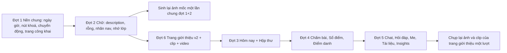

# SRS FEAT-uiux-91 Cải thiện UI/UX sau khảo sát (sprint 9.1)
Phiên bản 1.2 · 2026-11-12 · Trạng thái: **APPROVED** (chủ dự án duyệt báo cáo UI/UX và trang giới thiệu v2 ngày 2026-11-08). **"Dùng thử" (US-UX91-22 / FR-25) đã gỡ theo P-91-4** (chủ dự án bỏ, huỷ P-91-3): không endpoint `/demo/sessions`, không `DEMO_MODE`, không sandbox, không đặt giá model 9router. Phiên bản 0.2 → 1.0: thêm trang giới thiệu v2 (clip sống, kể chuyện theo cuộn, chữ lớn, chiều sâu), đổi thứ tự đợt 1 → 2 → 6 → 3 → 4 → 5, `DESIGN.md` đã sửa. 1.0 → 1.1: gỡ US-22, 21 story.

Nguồn: `docs/sprints/9.1/audit/findings.md`, `plan.md` (Quyết định của chủ dự án Q-UX91-1…5; Quyết định của PM cho TL-2), `proposals.md` P-91-1 / P-91-2, `techlead.md` TL-1 / TL-2, `US.md` cùng thư mục.

## 1. Mục đích và phạm vi
Đưa giao diện về đúng luật đã có (`DESIGN.md`, `UX.md`, luật chữ UI 09/10/2026) ở các chỗ khảo sát phát hiện lệch, và dựng lại trang giới thiệu theo chế độ *Persuade* kèm video. **Không** đổi nghiệp vụ, không đổi API, không đổi schema, không thêm thư viện.

| Trong phạm vi | Ngoài phạm vi |
| --- | --- |
| 21 story `US-UX91-01…21` (`US.md`; số 22 để trống), gộp 6 đợt theo TL-2, dev làm theo thứ tự đợt 1 → 2 → 6 → 3 → 4 → 5 | Màn quản trị, trợ giảng, `/settings/*`, `/admin`, `/class`, `/join` ngoài dòng chữ ở US-01 (BA chưa khảo sát); nút / luồng "Dùng thử" (bỏ, P-91-4) |
| Sửa `DESIGN.md` ở §2, §11, §14.x, thêm mục "Trang giới thiệu (Persuade)" (mục 7) | Biểu đồ Analytics (UX-17), menu Thêm của Lịch (UX-23), bộ lọc câu hỏi (UX-24), trang đăng nhập (UX-27): để sau |
| Ảnh mốc, e2e theo từng story | Nợ: bộ chọn lớp hiện buổi học tiếp theo; chọn lớp theo số việc chờ (L, API); gợi ý chat "chủ đề sai nhiều" (L, API); sửa `Demo*.tsx` |

## 2. Người dùng và quyền
Không story nào đổi quyền. Ma trận dưới đây là **bất biến cần giữ** (mỗi story có AC phân quyền tương ứng).

| Màn | Khách | STUDENT | TA | TEACHER | ADMIN |
| --- | :---: | :---: | :---: | :---: | :---: |
| `/` giới thiệu (ẩn danh) | xem | — (thấy Hôm nay) | — | — | — |
| `/` Hôm nay (nhóm Gấp / Hôm nay / Khi rảnh) | — | Hôm nay SV | nhóm, không `dismiss` | nhóm + `dismiss` | việc hệ thống |
| `/chat` | — | chính mình | không đọc chat riêng chưa escalate | không đọc | không đọc nội dung chưa escalate (prompt chỉ ADMIN, có `audit_log`) |
| `/grading`, `/grading/[id]` | — | 403 | duyệt theo quyền | duyệt | — |
| `/gradebook` | — | 403 | xem / sửa theo quyền | sửa, `Chốt điểm` | — |
| `/attendance` | — | 403 | điểm danh | điểm danh | — |
| `/insights`, `/observability` | — | 403 | theo quyền hiện có | số liệu lớp; **không** nội dung prompt | nội dung prompt (có `audit_log`) |
| `/documents` | — | 403 | theo quyền | quản lý | — |
| `/me`, `/threads` | — | dữ liệu của chính mình | — | — | — |

## 3. Luồng chính và nhánh lỗi

Thứ tự dev làm: đợt 1 → đợt 2 → **đợt 6** (trang giới thiệu v2, clip, video) → đợt 3 → đợt 4 → đợt 5. Đợt 1 trước đợt 2 (primitive `Button`, `datetime`, `.ep-motion-safe` dùng lại ở mọi đợt sau). Đợt 6 chen trước đợt 3–5 theo plan 9.1: ảnh và clip của khung ghim chụp từ giao diện lúc đó, sẽ lệch sau đợt 3–5 → dev chụp lại **một lượt** ở cuối pha 2 (ghi Nợ trong handoff đợt 6).

| Tình huống | Hệ thống phản ứng | Người dùng thấy |
| --- | --- | --- |
| API Hôm nay lỗi lần đầu | `ApiErrorNotice` + `Thử lại` (không đổi) | Một dòng nói chuyện gì hỏng + nút thử lại (P-107-3) |
| Làm mới Hôm nay lỗi khi đã có dữ liệu | Giữ nhóm cũ, dải "Chưa làm mới được…" | Không mất nhóm đã hiện |
| Điểm danh mất mạng | Hàng đợi cục bộ, thanh lưu "Chờ mạng", đồng bộ khi có mạng (không đổi) | Không mất lựa chọn |
| Sổ điểm xung đột 409 | Ô viền hổ phách + dòng "giữ của tôi / lấy giá trị kia" | Chọn bên giữ, không mất chữ |
| Duyệt bài lỗi mạng | Giữ điểm đã nhập, lỗi tại thanh dưới, `Thử lại` | Không mất nhận xét |
| Chat đứt stream | Tự nối lại, giữ phần đã sinh (không đổi) | Dải mất mạng |
| `ep:ui:course` trỏ lớp không còn | Bỏ giá trị, chọn lại theo US-06 AC2 | Không lỗi, không trang trống |
| Video / ảnh landing lỗi | Poster + liên kết mở tab mới; ảnh giữ khung kích thước | Bố cục không dịch |
| Không hỗ trợ `animation-timeline` | Nội dung tĩnh, đủ chữ | Không hiệu ứng theo cuộn, không mất nội dung |
| `localStorage` bị chặn | Coi như không có cờ / không có nháp | Không ném lỗi |

## 4. Yêu cầu chức năng

| FR | Hệ thống phải… | AC |
| --- | --- | --- |
| FR-1 | không hiển thị các `description=` có hành động **Xoá** ở bảng US-01 (gồm cả khung máy chủ `intro.ts`), thay bằng dữ liệu `meta`, tooltip hoặc placeholder theo bảng | US-01 AC1–AC2 |
| FR-2 | giữ ứng viên LCP của các route có `PreShell` khi đổi `intro.ts` | US-01 AC3 |
| FR-3 | cung cấp phép kiểm tự động `ui-antipatterns.sh` bắt `description=` chuỗi tĩnh > 40 ký tự ở `PageHeader` / `Section`, có ca `--selftest`; lấy `settings-integrations.spec.ts` dòng 154 làm mẫu AC | US-01 AC6 |
| FR-4 | định dạng mọi ngày giờ hiển thị qua **một** mô-đun `shared/lib` theo bảng quy ước (Hôm nay / Hôm qua / Thứ / ngày), luôn múi giờ `Asia/Ho_Chi_Minh`, `null` → "—" | US-02 AC1–AC5 |
| FR-5 | cho `Button` / `ButtonLink` prop `disabledReason` (dùng `aria-disabled`, `aria-describedby`, kiểu mờ chung), không viết Tooltip riêng từng màn | US-03 |
| FR-6 | áp chuyển động chức năng ≤ 200 ms: `:active` thu 0,97, hover gate `hover: hover`, thanh tiến độ `scaleX`, token ≤ 200 ms, khung vỏ không đổi `margin-left`, nháy lưu 200 ms | US-04 AC1–AC8, AC10–AC11 |
| FR-7 | giữ luật `reduce` `1ms` làm lưới và cho phép riêng `opacity` / màu bằng lớp `.ep-motion-safe` cho chuyển động chức năng mới | US-04 AC9 |
| FR-8 | trạng thái rỗng đúng mẫu DESIGN §15 (vì sao rỗng + một việc kế tiếp) ở hộp thư, hàng chờ chấm, sổ điểm | US-05 |
| FR-9 | nhớ lớp đã chọn; lần đầu chọn lớp đầu tiên có dữ liệu (Q-UX91-9) | US-06 |
| FR-10 | đổi nhãn nav, `h1`, `<title>`, thông báo, hộp thoại: `Threads` → Hỏi đáp công khai, `Insights` → Lỗ hổng kiến thức, `Analytics` → Số liệu lớp học; không đổi đường dẫn | US-07 |
| FR-11 | dựng trang giới thiệu v2 theo cấu trúc, màn đầu có clip sống (poster trước, tải sau `load`, không phát khi `reduce` / `Save-Data`, có nút `Tạm dừng`), nút `Xem video` mở hộp thoại, kể chuyện theo cuộn với khung ghim (≥ 1100 px; xếp dọc khi hẹp / `reduce`), chữ lớn, khung nổi khi rê chuột (máy tính), số liệu trung thực, hai cột vai (không tab), reduced-motion, hiệu năng; `Landing` là Server Component, JS thêm chỉ gồm một đoạn nội tuyến ≤ 0,5 KB và phần mở video ≤ 1 KB | US-08 |
| FR-12 | dựng clip 6–8 s lặp (≤ 1 MB / định dạng) và video đầy đủ 60–90 s: không tự phát video đầy đủ, `preload="none"`, poster, bản chữ thay thế; quay chỉ đọc trên demo (hoặc stack riêng `-p ep-video`), script dựng lại được | US-09 |
| FR-13 | nhóm việc giảng viên ở frontend theo `urgency` / `kind`; một nút chính; hành động hàng dùng `ghost` + mũi tên; không lặp mã lớp; `attention` / `upcoming` ở cột phải ≥ 1440 px | US-10 |
| FR-14 | Hôm nay sinh viên: timeline trong khung nhìn đầu, khử trùng "Tiếp tục học", ngày giờ chung | US-11 |
| FR-15 | điểm danh: "Có mặt" chấm mực, đỏ chỉ cho 3 trạng thái còn lại, thanh lưu dính đáy ở 375 px, nút phát biểu `+` trên di động | US-12 |
| FR-16 | chat: một Panel, lịch sử phẳng thu gọn được, `Phiên mới` ẩn khi phiên trống, gợi ý từ `GET /me/today`, xoá có hoàn tác | US-13 |
| FR-17 | hàng chờ chấm: ẩn cột "Bài tập" khi một bài, lý do cờ lên đầu hàng, hàng bấm được có `Duyệt` | US-14 |
| FR-18 | duyệt bài: một hàng một tiêu chí, trích dẫn không lặp chú thích, highlight giữ ≈ 1 s rồi mờ 200 ms, thanh hành động dính đáy luôn đủ, `A` / `‹` `›` | US-15 |
| FR-19 | sổ điểm: không làm tròn khi hiển thị (đệm `0` tới số lẻ lớn nhất của cột), một vùng cuộn cao bằng khung nhìn giữ ảo hoá, cột Đủ điểm / Thiếu điểm (ẩn khi không có hàng thiếu) | US-16 |
| FR-20 | Insights / Quan sát AI: một Panel mỗi khối, không khung lồng, mỗi chỉ số một chỗ | US-17 |
| FR-21 | Tài liệu: không cắt chữ ở ô Loại, không lặp "Chia sẻ từ", công tắc có nhãn chữ | US-18 |
| FR-22 | Hỏi đáp công khai: làm sạch đoạn trích bằng `shared/lib/markdown.ts`, nhãn trạng thái đa số nêu một lần | US-19 |
| FR-23 | `/me`: một khối giải trình, bỏ phụ đề mã lớp | US-20 |
| FR-24 | không gọi `POST /auth/refresh` ở `/` khi chưa có cờ "đã từng đăng nhập" | US-21 |

## 5. Dữ liệu
Không bảng / cột / migration mới. Không đổi seed ngoài việc dev / QC có thể đa dạng hoá seed lớp 2 (Nợ).

## 6. API
Không endpoint mới, không đổi hợp đồng. Các endpoint dùng lại:

| Dùng bởi | Endpoint | Ghi chú |
| --- | --- | --- |
| US-06, 10, 11, 13 | `GET /me/courses`, `GET /me/today`, `GET /courses/{id}/today` | `TodayItem` đã có `urgency` (`overdue` / `high` / `normal`), `kind`, `age_minutes`, `estimate_minutes` |
| US-21 | `POST /auth/refresh` | chỉ đổi **khi nào** frontend gọi |
| US-12, 15, 16 | điểm danh, duyệt, sổ điểm hiện có | không đổi `Idempotency-Key` / `version` |

## 7. Giao diện

### 7.1 Primitive và token
Chỉ token `--ep-*` và primitive `frontend/src/shared/ui`. Không thêm: biến thể nút `link`, Tooltip riêng, thư viện chuyển động. Nút phụ ở hàng dùng `Button` `ghost` + `iconEnd` mũi tên (P-91-2).

### 7.2 Sửa `DESIGN.md` (**đã sửa 2026-11-08** bởi BA theo [ĐỔI DESIGN] đã duyệt: §1–§2 nhãn nav, §11 + §11.1 mới, §14.1, §14.3, §14.8, §14.10, §14.13, §14.25)
| Mục | Sửa | Nguồn |
| --- | --- | --- |
| §2 (điều hướng), §14.3, §14.21, §14.25 | Ba nhãn mới: Hỏi đáp công khai, Lỗ hổng kiến thức, Số liệu lớp học | Q-UX91-1 |
| §11 Motion | "Drawer / dialog: ≤ 200 ms" (đổi từ 200–250); thêm câu "ứng dụng sau đăng nhập chỉ chuyển động chức năng ≤ 200 ms"; nêu Red Thread 280 ms là ngoại lệ đã có; nêu "không dàn dựng khi tải trang" **chỉ áp cho ứng dụng sau đăng nhập** | TL-1 đề xuất 3; [ĐỔI DESIGN] trang giới thiệu |
| Mục mới **"Trang giới thiệu (Persuade)"** | Mở đầu ≤ 600 ms; phần tử LCP không bắt đầu từ `opacity: 0`; hiệu ứng theo cuộn chỉ `transform` / `opacity`, bọc `prefers-reduced-motion: no-preference` và `@supports (animation-timeline: view())`; không bóng ngoài §7; vẫn Be Vietnam Pro và token `--ep-*`; không thư viện, JS thêm chỉ một đoạn nội tuyến nhỏ; video không tự phát | plan 9.1 (chủ dự án), TL-1 B, TL-2 |
| §14.1 | Hôm nay giảng viên: nhóm Gấp / Hôm nay / Khi rảnh, một việc kế tiếp có nút chính; `Lớp cần chú ý` ở cột phải ≥ 1440 px | Q-UX91-2 |
| §14.8 | "Có mặt" mặc định chấm mực; đỏ chỉ Vắng / Vắng phép / Muộn; thanh lưu dính đáy ở di động | Q-UX91-4 |
| §14.10 | Cột trạng thái Đủ điểm / Thiếu điểm (ẩn khi không có hàng thiếu); điểm hiển thị không làm tròn | Q-UX91-3, P-91-1 |
| §14.13 | Highlight trích dẫn giữ ≈ 1 s rồi mờ 200 ms | PM, TL-2 câu 3 |

### 7.3 Khung nhìn đầu, trạng thái, di động (theo story)
Mỗi story ở `US.md` nêu khung nhìn đầu, tải / rỗng / lỗi, 375 px và `reduce`. Mẫu bố cục bằng chữ: `findings.md` §3 (3.B Hôm nay, 3.C Chat, 3.D Duyệt bài, 3.E Sổ điểm; 3.A Trang giới thiệu đã sửa theo P-91-2: hai cột, không tab).

## 8. Phi chức năng
| Chỉ số | Yêu cầu | Nguồn |
| --- | --- | --- |
| LCP trang giới thiệu | ≤ 2,5 s, 375 px và 1440 px, ẩn danh | plan 9.1, UX.md §3 |
| JS route `/` | ≤ 256 KB gzip, không tăng; thêm ≤ 0,5 KB nội tuyến | plan 9.1, TL-2 |
| CLS | ≤ 0,1 (trang giới thiệu); ≤ 0,05 ở các story đổi bố cục tiêu đề | UX.md §3 |
| Chuyển động ứng dụng | ≤ 200 ms, chỉ `transform` / `opacity`, không thư viện | plan 9.1 |
| Video, clip | video đầy đủ < 8 MB mỗi định dạng, `preload="none"`, không âm thanh; clip ≤ 1 MB mỗi định dạng, chỉ tải sau `load`, không phát khi `reduce` / `Save-Data` | plan 9.1, TL-1 A, duyệt v2 |
| A11y | axe 0 serious / critical; `reduce` hiện trạng thái cuối; mọi chức năng dùng bàn phím; không nghĩa chỉ bằng màu | DESIGN §16 |
| Riêng tư | Không rò: chat riêng, điểm nháp, ghi chú quan sát, nhãn rủi ro, prompt (chỉ ADMIN) | CLAUDE.md |
| Dữ liệu quay video | Chỉ đọc trên demo (không ghi DB, không tốn hạn mức) hoặc stack riêng `-p ep-video`; dữ liệu mô phỏng (D44) | dev-phase1, TL-1 rủi ro 1 |

## 9. Kiểm thử
| Loại | Nội dung |
| --- | --- |
| Đơn vị | `datetime` (bảng quy ước, nửa đêm ICT, đổi tuần, khác năm, `null`, múi giờ trình duyệt khác); nhóm Hôm nay (`urgency` × `kind`); đệm số thập phân của sổ điểm; làm sạch đoạn trích markdown |
| e2e (đổi theo spec; QC sửa test theo US, **không nới**) | `shell.spec` (nhãn nav); `landing.spec` (`h2` mới, hai cột vai, reduce, không gọi API ẩn danh); `today.spec` (nhóm); `attendance.spec`; `gradebook.spec`; `private-chat.spec`; `assignment-lifecycle.spec` (duyệt bài); `me.spec`; `lcp.spec`; `panels.spec` NEST (Insights) |
| Ảnh mốc đổi | Đợt 1 + 2: `home-*`, `chat-*`, `threads-*`, `inbox-*`, `gradebook-*`, `settings-llm-*` (nhãn nav), `dev-ui-*` (nút khoá, `:active`) — **sinh lại một lần chung**. Đợt 3: thêm `hom-nay-gv-*`. Đợt 4: `gradebook-*` (lại), thêm `attendance-*`, `grading-queue-*`, `grading-review-1440`. Đợt 5: `chat-*`, `threads-*` (lại), thêm `me-390`, `insights-1440`, `observability-1440`, `documents-1440` (QC quyết số lượng, Q-UX91-12). Đợt 6: thêm `landing-1440`, `landing-390` |
| Đo | Một lượt LCP ẩn danh cho `/` (hiện không cổng nào đo: `lighthouserc.json` đặt `largest-contentful-paint: off`, `lighthouse-auth.cjs` đo `/` ở vai sinh viên); đo trên VPS, ghi "VPS 12 vCPU / 32 GB" |
| Lệnh | `bash scripts/ui-antipatterns.sh` (+ `--selftest`), `pnpm -C frontend lint && build`, `pnpm -C frontend exec playwright test` (desktop + mobile, `--retries=0`), mọi lệnh chạy trên VPS |
| Tay (QC) | Xem video một lượt; kiểm 375 px các màn sinh viên + `/attendance` + `/inbox`; kiểm bàn phím và `reduce` ở trang giới thiệu |
| Seed | Không đổi bắt buộc; lớp 2 đa dạng hơn để demo (Nợ) |

## 10. Câu hỏi mở và quyết định đã chốt
- Chốt: Q-UX91-1…5 (chủ dự án), TL-2 câu 1–4 (PM), P-91-1, P-91-2, Q-UX91-6…12. **Không còn câu mở.** Q-UX91-13…17 (Dùng thử) đã đóng vì chủ dự án bỏ tính năng (P-91-4). Spec **APPROVED**.
- **Spec cũ cần vá khi spec này APPROVED.** Mỗi dòng cần PM ghi số proposal trước khi BA sửa (luật "không thoả hiệp ngang hàng"); commit vá ghi số proposal và tăng phiên bản SRS cũ.

| Spec cũ | Chỗ | Vá vì | Story |
| --- | --- | --- | --- |
| `FEAT-ui-panels/SRS.md` dòng 44 | "cấu trúc một trang: `PageHeader` (h1 + mô tả)" | Mô tả → chỉ `meta` dữ liệu, không câu giải thích | US-01 |
| `FEAT-ui-foundation/US.md` US-PU-06 (+ `SRS.md` FR-44) | Khung máy chủ "tiêu đề + câu phụ của route"; AC8 LCP | `intro.ts` bỏ câu phụ; LCP vẫn kiểm bằng `lcp.spec` | US-01 AC3 |
| `FEAT-ui-foundation/US.md` AC7 (01-AC7), `SRS.md` FR-7 | `prefers-reduced-motion` | Luật lưới giữ `1ms`; thêm `.ep-motion-safe` cho opacity / màu chức năng | US-04 |
| `FEAT-ui-foundation/SRS.md` dòng 507 | Bảng điều hướng "Insights · Analytics" | Đổi nhãn | US-07 |
| `FEAT-course-foundation/US.md` AC3 (dòng 277), AC11 (dòng 249) | "Sinh viên 7 mục, TA 12, GV 15" (số mục giữ nguyên, nhãn đổi); trang `/` sinh viên | Nhãn nav; timeline Hôm nay sinh viên | US-07, 11 |
| `FEAT-course-foundation` (`/join`, AC14 dòng 161) | "một ô nhập mã 7 ký tự" | Câu hướng dẫn → placeholder `AN7K2MQ` | US-01 |
| `FEAT-crm-360/US.md` (dòng 65 giao diện điện thoại) + AC attendance desktop | Chấm "Có mặt" mặc định, "+ phát biểu" mọi hàng, vị trí nút lưu | Q-UX91-4; thanh lưu dính đáy | US-12 |
| `FEAT-gradebook/US.md` AC1 (dòng 189) và AC có cột "Trạng thái" | Khung nhìn đầu bảng điểm; giá trị "Đủ" | Cột Đủ điểm / Thiếu điểm; định dạng số; một vùng cuộn | US-16 |
| `FEAT-private-chat-pii/US.md` AC17 (dòng 208) | `/chat` lịch sử phiên, nút phiên mới | Một Panel, lịch sử phẳng, `Phiên mới` ẩn khi trống | US-13 |
| `FEAT-assignments/US.md` AC2 (dòng 263) | Màn duyệt hai cột; hàng chờ | Một hàng một tiêu chí; thanh hành động dính; highlight giữ ≈ 1 s | US-14, 15 |
| `FEAT-escalation-notify` (hộp thư rỗng) | Trạng thái rỗng + vùng chi tiết | Câu rỗng đúng mẫu, ẩn chi tiết khi rỗng | US-05 |
| `docs/design/DESIGN.md` | Xem 7.2 | — | nhiều |
| Confluence (KAOP) | Mọi message đã nằm trong SRS ở trên | Vá cùng đợt (CONTEXT: đổi / xoá message có trong SRS thì vá SRS + Confluence) | US-01, 07 |

## 11. Truy vết
| PRD / DESIGN / UX | FLOWS | Phase / sprint | US | FR | Test |
| --- | --- | --- | --- | --- | --- |
| Luật chữ UI (CLAUDE.md 09/10/2026); DESIGN §13, §15 | — | 9.1 đợt 2 | US-01, 05 | FR-1…3, 8 | `ui-antipatterns.sh`, `lcp.spec`, `settings-integrations.spec` mẫu |
| UX.md §2.10 | — | 9.1 đợt 1 | US-02 | FR-4 | đơn vị `datetime` |
| DESIGN §14.10, §15; UX.md §2.5 | — | 9.1 đợt 1 | US-03 | FR-5 | `dev-ui`, `gradebook.spec` |
| DESIGN §11, §16; plan 9.1 | — | 9.1 đợt 1 | US-04 | FR-6, 7 | `ui-foundation.spec`, `tokens.spec`, `a11y.spec` |
| DESIGN §2 | — | 9.1 đợt 2 | US-06, 07 | FR-9, 10 | `shell.spec` |
| PRD M0 (tài khoản, vào lớp; trang `/` ẩn danh); DESIGN §11.1 | F1 (Tài khoản) | 9.1 đợt 6 | US-08, 09, 21 | FR-11, 12, 24 | `landing.spec`, đo LCP ẩn danh, kiểm tay video |
| DESIGN §14.1; PRD M14 ("Hôm nay") | F14 (Hôm nay) | 9.1 đợt 3 | US-10, 11 | FR-13, 14 | `today.spec` |
| DESIGN §14.8; UX.md §5; PRD M5 (điểm danh, phát biểu) | F7 (Điểm danh và phát biểu) | 9.1 đợt 4 | US-12 | FR-15 | `attendance.spec` |
| DESIGN §14.12–§14.13; UX.md §5; PRD M8 (bài tập, chấm) | F9 (Bài tập: tạo → nộp → chấm → công bố) | 9.1 đợt 4 | US-14, 15 | FR-17, 18 | `assignment-lifecycle.spec` |
| DESIGN §14.10; PRD M7 (sổ điểm) | F10 (Sổ điểm) | 9.1 đợt 4 | US-16 | FR-19 | `gradebook.spec` |
| DESIGN §14.2; PRD M1 (chat riêng) | F3 (Hỏi riêng tư) | 9.1 đợt 5 | US-13 | FR-16 | `private-chat.spec` |
| DESIGN §14.3 (Threads), §14.9 (`/me`), §14.14 (tài liệu), §14.21–§14.22 (Insights, Quan sát); PRD M2, M9, M13 | F4, F6, F16, F17 | 9.1 đợt 5 | US-17…20 | FR-20…23 | `threads.spec`, `me.spec`, `documents.spec`, `panels.spec` |
| Hộp thư, trạng thái rỗng; PRD M3 (escalation) | F5 (Escalation) | 9.1 đợt 2 | US-05 | FR-8 | `escalation.spec` |

Số M và F đã đối chiếu với `docs/PRD.md` (M0–M15) và `docs/FLOWS.md` (F1–F19) ngày 2026-11-08. Story không đổi nghiệp vụ nên không thêm luồng mới.
