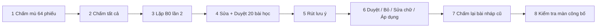

# Sprint 10.6: kiểm chứng «học từ lần sửa» với giảng viên tạm `giaovien`

Tech Lead soạn theo yêu cầu PM (2026-11-14). Căn cứ: SRS `FEAT-grading-guidance` v1.2 §9 (giao thức đo trước / sau, «Bật được»), D62, P-106-2, P-106-5.
Agent tạm `giaovien` (model `claude-fable-5-2`, effort medium) đóng vai giảng viên. Kết quả là **bằng chứng kỹ thuật cho harness**, không thay nhãn người thật trong luận văn (E3). PM tắt agent khi xong.

## 0. Điều chỉnh so với yêu cầu (P-106-9)

Theo D62 (1), lưu ý chỉ áp cho **đúng một** bài tập. Lưu ý rút từ BT-A không bao giờ vào prompt của BT-B. Vì vậy phương án «BT-A rút lưu ý, BT-B đo» không đo được gì. Tech Lead đã chọn phương án an toàn sau và ghi vào `proposals.md` P-106-9:

| Bài tập | Vai | Cỡ | Đo gì |
| --- | --- | --- | --- |
| **BT-A** | Học + đo, theo đúng SRS §9 | 60 bài: 20 «học» + 40 «đo» | MAE, lệch TB, tiêu chí vốn đúng nay sai, số tiêu chí phải sửa: ở `v0` so với `v1` |
| **BT-B** | **Đối chứng**: cùng lớp, không rút lưu ý | 24 bài | (a) Cách ly: BT-B giữ `guidance_version = 0`, prompt không đổi. (b) **Nền nhiễu**: chấm hai lần ở `v0`, đo độ chênh MAE do LLM tự dao động |

Tổng cộng 84 bài, đủ yêu cầu ≥ 60 bài.

## 1. Bộ dữ liệu

### 1.1 Lớp và bài tập

- Dùng một lớp riêng **`KC106`** (môn INT1006 «An ninh mạng», học kỳ như seed) với 60 sinh viên mô phỏng `kc001…kc060@edupilot.local`. Không dùng lớp 761987: lớp này chỉ có 30 sinh viên, và BT03 đã có 8 bài seed duyệt theo «sở thích gắt», sẽ làm bẩn phép đo.
- Tên và MSSV đều sinh giả. Không có người thật.
- **BT-A** (ESSAY): «Phân tích một sự cố lộ dữ liệu giả định ở doanh nghiệp vừa và nhỏ và đề xuất biện pháp phòng ngừa».
- **BT-B** (ESSAY): «So sánh xác thực một yếu tố và đa yếu tố cho một tổ chức 50 người». BT-B dùng 24 sinh viên đầu.
- Rubric chung cho hai bài: 4 tiêu chí, mỗi tiêu chí 0–2,5 điểm, bước 0,25, tổng 10. Bốn tiêu chí: (1) Luận điểm rõ, (2) Dẫn chứng / tình huống cụ thể, (3) Lập luận và biện pháp khả thi, (4) Trình bày, thuật ngữ. Phần `guidance` của rubric viết như một giảng viên bình thường, **không** gợi ý sở thích của `giaovien`.
- Cờ `GRADING_GUIDANCE` của lớp `KC106`: **bật**. Các cờ còn lại: tắt.

### 1.2 Sinh bài: `benchmarks/guidance/kc/gen.py`

Script chỉ dùng thư viện chuẩn và chạy một lần. Kết quả được commit để chạy lại cho ra đúng bộ dữ liệu.

1. Với mỗi bài, gieo `seed` cố định rồi chọn **hồ sơ chất lượng ẩn** cho từng tiêu chí (mức 0,5–2,5). Thêm 3 kiểu bài khó, mỗi kiểu khoảng 15 %:
   - dài, trôi chảy nhưng ít dẫn chứng;
   - ngắn nhưng chặt;
   - nhiều thuật ngữ nhưng biện pháp chung chung.

   Phân bố tổng điểm xấp xỉ chuẩn, tâm 6,5.
2. Gọi LLM **qua 9router** (`ROUTER_URL`, mặc định `http://127.0.0.1:20128/v1`, `ROUTER_KEY`, `GEN_MODEL`) để viết bài 250–450 từ theo hồ sơ. Chạy **tuần tự**, giãn cách, gặp 429 / 503 thì lùi theo `Retry-After`. **Cấm gọi Gemini trực tiếp.**
   - `GEN_MODEL` nên khác model chấm của stack, để tránh model chấm thiên vị bài do chính nó viết. Model đã dùng phải ghi vào báo cáo.
   - Model `ag/*` của 9router bỏ qua `response_format`. Script yêu cầu trả văn bản thuần, không cần JSON.
3. **Che và kiểm**: bài không được chứa họ tên, email, số điện thoại hay MSSV. Script lọc bằng regex (email, điện thoại, chuỗi 8–10 chữ số, mẫu họ tên viết hoa ≥ 2 từ ngoài danh sách thuật ngữ) và sinh lại bài trượt, tối đa 2 lần. Bài vẫn trượt thì bỏ và sinh bài thay thế.
4. Đầu ra trong `benchmarks/guidance/kc/data/`:
   - `bt-a/kcNNN.txt`, `bt-b/kcNNN.txt`: tên tệp là mã sinh viên giả, để nhập ZIP khớp tự động.
   - `rubric.json`.
   - `profile.jsonl`: hồ sơ ẩn. Chỉ dùng để chẩn đoán sau khi đã đo, **không** phải nhãn, `giaovien` **không** được đọc.
   - `order.json`: thứ tự nộp; `kc001–kc020` của BT-A là tập «học».
5. Gợi ý cỡ lời gọi: 84 bài + ≤ 10 % sinh lại ≈ 95 lời gọi. Không cần embedding.

### 1.3 Nạp vào stack: `benchmarks/guidance/kc/load.py`

Script chỉ dùng thư viện chuẩn và gọi **API thật**, như một client ngoài (D46). Không ghi thẳng vào DB.

1. Stack là stack test **duy nhất** trên Mac, đã `pnpm dev` + seed, LLM chấm đi qua 9router.
2. Dùng ADMIN gọi `POST /admin/courses` (lớp `KC106`, `Idempotency-Key` cố định) và gán `teacher@edupilot.local`.
3. Dùng TEACHER nhập roster CSV 60 dòng, tạo BT-A / BT-B (`ESSAY`, `rubric.json`), rồi bật cờ `PUT …/guidance-flags/GRADING_GUIDANCE`.
4. Nộp bài theo thứ tự thời gian:
   - ZIP BT-A `kc001–kc020` (tập học);
   - rồi ZIP BT-A `kc021–kc060` (tập đo);
   - rồi ZIP BT-B.

   Mỗi ZIP đi `presign` → `PUT` → `submissions/upload`. Kiểm tra `match_status = MATCHED` cho cả 84 bài.
5. Không bấm chấm. Việc chấm thuộc quy trình ở mục 2.
6. Chạy lại script không tạo đôi: khoá idempotency cố định, và ZIP được khử trùng theo băm.

### 1.4 Phiếu chấm mù: `benchmarks/guidance/kc/sheet.py`

Script sinh `~/kc-giaovien/phieu/<BT>/<kcNNN>.md` cho **64 bài đo** (40 bài BT-A đo + 24 bài BT-B). Mỗi phiếu gồm đề, rubric, văn bản bài và một khung điền điểm 4 tiêu chí. Phiếu **không** có điểm AI, hồ sơ ẩn hay mức kỳ vọng. Lệnh `sheet.py --collect` đọc phiếu đã điền và ghi `benchmarks/reports/guidance/kc-<ngày>/labels.csv` với các cột `bt, code, c1..c4, total, labeled_at`. Đây là **`teacher_label`**.

## 2. Quy trình của `giaovien`

**Phạm vi truy cập (PM dựng agent):**
- `giaovien` chỉ có trình duyệt tới `https://localhost` với tài khoản `teacher@edupilot.local` và thư mục `~/kc-giaovien/`.
- **Không** mở repo, mã, `benchmarks/`, `profile.jsonl`, `expected_grading.json` hay báo cáo đo.
- `giaovien` nhận một **thẻ vai** ngắn do PM đưa. Thẻ vai do PM soạn, Tech Lead không soạn, để người thiết kế bộ bài không cài sẵn lời giải:
  - Bạn là giảng viên học phần An ninh mạng.
  - Bạn chấm theo rubric, dùng phán đoán riêng.
  - Bạn ghi nhận xét ngắn khi sửa điểm.
- Mỗi bước, `giaovien` ghi một dòng vào `~/kc-giaovien/nhat-ky.md`: giờ bắt đầu và kết thúc, việc đã làm, chỗ thấy lạ. Chụp màn hình khi gặp lỗi.

**Chống vòng tròn:** điểm dùng để đo lấy từ **chấm mù trước khi chạy AI**, không lấy từ việc sửa nháp. Sửa nháp kéo điểm của người chấm về phía AI (hiệu ứng mỏ neo), làm MAE thấp giả. Việc sửa nháp chỉ dùng cho tập học, đúng cách sản phẩm vận hành. Tập đo **không bao giờ** được `giaovien` mở trên màn chấm trước bước 8.

| # | Ai | Làm gì | Màn / lệnh | Ghi lại |
| --- | --- | --- | --- | --- |
| 1 | `giaovien` | Chấm mù 64 phiếu (40 bài đo BT-A + 24 bài BT-B), mỗi tiêu chí bước 0,25. Chưa có lượt chấm AI nào chạy | `~/kc-giaovien/phieu/` | Giờ / phiếu; điều phối viên chạy `sheet.py --collect` |
| 2 | `giaovien` | `Chấm tất cả` cho BT-A, rồi cho BT-B | `/grading`, chọn bài tập | Thời gian lô xong; số bài `FAILED` |
| 3 | điều phối | **B0 lần 1**: chụp nháp. Rồi `POST …/submissions/{id}/grade` cho 40 bài đo BT-A + 24 bài BT-B (round + 1, vẫn `v0`) → **B0 lần 2**, chụp lại | `measure.py snap b0r1`, `snap b0r2` | `drafts-b0r1.json`, `drafts-b0r2.json` |
| 4 | `giaovien` | Mở **chỉ** 20 bài học BT-A (`kc001–kc020`, danh sách trên thẻ vai). Đọc bài và nháp AI, sửa điểm tiêu chí nếu không đồng ý, ghi nhận xét, `Duyệt`. Nếu đồng ý thì `Duyệt` nguyên | `/grading/[submissionId]` | Số tiêu chí đã sửa; số bài duyệt nguyên |
| 5 | `giaovien` | `Rút lưu ý` cho BT-A, chờ job xong | `/assignments/[id]` → Lưu ý chấm | Số lưu ý nháp; thời gian job; có hiện `NOT_ENOUGH_DATA` không |
| 6 | `giaovien` | Xét từng lưu ý: `Duyệt` / `Bỏ` / sửa chữ / `Cho nghỉ` theo phán đoán. Rồi `Áp dụng` | như trên | Số lưu ý duyệt / bỏ / sửa; bản mới `v1` |
| 7 | `giaovien` | Ở hàng chờ BT-A, thấy «N bài nháp cũ · Chấm lại»; bấm `Chấm lại`; chờ xong | `/grading` | N trên màn (kỳ vọng **40**; 20 bài học đã duyệt nên được miễn); `skipped`; thời gian |
| 7b | điều phối | **B1 lần 1**: chụp. Rồi `POST …/submissions/{id}/grade` cho 40 bài đo (round + 1, `v1`) → **B1 lần 2**. Chụp lại BT-B (không chấm thêm): `guidance_version` phải vẫn là 0 | `measure.py snap b1r1`, `snap b1r2`, `snap bt-b-after` | `drafts-b1r*.json` |
| 8 | `giaovien` | Duyệt nguyên 5 bài đo BT-A bất kỳ (việc này không đổi số đo vì số đo đã chụp). Mở hộp `Công bố` cho BT-A, đọc số bài miễn, bấm **Huỷ** | `/grading` → `Công bố` | Câu chữ trong hộp. Kỳ vọng: «20 bài chấm theo bản cũ: a đã sửa tay, b duyệt nguyên nháp», với a + b = 20 khớp bước 4. 5 bài đo (`v1`) không bị đếm |

`measure.py snap` (thư viện chuẩn, HTTP, TEACHER) lấy `GET …/grading-results` theo bài tập. Ảnh chụp chỉ lưu `code, round, guidance_version, status, criteria[], ai_scores[]`, **không** lưu văn bản hay nhận xét.

## 3. Phép đo: `benchmarks/guidance/kc/measure.py report`

Tính bằng `decimal.Decimal` trên ảnh chụp và `labels.csv`. Δ = điểm nháp AI − `teacher_label`.

| Chỉ số | Định nghĩa | Tập |
| --- | --- | --- |
| MAE tiêu chí, MAE tổng | Trung bình |Δ| theo tiêu chí; trung bình |Δ tổng| | BT-A đo: B0 (TB 2 lần), B1 (TB 2 lần) |
| **Lệch TB có dấu** | Trung bình Δ tổng và theo từng tiêu chí. Âm nghĩa là AI chấm gắt hơn giảng viên. Dùng để bắt **gắt quá tay** | như trên |
| Vốn đúng nay sai | Số tiêu chí có |Δ| ≤ 0,25 ở B0 nhưng > 0,25 ở B1 | BT-A đo |
| Số tốt lên / xấu đi | Số bài có |Δ tổng| giảm / tăng ≥ 0,25 | BT-A đo |
| **Số tiêu chí phải sửa tay** | Số tiêu chí có |Δ| ≥ 0,5: giảng viên sẽ phải sửa nếu duyệt nháp đó. B0 so với B1 | BT-A đo (40 × 4) |
| Số sửa tay thật | Số tiêu chí `giaovien` đã sửa ở bước 4, kèm số bài duyệt nguyên | BT-A học |
| **Nền nhiễu** ε | max(|MAE tổng b0r1 − b0r2| trên BT-A đo, |MAE tổng lần 1 − lần 2| trên BT-B) | BT-A, BT-B |
| Cách ly | BT-B: mọi `guidance_version = 0`; MAE BT-B sau bước 7 lệch ≤ ε | BT-B |
| Thời gian | Giờ của `giaovien` theo bước (nhật ký). Thời gian hệ thống: job reflect, lô chấm lại 40 bài, p50 / p95 một bài | tất cả |
| Lưu ý | Số nháp / duyệt / bỏ / sửa chữ; văn bản lưu ý cuối (không có PII) | BT-A |

Thời gian của agent không đại diện cho thời gian người. Chỉ báo để so tương đối giữa các bước, không dùng làm kết luận về công sức giảng viên.

## 4. Tiêu chí và ghi kết quả

**A. Harness: phải đạt hết, nếu không thì kết quả là `HARNESS_LỖI`.** QC ghi lỗi, Dev sửa, chạy lại từ bước bị lỗi.
1. Bước 1–8 đi hết trên màn thật, không cần Dev can thiệp, không có 5xx.
2. Ở bước 7, N = 40: 20 bài học đã duyệt được miễn, không bị chấm lại, `ai_scores` và `criteria` giữ nguyên.
3. BT-B cách ly (mục 3).
4. Văn bản lưu ý không chứa tên / MSSV / email; không chứa từ khoá tổng / trừ / muộn / làm tròn.
5. Mọi lời gọi LLM có trong `llm_audit` với provider 9router. Không có lời gọi Gemini trực tiếp.

**B. Chất lượng: `ĐẠT` (Bật được, SRS §9) khi cả bốn đúng.** Nếu không thì `KHÔNG ĐẠT` (Giữ tắt; harness vẫn có thể đạt).
1. MAE tổng B1 ≤ 0,8 × B0, **và** mức giảm > 2ε.
2. |lệch TB B1| ≤ |lệch TB B0| + 0,20.
3. Vốn đúng nay sai (B0 → B1) ≤ 1,5 × số tiêu chí đúng ở b0r1 nhưng sai ở b0r2, tức nhiễu tự nhiên. Nếu nhiễu bằng 0 thì ngưỡng là ≤ 4 tiêu chí.
4. Số tiêu chí phải sửa tay B1 < B0.

**Ghi kết quả** vào `benchmarks/reports/guidance/kc-<YYYY-MM-DD>/`:

| Tệp | Nội dung |
| --- | --- |
| `report.md` | Bảng chỉ số B0 / B1 / BT-B. Kết luận `ĐẠT` / `KHÔNG ĐẠT` / `HARNESS_LỖI`. Nguồn nhãn: «`giaovien` (agent `claude-fable-5-2`, effort medium), chấm mù» |
| `metrics.json` | Số đo, dạng chuỗi decimal |
| `drafts-*.json`, `labels.csv` | Chỉ có số và mã giả, không có văn bản |
| `guidance.md` | Các lưu ý và quyết định của `giaovien` |
| `nhat-ky.md` | Nhật ký của `giaovien`, có ảnh lỗi nếu có |
| `report.svg` | Biểu đồ cột MAE / lệch TB, vẽ bằng thư viện chuẩn (P-11-2) |

Mục «Giới hạn» của `report.md` phải ghi:
- bài mô phỏng;
- một model chấm, một model sinh;
- một giảng viên là agent;
- một bài tập học;
- n = 40.

Commit `benchmarks/guidance/kc/` và thư mục báo cáo lên `sprint/10.6-guidance`.

## 5. Ai làm gì

| Việc | Vai |
| --- | --- |
| `gen.py`, `load.py`, `sheet.py`, `measure.py` (chỉ thư viện chuẩn) | Dev, theo mục 1–3. Chi phí ≈ 95 lời gọi sinh bài + khoảng 300 lượt chấm (84 + 64 + 40 + 40, mỗi lượt hai pass) qua 9router |
| Thẻ vai, dựng và tắt `giaovien`, cấp quyền truy cập | PM |
| Điều phối bước 3 và 7b, ghi lỗi harness | QC |
| Đọc báo cáo, đề xuất bật / giữ tắt | Tech Lead → PM |
