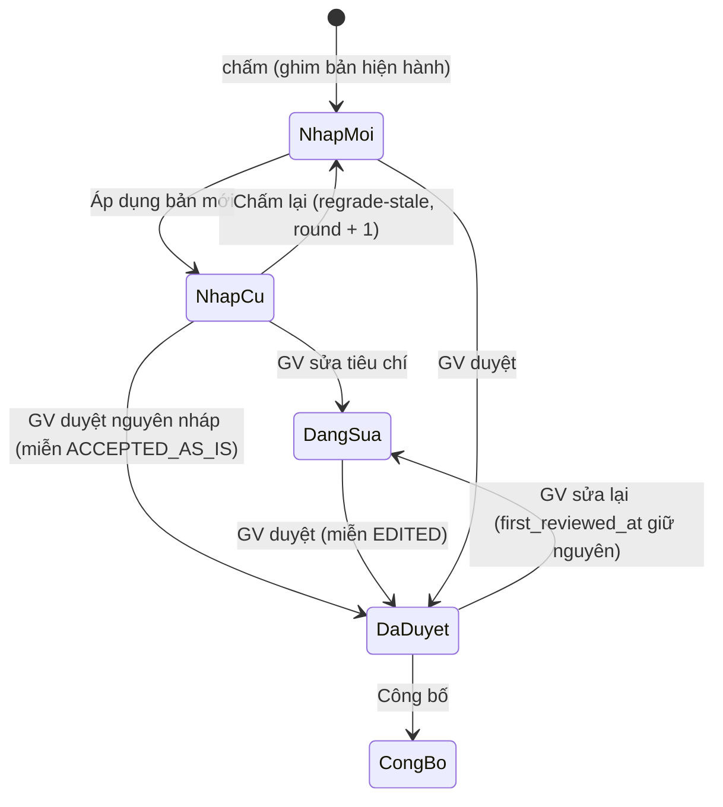

# Sprint 10.6: kênh Tech Lead

## TL-1 (D61, D62): thiết kế mã chi tiết cho «harness học từ lần giảng viên sửa» (M1, M2, M4, M6)

> **SRS thắng.** Nguồn chuẩn:
> - `docs/specs/FEAT-grading-guidance/SRS.md` v1.0 APPROVED (`6d6db6f7`);
> - `P-106-1` (PM xác nhận Q-G-1, 2, 3, 5, 6, 10).
>
> TL-1 chỉ nói **làm thế nào** trong khuôn đó: file, hàm, câu SQL, test. Chỗ TL-1 thấy SRS có lỗi kỹ thuật thì **không** tự làm khác. Các chỗ đó được ghi ở mục 0.2 và đưa vào `proposals.md` (P-106-2, P-106-3) để PM quyết; dev làm theo SRS cho tới khi PM đổi.
>
> **Nguồn khác:**
> - research `docs/research/2026-11-14-agent-memory.md` (nhánh `research/agent-memory`);
> - PoC `docs/research/poc/agent-memory/poc.py`.
>
> Mã dẫn dưới đây là của `sprint/10.6-guidance` (tách từ `sprint/10.5-decision` `c884c285`).
>
> **Cập nhật 2026-11-14 theo PM (`proposals.md`):**
> - **P-106-2 CHẤP NHẬN**, chi tiết ở **SRS v1.2** 4.2.11–4.2.12, cộng **P-106-5**.
>   - Bài giảng viên **đã duyệt** được miễn so phiên bản. Lý do miễn: `EDITED` / `ACCEPTED_AS_IS`.
>   - Giảng viên **được** duyệt cả nháp chấm theo bản cũ (miễn `ACCEPTED_AS_IS`): **không** chặn ở bước duyệt hay sửa.
>   - Bảo vệ là dòng "N bài nháp cũ · Chấm lại" cộng số bài miễn ở hộp công bố.
>   - `regrade-stale` không bao giờ đụng bài đã duyệt hoặc đã sửa tay.
>   - Giữ `first_reviewed_at/by` (ghi một lần) làm căn cứ miễn.
>   - Cách làm ở mục 6.
> - **P-106-3 CHẤP NHẬN:** `POST …/threads/similar-confirmed {q}` (mục 9).
>
> SRS v1.2 đã vá theo hai quyết định này; **SRS thắng** như mọi chỗ khác.

### 0.1 Bản đồ lát → mục

| Lát (plan) | Nội dung | Mục |
| --- | --- | --- |
| L1 | Migration `00021_grading_guidance.sql` (SRS §5) + sqlc | 1, 2 |
| L2 | Job `grading.reflect` (SRS 3.2, 4.2.5–4.2.8) | 4 |
| L3 | Ghim phiên bản + khối lưu ý + `ai_comments` (SRS 4.2.1–4.2.4) | 3 |
| L4 | Quyết định / áp dụng / chấm lại / chặn công bố / số đo + màn (SRS 4.2.9–4.2.13, §6 #3–#9, §7) | 5, 6, 7 |
| L5 | M2 (SRS 4.3), M4 (SRS 4.4), M6 (SRS 4.5) | 8, 9, 10 |
| L6 | Cờ, Hôm nay, env, guide | 11, 12; `docs/guides/grading-guidance.md` |

### 0.2 Chỗ TL thấy cần sửa trong SRS (TLR-1, TLR-2 đã được PM quyết; còn lại là gợi ý)

| # | Mức | Vị trí | Vấn đề | Đề xuất | Bằng chứng |
| --- | --- | --- | --- | --- | --- |
| TLR-1 → **P-106-2 (đã quyết)** | chặn luồng | SRS 4.2.12, US-GD-05 AC6, P-106-1 Q-G-1 | Bài giảng viên đã sửa tay để dạy hệ thống (bộ học) ghim `v0`. Sau `Áp dụng` (v1), luật cấm cứng chặn công bố chúng, và lối ra duy nhất là chấm lại, làm mất điểm sửa tay | **PM chốt** (SRS v1.2, P-106-5): bài đã duyệt được miễn, giảng viên được duyệt cả nháp bản cũ. Thi công: mục 6 | `publish.go:46–150` (chỉ công bố `REVIEWED`); `review.sql:60–66` (`ReviewApplyEdit` xoá `reviewed_by` / `reviewed_at` → cần `first_reviewed_at`) |
| TLR-2 → **P-106-3 (đã quyết)** | PII trong log | SRS §6 #10, 3.5 | `GET …?q=<bản nháp>` đưa chữ sinh viên chưa qua tường lửa vào URL; Caddy ghi nguyên URI (`deploy/caddy/Caddyfile:23–28`) | **PM chốt:** `POST …/threads/similar-confirmed {q}`; thân không vào log. Thi công: mục 9 | Caddyfile như trên |
| TLR-3 | gợi ý | SRS §5.1, 5.2 | FK `(course_id, assignment_id) → assignments` không có `ON DELETE CASCADE`, trong khi 4.2.14 ghi "Xoá lớp → CASCADE". Thực tế bài có bài nộp thì không xoá được (`assignment.go:637` → `409 HAS_SUBMISSIONS`), nên lưu ý không bao giờ mồ côi | Thêm `ON DELETE CASCADE` cho khớp 4.2.14 (vô hại) | `assignment.go:637` |
| TLR-4 | gợi ý (lỗi cú pháp) | SRS §5.5 | Dấu phẩy thừa trước `)` trong `grading_regression_cases`; các bảng mới thiếu trigger `set_updated_at` | Dev sửa khi viết migration (không đổi nghĩa) | – |
| TLR-5 | gợi ý | SRS 4.4, 3.5 | M4 nhúng lại chuỗi mà precheck (`usePostGate.tsx`, 800 ms) **vừa nhúng**. `Firewall.Embed` đã có cache `ep:emb` (`thread/firewall.go:45`) | Dùng **đúng hàm** `Firewall.Embed` với **đúng chuỗi** `title + "\n" + body`: trúng cache, 0 lời gọi thêm. Vẫn khớp SRS ("cache theo băm, TTL 5 phút" là sàn) | `thread/firewall.go:37–45` |
| TLR-6 | gợi ý (rủi ro P10) | SRS 4.4 | `ORDER BY embedding <=> $q LIMIT 3` trên `content_chunks`, lọc tài liệu kho tri thức. Khi P10 thêm HNSW (`00022`), quét HNSW + lọc chọn lọc (một tài liệu / lớp) có thể trả **ít hơn 3 hoặc 0** dòng dù có kết quả | Trong truy vấn M4, `SET LOCAL hnsw.iterative_scan = relaxed_order` (pgvector ≥ 0.8), hoặc ghi Nợ P10 để kiểm. Trước P10 chưa có HNSW nên quét chính xác | ARCHITECTURE §4 dòng `00021 indexes_tuning` (nay `00022`) |

### 1. Lược đồ: `00021_grading_guidance.sql`

**Số migration:**
- `00020` là decision (10.5). 10.6 chạy trước P10 và PR nên lấy **`00021`**.
- Hai số dự kiến dời lùi một: `indexes_tuning` → `00022`, `production` → `00023` (đã sửa `ARCHITECTURE.md` §4; tiền lệ của 10.5).
- Là ngoại lệ `ALTER` có chủ ý: yêu cầu mới; tiền lệ `00015`, `00020`.

**DDL:** chép SRS §5, sửa TLR-3, TLR-4. Ba chỗ SRS để ngỏ, TL chốt cách viết:

```sql
-- (a) trigger bất biến: thay thân hàm của 00017 bằng CREATE OR REPLACE trong migration MỚI (không sửa 00017)
CREATE OR REPLACE FUNCTION grading_results_ai_immutable() RETURNS trigger LANGUAGE plpgsql AS $$
BEGIN
    IF OLD.ai_scores IS NOT NULL AND NEW.ai_scores IS DISTINCT FROM OLD.ai_scores THEN
        RAISE EXCEPTION 'ai draft is immutable' USING ERRCODE = 'P0001';
    END IF;
    IF OLD.ai_total_before_late IS NOT NULL AND NEW.ai_total_before_late IS DISTINCT FROM OLD.ai_total_before_late THEN
        RAISE EXCEPTION 'ai draft is immutable' USING ERRCODE = 'P0001';
    END IF;
    -- SRS 5.3 / 4.2.1: sau DONE cấm đổi ai_comments, guidance_version (thử lại trước DONE được ghim lại)
    IF OLD.run_state = 'DONE' AND (NEW.ai_comments IS DISTINCT FROM OLD.ai_comments OR NEW.guidance_version IS DISTINCT FROM OLD.guidance_version) THEN
        RAISE EXCEPTION 'ai draft is immutable' USING ERRCODE = 'P0001';
    END IF;
    RETURN NEW;
END $$;
-- Down: CREATE OR REPLACE lại đúng thân của 00017.
```

```sql
-- (b) chỉ mục cho các truy vấn ở mục 2 (đều bắt đầu course_id — luật 13)
CREATE INDEX ggi_assignment_idx ON grading_guidance_items (course_id, assignment_id, status);   -- SRS
CREATE INDEX grc_course_idx ON grading_regression_cases (course_id, kind, created_at);          -- cmd/regress đọc theo lớp
CREATE INDEX question_bank_rejected_idx ON question_bank (course_id, reviewed_at DESC)
    WHERE review_status = 'REJECTED' AND reject_reason IS NOT NULL AND reject_reason <> 'UNSPECIFIED';  -- M6
-- (c) trigger set_updated_at cho grading_guidance_items, course_guidance_flags, grading_regression_cases (TLR-4)
-- (d) P-106-2: dấu "giảng viên đã duyệt" KHÔNG bị xoá khi sửa lại. ReviewApplyEdit (review.sql:60) đặt reviewed_by/at = NULL khi
--     REVIEWED → DRAFT, nên không dùng được làm điều kiện miễn. Cột mới chỉ ghi lần đầu, như ai_scores.
ALTER TABLE grading_results ADD COLUMN first_reviewed_at timestamptz,
    ADD COLUMN first_reviewed_by uuid REFERENCES users (id);
-- ReviewMark: first_reviewed_at = coalesce(first_reviewed_at, now()), first_reviewed_by = coalesce(first_reviewed_by, reviewer)
-- Trigger bất biến (a) thêm: OLD.first_reviewed_at IS NOT NULL AND NEW.first_reviewed_at IS DISTINCT FROM OLD.first_reviewed_at → P0001
```

`course_guidance_flags` (SRS 5.4):
- Là bảng **riêng của tính năng này**, khác `course_features` mà PR dự kiến (`docs/phases/PR.md` L1). SRS thắng.
- Khi làm PR, PM cân nhắc gộp; TL đã ghi vào `ARCHITECTURE.md` §4 để không ai tạo bảng thứ ba.

### 2. sqlc: `internal/store/queries/guidance.sql` (mới) và chỗ sửa

| Tên | Việc | Ghi chú |
| --- | --- | --- |
| `GuidanceFlagsAll :many` | mọi `(course_id, feature)` đang bật | Ảnh chụp cờ (mục 11), mẫu `DecisionCourseGatesEnabled` |
| `GuidanceFlagGet/Set` | đọc / đặt cờ, `version` → 409 | SRS §6 #1–2 |
| `GuidanceCurrentVersion :one` | `assignments.guidance_version` + `type` | |
| `GuidanceSetAt :many` | SRS 4.2.3 nguyên văn; `order by` vị trí tiêu chí ở Go, rồi `approved_in_version, id` | Hàm thuần theo `(assignment_id, v)` |
| `GuidanceItems :many` | mọi mục của bài trừ `REJECTED` > 30 ngày; cursor `(created_at, id)`, `limit` ≤ 100 | SRS §8 phân trang |
| `GuidanceCases :many` | kết quả hiện hành (vòng cao nhất) `REVIEWED` / `PUBLISHED`, `ai_scores IS NOT NULL`, của bài; trả `id, criteria, ai_scores, ai_comments, reviewed_at`; `order by reviewed_at desc limit 200` | Lệch tính bằng `decimal` ở Go |
| `GuidanceInsertDraft :one`, `GuidanceDecide :execrows` (có `version`), `GuidanceApply :exec`, `GuidanceVersionInsert :exec` | SRS 4.2.9–4.2.10 | |
| `GuidanceStaleCount :one` | kết quả hiện hành chưa công bố có `guidance_version ≠ hiện hành`, đếm ba nhóm: **nháp cũ** (`DRAFT`, `changedCriteria = ∅`, `first_reviewed_at IS NULL`), **đang sửa dở** (`DRAFT`, có tiêu chí sửa hoặc có `first_reviewed_at`), **đã duyệt** (`REVIEWED`) | "N bài nháp cũ · Chấm lại" + "M đang sửa dở" (SRS §7) |
| `GuidanceStaleCandidates :many` | đúng nhóm "nháp cũ" (SRS 4.2.11): `DRAFT`, `run_state IN ('DONE','FAILED')`, `first_reviewed_at IS NULL`, bài nộp mới nhất, `round < 20`, `limit REGRADE_MAX_BATCH`, `for update of r`; lọc `changedCriteria = ∅` ở Go (so `decimal`) | Không bao giờ chọn bài đã duyệt / đã sửa |
| `GuidanceStats :many` | hàng thô theo `guidance_version` của kết quả hiện hành `REVIEWED` / `PUBLISHED` | MAE / lệch tính bằng `decimal` ở Go (SRS 4.2.13) |
| `EssayGradeContext` (**sửa**) | thêm `a.guidance_version`, `a.type` | |
| `EssaySaveDraft` (**sửa**) | `guidance_version = sqlc.arg(guidance_version)`, `ai_comments = coalesce(ai_comments, sqlc.arg(ai_comments))` | Ghim = giá trị **đã dùng dựng prompt** (mục 3.2) |
| `PublishLockMany` (**sửa**) | thêm `guidance_version`, `first_reviewed_at`, `ai_scores` (đã có `criteria`) | Đếm `exempt{EDITED, ACCEPTED_AS_IS}`; lưới an toàn (mục 6) |
| `ReviewMark` (**sửa**) | thêm `first_reviewed_at = coalesce(first_reviewed_at, now())`, `first_reviewed_by = coalesce(first_reviewed_by, sqlc.arg(reviewer))` | P-106-2 |
| `RegressionCaseUpsert :exec` | `on conflict (course_id, kind, source_id, coalesce(criterion_id,'')) do update set expected = …` | SRS 4.3, idempotent |
| `KnowledgeSimilarPosts :many` | mục 9 | |
| `QuestionRejectHints :many` | mục 10 | |

### 3. Grader: ghim, khối lưu ý, `ai_comments` (`internal/grading`)

**3.1 `essay_prompt.go`**
- `PromptInput` thêm `Guidance []GuidanceLine` (`{CriterionID, Text}`) và `GuidanceVersion int`.
- Khối theo **đúng chữ SRS 4.2.2**, đặt **sau vòng in RUBRIC, trước ĐÁP ÁN CHUẨN**, nghĩa là trong system và ngoài khối bài làm.
- Thứ tự theo `rb`: lượt 2 dùng rubric đảo, nên thứ tự khối cũng đảo theo, để lưu ý nằm cạnh tiêu chí như lượt 1.
- `v0` hoặc danh sách rỗng thì **không ghi gì**. `TestEssayPromptUnchangedAtV0` so byte với golden hiện có của `essay_prompt_test.go`.

```go
if len(in.Guidance) > 0 {
	fmt.Fprintf(&s, "\nLưu ý của giảng viên (bản v%d) — chỉ về điểm từng tiêu chí:\n", in.GuidanceVersion)
	for _, r := range rb { // rb đã đảo ở lượt 2
		for _, g := range in.Guidance {
			if g.CriterionID == r.ID {
				fmt.Fprintf(&s, "[%s] %s\n", r.ID, strings.TrimSpace(g.Text))
			}
		}
	}
}
```

**3.2 `essay.go` `Run` (dòng 144).** Đọc phiên bản **một lần** ở đầu `Run`, dùng cho cả hai lượt, ghi đúng giá trị đó.
- SRS 4.2.1 viết "đọc trong cùng giao dịch ghi kết quả". TL hiểu là ghi **cùng lúc** với kết quả, không phải đọc lại lúc ghi.
- Nếu đọc lại lúc ghi mà giảng viên vừa Áp dụng thì giá trị ghim **khác** bộ lưu ý đã nằm trong prompt. Hệ quả: một bài nhận nhãn v1 nhưng thật ra chấm bằng v0. Đó là lỗi khó thấy nhất của tính năng này.

```go
v := 0
if c.AssignmentType == "ESSAY" && g.Flags.On(courseID, FlagGradingGuidance) && g.Cfg.GuidanceEnabled {
	v = int(c.AssignmentGuidanceVersion)
}
var guide []GuidanceLine
if v > 0 {
	rows, err := q.GuidanceSetAt(ctx, store.GuidanceSetAtParams{CourseID: courseID, AssignmentID: *c.AssignmentID, V: int16(v)})
	if err != nil {
		return Outcome{}, &TransientError{Code: ErrInternal, Err: err} // thử lại; KHÔNG chấm thiếu lưu ý
	}
	guide = orderByRubric(rows, rubric) // tiêu chí không còn trong rubric → bỏ, đếm vào log
}
// … passes(ctx, c, rubric, cleaned, text, tiers, guide, v) → onePass → PromptInput{…, Guidance: guide, GuidanceVersion: v}
// … saveDraft(…, v, aiComments)
```

- Lỗi đọc lưu ý thì chấm **thử lại**, không chấm tiếp với `v0` âm thầm. Chấm thiếu lưu ý mà vẫn ghim `v` là ghim sai.
- `saveEmpty` và `fail`: ghim `v` như nhau. Bài trống không có LLM; `ai_comments` để NULL.

**3.3 `ai_comments`** (SRS 4.2.4):
- Dạng `{"criteria": {"c1": "...", …}, "overall": "..."}`, lấy từ `p1` (lượt 1 đã qua `Check`) trong `saveDraft` (`essay.go:386`).
- Ghi bằng `coalesce`, như `ai_scores`.

### 4. Job `grading.reflect` (`internal/grading/reflect.go`, mới)

**4.1 Gateway** (`POST …/guidance/reflect`, TEACHER, `Idempotency-Key`): kiểm theo thứ tự rồi mới xếp hàng.

| Bước | Hỏng thì |
| --- | --- |
| cờ + `GUIDANCE_ENABLED` | `409 GUIDANCE_DISABLED` |
| bài là `ESSAY` | 404 (hoặc 409 như SRS chốt) |
| đủ điều kiện (4.2.5): đếm bằng `GuidanceCases` + so `decimal` | `409 NOT_ENOUGH_DATA {results, edits}` |
| trần 3 / giờ: `INCR ep:rl:reflect:{assignment}` + `EXPIRE 3600` lần đầu, > `REFLECT_MAX_PER_HOUR` | `429 RATE_LIMITED` |

Khoá idempotent `(assignment_id, max(reviewed_at), guidance_version)`:
- `SET ep:guidance:reflect:{sha256(khoá)} {job_id} NX EX 3600`;
- đã có → trả **202 cùng `job_id` cũ**, không tạo việc mới.

`jobs.EnqueueTx(KindReflect = "grading.reflect", payload {course_id, assignment_id, guidance_version})`.

**4.2 Worker:**
- Theo mẫu `grading.batch` (`queue_api.go`, `cmd/worker/registry.go:60`): handler loại việc chỉ `XADD ep:grading.reflect`; consumer group riêng chạy việc. Thử lại 3 lần, rồi `ep:grading.reflect.dead` (SRS §5).
- Consumer **kiểm lại** điều kiện (dữ liệu có thể đổi sau khi xếp hàng). Không còn đủ thì `Abort("NOT_ENOUGH_DATA")`.

**4.3 Dựng đầu vào** (SRS 4.2.6; Q-G-10 đã chốt):
- Từ `GuidanceCases`, với mỗi tiêu chí lệch ≥ `GUIDANCE_MIN_DELTA` có:
  - `case_id` = 8 byte ngẫu nhiên hex **mỗi lần chạy** (`crypto/rand`); bảng `case_id → result_id` chỉ ở RAM của lần chạy;
  - `ai_score`, `teacher_score` (`decimal`, chuỗi);
  - `ai_comment` = `ai_comments.criteria[id]` (bỏ trường nếu NULL; **không** dùng `criteria[].comment` vì có thể là chữ sửa tay).
- Lấy ≤ `GUIDANCE_MAX_CASES` ca mới nhất.
- `existing`: các mục đang có hiệu lực (`GuidanceSetAt` ở phiên bản hiện hành).
- Toàn bộ là JSON, nằm trong khối ranh giới `NewBoundary` ở **user**: `ai_comment` là đầu ra LLM trên bài không tin cậy, nên coi là dữ liệu.

**4.4 Gọi:**
- `llm.Structured`, `Task: llm.TaskGrading` (Q-G-15), `Lane: llm.LaneBatch`, `Temperature: 0`, `MaxTokens: 2048`.
- `llm.WithIdentity(ctx, llm.Identity{UserID: &owner, CourseID: &course})`: gateway che danh tính, ghi `llm_audit`.
- System prompt: `REFLECT_SYS` của PoC, đổi cho khớp schema SRS 4.2.7 (`direction`, `case_ids` ≥ 2), thêm "không nhắc tổng / trừ muộn / làm tròn".
- Schema strict: `criterion_id` enum = id rubric; `text` `maxLength` `GUIDANCE_TEXT_MAX`.

**4.5 Kiểm bằng code: đúng thứ tự SRS 4.2.8.** Mỗi bước bỏ mục thì tăng một biến đếm trong `dropped{criterion, case, direction, support, keyword, pii, duplicate, overflow}`.

```go
func validate(it rawItem, cases map[string]caseRow, rubric map[string]RubricItem, existing []GuidanceLine, det piiDetector) (item, string) {
	if _, ok := rubric[it.CriterionID]; !ok { return item{}, "criterion" }
	var ids []uuid.UUID
	for _, cid := range dedupe(it.CaseIDs) {
		c, ok := cases[cid]
		if !ok || c.CriterionID != it.CriterionID { return item{}, "case" }
		if !sameDirection(it.Direction, c.AI, c.Teacher) { continue } // CLARIFY: luôn true
		ids = append(ids, c.ResultID)
	}
	if len(ids) < cfg.MinSupport { return item{}, "support" }        // support do CODE đếm
	if forbidden.MatchString(textfold.Fold(it.Text)) { return item{}, "keyword" } // tổng|trừ|muộn|làm tròn|phạt
	if det.Hit(it.Text) { return item{}, "pii" }                                // privacy.Detect: roster + regex
	if jaccardMax(it, existing) >= 0.8 { return item{}, "duplicate" }
	return item{…, Support: len(ids), SourceResultIDs: uniq(ids)}, ""
}
```

- `textfold` đã có (`internal/textfold`). Từ khoá so trên chữ đã bỏ dấu (`tong|tru|muon|lam tron|phat`), dùng ranh giới từ để "trừu tượng" không khớp "tru".
- Sau `validate`, bước (viii) cắt còn `GUIDANCE_MAX_ITEMS`.
- Ghi `INSERT DRAFT` trong **một** giao dịch kèm outbox `grading_guidance.changed` (mục 12). Lỗi giữa chừng thì không ghi gì (SRS 3.8: "không nháp nửa vời").
- `Complete` với `{drafts, dropped}`: chỉ là số đếm, không có chữ.

### 5. Quyết định, áp dụng, quyền (SRS 4.2.9–4.2.10, §6 #3–#6)

**Handler** ở `internal/httpapi/assignmenthttp` (cùng nhóm bài tập); service `internal/grading/guidance.go`.

**Quyền** theo bảng SRS §2 (P-106-1 Q-G-2):
- route `decide` / `apply` / `reflect` dùng `RequireRole(Teacher)` sau `CourseAccessGuard`;
- TA gọi thì `403`;
- `GET …/guidance`, `…/stats` cho TA, TEACHER;
- sinh viên: route không mount cho STUDENT, nên DTO sinh viên không đổi.

**`decide`** (`POST …/guidance/items/{iid}/decide`):
- Khoá hàng, kiểm `version` → 409.
- `APPROVE` / `REJECT` chỉ từ `DRAFT`, ngược lại `409 ITEM_NOT_DRAFT`.
- `RETIRE` chỉ từ mục đang hiệu lực: đặt `pending_retire = true`.
- `text` sửa:
  - chỉ ở `DRAFT`;
  - chạy lại **đúng** bước (v), (vi) của 4.5, hỏng thì `422 GUIDANCE_TEXT_REJECTED`;
  - lưu `text_original` một lần.
- Mỗi quyết định ghi `audit_log` (`grading_guidance.approve|reject|retire|edit`; before / after có `text`, `support`, không có id sinh viên).

**`apply`** (`{expected_version}`, `Idempotency-Key`). Một giao dịch:
1. `select guidance_version from assignments … for update`;
2. so `expected_version`, sai → `409 VERSION_CONFLICT`;
3. có mục `APPROVED AND approved_in_version IS NULL` hoặc `pending_retire`, không có → `409 NOTHING_TO_APPLY`;
4. gán `approved_in_version = N+1` / `retired_in_version = N+1, status = 'RETIRED', pending_retire = false`;
5. `INSERT grading_guidance_versions`;
6. `UPDATE assignments SET guidance_version = N+1`;
7. `audit_log`; outbox.

Trả `{version, stale}` (`stale` = `GuidanceStaleCount`).

**`TestGuidanceVersionOnlyViaApply`:** `grep` trong `internal/` khẳng định chỉ `guidance.go` có câu `UPDATE assignments SET guidance_version`. Kèm test hành vi.

### 6. Chấm lại lô, so phiên bản khi công bố (SRS v1.2 4.2.11–4.2.12, P-106-2, P-106-5)

**Luật:**
- Giảng viên được sửa và duyệt **mọi** nháp, kể cả nháp chấm theo bản cũ. **Không** có 409 ở `Review` / `EditResult`.
- Duyệt nguyên nháp bản cũ là quyết định của giảng viên, được miễn với lý do `ACCEPTED_AS_IS`.
- Bảo vệ nằm ở hai chỗ:
  - dòng "N bài nháp cũ · Chấm lại" trên hàng chờ;
  - số bài miễn theo lý do trong hộp công bố.
- `regrade-stale` **không bao giờ** ghi đè điểm người đã chốt hay đã sửa.

**Căn cứ "đã duyệt":** `first_reviewed_at` / `first_reviewed_by` (mục 1 (d)).
- Ghi một lần ở `ReviewMark`; không bị `ReviewApplyEdit` xoá; bất biến bằng trigger.
- Nhờ vậy bài đã duyệt mà sửa lại (về `DRAFT`) không mất quyền miễn, và `regrade-stale` không chọn nó.



**`regrade-stale`** (không thân, `Idempotency-Key`, TA / TEACHER; SRS §6 #7):
- Dùng `GuidanceStaleCandidates` (mục 2), lọc `changedCriteria(criteria, ai_scores) = ∅` (`publish.go:175`) ở Go.
- Rồi dùng lại `Batches.enqueue` (`queue_api.go:121`): `GradingInsertQueued(round+1)` trong cùng giao dịch, rồi `jobs` + outbox `grading.batch`.
- Trả `{job_id, queued, skipped: {reviewed, edited}}` (SRS 4.2.11). Bài vướng `round` 20 cũng bị bỏ và báo như SRS 3.8.
- Chấm lại **một** bài (`POST …/submissions/{id}/grade`) giữ hành vi hiện có. Giao diện dùng `ConfirmIrreversible` khi bài đó đang sửa dở (SRS §7).

**Công bố** (`publish.go:46`), sau `PublishLockMany`, trước mọi ghi, chỉ khi cờ lớp bật:

```go
exempt := map[string]int{}
for _, r := range rows { // rows đều REVIEWED (422 NOT_REVIEWED đã chặn phần còn lại)
	if r.GuidanceVersion == eff {
		continue
	}
	if r.FirstReviewedAt == nil { // lưới an toàn bất biến: bài chưa có người duyệt mà lệch bản
		return idsDetail(apierr.MixedGuidance, http.StatusConflict, …) // 409 {versions, counts}, không công bố gì
	}
	if len(changedCriteria(r.Criteria, r.AiScores)) > 0 {
		exempt["EDITED"]++
	} else {
		exempt["ACCEPTED_AS_IS"]++
	}
}
// phản hồi: exempt{EDITED, ACCEPTED_AS_IS}; ghi vào audit_log của lần công bố
```

- `GET …/assignments/{aid}/guidance` trả `stale` theo ba nhóm của `GuidanceStaleCount`, để hàng chờ hiện "N bài nháp cũ · Chấm lại" và "M đang sửa dở".
- Hộp công bố gọi `GET …/guidance`, hoặc dùng `exempt` của phản hồi, để hiện "k bài chấm theo bản cũ: a đã sửa tay, b duyệt nguyên nháp" (SRS §7).

### 7. Giao diện (SRS §7)

| Màn | File | Ghi chú kỹ thuật |
| --- | --- | --- |
| `/assignments/[id]` khối "Lưu ý chấm" | `frontend/src/features/assignments/AssignmentDrawer.tsx` (+ component mới `GuidancePanel.tsx` cùng thư mục) | Query `['guidance', aid]`. `Rút lưu ý` → 202 → theo dõi `job.progress` bằng `useSSE`; rời trang được. Quyết định dùng `useUndoableAction` (lạc quan + "Hoàn tác"). Sửa chữ dùng `useAutosaveDraft` (không mất chữ). `Áp dụng` khoá khi không có gì đổi (tooltip trên nút: lý do khoá) |
| `/grading` | `frontend/src/features/grading/QueueTab.tsx` | `InlineNotice` "N bài nháp cũ · Chấm lại" (+ "M đang sửa dở" nếu có). Hộp xác nhận công bố hiện "k bài chấm theo bản cũ: a đã sửa tay, b duyệt nguyên nháp". `409 MIXED_GUIDANCE` (lưới an toàn) → dòng báo tại chỗ + `Chấm lại` |
| `/grading/[submissionId]` | `SubmissionReview.tsx` | Phụ đề `meta` "bản v2 · 3 lần sửa" trên nhãn tiêu chí. `Popover` liệt kê lưu ý của **phiên bản ghim của kết quả này**, không phải bản hiện hành. Thêm `guidance: {version, items_by_criterion, stale}` vào `ResultView` (`review.go:205`), tính từ `GuidanceSetAt(result.guidance_version)`. Khi `stale`: chip "Bản cũ" + nút phụ `Chấm lại` (`ConfirmIrreversible` nếu đang sửa dở). Sửa và `Duyệt` **vẫn mở** (P-106-5) |
| `/class/settings` | màn cài đặt lớp hiện có | 4 công tắc; `REGRESSION_CAPTURE` khoá với TEACHER (`can_edit=false`, tooltip "Chỉ quản trị viên bật") |
| `/threads` soạn | `RealThreads.tsx` + `usePostGate.tsx` | Gọi `POST …/threads/similar-confirmed {q}` (P-106-3) **sau** precheck `allowed && !personal`, cùng debounce; xem TLR-5 |
| `/questions` loại câu | màn ngân hàng câu hỏi hiện có | Sau `Loại`: dãy chip lý do (bỏ qua được) + "Hoàn tác" |

Chung:
- `apiClient` + TanStack Query, `<PageState>`;
- không `fetch` trần;
- `bash scripts/ui-antipatterns.sh` sạch;
- 375 px cho khối Threads.

### 8. M2: ca hồi quy (SRS 4.3; P-106-1 Q-G-3)

**Ghi ca**, trong giao dịch nghiệp vụ, khi cờ `REGRESSION_CAPTURE` bật:

| Ca | Hook | `expected` |
| --- | --- | --- |
| `GRADING_EDIT` | `assignment.(*Service).Review` (`review.go:606`), ngay trước `audit`: mỗi tiêu chí `|criteria − ai_scores| ≥ REGRESSION_MIN_DELTA` → `RegressionCaseUpsert` | `{ai_score, teacher_score, direction, rubric_hash}` |
| `GRADING_APPEAL` | `appeal.go` khi `ADJUSTED` | như trên |
| `THREAD_CORRECTED`, `THREAD_REJECTED` | `thread.(*Service).Decide` (`thread/service.go:630`) | `{state}` |

- `rubric_hash` = `sha256` của rubric JSON chuẩn hoá. `run` bỏ qua ca có rubric đã đổi.
- `expected` chỉ có số / enum. Service kiểm không có chuỗi dài hơn 64 ký tự (`TestRegressionCaseNoText`).

**`cmd/regress`** (Go, cùng module, **không** service):
- `run --course <id> [--kind GRADING] [--baseline benchmarks/guidance/baseline.json]`:
  - đọc ca + `submissions.extracted_text` + rubric + lưu ý ở **phiên bản hiện hành** ngay trong DB;
  - chấm qua một hàm tách từ `Grader`;
  - in MAE tổng, lệch TB có dấu, số ca xấu đi;
  - "Có lùi" (`REGRESSION_MAX_REL` 0,10 trên MAE, hoặc |lệch TB| xấu thêm > 0,20 theo SRS §9) → thoát 1.
- Hàm tách: `grading.GradeText(ctx, in PromptInput) (Merged, error)`, để `Run` và CLI dùng chung `passes` + `Merge`, không chép lại.
- `export`: `REGRESSION_EXPORT_ALLOWED=false` → thoát ≠ 0 (`TestRegressCLIRefusesExport`).
- Chỉ chạy trên stack test (`-p ep-<vai>`) với LLM qua 9router; CI không chạy.
- E2 (`--e2`): đọc câu hỏi thread + đáp án xác nhận trong DB; cách chấm ở `benchmarks/e2/README.md`.

### 9. M4: câu tương tự đã xác nhận (SRS 4.4; P-106-1 Q-G-5: chỉ POST)

**Route** `POST …/threads/similar-confirmed`, thân `{q}` (P-106-3: chữ đang soạn không nằm trong URL nên không vào log truy cập của Caddy / gateway). Chỉ đọc: không `Idempotency-Key`, không ghi DB. `400` khi thiếu thân; `q` > 4.000 ký tự → `422` (cùng trần với precheck).

**Service** `thread.(*Service).SimilarConfirmed(ctx, a, courseID, q)`:
1. cờ `THREAD_SUGGEST` (ảnh chụp, mục 11) tắt → `[]`;
2. `< 3 từ` → `[]`;
3. rate limit `ep:rl:suggest:{user}:{phút}`, quá `THREAD_SUGGEST_RPM` → 429;
4. `privacy.Detector.Detect(q)` có phát hiện → `[]`. Không nhúng chữ có PII; bước này cục bộ, không gọi mạng;
5. `Firewall.Embed(ctx, q)` (TLR-5; cache `ep:emb`);
6. truy vấn dưới đây; lọc `cosine ≥ THREAD_SUGGEST_MIN` ở Go;
7. lỗi ở bất kỳ bước nào → `[]` + log `warn` không có chữ.

```sql
-- name: KnowledgeSimilarPosts :many
SELECT p.thread_id, t.title, (1 - (c.embedding <=> sqlc.arg(vec)::vector))::float8 AS cosine
FROM content_chunks c
JOIN knowledge_items k ON k.chunk_id = c.id AND k.source_type = 'POST' AND k.course_id = sqlc.arg(course_id)
JOIN forum_posts p ON p.id = k.source_id AND p.course_id = k.course_id
JOIN forum_threads t ON t.id = p.thread_id AND t.course_id = p.course_id
WHERE c.course_ids @> ARRAY[sqlc.arg(course_id)::uuid] AND c.embedding IS NOT NULL
  AND p.verification_state IN ('VERIFIED', 'CORRECTED') AND p.hidden_at IS NULL AND p.deleted_at IS NULL
  AND t.hidden_at IS NULL AND t.deleted_at IS NULL
ORDER BY c.embedding <=> sqlc.arg(vec)::vector
LIMIT 3;
```

- 0 lời gọi sinh chữ; không ghi DB.
- Kho tri thức đã tự gỡ mục khi bài bị ẩn / xoá / bỏ xác nhận (`thread/moderation.go:140–153`); các điều kiện trên chỉ để chắc.

### 10. M6: lý do loại + khối "Tránh" (SRS 4.5; Q-G-11)

- `exam.(*Service).Review` (`exam/review.go:53`) và bulk reject (`practice/bulk.go`) nhận `reject_reason` (tuỳ ý). Lý do lạ → 422. Ghi kèm `audit_log` hiện có.

```sql
-- name: QuestionRejectHints :many
SELECT reject_reason, count(*)::int AS n FROM question_bank
WHERE course_id = sqlc.arg(course_id) AND review_status = 'REJECTED' AND reject_reason IS NOT NULL AND reject_reason <> 'UNSPECIFIED'
  AND reviewed_at >= now() - make_interval(days => sqlc.arg(window_days)::int)
GROUP BY reject_reason ORDER BY n DESC, reject_reason LIMIT 3;
```

- Tổng `n` < `QUESTION_HINTS_MIN_REJECTS` → không có khối.
- Câu cố định là `map[string]string` trong `internal/exam/hints.go`, đúng chữ SRS 4.5.
- Hàm `exam.HintsBlock(rows) string` được gọi ở **cả hai** đường sinh câu:
  - `practice/generate.go:184` (nối vào `user`);
  - `exam/suggest.go` (nối vào prompt `suggest_mcq.txt`).
- Khối chỉ chứa câu cố định, không có chữ người dùng, nên không cần ranh giới.
- `gen-stats` thêm `hints: [reason]` đã dùng cho lô đó: lưu vào `jobs.result` lúc chạy, không tính lại.

### 11. Cờ, công tắc, env

**Ảnh chụp cờ:**
- `internal/grading/flags.go`: ảnh chụp `map[courseID]set[feature]` nạp bằng `GuidanceFlagsAll`.
- Làm mới khi có sự kiện `guidance_flags.changed` (Redis pub/sub, như `decisioncfg.go` của D60), TTL 60 s làm lưới an toàn (SRS §8).
- `PUT` cờ ghi DB + outbox trong một giao dịch.

**Env** (SRS 4.1): đọc ở `internal/platform/config`. Sai kiểu thì gateway **không khởi động** và nêu tên biến (mẫu env hiện có). Toàn bộ biến liệt kê ở `ARCHITECTURE.md` §8.

`GUIDANCE_ENABLED=false` → mọi API ghi của tính năng trả `409 GUIDANCE_DISABLED`; grader ghim `0`; chặn công bố tắt (như hiện hành).

### 12. Hôm nay, outbox

- Topic `grading_guidance.changed {course_id, assignment_id}`: phát ở reflect xong, `decide`, `apply`, `regrade-stale`. Worker đăng ký `reg.Register(grading.TopicGuidanceChanged, inv.Handle)` (`cmd/worker/registry.go`) để xoá cache "Hôm nay" của nhân viên lớp.
- Nguồn việc "Hôm nay" (F14): BA ghi bảng; dev theo mẫu `today/assignment_provider.go`:
  - TEACHER: "Lưu ý chấm chờ duyệt · <bài>" khi có `DRAFT`;
  - nhân viên: "N bài chấm theo bản cũ · <bài>" khi `stale > 0`.

### 13. Test (CI chỉ provider `fake`; tên test theo SRS §9)

| Test (SRS) | Cách viết, bắt lỗi gì |
| --- | --- |
| `TestGuidanceSetAtVersion` | Bảng: APPROVED v2, RETIRED v4 → có ở v2, v3; không có ở v1, v4. Kèm một mục APPROVED chờ (`approved_in_version` NULL) → không có ở bất kỳ phiên bản nào |
| `TestEssayPromptUnchangedAtV0` | Golden byte của `BuildEssayPrompt` khi `Guidance` rỗng **bằng** bản trước 10.6 |
| `TestGuidanceBlockDeterministic` | Cùng `(assignment, v)` → cùng byte; lượt 2 đảo thứ tự |
| `TestGuidancePinIsVersionUsed` (**TL thêm**) | Provider giả chặn ở lượt 1; trong lúc đó `apply` lên v2; kết quả phải ghim `v1` và prompt chứa "bản v1". Bắt lỗi ghim khác bản thật đã dùng (mục 3.2) |
| `TestReflectInputNoSubmissionText` | Đặt chuỗi canary trong `extracted_text` và trong `criteria[].comment` sửa tay. Bắt `llm.Request` của provider giả, khẳng định **không** chứa hai canary đó |
| `TestReflectValidate` | Bảng: tiêu chí lạ; `case_id` lạ; sai chiều; `support < 2`; "trừ điểm muộn"; tên trong roster; Jaccard ≥ 0,8 → đúng biến `dropped`. `support` = số ca hợp lệ, không phải số LLM khai |
| `TestReflectIdempotent` | Hai `POST` cùng khoá → cùng `job_id`; lần 4 trong giờ → 429 |
| `TestApplyVersion` | 2 APPROVE + 1 RETIRE → +1 đúng một lần, có `grading_guidance_versions`; chỉ REJECT → `NOTHING_TO_APPLY`; `expected_version` cũ → 409 |
| `TestRegradeStale` / `TestRegradeNeverOverwritesTeacherScores` | Chỉ chọn `DRAFT` bản cũ, mọi tiêu chí chưa sửa, chưa từng duyệt → round + 1. **Không bao giờ** chọn `REVIEWED`, `PUBLISHED`, `DRAFT` có tiêu chí sửa, hay `DRAFT` có `first_reviewed_at`. `skipped = {reviewed, edited}` đúng số; round 20 → bỏ và báo |
| `TestPublishMixedGuidance` (SRS v1.2) | (a) Duyệt 5 bài ở v0 (3 có sửa, 2 nguyên nháp) → Áp dụng v1 → công bố: **200**, `exempt = {EDITED: 3, ACCEPTED_AS_IS: 2}`, có trong `audit_log`. (b) Sau Áp dụng, `Review` / `EditResult` một nháp v0 → **200** (không chặn), rồi công bố → miễn `ACCEPTED_AS_IS`. (c) Bài đã duyệt, sửa lại (về `DRAFT`), duyệt lại → vẫn miễn. (d) Lưới an toàn: chèn tay một hàng `REVIEWED` lệch bản có `first_reviewed_at` NULL → `409 MIXED_GUIDANCE`, không công bố gì. (e) Cờ tắt → không đếm, không chặn |
| `TestFirstReviewedImmutable` (**TL thêm**) | `ReviewApplyEdit` xoá `reviewed_at` nhưng **giữ** `first_reviewed_at`; cố đổi `first_reviewed_at` đã có → `P0001` |
| `TestGuidanceRBAC` | TA `decide` / `apply` / `reflect` → 403; TEACHER lớp khác → 404; STUDENT không có route |
| `TestGuidanceDeleteStudent` | Bỏ id khỏi `source_result_ids`; `support < 2` → `needs_recheck`, hành vi chấm **không đổi** (golden prompt như trước) |
| `TestRegressionCaseNoText`, `…Idempotent`, `TestRegressCLIRefusesExport` | như SRS |
| `TestSimilarConfirmed` | Route là `POST`; `GET …?q=` → 405. Chỉ POST nguồn (TICKET cùng nội dung → không trả); lớp khác → không; bài ẩn / bị bỏ xác nhận → không; dưới ngưỡng → không; chữ có MSSV → `[]` **và** provider nhúng giả không bị gọi; 429 |
| `TestRejectReasonHints` | < 5 câu → không khối; ≥ 5 → top 3 đúng thứ tự; khối chỉ gồm câu cố định |
| Trigger | Sửa `ai_comments` / `guidance_version` khi `run_state='DONE'` → `P0001`; khi `QUEUED` / `RUNNING` → được |
| Migration | up / down / up trên Postgres thật |
| Contract | `go test ./internal/contract/...` cho 12 API |
| E2E | 3 spec SRS §9 (provider `fake`), gồm nhánh lỗi US-GD-10 AC3 |

**Provider giả:** thêm phát lại cho schema reflect theo mẫu `fake` hiện có. Không thêm env.

### 14. Rủi ro

| Rủi ro | Dấu hiệu | Cách lùi |
| --- | --- | --- |
| `support ≥ 2` quá chặt khi ít dữ liệu (PoC: 41/45 mục có support 1) | Reflect hay ra `drafts: 0` | Đúng thiết kế (an toàn). Protocol đo dùng 20 bài học thì đủ. Không hạ ngưỡng nếu PM chưa quyết |
| Lưu ý chấm gắt quá tay (PoC chân B: lệch TB +0,23 → −0,25) | `bias_total` âm ở `stats`, cổng `cmd/regress` | Tiêu chí "bật được" SRS §9; `Cho nghỉ`; tắt cờ |
| Reflect lặp lời tả sai của AI (PoC 3/3) | Tỉ lệ `Bỏ` cao | Người duyệt (bắt buộc). Cho reflect đọc bài phải mở lại D62 + Q-G-10 |
| Bài đã duyệt / duyệt nguyên nháp bản cũ được công bố (P-106-2, P-106-5) | Cùng lô có điểm chốt dưới hai bản | Chấp nhận có chủ ý: quyết định của giảng viên. Hộp công bố hiện số bài miễn theo lý do (`EDITED` / `ACCEPTED_AS_IS`); hàng chờ nhắc "N bài nháp cũ · Chấm lại" trước đó |
| M4 + HNSW P10 (TLR-6) | Gợi ý rỗng sau P10 | `hnsw.iterative_scan` hoặc Nợ P10 |
